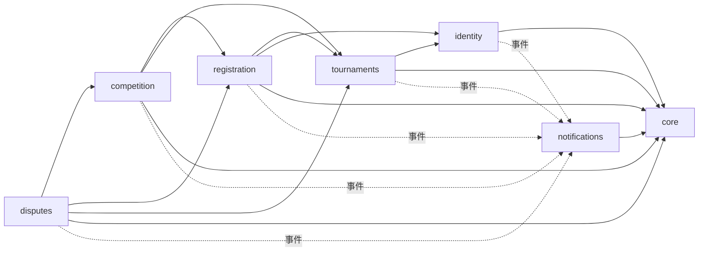
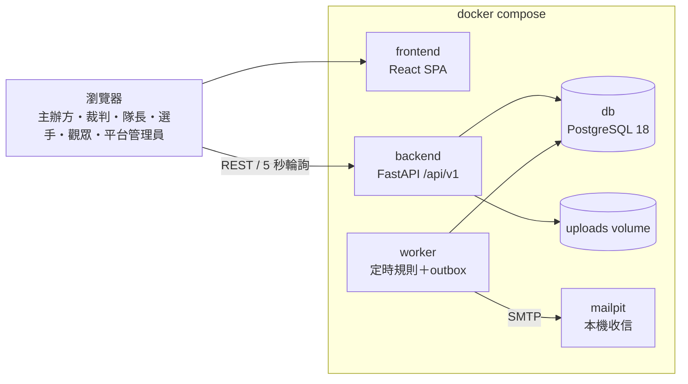
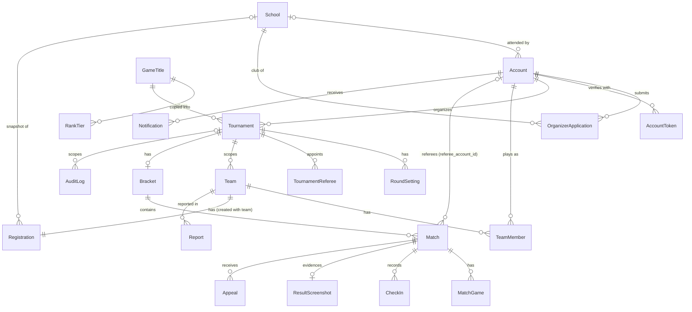

# 架構骨幹：電競賽事管理平台

> 名詞一律依 PRD §3，程式命名採該節括號內的英文。本文件只列「各自開發時可能做得不一致」的約束；其餘交給程式碼決定。

## 設計範式

**模組化單體**：單一 FastAPI 後端程式碼，依 PRD 功能群切成 6 個業務模組與 1 個共用核心，每個模組內部分三層。

| 層 | 位置 | 職責 | 不可做 |
| --- | --- | --- | --- |
| router | `app/modules/<模組>/router.py` | HTTP 輸入輸出、帳號層級權限、開啟並提交交易 | 業務規則、直接查詢資料表 |
| service | `app/modules/<模組>/service.py` | 業務規則、資源層級權限、狀態轉換、寫操作紀錄、發事件 | `commit()`、讀寫其他模組的資料表 |
| repository | `app/modules/<模組>/repository.py` | 本模組資料表的查詢與加鎖 | 業務判斷、碰其他模組的資料表 |
| models | `app/modules/<模組>/models.py` | 本模組的 SQLModel 資料表與 schema | — |

`worker` 是同一份程式碼的另一個進入點（`app/worker/`），角色等同 router：負責開交易、呼叫 service。

## 不變式與規則

### AD-1 — 模組清單與資料擁有權 [ADOPTED]

- **Binds:** all
- **Prevents:** 兩個模組各自寫同一張表，或由 AI 自行新增模組，導致同一份資料出現兩個擁有者。
- **Rule:** 每個實體只屬於一個模組，只有該模組的 repository 能讀寫它。新增實體時必須歸入下表其中一個模組；要新增模組，須先修改本文件。

| 模組 | 擁有的實體 |
| --- | --- |
| `identity` | Account、School（學校清單，平台管理員維護；放在依賴鏈最底層，其他模組都能查詢）、AccountToken（驗證信與重設密碼的一次性 token）、OrganizerApplication（平台管理員與主辦方為 Account 上的旗標） |
| `tournaments` | GameTitle、RankTier（段位對照）、Tournament、RoundSetting（分輪 BO）、RefereeInvitation、TournamentReferee |
| `registration` | Team、TeamMember（含隊長角色、遊戲 ID、段位、段位截圖）、Registration |
| `competition` | Bracket、Match、MatchGame、CheckIn、ResultScreenshot |
| `disputes` | Appeal、Report |
| `notifications` | Notification、EmailDelivery |
| `core`（共用核心，非模組） | AuditLog、OutboxEvent、時鐘、權限工具、錯誤格式、檔案儲存 |

### AD-2 — 跨模組只經 service 公開介面 [ADOPTED]

- **Binds:** all
- **Prevents:** 某個模組直接 join 或查詢別人的資料表，日後擁有模組改了欄位或規則，查詢結果就默默出錯。
- **Rule:** 需要別的模組的資料或動作時，只能呼叫該模組 `service.py` 的公開函式，回傳值為 Pydantic schema，不是 ORM 物件。資料表之間可以有跨模組外鍵以維持資料完整性，但查詢只能由擁有模組發出。公開觀賽頁也照這條規則，向各擁有模組的 service 取資料。

### AD-3 — 依賴方向與混合溝通 [ADOPTED]

- **Binds:** all
- **Prevents:** 模組之間互相呼叫形成循環依賴，或通知邏輯散落在各個 service 裡。
- **Rule:** 核心流程只能依下圖方向直接呼叫，反方向一律禁止。通知這類附帶動作只能發事件（AD-8），不得直接呼叫 `notifications`。



`notifications` 處理事件時，可以呼叫任何模組的 service 查詢收件人；但沒有任何模組可以呼叫 `notifications`。`core` 不得 import 任何模組。

提高名額會讓候補遞補，而 `tournaments` 不能呼叫 `registration`，因此由 `registration` 主導：先鎖賽事列，再呼叫 `tournaments` 修改名額，最後依遞補規則遞補（`raise_capacity()`）。

### AD-4 — 抽籤後的隊伍位置異動由 competition 主導 [ADOPTED]

- **Binds:** FR-17、FR-22、FR-33
- **Prevents:** 退賽遞補或取消資格頂替時，`registration` 和 `competition` 各改一半，造成對戰表和報名狀態不一致。
- **Rule:** 抽籤前退賽等於撤回報名，完全由 `registration` 處理。抽籤後的退賽與取消資格一律由 `competition` 的 service 執行：它先修改對戰表，再呼叫 `registration` 取得下一個候補並更新報名狀態。`disputes` 查證屬實後呼叫 `competition` 執行取消資格。

### AD-5 — 一個使用案例＝一個交易，由進入點提交 [ADOPTED]

- **Binds:** all
- **Prevents:** service 各自 `commit()`，連鎖操作（例如取消資格 → 頂替 → 寫紀錄 → 發事件）中途失敗時只寫進一半。
- **Rule:** 交易由 router 或 worker 的每個工作開啟並提交，整條呼叫鏈共用同一個 session。worker 每處理一筆到期項目或一則 outbox 事件，就是一個獨立的交易，一筆失敗不影響其他筆。service 與 repository 一律不得 `commit()` 或 `rollback()`。操作紀錄（AD-9）與事件（AD-8）都寫在同一個交易裡。

### AD-6 — 併發控制：鎖列，且固定加鎖順序 [ADOPTED]

- **Binds:** FR-9、FR-11、FR-13～FR-19、FR-26、FR-27、FR-31、FR-41、NFR-1
- **Prevents:** 同時報名時超收，多人同時加入時隊伍超過人數上限，同一場次的比分互相覆蓋；兩條流程以相反順序加鎖，造成死結。
- **Rule:** 凡是會改變某賽事正取、候補或名單的操作，都必須先以 `SELECT … FOR UPDATE` 鎖住該 Tournament 列，再讀取並判斷。這些操作包括：送出報名、撤回、退賽、退回、提高名額（`raise_capacity()`）、優先期結算、截止補位、抽籤、遞補、頂替，以及名單異動（建立隊伍 `create_team()`、加入隊伍 `join_team()`、填寫參賽資料、移除隊員、轉讓隊長、退出隊伍、解散隊伍）。所有這些操作都須在鎖住後才檢查隊長身分、人數上限與名單狀態，不得在加鎖前先檢查。TeamMember 的（tournament_id, account_id）唯一鍵是最後一道防線：即使程式漏鎖，同一帳號也無法加入同賽事的兩支隊伍。任何 Match 的寫入（報到、登錄比分、送出系列結果、更正、判棄權、提出申訴、申訴期滿自動確認、晉級填位）都必須先鎖住該 Match 列，鎖住後再檢查狀態與期限。同一個交易同時需要兩種鎖時，順序固定為：先 Tournament，再依 id 遞增鎖 Match。會連鎖到下一場或賽事狀態的流程（申訴期滿自動確認、處理申訴）不能先鎖本場再去鎖下一場或賽事：一開始就先鎖 Tournament 列，再依 id 遞增一次鎖住本場、下一場與季軍賽（`next_match_id` 不會變，可以事先讀出）。加鎖函式只寫在擁有模組的 repository 裡（`lock_tournament()`、`lock_match()`）；其他模組要加鎖時，呼叫該模組 service 提供的函式。

### AD-7 — 定時規則由 worker 輪詢資料庫並冪等執行 [ADOPTED]

- **Binds:** FR-7、FR-14、FR-16、FR-19、FR-21、FR-24、FR-25、FR-29、FR-31（提醒）、NFR-4
- **Prevents:** 排程寫在 API 程序裡，多程序時重複執行、重啟時遺失；或者到期時間只存在記憶體裡；或者為「前一場申訴未處理」另做一套暫停旗標，和到期查詢互相打架。
- **Rule:** 所有到期時間都以欄位存在資料表中。獨立的 `worker` 容器每 15～30 秒查詢已到期但尚未處理的資料（報名開始 → 尚未開放轉為開放報名、優先期結束、報名截止 → 截止補位 → 抽籤、賽事開始 → 最早場次開放報到時由賽程已公布轉為進行中、判棄權、申訴期滿、申訴逾期提醒），處理前依 AD-6 加鎖，並重新檢查狀態，所以重複執行沒有副作用。API 程序裡不得有任何排程器。
- **棄權期限：** `Match.forfeit_deadline` 只在場次兩隊都確定時設定（`start_forfeit_clock()`），值為「max（預定開始時間, 兩隊確定的時間）＋棄權時限」：抽籤時為所有兩隊都已確定的場次設定（第一輪，以及兩支輪空隊伍在第二輪相遇的場次），之後由晉級填位、遞補或頂替填入第二支隊伍時設定，主辦方修改時間時重算。隊伍未確定的場次 `forfeit_deadline` 為空，worker 不會選到它，報到也被拒絕（`MATCH_TEAMS_PENDING`）。「前一場申訴未處理時暫停」就是這個狀況，只影響等待該結果的場次，不是整輪，也不需要額外的狀態或旗標。
- **已取消或已結束的賽事：** 場次層級的工作（判棄權、申訴期滿、申訴逾期提醒、賽事開始）先檢查賽事狀態，已取消或已結束的賽事一律略過。

### AD-8 — 事件採交易式 outbox [ADOPTED]

- **Binds:** FR-37、FR-38，以及所有會發通知的 FR
- **Prevents:** 資料已改成功但通知沒寄出、同一事件重複通知，或 Email 寄送失敗讓主流程跟著失敗。
- **Rule:** service 透過 `core.events.publish(session, 事件)` 把事件寫入 `OutboxEvent`，與資料變更在同一個交易裡。`worker` 讀取 outbox，交給 `notifications` 產生站內通知與 EmailDelivery，以（事件 id、收件人）唯一約束去重。這只能擋住「同一事件處理兩次」；由 worker 定時檢查而發出的提醒（例如申訴逾期提醒），每次輪詢都可能產生新事件，因此另在資料列記錄已提醒的時間（`Appeal.reminded_at`）：worker 只挑尚未提醒的申訴，並在發出事件的同一個交易寫入 `reminded_at`，每筆只提醒一次。Email 失敗時記錄下來並重試，不回滾任何業務資料。事件名稱一律用過去式，例如 `MatchResultSubmitted`（裁判已送出系列結果）、`MatchResultConfirmed`（場次已確認）。事件內容只帶實體 id 與該事件特有的資料，不帶收件人清單；收件人一律由 `notifications` 在處理時依 PRD FR-37 的通知對象表查詢決定。

### AD-9 — 操作紀錄同交易寫入、只增不改 [ADOPTED]

- **Binds:** NFR-3、SM-4
- **Prevents:** 有些操作漏記，或紀錄事後被改動，使申訴與取消資格無從查證。
- **Rule:** NFR-3 列出的每種變更，都由 service 在同一個交易內呼叫 `core.audit.record(操作者, 所屬賽事, 動作, 對象, 變更前, 變更後)`。AuditLog 帶 `tournament_id`（帳號類的操作，例如註冊、主辦方申請，為空），並以（tournament_id, at）建立索引；主辦方查閱自己賽事的紀錄時，`tournaments` 確認主辦方身分後呼叫 `core.audit.list_for_tournament()`，不必跨模組 join 各實體表。worker 自動執行的操作，操作者記為 `system`。程式中不得對 AuditLog 發出 UPDATE 或 DELETE，並由資料庫 trigger 拒絕這兩種操作。

### AD-10 — 權限分兩層，皆在伺服器端 [ADOPTED]

- **Binds:** FR-4、FR-5、FR-11、FR-26、NFR-5
- **Prevents:** 權限檢查一下寫在 router、一下寫在 service，worker 或其他模組呼叫時就被繞過；或只靠前端隱藏按鈕；或 `core.authz` 為了判斷裁判身分去查別的模組的資料表。
- **Rule:** 帳號層級的檢查（已登入、Email 已驗證、平台管理員、主辦方）寫在 router，用 `Depends`。資源層級的檢查（賽事主辦方、被指派的裁判、隊長、隊員）一律寫在 service 方法開頭，呼叫 `core.authz` 的共用函式。這些函式只接收呼叫端已載入的實體、帳號，或從其他模組 service 取得的 schema（例如 `ensure_assigned_referee(match, account)`），自己不查資料庫。前端隱藏按鈕不算權限檢查。
- **裁判：** Match 直接以 `referee_account_id` 存被指派裁判的帳號 id，`ensure_assigned_referee()` 只比對兩個 id，不查 `tournaments` 的 TournamentReferee。指派時由 `competition` 呼叫 `TournamentService.is_referee()` 確認該帳號是此賽事的裁判，並呼叫 `RegistrationService.is_member()` 拒絕指派到其隊伍參賽的場次；晉級填位後若指派的裁判成了其中一隊的隊員，`competition` 取消該場的指派並發事件通知主辦方改派。送出系列結果前，主辦方可以改派或收回指派（`unassign_referee()`）；場次未指派裁判時由主辦方代登，`competition` 先向 `tournaments` 取得賽事 schema，再交給 `ensure_tournament_owner()`。
- **身分衝突：** `registration` 建立或加入隊伍時，向 `tournaments` 取得賽事 schema，拒絕該賽事的主辦方（`ORGANIZER_CANNOT_JOIN`）。
- **隊長：** competition 與 disputes 判斷隊長身分時，先向 `registration` 的 `get_team()` 取得 `TeamRead`（含隊員角色），再交給 `ensure_captain()`；檢舉需要的報名狀態以 `get_registration()` 取得。

### AD-11 — 狀態只能經唯一的轉換函式修改 [ADOPTED]

- **Binds:** Tournament、Registration、Match 的狀態欄位
- **Prevents:** 多個 Story 各自直接指派 `status = ...`，跳過或繞開 PRD 規定的狀態流程。
- **Rule:** 每個有狀態的實體，在擁有模組的 service 裡只有一個轉換函式（例如 `transition_match(match, to)`）。它依照 PRD §3 的轉換表檢查合法性，不合法時拋出業務錯誤；其他程式不得直接指派狀態欄位。狀態以 Python `StrEnum` 定義，值用英文。場次的「暫停」不是一個狀態，而是待開打且 `forfeit_deadline` 為空（AD-7）；場次結果類型另存 `Match.outcome`（`played`、`forfeit`、`double_forfeit`、`walkover`、`disqualified`），「已取消」（`voided`）只用於準決賽沒有產生勝隊時的季軍賽。判棄權的場次經申訴安排重新比賽時，由申訴中回到待開打。

### AD-12 — 快照：賽事凍結遊戲設定，報名凍結分配依據 [ADOPTED]

- **Binds:** FR-6、FR-7、FR-12～FR-17
- **Prevents:** 平台管理員修改遊戲預設值後，已建立的賽事跟著改變；或者有人即時重算段位積分、有人用送出當下的值，正取結果因此不一致。
- **Rule:** 建立賽事時，把遊戲的先發人數、替補人數、BO、每局預估時間、比分型態與段位對照表複製進賽事，之後只讀賽事上的副本。送出報名時（含被退回後重送），把學校（`school_id`）、平均段位積分（名單所有成員含替補）與送出時間寫入 Registration，所有名額分配與候補排序只用這三個欄位；同分時依送出時間、再依報名 id 排序，結果固定。

### AD-13 — 時間：UTC 儲存，只經可替換時鐘取得 [ADOPTED]

- **Binds:** all
- **Prevents:** 時區混用造成期限算錯；或程式直接呼叫 `datetime.now()`，測試無法模擬「30 分鐘後」。
- **Rule:** 資料庫一律用 `timestamptz` 存 UTC，API 回傳 ISO 8601（含時區），前端顯示 Asia/Taipei 時間。後端只能透過 `core.clock.now()` 取得目前時間，測試時可以替換。

### AD-14 — 對戰樹以輪詢更新 [ADOPTED]

- **Binds:** FR-35、FR-36、FR-38、NFR-2
- **Prevents:** 有人做 WebSocket、有人做 SSE，最後並存兩套即時機制；或各頁自訂輪詢頻率，後端負載無從估算。
- **Rule:** 後端不提供推播通道，前端只用 TanStack Query 輪詢，且只有下列三種：
  - 公開的對戰樹與場次頁：每 5 秒。
  - 登入者的未讀通知數：每 30 秒。
  - 頁面上的倒數到期後：該頁每 5 秒重抓，直到伺服器回傳新狀態，最多 2 分鐘。

### AD-15 — 截圖檔案儲存與存取 [ADOPTED]

- **Binds:** FR-12、FR-18、FR-28、FR-30、FR-32、FR-36、NFR-6
- **Prevents:** 段位截圖被放在公開的靜態路徑上，任何人都能直接下載。
- **Rule:** 上傳檔案一律經由 `core.storage` 存入 docker volume，資料庫只存檔案鍵值。所有檔案都經由 API 下載：段位截圖只有該賽事的主辦方能下載；結算截圖公開；申訴與檢舉的附件只有該賽事的主辦方能看。上傳時以 MIME 類型與大小驗證（JPG／PNG，5 MB 以內）。

### AD-16 — 測試使用真 PostgreSQL [ADOPTED]

- **Binds:** 單元測試以外的所有測試、SM-2
- **Prevents:** 在 SQLite 上「通過」的測試，實際上沒有驗證 `FOR UPDATE` 與 trigger。
- **Rule:** 整合與端對端測試都連線到 docker 裡的 PostgreSQL 18；禁止使用 SQLite 或 ORM 模擬層替代。

### AD-17 — 執行環境只有本機 docker compose [ADOPTED]

- **Binds:** NFR-8、SM-5
- **Prevents:** 有人照範本保留 Traefik 或雲端部署設定，有人又另外加服務，最後一鍵啟動失效。
- **Rule:** `compose.yml` 固定包含 `db`、`backend`、`worker`、`frontend`、`mailpit` 五個服務，一個指令就能全部啟動，並自動載入示範資料（2 款遊戲、學校清單、32 隊賽事）；示範資料一律透過各模組 service 建立，不直接寫入資料表，以確保快照與操作紀錄齊全。移除範本的 Traefik、adminer 與雲端部署設定。設定一律從 `.env` 讀取，`.env.example` 要放進版本控制。

### AD-18 — 遊戲差異只能來自設定 [ADOPTED]

- **Binds:** FR-6、FR-8、FR-12、FR-26、NFR-9、SM-3
- **Prevents:** 程式裡出現 `if game == "VALORANT"` 這類分支，導致新增遊戲時必須改程式。
- **Rule:** 程式不得依遊戲名稱或 id 分支。人數、BO、勝局門檻、段位換算、比分型態與比分欄位，一律從賽事上的設定快照（AD-12）讀取；比分型態以 `StrEnum`（`win_loss`、`rounds`）列舉處理。

### AD-19 — 公開資料只經專用 schema 輸出 [ADOPTED]

- **Binds:** FR-34～FR-36、NFR-6
- **Prevents:** 公開頁 API 直接沿用內部 schema，不小心洩漏 Email、學校或段位截圖。
- **Rule:** 不需登入的 API 只能回傳名稱以 `Public` 開頭的 schema（例如 `PublicBracket`、`PublicMatch`）；這類 schema 不得包含 Email、學校、遊戲 ID 以外的帳號資料，也不得包含段位截圖鍵值。

### AD-20 — 名額規則依賽事模式切換，只在 AllocationPolicy 內分支 [ADOPTED]

- **Binds:** FR-7、FR-13～FR-18、FR-39、Story 4.5、6.5 的遞補
- **Prevents:** 送出驗證、名額分配、撤回遞補、抽籤後遞補各自用 `if mode == ...` 判斷，加上新模式時漏改某一處，兩種模式的規則就會混在一起。
- **Rule:** 賽事模式（`campus` 校園賽：同校檢查加三階段分配；`custom` 自訂：邀請制報名、不限學校、先到先得）存放在 Tournament 上，賽事「尚未開放」時可以修改，開放報名後就不能更改。自訂模式的建隊須持有效的賽事報名邀請連結，由 `registration` service 檢查；觀賽頁面不受模式影響，一律公開。所有與學校或名額相關的判斷，包括同校檢查、正取判定、候補排序、遞補對象與每校上限，一律呼叫 `AllocationPolicy` 依模式提供的策略；其他程式不得自行依模式分支。

### AD-21 — 一次性帳號 token 由 identity 統一管理 [ADOPTED]

- **Binds:** FR-1、FR-40、AD-8
- **Prevents:** 驗證信與重設密碼各做一套 token（一個存明文、一個不會過期），或在請求裡直接寄信、繞過 outbox，Email 失敗時讓使用者操作跟著失敗。
- **Rule:** Email 驗證與重設密碼的 token 一律存在 `identity` 的 AccountToken（用途、token 雜湊、到期時間、使用時間），資料庫只存雜湊；token 使用一次即失效；同一帳號同一用途重新產生時，舊 token 全部作廢。寄信只經 outbox 事件（`VerificationEmailRequested`、`PasswordResetRequested`），事件內容帶 token 明文；`notifications` 處理這兩種事件時只寄 Email，不建立站內通知。申請重設密碼時，不論 Email 是否已註冊都回相同結果。

## 一致性慣例

| 項目 | 慣例 |
| --- | --- |
| 命名 | 類別與實體名稱用 PRD §3 括號內的英文（`Match`、`MatchGame`，不要寫成 `Game`、`Round`）；資料表用 snake_case 單數；事件名稱用過去式 PascalCase |
| ID | UUID v4（範本預設） |
| API 路徑 | `/api/v1/<複數資源>`，kebab-case；巢狀不超過兩層（例如 `/tournaments/{tournament_id}/registrations`） |
| 錯誤格式 | 業務錯誤回 4xx：`{"detail": {"code": "UPPER_SNAKE", "message": "繁中訊息"}}`；驗證錯誤沿用 FastAPI 預設的 422 |
| 金額／分數 | 段位積分存整數；平均值存 `numeric(6,2)` |
| ORM | 只用 SQLModel；遷移只用 Alembic，每個 Story 的 schema 變更各自一支遷移檔 |
| 前端套件管理 | 沿用範本，使用 Bun 與根目錄的 `bun.lock`；不得另外產生 `package-lock.json` |
| 前端呼叫 | 只用 `@hey-api/openapi-ts` 產生的 client，不手寫 fetch／axios |
| 前端結構 | `src/routes/` 放頁面（TanStack Router 檔案路由）；`src/features/<模組>/` 放元件與 hooks，名稱與後端模組一致 |
| 介面語言 | 介面文字一律繁體中文；程式碼、資料庫值與錯誤代碼用英文 |
| 測試位置 | `backend/tests/<模組>/`，鏡射後端模組；端對端測試放 `frontend/tests/` |

## 技術堆疊

> 版本於 2026-10-14 查證（官方 full-stack-fastapi-template master 分支、套件註冊站）。「≥」表示可接受的最低版本，「隨範本」表示沿用起始範本的設定；實際安裝的版本一律由版本鎖定檔固定（後端 `uv.lock`、前端 `bun.lock`），並與程式一起放進版本控制，所有組員與 docker image 安裝的版本完全相同。升級套件時更新鎖定檔並重新跑完測試。

| 名稱 | 版本 |
| --- | --- |
| 起始範本 | fastapi/full-stack-fastapi-template（master，2026-10） |
| Python | 3.14 |
| FastAPI | ≥ 0.141.1 |
| SQLModel | ≥ 0.0.46 |
| Alembic | ≥ 1.19.1 |
| psycopg | 3.3（binary） |
| PostgreSQL | 18（docker image `postgres:18`） |
| React | 19.3 |
| TypeScript | 6.0 |
| Vite | 8.3 |
| TanStack Router／Query | 1.170／5.104 |
| Tailwind CSS／shadcn/ui | 4.2／隨範本 |
| @hey-api/openapi-ts | 0.97.3 |
| pytest | 隨範本 |
| Bun | 1.4（frontend 容器 image 固定小版本） |
| Playwright | 1.63.0 |
| Mailpit | 隨範本 |

## 結構骨架

### 容器圖



### 核心實體關聯



### 原始碼骨架

```text
backend/app/
  core/            # audit, events(outbox), authz, clock, storage, errors, db session
  modules/
    identity/      # router.py service.py repository.py models.py
    tournaments/
    registration/
    competition/   # bracket_service.py match_service.py 可分檔，仍屬同一模組
    disputes/
    notifications/
  worker/          # 進入點：輪詢到期工作、消化 outbox
  seed/            # 示範資料
backend/tests/<模組>/
frontend/src/routes/ · frontend/src/features/<模組>/ · frontend/tests/
compose.yml · .env.example
```

## 功能 → 架構對照

| PRD 功能群 | 所在模組 | 受哪些規則約束 |
| --- | --- | --- |
| 4.1 帳號與身分（FR-1～5、FR-40） | `identity`；裁判邀請在 `tournaments`，指派裁判在 `competition` | AD-1、AD-10、AD-21 |
| 4.2 賽事與遊戲設定（FR-6～10） | `tournaments`；學校清單在 `identity`；提高名額由 `registration` 主導 | AD-7、AD-8、AD-11、AD-12 |
| 4.3 隊伍與報名（FR-11～18、FR-41） | `registration`（抽籤後退賽由 `competition` 處理） | AD-4、AD-6、AD-7、AD-10、AD-12、AD-15 |
| 4.4 抽籤與對戰表（FR-19～23） | `competition` | AD-4、AD-6、AD-7、AD-11 |
| 4.5 場次進行（FR-24～29） | `competition` | AD-6、AD-7、AD-11、AD-13、AD-15 |
| 4.6 申訴與檢舉（FR-30～33） | `disputes` → `competition` | AD-3、AD-4、AD-9 |
| 4.7 觀賽與通知（FR-34～38） | 公開頁向各模組查詢；`notifications` | AD-2、AD-8、AD-14、AD-15 |
| NFR-1～9 | 跨模組 | AD-5、AD-6、AD-7、AD-9、AD-10、AD-13、AD-16、AD-17 |

## 暫不決定

- **快取與水平擴充**：NFR-2 先以單一 backend 容器實測；量測結果不達標時，再決定是否加快取或多開 worker 程序。
- **抽籤亂數的可重現性**：先用 `secrets` 隨機產生，並把抽籤結果寫進操作紀錄；是否要保存亂數種子以重現抽籤，等 competition 的 Epic 再決定。
- **CI 管線**：課程不強制要求；開始寫測試的 Epic 再決定是否用 GitHub Actions 跑 pytest 與覆蓋率。
- **錯誤監控**：範本附的 Sentry 先不啟用，只寫本機日誌。
- **正式寄信與 HTTPS**：第一版只用 Mailpit 收信、HTTP 本機執行，不做正式部署。
- **任何帳號都能建立自訂賽事（加分）**：第一版只有主辦方能建立自訂賽事。開放給所有已驗證帳號會繞過主辦方審核（AD-10 的帳號層級權限），做到加分項目時再以新的 AD 定義。
- **加分項目的架構位置**：選手 KDA、LoL API、雙敗制或循環賽、手機推播，等必做項目完成後另外補充本文件。
