# C 軟體設計／D 物件設計 打底稿

> 用途：撰寫課程 C、D 文件的起點，內容與 [架構骨幹](ARCHITECTURE-SPINE.md) 一致，引用處標示 AD 編號。類別圖的欄位與方法是**開工前的初稿**；程式寫好之後，以程式碼為準重新產生類別圖（例如用 pyreverse 或 IDE 匯出），再更新 D 文件。

---

# 第一部分：C 軟體設計

## C-1 系統架構圖

系統以 docker compose 啟動 5 個服務（AD-17）。瀏覽器載入 React 單頁應用，所有資料存取都透過 REST API；`worker` 與 `backend` 共用同一份程式碼，負責定時規則與通知寄送。

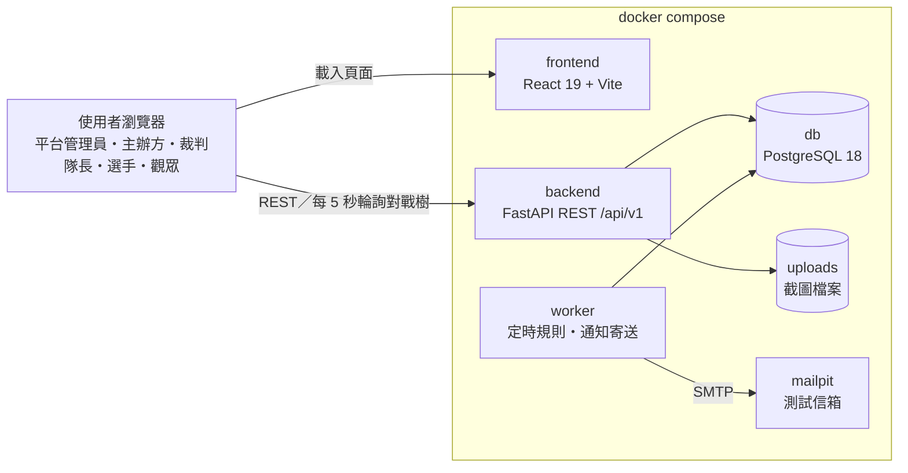

| 服務 | 職責 | 對應需求 |
| --- | --- | --- |
| frontend | 所有頁面、對戰樹視覺化；只透過自動產生的 API client 呼叫後端 | FR-34～36、NFR-7 |
| backend | 處理所有使用者操作、權限檢查、業務規則 | FR-1～41、NFR-5 |
| worker | 每 15～30 秒處理到期工作（報名開始、優先期結束、報名截止、賽事開始、判棄權、申訴期滿、申訴逾期提醒）、寄送通知與驗證／重設密碼信 | NFR-4、FR-37、FR-1、FR-40 |
| db | 唯一的資料來源；以列鎖保證併發一致 | NFR-1、NFR-3 |
| mailpit | 示範與測試用的收信伺服器，不對外寄信 | FR-37 |

## C-2 分層架構說明

後端採**模組化單體**（AD-1～AD-3）：依功能切成 6 個業務模組，每個模組內部分成三層。

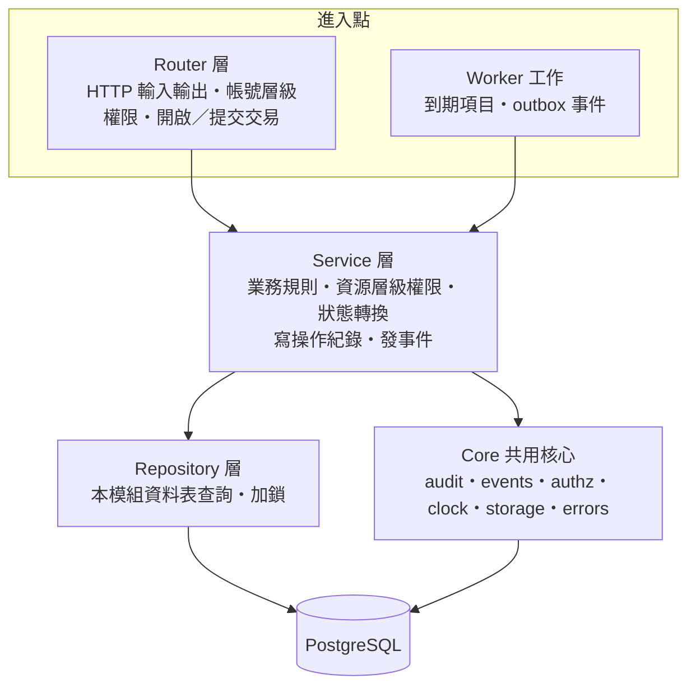

| 層 | 做什麼 | 不做什麼 |
| --- | --- | --- |
| Router | 解析請求、驗證輸入格式、檢查登入與帳號身分、開啟交易並在成功後提交、轉換回應 | 業務判斷、直接查資料表 |
| Service | 名額分配、抽籤、晉級、申訴處理等業務規則；檢查「是不是這個賽事的主辦方」；呼叫唯一的狀態轉換函式；寫操作紀錄、發事件 | 提交交易、讀寫其他模組的資料表 |
| Repository | 本模組資料表的 CRUD 與 `SELECT … FOR UPDATE` | 業務判斷 |
| Core | 各模組共用的基礎功能；不依賴任何業務模組 | 業務規則 |

**為什麼分層加分模組**：分層讓每段程式只有一種職責、容易單元測試；分模組讓每個功能群（報名、對戰表、申訴…）的程式集中在一起，模組之間只能透過 Service 公開介面溝通（AD-2），修改某個功能不會意外影響其他功能。

## C-3 模組劃分與依賴

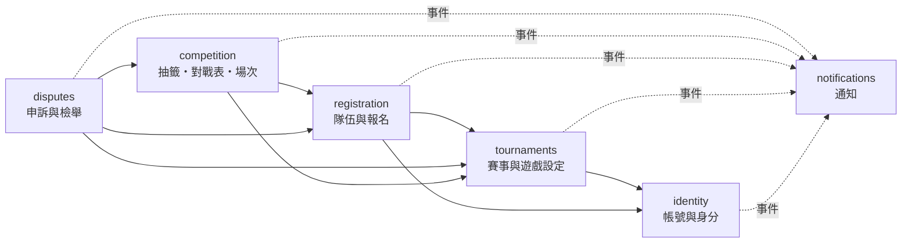

- 箭頭為「可呼叫」方向，反方向禁止，因此不會出現循環依賴（AD-3）。
- 所有模組都可使用 `core`；`notifications` 只透過事件接收，沒有模組直接呼叫它。
- 抽籤後的退賽遞補與取消資格頂替，由 `competition` 主導（AD-4）。
- 提高名額會讓候補遞補，而 `tournaments` 不能呼叫 `registration`，因此由 `registration` 主導：先鎖賽事列，再呼叫 `tournaments` 修改名額，最後依遞補規則遞補。

| 模組 | PRD 功能群 | 主要 FR |
| --- | --- | --- |
| identity | 4.1 帳號與身分、學校清單 | FR-1～3、FR-5、FR-6（學校清單）、FR-40 |
| tournaments | 4.2 賽事建立與遊戲設定（含裁判邀請） | FR-4、FR-6～10、FR-39 |
| registration | 4.3 隊伍與報名、提高名額後的遞補 | FR-9（提高名額）、FR-11～18、FR-41 |
| competition | 4.4 抽籤與對戰表、4.5 場次進行、指派裁判 | FR-4（指派）、FR-19～29 |
| disputes | 4.6 申訴與檢舉 | FR-30～33 |
| notifications | 4.7 通知 | FR-37～38 |
| （各模組公開查詢） | 4.7 觀賽 | FR-34～36 |

## C-4 關鍵機制

### C-4.1 搶報名不超收（NFR-1、FR-15）

同一賽事所有會改變正取、候補或名單的操作，都先鎖住該賽事的資料列，因此會依序執行（AD-6）；名單異動也加鎖，避免多人同時加入時超過人數上限，TeamMember 的（tournament_id, account_id）唯一鍵是最後一道防線。

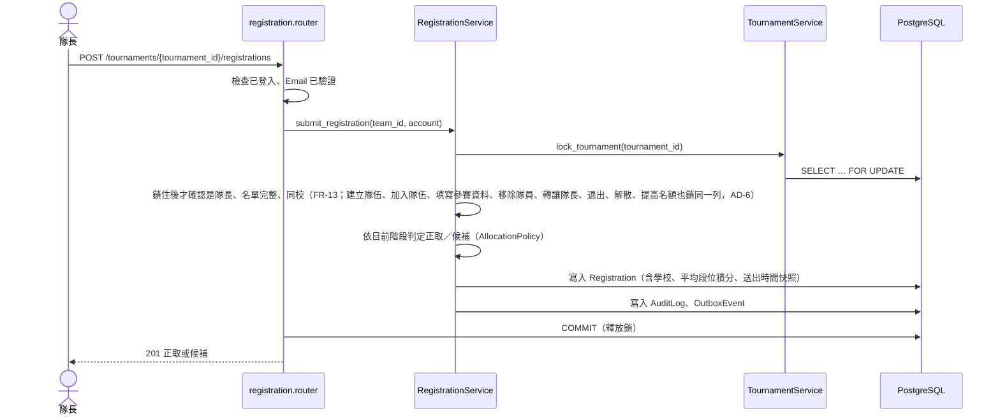

### C-4.2 定時規則（NFR-4）：申訴期滿 → 晉級 → 通知

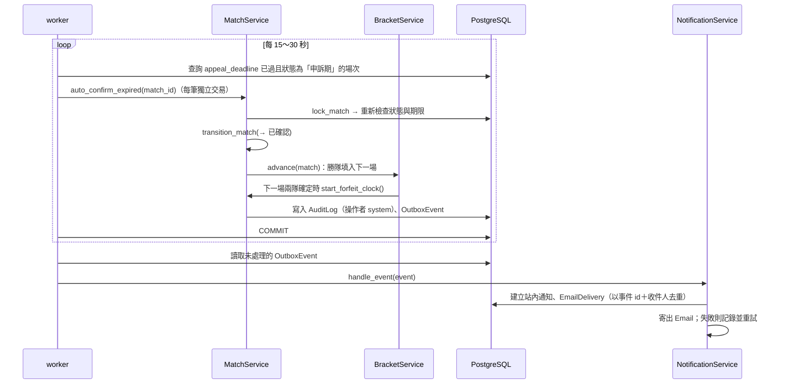

- **棄權期限**只在場次兩隊都確定時設定：抽籤時為所有兩隊都已確定的場次設定（第一輪，以及兩支輪空隊伍在第二輪相遇的場次），之後由晉級填位、遞補或頂替讓兩隊確定的那一刻設定，值為「預定開始時間與兩隊確定時間較晚者＋棄權時限」，主辦方修改時間時一併重算。隊伍還沒確定的場次 `forfeit_deadline` 為空，worker 不會選到它；「前一場申訴未處理時暫停」因此不需要另外的狀態或旗標，只影響等待該結果的場次，同一輪的其他場次照常進行（AD-7）。
- **輪空推進**：晉級填位時，若某一方的位置確定不會有隊伍（前一場雙方棄權，或退賽、取消資格後無人遞補），該場直接以輪空（`walkover`）確認並繼續往下一輪推進；準決賽沒有產生勝隊時，季軍賽轉為「已取消」。
- **賽事的時間觸發**也由同一個 worker 處理：報名開始時間到時由「尚未開放」轉為「開放報名」，最早場次開放報到時由「賽程已公布」轉為「進行中」。
- **已取消或已結束的賽事**：場次層級的工作（判棄權、申訴期滿、申訴逾期提醒、賽事開始）先檢查賽事狀態，一律略過。
- **連鎖加鎖**：申訴期滿自動確認、處理申訴會連鎖到下一場或賽事狀態，因此一開始就先鎖賽事列，再依 id 遞增一次鎖住本場、下一場與季軍賽（AD-6）。

### C-4.3 其他機制摘要

| 機制 | 做法 | AD |
| --- | --- | --- |
| 交易邊界 | 一個操作一個交易；Router／worker 提交，Service 不提交 | AD-5 |
| 操作紀錄 | Service 在同一交易內寫 AuditLog（含所屬賽事 `tournament_id`）；主辦方依賽事查閱；資料庫 trigger 禁止修改與刪除 | AD-9 |
| 權限 | 帳號層級在 Router（Depends），資源層級在 Service（core.authz）；authz 只比對已載入的實體或 schema，例如 `Match.referee_account_id` 與帳號 id，不查資料庫 | AD-10 |
| 提醒只發一次 | 申訴逾期提醒以 `Appeal.reminded_at` 記錄已提醒，worker 只挑尚未提醒的申訴 | AD-8 |
| 狀態機 | 賽事、報名、場次各有唯一的轉換函式，依 PRD §3 檢查 | AD-11 |
| 遊戲可設定 | 建立賽事時複製遊戲設定；程式不依遊戲名稱分支 | AD-12、AD-18 |
| 時間 | 存 UTC；後端只經 `core.clock.now()` 取時間，測試可模擬 | AD-13 |
| 輪詢 | 只有三種：對戰樹與場次頁每 5 秒、未讀通知數每 30 秒、倒數到期後當頁每 5 秒（最多 2 分鐘）；壓測須包含 | AD-14 |
| 檔案 | 存 volume，經 API 依權限下載 | AD-15 |
| 個資 | 公開 API 只回 `Public*` schema | AD-19 |
| 一次性 token | 驗證信與重設密碼 token 只存雜湊、用一次即失效、重新產生作廢舊的；經 outbox 只寄 Email | AD-21 |

## C-5 部署與環境

- 唯一的執行環境是本機 docker compose，一個指令啟動全部服務並載入示範資料（2 款遊戲、學校清單、32 隊賽事）。
- 設定由 `.env` 提供；`.env.example` 進版本控制。
- 測試環境同樣使用 compose 中的 PostgreSQL 18（AD-16），併發整合測試也在這個資料庫上執行。
- 不做雲端部署、HTTPS、正式寄信與錯誤監控（見架構骨幹的「暫不決定」）。

## C-6 技術選型

| 層 | 技術 | 版本 |
| --- | --- | --- |
| 前端 | React、TypeScript、Vite、TanStack Router／Query、Tailwind CSS、shadcn/ui、Bun | 19.3、6.0、8.3、1.170／5.104、4.2、隨範本、1.4 |
| 後端 | Python、FastAPI、SQLModel、Alembic | 3.14、≥0.141.1、≥0.0.46、≥1.19.1 |
| 資料庫 | PostgreSQL | 18 |
| 測試 | pytest、Playwright | 隨範本、1.63.0 |
| 起始範本 | fastapi/full-stack-fastapi-template | 2026-10 master |

表中的版本是選型時查證的版本；「≥」是可接受的最低版本，「隨範本」沿用起始範本的設定。實際安裝的版本一律由版本鎖定檔固定（後端 `uv.lock`、前端 `bun.lock`），與程式一起放進版本控制。

---

# 第二部分：D 物件設計

> 每個模組一張類別圖。圖中只列決定職責的主要欄位與方法；`Router` 與 `Repository` 只在 identity 示範一次，其他模組結構相同、圖上省略。

## D-0 共用核心 core

**職責**：提供各模組共用、與業務無關的基礎功能。不得 import 任何業務模組。

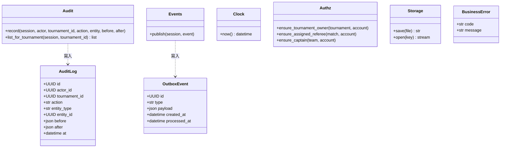

- `record()` 的 `tournament_id` 由呼叫端傳入：賽事內的操作帶該賽事的 id，帳號類的操作（註冊、主辦方申請等）傳空值。主辦方查閱自己賽事的紀錄時，由 `tournaments` 確認主辦方身分後呼叫 `list_for_tournament()`，不需要跨模組 join 各實體表（AD-1、AD-9）。
- `Authz` 的函式只比對傳入物件的欄位，例如 `ensure_assigned_referee(match, account)` 只比對 `match.referee_account_id` 與 `account.id`，不必查 `tournaments` 的 TournamentReferee（AD-10）。

## D-1 identity 帳號與身分

**職責**：註冊、登入、Email 驗證與重寄驗證信、忘記與重設密碼、主辦方申請與審核、學校清單；提供帳號查詢給其他模組。

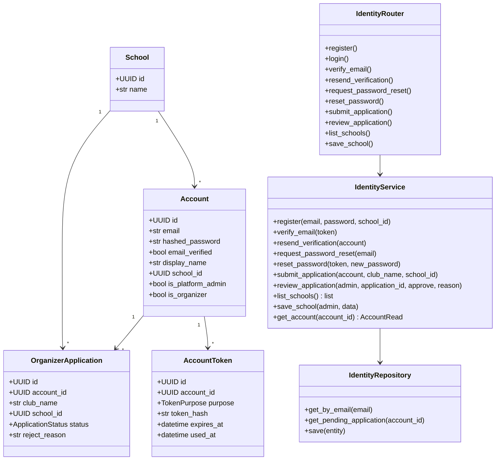

- 學校清單（`School`）以教育部大專校院名錄為初始資料，由平台管理員維護；帳號、主辦方申請與報名的學校只能選清單內的學校（帳號的學校為選填，參加校園賽時必須設定），同校檢查一律比對 `school_id`，不比對文字（FR-6）。School 放在 identity，是因為 identity 位於依賴鏈的最底層，其他模組都可以向它查詢。

- `TokenPurpose` 為 `verify_email`、`reset_password`。驗證 token 24 小時、重設 token 1 小時到期（PRD §10 推定值），只存雜湊、用一次即寫入 `used_at`；`register`、`resend_verification`、`request_password_reset` 產生新 token 時，作廢同帳號同用途的舊 token（AD-21）。
- 寄信經 outbox 事件 `VerificationEmailRequested`、`PasswordResetRequested`，只寄 Email、不建立站內通知。`request_password_reset` 對未註冊的 Email 不產生事件，但回應與已註冊時相同（FR-40）。

## D-2 tournaments 賽事與遊戲設定

**職責**：遊戲清單與段位對照（平台管理員維護）、建立與修改賽事（含設定快照）、賽事狀態、裁判邀請與裁判身分、依賽事查閱操作紀錄。

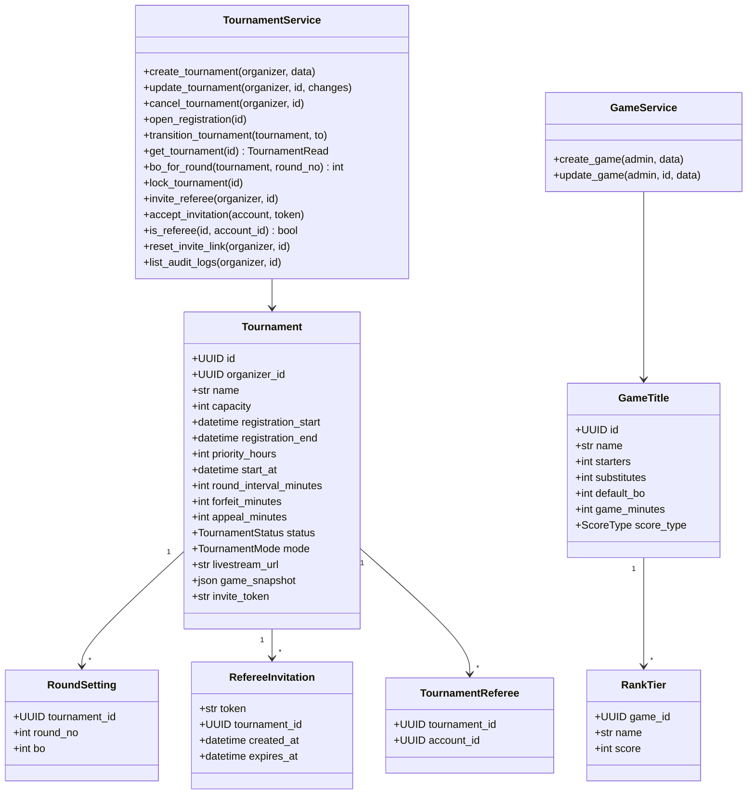

- 建立賽事時把遊戲的人數、BO、每局預估時間（`game_minutes`）、比分型態與段位對照複製到 `game_snapshot`（AD-12）。`bo_for_round` 先查 RoundSetting，沒有分輪設定時才用快照中的預設 BO；BO 數只接受 1、3、5、7（FR-6、FR-8）。
- `create_tournament` 與 `update_tournament` 檢查每輪間隔不小於「棄權時限＋預設 BO 數 × 每局預估時間＋申訴期」（FR-7）。報名開始時間未到時，賽事建立為「尚未開放」，由 worker 呼叫 `open_registration` 轉為開放報名。
- `update_tournament` 依賽事狀態限制可改的欄位：尚未開放時都能改；開放報名後到抽籤前只能放寬（延長報名、提高名額、延長棄權時限、申訴期與每輪間隔）或修改分輪 BO；抽籤後只能改場次時間（FR-9）。提高名額會讓候補遞補，因此由 `registration` 的 `raise_capacity` 在鎖住賽事列後呼叫本函式，`tournaments` 自己不呼叫 `registration`。
- `mode`（`campus`／`custom`）在開放報名後不可更改，所有依模式的判斷只經 `AllocationPolicy`（AD-20）。`livestream_url` 選填，限 http／https；`update_tournament` 在賽事結束前都可修改它，不受抽籤後鎖定（FR-7、FR-9）。
- `get_tournament` 回傳 `TournamentRead` schema，供 `registration` 檢查主辦方不能建立或加入隊伍、`competition` 在主辦方代登時檢查身分；`is_referee` 供 `competition` 指派裁判時確認身分（AD-2、AD-10）。`list_audit_logs` 確認主辦方身分後呼叫 `core.audit.list_for_tournament()`（AD-9）。
- `invite_referee` 產生的邀請 7 天後到期（PRD §10 推定值），並把同賽事尚未到期的舊邀請 `expires_at` 設為現在，使舊連結立即失效；`accept_invitation` 檢查到期（FR-4）。

## D-3 registration 隊伍與報名

**職責**：建立隊伍與邀請隊員、選手參賽資料、送出報名、三階段名額分配、候補排序、抽籤前撤回、主辦方退回、提高名額後的遞補。名額規則集中在純函式的 `AllocationPolicy`，方便單元測試。

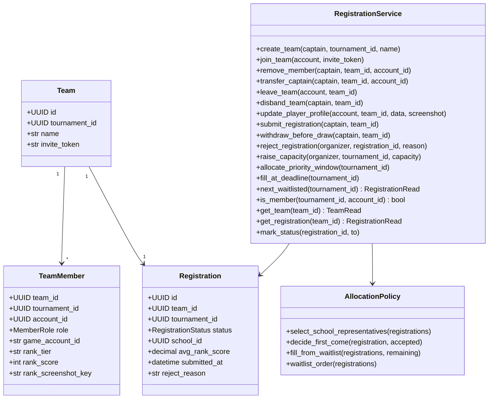

- 隊長身分只看 `TeamMember.role`（`MemberRole`：`captain`／`player`），每隊恰好一位 `captain`；`core.authz.ensure_captain` 依此判斷。
- 會改變名額或名單的操作——`create_team`、`join_team`、`update_player_profile`、`remove_member`、`transfer_captain`、`leave_team`、`disband_team`、`submit_registration`、`withdraw_before_draw`、`reject_registration`、`raise_capacity`——都先鎖住賽事列，鎖住之後才檢查隊長身分、人數上限與名單狀態（AD-6）。TeamMember 帶 `tournament_id`，以（tournament_id, account_id）唯一鍵作為最後一道防線，同一帳號無法加入同賽事的兩支隊伍。
- `create_team`、`join_team` 先向 `tournaments` 取得賽事 schema（`get_tournament`），拒絕該賽事的主辦方建立或加入隊伍（`ORGANIZER_CANNOT_JOIN`，FR-11）。
- 名額分配與候補排序只使用 Registration 上的三個快照欄位（`school_id`、`avg_rank_score`、`submitted_at`，AD-12）。平均段位積分計入名單上所有成員（含替補），同分時依送出時間、再依報名 id 排序（FR-12、FR-14）。
- 截止補位由 `fill_at_deadline` 呼叫 `AllocationPolicy.fill_from_waitlist`：所有候補都參加，回傳 `waitlist_order` 在報名截止後階段的前 `remaining` 隊，不另寫一套排序，每校正取最多 2 隊（PRD FR-16、FR-17）。
- `raise_capacity` 鎖住賽事列後呼叫 `TournamentService.update_tournament` 修改名額，再依當下階段的遞補規則讓候補遞補；優先期內只改名額，留待優先期結算時一併分配（FR-9）。
- `next_waitlisted` 回傳 `RegistrationRead` schema 而非 ORM 物件；`competition` 要改報名狀態時一律呼叫 `mark_status`（AD-2）。`is_member` 供 `competition` 指派裁判與晉級填位時檢查裁判是不是兩隊的隊員。
- `get_team` 回傳 `TeamRead`（隊名、隊員帳號與角色），`get_registration` 回傳 `RegistrationRead`；competition 報到、上傳結算截圖與 disputes 申訴、檢舉，都先用它們取得隊長身分與報名狀態，再交給 `core.authz.ensure_captain`（AD-2、AD-10）。
- 名單鎖定期間 `update_player_profile`、`remove_member`、`transfer_captain`、`leave_team`、`disband_team` 都被拒絕。`leave_team` 讓隊員離開並刪除其參賽資料，隊長須先轉讓；`disband_team` 讓所有隊員離開、報名轉為撤回，發出 `TeamDisbanded`（FR-41）。被退回後重送時，三個快照欄位都重新寫入（FR-18）。
- `remove_member`、`transfer_captain` 先鎖 Tournament（AD-6），再檢查名單未鎖定（無報名，或報名已被退回）；隊長不能移除自己。移除時刪除該隊員的參賽資料；轉讓在同一交易內互換兩人的 `role`。事件為 `TeamMemberRemoved`、`CaptainTransferred`，通知對象依 PRD FR-37（FR-41）。

## D-4 competition 抽籤、對戰表與場次

**職責**：抽籤與產生單淘汰對戰表（含輪空、季軍賽）、排定場次時間、晉級推進（含輪空）、抽籤後退賽遞補與取消資格頂替、指派裁判、報到、判棄權、逐局比分、送出系列結果、申訴期與自動確認，以及賽事開始時的狀態推進。對戰表產生演算法集中在純函式的 `BracketGenerator`。

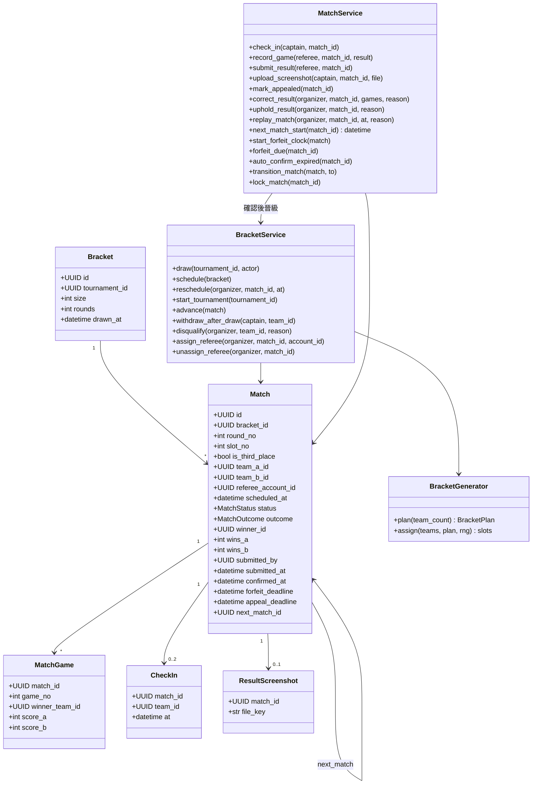

- `record_game` 在兩隊都報到前拒絕登錄、`submit_result` 在尚無一隊達到勝局門檻時拒絕送出（FR-26、FR-27）。`submit_result` 寫入 `submitted_by` 與 `submitted_at`，記錄送出系列結果的帳號（被指派的裁判，或代登的主辦方），場次進入申訴期；判棄權的場次兩者皆為空。場次變為已確認時（申訴期滿、申訴處理完成、輪空或取消資格判負）才寫入 `confirmed_at`。申訴更正的處理者記在 `Appeal.handled_by`，不覆寫 `submitted_by`（FR-27）。
- `MatchStatus`：`scheduled` 待開打、`live` 進行中、`appeal_window` 申訴期、`appealed` 申訴中、`confirmed` 已確認、`voided` 已取消（只用於準決賽沒有產生勝隊時的季軍賽）。`MatchOutcome`：`played`、`forfeit`、`double_forfeit`、`walkover`、`disqualified`；各結果類型的欄位填法見期中文件 B 的 MATCH 資料表。
- `start_forfeit_clock` 在場次兩隊都確定時設定 `forfeit_deadline`＝max（預定開始時間, 現在）＋棄權時限：抽籤後由 `schedule` 為所有兩隊都已確定的場次呼叫，之後由 `advance`、遞補與頂替在填入第二支隊伍時呼叫，`reschedule` 會重算。隊伍未確定時 `forfeit_deadline` 為空，`forfeit_due` 不會選到它，`check_in` 也拒絕報到（`MATCH_TEAMS_PENDING`）（FR-24、FR-25、AD-7）。
- `schedule` 讓同一輪排在同一時段，下一輪晚於上一輪「每輪間隔」；若上一輪的 BO 數使「棄權時限＋BO 數 × 每局預估時間＋申訴期」超過每輪間隔，下一輪順延到這個下限。系統不自動分批，一位裁判可以被指派到多個場次（FR-23）。哪些隊伍輪空由亂數決定，輪空位置平均分散（FR-20）。`reschedule` 的新時間不得早於現在，也不得晚於 `next_match_id` 那一場（決賽與季軍賽除外）。
- `advance` 在場次確認後把勝隊填入下一場、準決賽敗隊填入季軍賽。下一場某一方確定不會有隊伍時，把該場以 `walkover` 確認並繼續推進；準決賽沒有產生勝隊時，季軍賽轉為 `voided`。填位後若指派的裁判是其中一隊的隊員，取消該場的指派並發出事件通知主辦方（FR-4、FR-21）。
- `assign_referee` 呼叫 `TournamentService.is_referee` 確認帳號是此賽事的裁判，並呼叫 `RegistrationService.is_member` 拒絕指派到其隊伍參賽的場次；結果寫入 `referee_account_id`（AD-10）。送出系列結果前可改派或以 `unassign_referee` 收回，收回後由主辦方代登。
- `start_tournament`、`forfeit_due`、`auto_confirm_expired` 由 worker 呼叫，每筆一個交易，可重複執行；`start_tournament` 在最早場次開放報到時呼叫 `TournamentService.transition_tournament` 轉為進行中。這些工作先檢查賽事狀態，已取消或已結束的賽事一律略過。

## D-5 disputes 申訴與檢舉

**職責**：隊長提出申訴（每隊每場一次）與資格檢舉；主辦方處理申訴（維持或更正）與查證檢舉（駁回或取消資格），結果交由 `competition` 執行；申訴逾期時提醒主辦方一次。

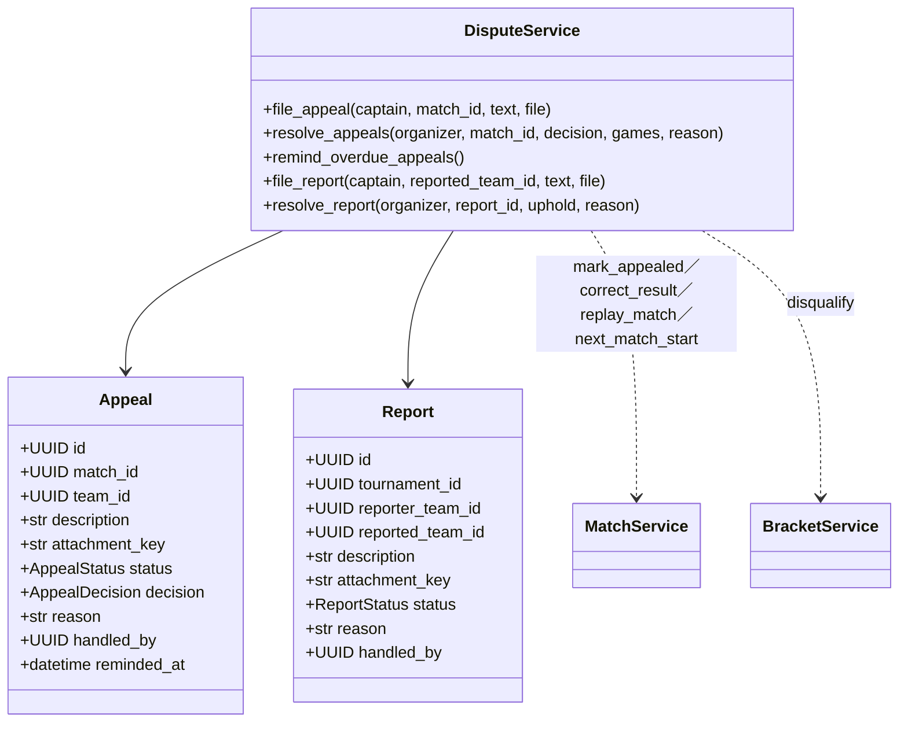

- `file_appeal` 透過 MatchService 鎖住場次，確認未超過 `appeal_deadline`、場次為申訴期或申訴中、該隊未申訴過，再建立申訴；場次仍在申訴期時才呼叫 `mark_appealed` 轉為申訴中。所以另一隊在期限內仍能申訴，一個場次最多兩筆（FR-30）。
- `resolve_appeals` 以場次為單位處理：同一場次未結案的申訴以相同的決定與理由一併結案，並寫入 `handled_by`；選擇更正時由 MatchService 依新的各局結果重算系列比分；選擇重新比賽時（只用於判棄權的場次）呼叫 `replay_match`，場次回到待開打、清除 outcome 與報到紀錄、依新時間重新起算棄權期限（FR-31）。
- `remind_overdue_appeals` 由 worker 呼叫：只挑處理中且 `reminded_at` 為空的申訴，提醒時間為下一場預定開始前 1 小時（以 `MatchService.next_match_start` 取得；決賽與季軍賽沒有下一場，為提出後 1 小時）；發出提醒事件的同一個交易寫入 `reminded_at`，每筆申訴只提醒一次（AD-8）。
- `resolve_report` 寫入 `handled_by` 與理由；判定屬實時呼叫 `BracketService.disqualify`，頂替規則（含決賽隊伍由準決賽敗隊頂替、已淘汰隊伍只標示取消資格）完全由 `competition` 處理（AD-4、FR-22）。`file_report` 只接受檢舉人與被檢舉隊伍都已送出報名，報名狀態以 `RegistrationService.get_registration` 取得（FR-32）。

## D-6 notifications 通知

**職責**：消化 outbox 事件，依 FR-37 對照表決定收件人，建立站內通知並寄送 Email（失敗重試）；提供通知中心查詢與標為已讀。

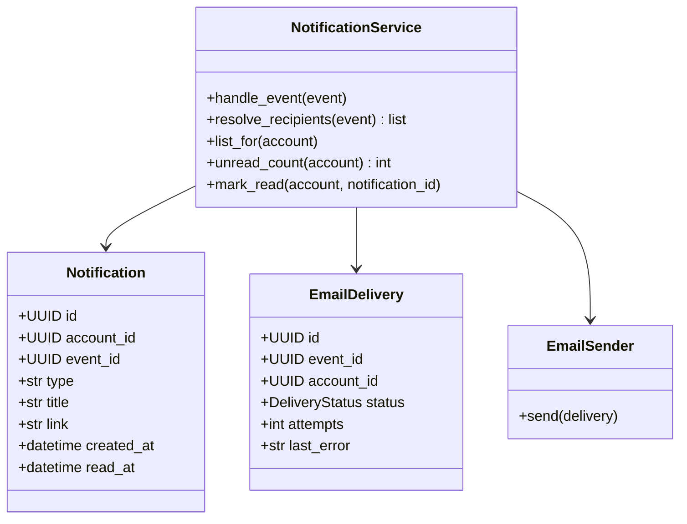

- `list_for` 依 `created_at` 由新到舊排序（FR-38）；前端以 `unread_count` 每 30 秒輪詢（AD-14）。
- `VerificationEmailRequested`、`PasswordResetRequested` 只建立 EmailDelivery，不建立 Notification（AD-21）。

---

## 撰寫 C／D 正式文件時的提醒

- 正式文件請直接引用本稿的圖，並在每個機制旁附上 AD 編號，讓老師看得出「設計決策 → 規則 → 實作」的追溯關係。
- D 文件的類別圖在實作後要以程式碼為準重新產生；本稿與程式不一致時，以程式為準，並回頭確認是否違反架構骨幹的 AD。
- 狀態轉換圖（賽事、報名、場次）可以直接從 PRD §3 的狀態定義畫出，適合放在 B 或 D 文件。
