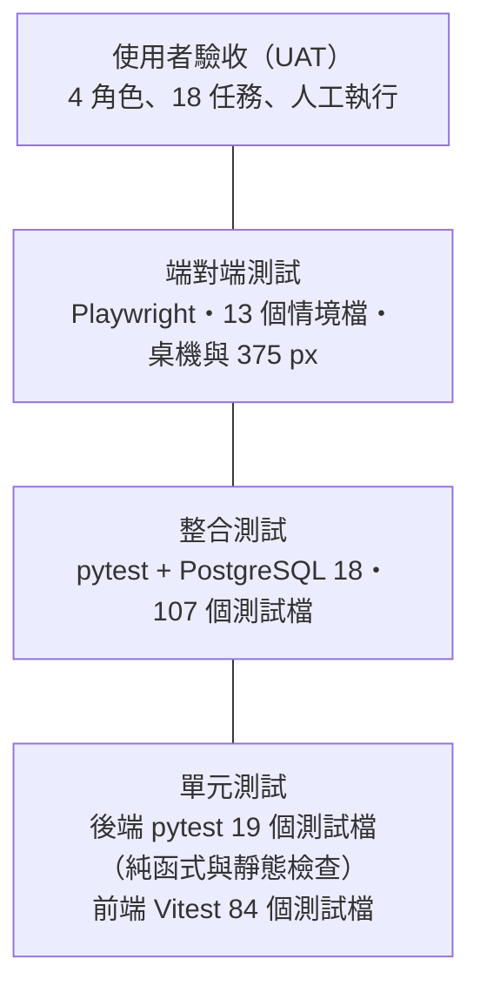
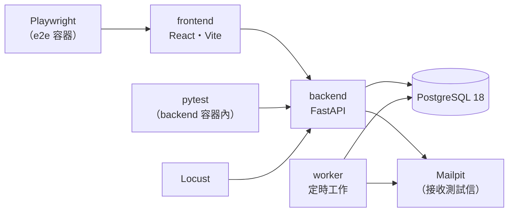

# 版本紀錄

| 版本 | 日期 | 修改內容 |
| --- | --- | --- |
| 1.0 | 2026-11-28 | 初版（草稿）：依目前 `main`（`2590d63`）的測試程式、`scripts/test-all.sh`、CI 設定、`backend/tests/traceability.yaml`、壓力測試（`scripts/load/`）與 UAT 腳本整理；待組內確認 |

# 壹、測試計畫簡介

## 一、測試目的

### （一）系統品質目標

本系統是校際與社群電競盃賽的管理平台，錯誤會直接影響比賽結果與隊伍權益，因此測試以《軟體需求分析文件》（以下簡稱 B）的 41 條功能需求（FR-1～FR-41）與 9 條非功能需求（NFR-1～NFR-9）為驗收依據。其中下列品質目標風險最高，測試優先處理：

| 品質目標 | 對應需求 | 為什麼重要 |
| --- | --- | --- |
| 名額與比分在併發下一致 | NFR-1 | 多支隊伍同時報名、兩位裁判同時登錄同一場時，不能超收、重複或互相覆蓋 |
| 定時規則準時且正確 | NFR-4 | 優先期結束、報名截止、棄權判定、申訴期滿都由 worker 自動執行，錯過或重複執行會改變賽果 |
| 權限在伺服器端驗證 | NFR-5、FR-5 | 繞過介面直接呼叫 API 也必須被拒絕 |
| 操作紀錄完整且不可修改 | NFR-3 | 爭議發生時，主辦方要能查到誰在何時改了什麼 |
| 規則演算法正確 | FR-14～FR-19、FR-26～FR-28 | 名額分配、抽籤與對戰表、排程、晉級是純函式，錯一個分支就會排錯賽程 |
| 回應時間與手機可用 | NFR-2、NFR-7 | 一般操作 1 秒內回應；所有頁面在 375 px 寬可操作 |

### （二）測試活動目標

1. 每條 FR 至少有一個自動化測試；每個後端測試檔都標出對應的 Story 與 FR（`backend/tests/traceability.yaml`），由測試強制檢查。
2. 後端整體覆蓋率 85% 以上；四個規則純函式（`allocation.py`、`bracket.py`、`schedule.py`、`progression.py`）的分支覆蓋率各 90% 以上。
3. 每個 PR 由 CI 執行全部後端測試、前端單元測試、靜態檢查與建置，未通過不能合併。
4. 新增的測試要能抓到錯誤：審查時以突變檢查（故意改壞程式）確認測試會失敗，不以「全部通過」或「覆蓋率高」作為唯一證據（做法見《AI 應用文件》參、一）。
5. 以端對端測試走完兩款遊戲從建立賽事到頒獎的完整流程，並在桌機與 375 px 兩種視窗執行。

## 二、測試範圍

### （一）納入

後端依模組化單體的模組劃分，前端依功能群劃分。「測試檔數」為目前 `main` 的實際數量。

| 範圍 | 主要功能 | 對應功能群與需求 | 測試檔數 |
| --- | --- | --- | --- |
| identity（帳號與身分） | 註冊、Email 驗證、登入登出、忘記與重設密碼、主辦方申請與審核、身分切換、權限依賴 | 1.0；FR-1～FR-5、FR-40 | 11 |
| tournaments（賽事） | 遊戲設定與學校清單、建立與修改賽事、分輪 BO、取消賽事、裁判邀請、自訂模式報名連結、操作紀錄查閱 | 2.0；FR-6～FR-10、FR-39、NFR-3 | 13 |
| registration（報名） | 建立隊伍、隊員異動、選手資料、送出報名、優先期／先搶期／截止補位三階段分配、撤回與遞補 | 3.0；FR-11～FR-18、FR-41 | 23 |
| competition（競賽） | 抽籤與對戰表、排程與改時間、裁判指派、報到、判棄權、逐局比分、晉級與季軍賽、退賽遞補、結算截圖 | 4.0、5.0；FR-19～FR-30 | 38 |
| disputes（申訴與檢舉） | 提出與處理申訴、申訴逾期提醒、提出與處理檢舉、取消資格 | 6.0；FR-31～FR-35 | 9 |
| notifications（通知） | 交易式 outbox、站內通知、Email 寄送與重試 | 7.0；FR-36～FR-38 | 5 |
| worker（定時工作） | 開放報名、優先期結算、報名截止補位、自動抽籤、判棄權、申訴期滿確認、逾期提醒 | NFR-4 | 11 |
| core 與跨模組規則 | 時鐘、錯誤格式、權限、操作紀錄、檔案儲存；架構規則（AD-2、AD-3、AD-5、AD-13）、未登入寫入 API 清單、遷移與模型一致、測試追溯檢查 | NFR-3、NFR-5、NFR-8 | 16 |
| 前端單元 | 84 個測試檔（另有 5 個共用 fixture 與 helper），涵蓋各頁面、元件與 hooks（登入、賽事頁、報名、對戰樹、場次頁、報到、比分、申訴、後台） | 1.0～7.0 的介面；NFR-7 | 84 |
| 端對端 | 13 個情境檔：帳號、賽事完整演練、觀眾、自訂模式、退賽、報名退回與撤回、隊員異動、頒獎台、結算截圖、對戰表搜尋、操作紀錄、已錄取隊伍 | 完整業務流程；NFR-2、NFR-7 | 13 |
| 壓力與負載（補充量測） | 觀眾輪詢、同時報到、同時報名、同時登入、混合情境 | NFR-1、NFR-2 | `scripts/load/` |
| 使用者驗收（UAT） | 4 種角色、18 個任務、SUS 問卷 | 驗收 | `uat-script.md` |

### （二）排除

| 項目 | 原因 |
| --- | --- |
| 正式環境部署、雲端監控與災難復原 | 本專案以 docker compose 在單機示範（NFR-8），不部署到雲端 |
| 真實 Email 服務商的寄送 | 以 Mailpit 接收並檢查信件內容；服務商端的到達率不在範圍 |
| 第三方直播平台嵌入 | 直播連結功能經組內決定不做（2026-11-04） |
| 瀏覽器相容性矩陣 | 端對端只跑 Chromium（桌機、375 px 兩種視窗），不測 Safari、Firefox |
| 壓力測試的效能目標驗收 | B 1.2 版已把 NFR-1、NFR-2 改以整合與端對端測試驗證；`scripts/load/` 的壓力測試是補充量測，結果在本機筆電上取得，只作為瓶頸分析，不作為驗收門檻 |

## 三、測試方法

### （一）測試金字塔

| 測試階段 | 測試目標 | 測試工具 |
| --- | --- | --- |
| 單元測試（後端） | 規則純函式（名額分配、對戰表、排程、晉級）、列舉、架構規則與測試追溯；不連資料庫 | pytest、coverage.py（含分支覆蓋率） |
| 單元測試（前端） | 頁面、元件與 hooks 的畫面狀態、表單驗證、錯誤訊息、倒數與輪詢 | Vitest、Testing Library（API client 以 `vi.mock` 替換） |
| 整合測試 | 經 HTTP 呼叫 API 到真 PostgreSQL：權限、業務錯誤、交易與列鎖、outbox 事件、操作紀錄、worker 工作；以 `frozen_clock` 推進時間驗證定時規則 | pytest、httpx TestClient、PostgreSQL 18、Mailpit |
| 併發測試（整合的一部分） | 多執行緒同時送出報名、報到、登錄比分、申訴、檢舉、退賽，驗證沒有超收、重複或覆蓋 | pytest、`threading.Barrier`、各自獨立的資料庫 session |
| 端對端測試 | 從瀏覽器走完整業務流程：兩款遊戲從建立賽事、報名、抽籤、報到、比分、申訴到頒獎；記錄 API 回應時間 | Playwright（Chromium，desktop 與 mobile-375 兩個 project） |
| 壓力與負載（補充） | 階梯加壓找出瓶頸，跑完核對資料正確性 | Locust 2.43.3、py-spy |
| 使用者驗收 | 由組員扮演四種角色依腳本操作，記錄觀察與 SUS 分數 | UAT 試用腳本、示範資料 |

### （二）測試執行原則

1. **持續整合**：每個 PR 由 GitHub Actions 執行 `.github/workflows/ci.yml` 的 10 個步驟：啟動服務、Alembic 只有一個 head、後端測試（含覆蓋率門檻）、後端靜態檢查（ruff、mypy）、前端建置、型別檢查、Biome、前端單元測試、端對端 image 可建置、API client 與後端一致。任一步驟失敗就不能合併；CI 失敗時讀 log 修正根本原因，不跳過或刪除測試。
2. **由下而上**：開發時先寫單元與整合測試；Story 完成時再補端對端情境。總指令 `scripts/test-all.sh` 依單元 → 整合 → 端對端的順序執行，任一層失敗仍跑完其餘層並產生報告。
3. **高風險優先**：併發、定時規則、權限與規則純函式最先測，並有專屬的併發測試檔（例如 `test_score_concurrency.py`、`test_settlement_concurrency.py`）與分支覆蓋率門檻。
4. **回歸測試**：修 bug 時先寫重現錯誤的測試，再修程式；所有測試在每個 PR 重跑。
5. **測試本身要被驗證**：每個 Story 經三位獨立審查子代理審查，其中 Verification Gap 專找「拿掉程式測試也不會失敗」的地方；新增測試以突變檢查確認會失敗。
6. **可重現的時間**：程式一律用 `app.core.clock.now()` 取得時間，跟期限有關的測試用 `frozen_clock` 固定時間，不依賴真實時鐘。

## 四、測試環境

### （一）環境配置

| 環境 | 用途 | 資料庫 |
| --- | --- | --- |
| 開發者本機（docker compose） | 開發時執行單元、整合與端對端測試；`scripts/test-all.sh` 產生測試報告 | compose 的 PostgreSQL 18（測試專用資料庫，禁止 SQLite） |
| GitHub Actions（ubuntu-latest） | 每個 PR 的自動檢查 | 同一份 compose 的 PostgreSQL 18 |
| 端對端環境（compose 的 `e2e` profile） | Playwright 對完整系統操作 | PostgreSQL 18，每個情境自行建立資料 |
| 壓力測試環境（`scripts/load/compose.load.yml`） | Locust 加壓、資料正確性核對 | PostgreSQL 18，由 `seed.py` 建立種子資料 |
| 示範環境（`init` 載入示範資料） | UAT 與期末展示 | PostgreSQL 18，示範資料腳本建立 |

### （二）技術架構

### （三）測試工具

| 工具 | 版本或設定 | 用途 |
| --- | --- | --- |
| pytest | 後端容器內執行；依 `traceability.yaml` 加上 `unit`／`integration` marker | 後端單元與整合測試 |
| coverage.py | `branch = true`、`fail_under = 85`；純函式另以 `scripts/check_branch_coverage.py` 檢查 90% | 覆蓋率 |
| Vitest | 前端容器內執行 `bun run test:unit` | 前端單元測試 |
| Playwright | Chromium；desktop 與 mobile-375（375×812）兩個 project；CI 重試 2 次、workers 1 | 端對端測試 |
| Mailpit | compose 服務 | 接收與檢查 Email |
| Locust、py-spy | 2.43.3 | 壓力測試與執行緒取樣 |
| ruff、mypy、Biome、tsc | `scripts/lint.sh`、`bunx biome check`、`bun run typecheck` | 靜態檢查 |
| GitHub Actions | `.github/workflows/ci.yml` | 持續整合 |

# 參考文獻

1. 本組，《軟體需求分析文件》（`docs/midterm/B-軟體需求分析文件.md`），貳、四 非功能需求與肆 附錄功能需求規格。
2. 本組，《軟體設計文件》（`docs/midterm/C-軟體設計文件.md`），附錄 AD-1～AD-21。
3. 本組，Story 7.3 測試覆蓋率與測試報告素材（`_bmad-output/implementation-artifacts/spec-7-3-test-coverage-report.md`）。
4. 本組，壓力與負載測試（`scripts/load/README.md`）；使用者驗收測試腳本（`_bmad-output/test-artifacts/uat-script.md`）。
5. pytest 文件，https://docs.pytest.org/；Playwright 文件，https://playwright.dev/；Locust 文件，https://docs.locust.io/。
