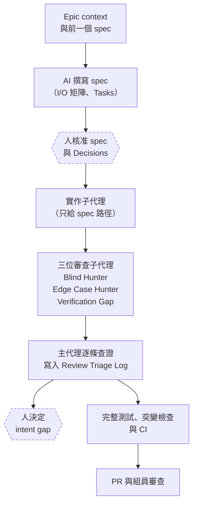

# 版本紀錄

| 版本 | 日期 | 修改內容 |
| --- | --- | --- |
| 1.0 | 2026-11-28 | 初版（草稿）：依 `docs/ai-usage/` 四位組員共 298 筆紀錄（2026-10-14～2026-11-25）整理 18 個代表案例、類別與成熟度統計、AI 常見錯誤與本組的防範機制；待組內確認 |
| 1.1 | 2026-11-28 | 依組內審查修正：統計納入 #128 合併後 D 新增的 1 筆（共 299 筆），補上 D 的第二組重複紀錄；案例 11 移到單元測試；案例 15 的審查項數補齊 |

# 文件說明

本文件是課程期末報告第 (g) 項「哪些軟體工程活動用到生成式 AI、怎麼用」。內容全部取自組員在開發過程中逐筆記錄的 AI 使用紀錄（`docs/ai-usage/A-王閎立.md`、`B-蘇采羚.md`、`C-邱芯彤.md`、`D-黃鉅燊.md`），沒有另外編造案例；每個案例都附上紀錄中的證據（spec、PR、commit 或測試輸出）。

每個案例分成三小節：

- （一）說明：這個案例在做什麼、屬於哪個 Story、AI 用到什麼程度（成熟度等級見伍、一）。
- （二）Prompt：給 AI 的指令或流程。紀錄當時只寫下指令摘要，沒有保存逐字的對話，因此這裡是依紀錄的〈怎麼用〉整理，不是逐字稿。
- （三）AI 回覆：AI 產出了什麼，以及 **AI 錯在哪、怎麼被發現、團隊怎麼修改**。後者是本組最重視的部分：本組不把「AI 說測試通過」當成證據，每個案例都寫出實際驗證的方式。

本組使用的工具：

| 工具 | 用途 |
| --- | --- |
| Claude Code（Opus 5.5，少數工作用 Sonnet 5.5） | 主要的 AI 開發環境，讀寫程式、執行測試與 git 指令 |
| BMAD Method（`bmad-build`、`bmad-code-review` 等） | 固定的 Story 流程：寫 spec → 人核准 → 實作子代理 → 三位獨立審查子代理 → 主代理逐條查證 → 測試驗證 |
| GitHub Actions | 每個 PR 自動跑全部測試、lint、Alembic head 與 API client 一致性檢查 |
| Playwright、pytest、Vitest、Locust | 端對端、後端、前端單元與壓力測試 |

本組的 Story 流程如下，人只在虛線框的檢查點做決定：

# 壹、系統設計

## 一、需求分析

### 案例 1：Story 3.7 撤回報名與提高名額的 spec（C，L4）

#### （一）說明

Story 3.7 讓隊伍在抽籤前撤回報名，並讓主辦方提高名額時自動由候補遞補（FR-9）。AI 依期末分工與 epics 寫 spec，再由一位沒參與規劃的子代理獨立審查。證據：`_bmad-output/implementation-artifacts/spec-3-7-withdraw-registration.md` 的 Decisions、Review Triage Log 與 Design Notes。

#### （二）Prompt

> 讀期末分工與 epics 的 Story 3.7，派子代理平行調查後端分配邏輯、前端 S17／S12 的介面字串、通知中心與模組契約，整理成 spec。完成後另派一個沒參與規劃的子代理，對照 epics、PRD、UX 與程式獨立審查 spec。

#### （三）AI 回覆

AI 產出 I/O 矩陣 14 列、Tasks 10 項、9 條 Decisions 的 spec。獨立審查提出 11 項（high 2、medium 4、low 4），AI 修改前先讀原始碼抽查其中 4 項，都成立。

AI 的錯誤與修正：

1. **I/O 矩陣寫出不可能發生的狀態。** 初稿沿用 epics 3.6 的範例，寫成「W 校撤回 1 隊後只有 F 遞補」，但該狀態正取 3 隊、名額 5，依 `backfill_vacancies` 的「空位＝名額－正取數」，F、G、H 會全部遞補，而且截止補位早已補滿。審查子代理實際推算才抓到，改成撤回前名額已滿。
2. **判斷階段的依據與畫面不一致。** AI 用賽事狀態 `open`／`closed` 判斷先搶期或截止後，但畫面的候補順位用 `_current_phase`（只看時間）。worker 延遲轉換狀態的期間，實際遞補的隊伍會與畫面顯示的候補第 1 位不同。改用 `_current_phase`。
3. 錯誤碼寫「422 或 409」未定案、漏了 epics 明定的 `waitlist_order` 兩階段單元測試，都由審查抓到後補上。

團隊判斷：組員決定撤回與提高名額放在同一份 spec，並決定把同校遞補接到 6.5 取消資格後的分配；AI 因此發現只看「優先期學校沒有正取」會誤判，改在結算時記錄 `is_representative`。

### 案例 2：使用案例圖對照老師範例修訂（B，L3）

#### （一）說明

期中文件 B 的使用案例圖對照去年範例審查並修訂（PR #84，由組長在 #85 套用）。這是 L3：AI 依 FR 與 UML 規則產出，組員逐張看圖做所有取捨，沒有經過多代理審查。

#### （二）Prompt

> 讀老師給的範例（去年第 2 組期末版 A～G）與我們 main 的 A～D，列出不足與使用案例圖的問題。再依審查結果修圖，每一輪都先給我看圖，我決定後才改。

#### （三）AI 回覆

AI 列出與範例相比的 4 項不足、7 張使用案例圖的 14 個問題（include／extend 誤用、訪客與觀眾同義詞、漏畫的關係等，各附 FR 依據），並產出整體圖與 7 張分圖的修訂版。

AI 的錯誤與修正：

1. **把系統內部元件當成參與者。** AI 把「時間」參與者重新定義成「背景工作程序」，但 worker 在系統邊界內，不能當參與者。組員問「actor 有時間很怪嗎」時，AI 才發現並改回「外部的期限到達」。
2. 拿掉連線上的「接收」標籤後，「帳號 → 發送站內通知與 Email」看起來像帳號發起寄信。組員發現後改名為「接收站內通知與 Email」。
3. **過度執行指令。** 組員說「片段不編號」只指 7.0，AI 卻把 6 張圖的 12 個片段編號全部拿掉；又把整份 B 複製成 87 頁的修訂版。組員指正後恢復編號，修訂版縮成只含使用案例圖的 11 頁。
4. AI 用不唯一的錨點做文字替換，把 B 的一大段內容重複插入，排版時找不到圖才發現，還原後重做。

## 二、邏輯設計（架構）

### 案例 3：把架構規則寫成自動測試（A，L3）

#### （一）說明

組長請 AI 對照課程講義〈AI 時代的細部設計〉，找出可應用到本專案的觀念，選定「把依賴規則寫成測試」，用 `ast` 檢查架構規則 AD-2（跨模組只經 service）、AD-3（呼叫方向）、AD-5（只有 router 能 commit）、AD-13（時間一律用 `clock.now()`）。證據：`spec-architecture-tests.md`、`backend/tests/test_architecture.py`。

#### （二）Prompt

> 讀老師的講義（106 頁），對照 main 的程式與 ARCHITECTURE-SPINE，找出可以應用的觀念。（選定第 28 頁後）用 bmad-build 寫 spec 並實作「把依賴規則寫成測試」。

#### （三）AI 回覆

AI 產出講義對照分析（已做到 6 項、可改善 4 項）與 53 個架構測試。反向驗證：在 `registration/service.py` 暫時加入越界 import、`datetime.now()`、`session.commit()`，三條規則各自失敗且行號正確。之後完整測試套件 1698 passed。

AI 的判斷與修正：

1. AI 盤點時發現架構文件的 AD-3 圖沒有畫 competition → identity，但程式有這樣呼叫；照圖寫測試會把現有程式判成違規。**AI 沒有自己決定，列成問題交給人**，組長決定 AD-3 可以依序往下跳級。
2. 跨模組 import models 有 12 處，照 AD-2 字面會全部違規。AI 確認都是型別、沒有資料表類別後交給人決定，組長定出界線：可以 import 型別，不能 import 資料表類別。
3. 第一版測試有 mypy 型別錯誤（`owner` 可能是 None），跑工具後才發現並修正。

這組測試之後成為擋下 AI 越界的機制：每個 PR 的 CI 都會跑。

## 三、細部設計（類別圖）

### 案例 4：期中文件依實作同步，用 AST 比對類別圖（A，L3）

#### （一）說明

第一批 35 個 Story 完成後，組長請 AI 依程式同步 A～D 四份文件（A 1.4、B 1.5、C 1.4、D 1.5），D 的類別圖依程式重畫。證據：`spec-midterm-docs-sync.md`。

#### （二）Prompt

> 依目前 main 的程式同步四份期中文件，並全部重新產生 PDF 與 Word。比對各模組的 models、service、router、worker 與 spec 的 Decisions。

#### （三）AI 回覆

AI 改寫四份 Markdown 並用 `build.mjs` 排版，結束碼 0、沒有畫圖錯誤。

AI 的錯誤與修正：

1. **依記憶寫的參數名與程式不同。** 用 Python AST 比對 D 類別圖的函式名稱與參數，發現 7 個函式的參數與程式不同，逐一修正。這是本組之後要求「圖以程式為準、用工具比對」的原因（後續 PR #91、#92 把每張圖標上對應的程式檔與函式）。
2. AI 依行號改 D 時吃掉 3 個 Mermaid 的結尾標記，排版回報 Lexical error 才發現。
3. AI 原本寫「每個 PR 都經組員審查」，用 `gh pr list` 查 81 個已合併 PR，發現 #1、#2 沒有審查，改掉這個說法。
4. `frontend/openapi.json` 是舊檔，API 章節改以各 `router.py` 為準。

# 貳、程式設計

## 一、撰寫程式

### 案例 5：Story 6.5 檢舉處理（B，L4）

#### （一）說明

Story 6.5 讓主辦方處理檢舉，屬實時取消資格並結案相關申訴。沒有對話脈絡的實作子代理只依 spec 實作，三位審查子代理平行審查。證據：commit `bf35b14`、`spec-6-5-resolve-report.md` 的 Review Triage Log。

#### （二）Prompt

> （bmad-build）把核准的 spec 交給實作子代理。完成後主代理讀差異、對照 spec 的 Tasks 與 I/O 矩陣，再跑 Blind Hunter、Edge Case Hunter、Verification Gap 三位審查者，核對後把修正交回同一個子代理。

#### （三）AI 回覆

AI 產出後端 `resolve_report` 與路由、前端 S33 檢舉處理頁、15 個後端測試函式，共 30 個檔案。後端 2350 passed、覆蓋率 97%；前端 973 passed。審查 20 點：修正 5 點、排除 15 點（理由逐點記錄）。

AI 的錯誤與修正：

1. **新增列舉值時沒有檢查其他使用者。** 實作子代理新增 `AppealDecision.DISQUALIFIED`，沒注意到處理申訴的 API 也用同一個 enum；`resolve_appeals` 會把它當成重新比賽，可能回 500 或把重賽記成取消資格。Verification Gap 審查者找出，改成回 422 並補測試。
2. 審查另外找出 4 個低度問題，例如賽事資料還沒載入時已結束的賽事會顯示「取消資格」、取消資格後對戰表沒有重抓。
3. 主代理也排除審查者的誤判，例如「第二隊送出後不會重抓」：讀程式確認 S4 的 refresh 會使整場的查詢失效，判定不成立。

### 案例 6：Story 4.5 抽籤後退賽與候補遞補（D，L4）

#### （一）說明

Story 4.5 讓隊伍在抽籤後退賽，由候補遞補對戰表的位置。新增 competition 的 `retirement.py`、兩支 API、registration 3 個公開函式、通知規則與 S17 退賽區塊。證據：`spec-4-5-post-draw-withdrawal.md` 的 Implementation Notes 與 Review Triage Log。

#### （二）Prompt

> （bmad-build）spec 核准後由子代理實作；三位只拿 diff 的審查子代理找問題，主 session 逐條判定後派回同一個子代理修正；主 session 自己跑完整測試與突變檢查。6.5 只改 `service.disqualify` 那一行轉呼叫，B 的 `disqualification.py` 不動。

#### （三）AI 回覆

AI 產出後端 5 個新測試檔（51 個測試）與既有檔新增 14 個測試、前端 7 個單元測試與 1 支 e2e。完整後端測試 2725 passed、覆蓋率 97%。突變檢查：讓 `backfill_drawn_from_waitlist` 直接回 None，6 個測試失敗；拿掉報到、比分、截圖的 `lock_tournament`，3 個鎖序測試失敗。

AI 的錯誤與修正：

1. **死結。** 子代理的併發測試抓到報到只鎖場次、退賽先鎖賽事時會死結，報到改成先鎖賽事；審查再指出比分寫入與結算截圖是同一機制，一起修正並補確定性的鎖序測試。
2. **測試全用替身，關鍵順序沒被保護。** 所有退賽測試都用替身、不看學校，「先讓離開的隊伍出局、再取候補」的順序沒有測試；補上用真 registration 的測試，對調順序時會失敗。
3. 寫入後才 `assert`，改成業務錯誤避免 500；退賽被拒後錯誤訊息一閃即逝（與 3.7 同一個 bug），改成確認框開著時保持掛載。
4. 21 項審查發現中 10 項駁回，理由記在 Review Triage Log。

## 二、程式修改（除錯）

### 案例 7：AI 寫的延後項目前提不成立（D，L4）

#### （一）說明

4.5 留下一個延後項目：「4.2 正取不足而略過自動抽籤後，正取補足時要再自動抽籤」。這個延後項目本身是 AI 在 4.5 spec 寫的。證據：`spec-deferred-auto-draw-after-skip.md`。

#### （二）Prompt

> 依 deferred-work 的修法寫 spec，把看得到的決定列成選項給我選；子代理實作後三層審查，主 session 逐條判定、查證並修正。

#### （三）AI 回覆

組員先照建議選了「補足後自動抽籤」「通知加一句說明」。審查子代理質疑測試裡的候補是人為寫入的；主 session 追 `fill_from_waitlist`、`waitlist_order` 才確認：截止時已補滿，剩下的候補都超過每校上限，**這條路目前根本走不到**，原本要加的通知句子會誤導主辦方。AI 據此請組員重新決定，改為「程式保留、通知不改」。

同一次審查還找出：預先排除的跨模組查詢放在 try 外，拋錯會讓同一輪後面的賽事都不抽籤；「不鎖」的測試只看結果，拿掉預先排除也會過，改用 spy 驗證。這個案例說明 AI 寫下的「待辦」也要查證前提，不能直接照做。

### 案例 8：PostgreSQL 交易失效的例外處理（D，L3）

#### （一）說明

組員 A 在 PR #113 審查時指出：AI 在 docstring 寫「查詢拋錯只略過這一場」，但對 SQL 錯誤不成立。證據：`spec-auto-draw-prefilter-savepoint.md`。

#### （二）Prompt

> 依 A 在 #113 的建議，把自動抽籤的預先排除移進每個候選的 savepoint，寫一個會拋真 SQL 錯誤的測試。

#### （三）AI 回覆

AI 把預先排除移進 savepoint，新增 `test_due_prefilter_sql_error_skips_only_that_tournament`。突變檢查：換回修正前的程式，新測試失敗。

AI 的錯誤與修正：

1. **對資料庫交易語意的誤解。** 前一版 AI 只把查詢放進 try，以為例外都能就地吞掉，沒想到 PostgreSQL 的 SQL 錯誤會讓整個外層交易失效，後面的賽事全部失敗。由組員審查發現，不是 AI 自己發現。
2. AI 做突變檢查時在容器內執行 `git show ... > service.py`，容器沒有 git，重新導向把檔案清空，靠事先備份還原（本機檔案未受影響）。

### 案例 9：子代理把測試失敗歸因於環境（C，L4）

#### （一）說明

Story 3.4 第二階段實作優先期結束自動分配。證據：`spec-3-4-priority-window-allocation.md` 的 Decisions 與 Implementation Notes。

#### （二）Prompt

> （bmad-build）把 spec 交給沒有對話脈絡的實作子代理，主流程再自己讀 diff，逐項對照 Tasks、驗收條件與 I/O 矩陣。

#### （三）AI 回覆

實作後後端 1879 個測試全過，前端全量有 2～3 個失敗。

AI 的錯誤與修正：

1. **把失敗推給「環境不穩」而不查原因。** 子代理判斷前端失敗是「全量平行時的不穩定、與本 Story 無關」。主流程到 main 跑全量 761 個全過，才找到真正原因：分支開在 #47 之前，少了 `setup.ts` 的 `asyncUtilTimeout` 與 `testTimeout` 設定。主流程第一次比較時掛載了本機 Windows 的 `node_modules`、條件不同，改成公平的對照後才確認。
2. **子代理偏離凍結規則。** 凍結區塊寫「沒有任何報名的賽事也要寫結算紀錄」，Design Notes 卻規定 worker 只從有 `pending` 的賽事找候選，子代理照後者做。主流程做 I/O 矩陣檢查時發現，沒有自己決定，停下來問人；組員選擇「不寫結算紀錄」並要求先確認 3.5、3.6 與抽籤不依賴這一點。

# 參、系統測試

## 一、單元測試

### 案例 10：覆蓋率 100% 但規則沒被驗證（D，L5）

#### （一）說明

Story 4.1 對戰表產生器。實作子代理寫的測試全綠、覆蓋率 100%，三位審查者平行審查測試是否真的釘住規則。證據：`spec-4-1-bracket-generator.md` 的 Review Triage Log。

#### （二）Prompt

> （bmad-build 審查步驟）三位沒有對話脈絡的審查子代理平行審查 diff；主代理逐項查證、判定後，把要修的交回實作子代理。

#### （三）AI 回覆

審查提出 16 項，7 項修正（都是測試與 docstring）、3 項判定不屬實。

AI 的錯誤與修正：

- **實作子代理的測試沒有真正驗證「輪空交替落在上、下半區」**：13 隊與 10 隊兩種順序的結果相同，把演算法換掉測試也不會失敗。Verification Gap 審查者指出後，主代理用 14 隊補上精確測試。
- 主代理再做突變測試證明新測試有效：把輪空分散改成依序排列，39 個測試失敗；把季軍賽來源改錯，62 個測試失敗。兩者在修正前都不會被抓到。

這個案例讓本組確立「覆蓋率 100% 不等於規則有被驗證」，之後的 Story 都要求突變檢查。

### 案例 11：用性質測試與突變檢驗晉級規則（D，L5）

#### （一）說明

Story 5.5 晉級規則。用 4.1 的產生器產生 2～32 隊的賽事，隨機決定每場結果（含雙方棄權、取消資格）一路推進到結束，檢查不變式。證據：PR #6、`spec-5-5-progression-rules.md`。

#### （二）Prompt

> 用 4.1 的對戰表產生器產生 2～32 隊的賽事，隨機決定每場結果一路推進到結束，檢查不變式；再故意把程式改錯，確認測試會失敗。

#### （三）AI 回覆

AI 定出不變式：每場最後已確認或已取消、只結束一次、同一位置不填兩次、被取消資格的隊伍不再出場、季軍賽只在準決賽沒有勝隊時取消、每次新湊齊兩隊的場次剛好起算一次棄權期限。突變檢查：決賽取消資格仍給亞軍 → 25 個測試失敗；只對直接確認的下一場起算棄權期限 → 31 個失敗。

AI 的錯誤與修正：第 1 輪的 Verification Gap 審查者指出，性質測試只檢查「發出起算訊號時兩隊都在」，沒有檢查「該發的都有發」。若程式漏掉連鎖輪空後湊齊的場次，測試仍全綠，那場比賽就永遠不會自動判棄權。重做時改成比對「新湊齊的場次集合＝起算訊號集合」。

## 二、前端測試

### 案例 12：Story 4.6 對戰表頁的三位審查者（A，L4）

#### （一）說明

Story 4.6 第二階段 S3 對戰表頁。組長選擇跑三位審查子代理，AI 逐條驗證後修正並補測試。

#### （二）Prompt

> 跑三個審查子代理（Blind Hunter、Edge Case Hunter、Verification Gap），逐條驗證、分類後修正並補測試。

#### （三）AI 回覆

Review Triage Log 13 列：修正 7 項、1 項由組長決定後修正、駁回 2 項、判定不成立 3 項；S3 頁面測試從 9 個增加到 18 個。反向驗證：分別拿掉 `connectionLost ||`、對戰表變動時重抓賽事、標題檢查，各有測試失敗。

AI 的錯誤與修正：

1. 實作在「尚未抽籤後一次暫時失敗」時立刻顯示連線中斷，這是第一階段 hook 的語意，AI 沒發現它與 S3 衝突。兩位審查者都指出，修正 hook 並改掉第一階段測試的錯誤預期。
2. 換賽事時 `keepPreviousData` 會把上一場的對戰樹顯示在新賽事底下，改成以賽事 id 當 key。
3. 所有 404 都被當成「尚未抽籤」，改成只認 `BRACKET_NOT_FOUND`。
4. AI 的測試只走「第一次載入就失敗」的路徑，補上 9 個測試。

## 三、併發與交易

### 案例 13：「鎖內重讀」其實沒有重讀（B，L4）

#### （一）說明

Story 6.3 申訴逾期提醒。三位審查者平行審查，主代理驗證後分類，1 筆需求缺口交給組員決定。證據：`spec-6-3-appeal-overdue.md` 的 Review Triage Log。

#### （二）Prompt

> （bmad-build 審查步驟）Blind Hunter 只拿 diff，另兩位可讀 spec 與程式；主代理對照程式驗證後分類，intent gap 交給人決定，其餘修補交回實作子代理。

#### （三）AI 回覆

約 30 筆發現（含重複）：1 筆需求缺口、10 項修補、3 筆延後、4 筆不處理。

AI 的錯誤與修正：

1. **ORM 快取造成的讀到舊資料。** AI 寫的「鎖內重新讀場次」實際沒有重讀：`get_match` 用 `session.get`，拿到的是加鎖前讀進 identity map 的舊物件，主辦方剛改期仍會照舊時間提醒。兩位審查者獨立發現，加上 `session.expire_all()` 後補測試；子代理另外發現原本的測試是因為弱參照碰巧通過，改成持有強參照才真正測到。
2. 通知標題「申訴快到處理期限」與行為不符（已逾期的申訴也會立刻提醒），交給組員決定文字，改為「申訴待處理」。
3. Verification Gap 指出 8 處測試太弱，以及 S27 測試依賴真實時鐘才通過。

## 四、持續整合

### 案例 14：CI 第一次執行就擋下 AI 的錯誤（D，L5）

#### （一）說明

PR #1 建立 GitHub Actions，每個 PR 自動跑全部測試，並檢查兩種 AI 常漏的錯誤：Alembic 只有一個 head、前端 API client 與後端一致。

#### （二）Prompt

> 依 README 的測試指令寫 CI，另外檢查 Alembic 只有一個 head、API client 與後端一致。

#### （三）AI 回覆

AI 產出 `.github/workflows/ci.yml`（10 個步驟）。**CI 第一次執行就抓到 `main` 上的真實錯誤**：Story 1.5 的 code review 修正改了後端 docstring，但沒有重新產生 `frontend/src/client`。這是 AI 實作時漏掉、人工審查也沒看出來的，補一個 commit 修正（Actions run `40710158556` 失敗、`40712474316` 成功）。這是本組「以外部自動驗證取代 AI 自己說測試通過」的起點。

## 五、效能與壓力測試

### 案例 15：AI 推翻自己子代理的錯誤結論（D，L4）

#### （一）說明

用 Locust 對本機 compose 做五個情境的階梯加壓（觀眾輪詢、報到、報名、登入、混合），涵蓋 NFR-1（同時報名不超收）與 NFR-2（API 1 秒內）。證據：`scripts/load/README.md`、`spec-load-test.md`。

#### （二）Prompt

> 寫壓力測試的 spec，子代理寫腳本並實跑。（讀回報後）補資源紀錄、上限階重跑 3 次，並實證「伺服器卡死」這個結論。三個審查者交叉審查後交回修補，最後用縮小規模實跑 `run.sh all`。

#### （三）AI 回覆

結果：觀眾輪詢 p95 < 1 秒的上限為 150 人；32 隊同時報到全部成功、沒有重複；200 隊同時報名不超收（正取 32 = 名額 32），但 129 筆回 500；同時登入上限 40 人。

AI 的錯誤與修正：

1. **子代理的結論誇大。** 第一版寫「伺服器卡死、不會自己恢復、要重啟」。主代理要求實證後，時間序列顯示約 9 分鐘會自己恢復，嚴重度由高降為中。py-spy 看到 40 條執行緒都卡在等連線，再用對照實驗證實根因是執行緒池（放大到 1000 後 RPS 從 1.5 升到 70），不是連線池。
2. 子代理自己的 Locust 抖動邏輯讓所有使用者在第 5 秒同步，造成假的高延遲，修正後重跑。
3. **安全檢查形同虛設。** 審查發現「只打本機」的檢查實際無效：Locust 會吞掉事件處理器的例外，`localhost.evil.com` 也能通過。改成精確比對主機名稱並立即結束，用三個惡意主機名稱驗證會被擋下。
4. 審查共 19 項：修正 15 項、駁回 3 項、主代理收尾 1 項。

## 六、使用者驗收測試

### 案例 16：UAT 腳本在真實系統上演練（D，L4）

#### （一）說明

V 模型最上層的驗收測試：給小組使用的 UAT 試用腳本，4 種角色、18 個任務、觀察紀錄表與 SUS 問卷。證據：`_bmad-output/test-artifacts/uat-script.md` 第 7 節。

#### （二）Prompt

> 依需求清單、示範資料與程式寫 UAT 腳本，列出寫作時無法確定的「待確認」。再用全新資料庫啟動完整 compose，實際執行腳本裡的指令、API 與 Playwright 截圖逐項確認，結果寫回腳本。另派一個事實查核子代理，只給成品，要它對照程式與執行中的系統自己重跑。

#### （三）AI 回覆

13 項待確認中 10 項實測確認，例如單方棄權由 worker 約 20 秒判定、375 px 對戰表 `scrollWidth` = 375。

AI 的錯誤與修正：

1. AI 照程式推得的棄權指令，演練時判成雙方棄權（兩隊都沒報到），與任務「確認對手沒到」不符，改成先讓一隊報到再過期。
2. 原本請主辦方「改到約 10 分鐘後」，實測被拒：最早是現在＋30 分鐘，要留完整的報到時間。
3. 事實查核子代理找出 10 項錯誤，例如場次 B 是棄權場、沒有各局比分，不能用於觀看比分的任務；步驟順序會讓任務看不到申訴期。全部修正。

# 肆、專案管理與流程改善

### 案例 17：修正 BMAD 每次都重新產生 epic context（D，L5）

#### （一）說明

開發初期盤點 repo 是否符合 BMAD 流程（PR #1，squash commit `97bfb90`）。

#### （二）Prompt

> 盤點 repo 的文件與架構，確認是否符合 BMAD；先開分支提出方案，討論後再執行。

#### （三）AI 回覆

AI 讀 `bmad-build` 的步驟時發現，它用檔案修改時間判斷 epic context 是否過期，但 git 不保存檔案時間，所以每個人 clone 或 pull 後都會被判定過期而重新產生，浪費大量 token。改成依 git commit 判斷（`_bmad/custom/bmad-build.toml`）。另外發現 `epics.backup-*.md` 會被 `*epic*` 檔名比對抓到、可能被當成需求來源，刪除 2 份備份（5,756 行）。驗證：實際執行 BMAD 的 render，確認規則有注入 workflow，模擬判斷結果為「context 有效、不重新產生」。

### 案例 18：讓 AI 讀得到期末規則（A，L5）

#### （一）說明

期中結束後，組內決定期末的 15 個擱置 Story 改依完整驗收條件。PR #96 的審查留言指出缺口。

#### （二）Prompt

> 讀 PR #96 的審查留言，核對 bmad-build 讀的是 epics.md 與 epic context 而不是 CONTRIBUTING，確認缺口成立後修正。

#### （三）AI 回覆

**AI 上一輪的錯誤**：把「期末改依完整驗收條件」只寫進 CONTRIBUTING 第 7.3 節，沒想到 `bmad-build` 讀的是 epics.md 與 epic context，照做會把期末的 Story 做小。組員 D 在審查中指出。修正：epics.md〈期中範圍〉開頭加一段說明，7 份 epic context 各加一行，15 個擱置 Story 標成「期中擱置，期末要做」；再用 workflow 的過期判斷規則確認 context 不會被重新產生而蓋掉修改。

# 伍、使用統計與檢討

## 一、成熟度等級（本組自訂）

課程沒有給定等級，以下是本組的定義（`docs/ai-usage/README.md`）：

| 等級 | 名稱 | 判斷方式 |
| --- | --- | --- |
| L1 | 問答輔助 | 問 AI、查資料，成果是人自己做的 |
| L2 | 產生初稿 | AI 產出初稿，人大幅改寫才能用 |
| L3 | 依規格產出、人審查 | AI 依 spec、架構等既有規格產出可用的成果，人審查並做決策 |
| L4 | 多代理流程＋自動驗證 | AI 依固定流程規劃 → 實作 → 多個審查者 → 測試或 CI 驗證，人只在檢查點決策 |
| L5 | 改善流程本身 | 用 AI 找出並修正 AI 工作流程的問題，並有改善前後的證據 |

## 二、統計

統計對象：四份紀錄共 299 筆，期間 2026-10-14～2026-11-25（D 在 #128 補記的 2026-11-25 一筆已計入；2026-11-26 之後新增的紀錄沒有計入）。成員分布：A 91 筆、B 66 筆、C 62 筆、D 80 筆。

| 類別 | L1 | L2 | L3 | L4 | L5 | 合計 |
| --- | --- | --- | --- | --- | --- | --- |
| 需求 | 0 | 0 | 31 | 20 | 0 | 51 |
| 設計 | 0 | 0 | 17 | 1 | 0 | 18 |
| 程式 | 1 | 17 | 46 | 79 | 0 | 143 |
| 測試 | 0 | 0 | 26 | 39 | 5 | 70 |
| 專案管理與流程 | 0 | 4 | 6 | 5 | 2 | 17 |
| 合計 | 1 | 21 | 126 | 144 | 7 | 299 |

統計說明：

- 類別取紀錄標題的第一個類別。少數紀錄寫的不是 README 的五類（例如「審查」「實作」「修正」「統一 code review」），依 README「程式審查屬於程式」歸入程式；「整合」「盤點」歸入專案管理與流程；標題同時寫兩類的（例如「程式＋測試」）以第一個為準。
- D 的紀錄有兩組重複：2026-10-29「兩輪多代理審查加 mutation 測試」（L5）與「Story 4.3 第一階段：排定與修改場次時間的規則（schedule.py）」（L4）各記了兩次。上表照紀錄原樣計算，扣除重複後實際是 297 筆；L5 的 7 筆實際是 6 件。
- 〈問題與修正〉寫「無」的有 15 筆，其餘 284 筆都記下 AI 的錯誤或需要人判斷的地方。

解讀：L3、L4 佔 90%（270 筆），表示大部分工作是 AI 依既有 spec 產出、再經審查與測試驗證；L1、L2 只有 22 筆，集中在開發初期與少數臨時查詢。L5 的 6 件都是用 AI 找出並修正 AI 工作流程本身的問題：案例 10、11、14、17、18，以及 D 2026-10-29 以 mutation 驗證 Story 4.3 的測試。設計類多停在 L3，因為圖面的取捨（拆圖、標註方式）由組員逐張決定，沒有自動驗證可以取代。

## 三、AI 常見的錯誤類型

整理 284 筆〈問題與修正〉，重複出現的錯誤類型如下：

| 錯誤類型 | 代表案例 | 怎麼被發現 |
| --- | --- | --- |
| 測試全綠、覆蓋率高，但沒有驗證規則 | 案例 6、10、11 | Verification Gap 審查者、突變檢查 |
| 沒有查證前提就下結論或寫進 spec | 案例 1、7、9、15 | 獨立審查者推算、主代理要求實證 |
| 依記憶寫程式介面、圖與文件 | 案例 4 | AST 比對、排版錯誤 |
| 違反架構規則（AD-8、AD-19、AD-20 等） | 案例 3；Story 3.10、3.11 的 spec 審查 | 架構測試、審查者對照架構文件 |
| 資料庫交易與 ORM 語意的誤解 | 案例 8、13 | 組員審查、兩位審查者獨立發現 |
| 過度執行或偏離指令 | 案例 2、9 | 組員逐張檢視、主代理對照凍結區塊 |
| 子代理回報的數字不是親眼所見 | C 2026-11-23 Story 3.11 的補充紀錄 | 主流程區分「親自執行」與「轉述」 |
| 工具靜默失敗（Windows 的 `python` 佔位程式、不唯一的文字替換錨點） | 案例 2；B、C 多筆 | `git diff --stat`、讀回檔案 |

## 四、本組的防範機制

針對上述錯誤，本組逐步加入以下機制，每一項都有紀錄中的觸發事件：

1. **三位獨立審查子代理**：審查者沒有實作的對話脈絡，Blind Hunter 只看 diff，Verification Gap 專找「拿掉程式測試也不會失敗」的地方。審查結果由主代理逐條讀程式查證，誤判照樣記錄並駁回（案例 5、12、13）。
2. **突變檢查**：新增的測試要故意改壞程式確認會失敗（案例 6、8、10、11）。
3. **CI 與架構測試**：每個 PR 跑全部測試、Alembic head、API client 一致性與架構規則測試（案例 3、14）。
4. **測試追溯檢查**：每個後端測試檔必須登記在 `traceability.yaml`，標出層級、Story 與 FR，由測試強制（Story 7.3）。
5. **人只在檢查點決定**：spec 的凍結區塊只有人能改；需求不清楚而使用者會察覺的地方，AI 要停下來問（案例 3、9）。
6. **紀錄要寫錯誤**：〈問題與修正〉是必填欄位，紀錄中的數字只取自實際執行的輸出（`CLAUDE.md`）。

# 參考文獻

1. 本組 AI 使用紀錄：`docs/ai-usage/A-王閎立.md`、`B-蘇采羚.md`、`C-邱芯彤.md`、`D-黃鉅燊.md`，以及格式與成熟度定義 `docs/ai-usage/README.md`。
2. 各案例的 spec 與 Review Triage Log：`_bmad-output/implementation-artifacts/`。
3. 壓力測試結果：`scripts/load/README.md`；使用者驗收測試腳本：`_bmad-output/test-artifacts/uat-script.md`。
4. BMAD Method 官方文件，https://github.com/bmad-code-org/BMAD-METHOD。
5. Anthropic，Claude Code 文件，https://docs.claude.com/en/docs/claude-code。
