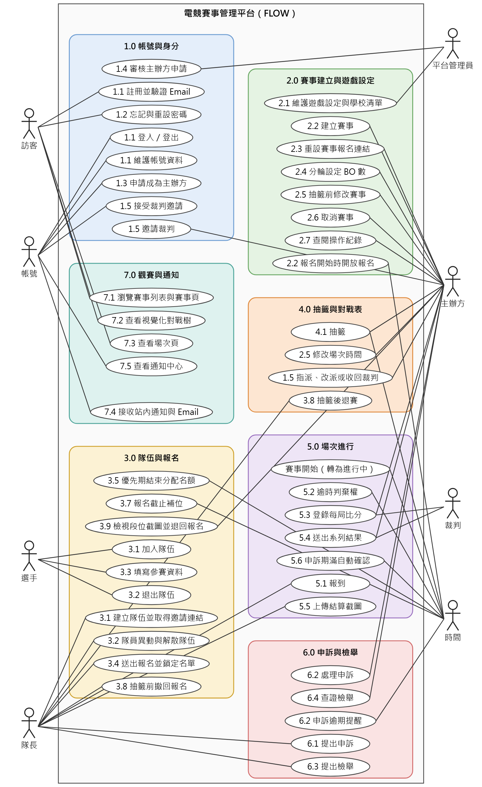
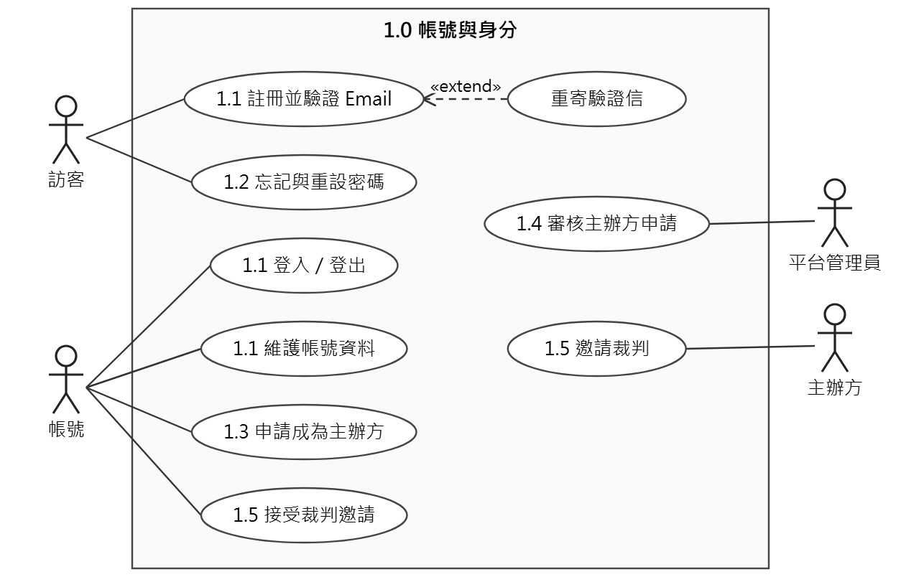
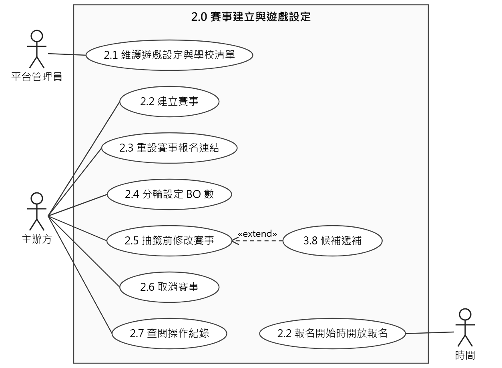
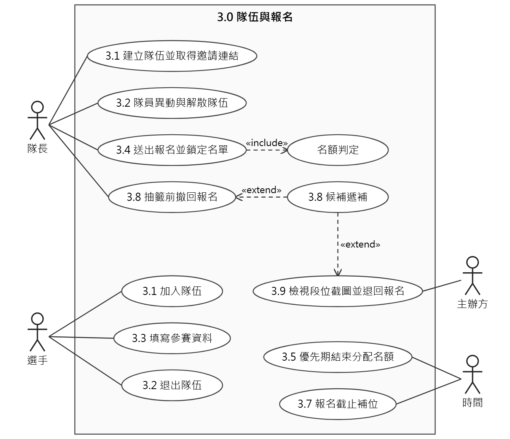
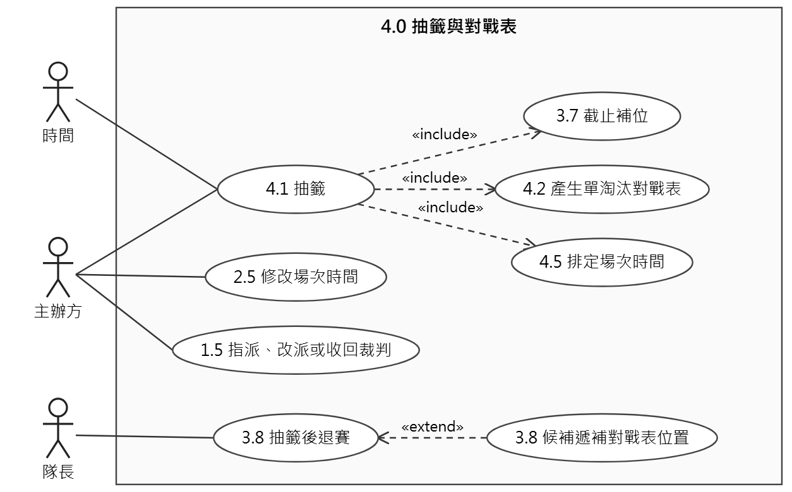
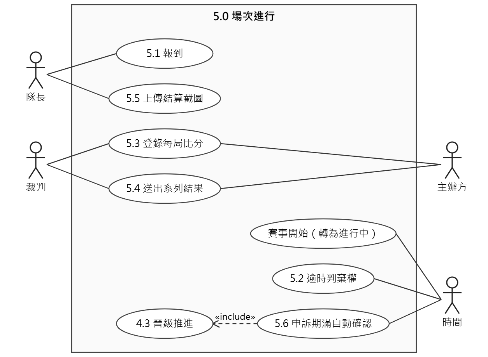
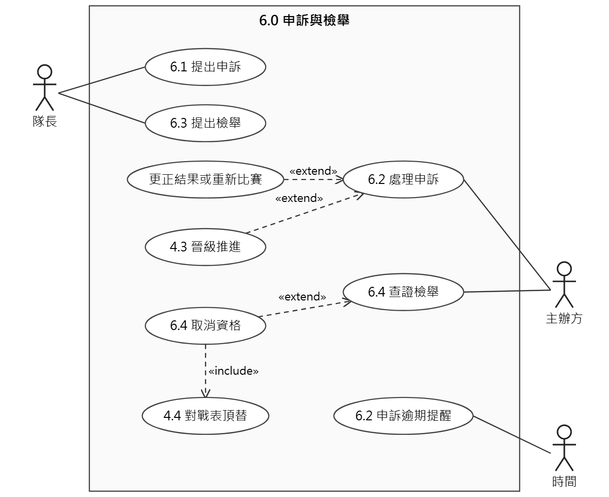
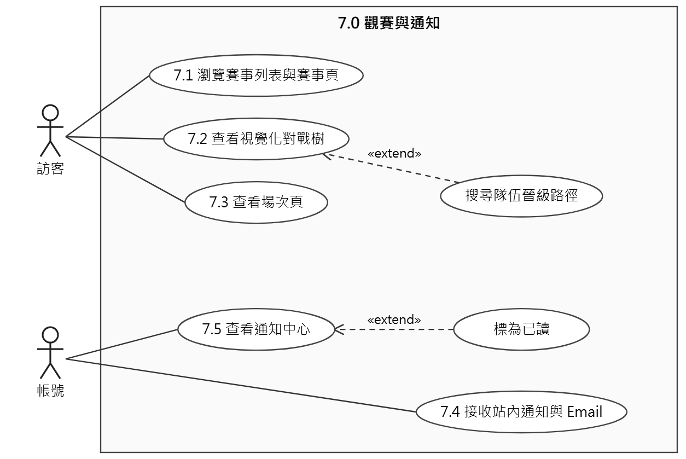

# 參、系統分析

本文件只收錄《軟體需求分析文件》參、一「使用案例圖」的修訂版，供組員審核；其餘章節不變。改了什麼與原因見 `使用案例修訂說明.md`。

## 一、使用案例圖

本節先以整體圖呈現全貌，再依功能群繪製使用案例圖。圖例如下：

1. 人形為參與者（actor），方框為系統邊界，橢圓為使用案例；實線表示參與者使用該案例。
2. 虛線箭頭標示 «include» 與 «extend»：每次都會發生的行為用 «include»（箭頭指向被包含的案例）；有條件才發生的行為用 «extend»（箭頭從延伸案例指向基礎案例）。
3. 使用案例名稱前的數字是功能清單（貳、二）的功能編號，可以據此對回功能需求；同一個功能拆成幾個使用案例時，編號會重複出現。沒有編號的是某個功能內的片段步驟。編號不屬於本功能群的案例，是因為與本功能群的流程直接相關而一併畫出。
4. 「時間」代表系統外部的時間流逝：期限到達時自動觸發的使用案例（例如逾時判棄權、申訴期滿自動確認）以「時間」為參與者。事件通知由業務事件觸發，不屬於「時間」，因此從帳號的角度畫成「接收站內通知與 Email」。
5. 參與者依權限劃分，子參與者也能使用父參與者的使用案例，圖上不重複連線：任何帳號都能做訪客能做的事（例如瀏覽對戰樹）；平台管理員、主辦方、裁判與選手都是帳號；隊長也是選手，因此能填寫自己的參賽資料。

### （零）整體使用案例圖

整體圖把 7 個功能群畫成系統邊界內的框，呈現每個參與者會用到的使用案例；功能群內的 «include»、«extend» 關係與片段步驟見（一）～（七）。

### （一）1.0 功能群：帳號與身分

本功能群涵蓋帳號的建立、驗證、登入與主辦方權限的申請審核。訪客註冊並驗證 Email 後成為帳號；帳號可申請成為主辦方，由平台管理員審核；主辦方再邀請帳號擔任自己賽事的裁判。「依身分控管權限」（1.6）是所有使用案例都要遵守的限制，不另外畫成使用案例。

### （二）2.0 功能群：賽事建立與遊戲設定

平台管理員維護遊戲清單、預設值與學校清單；主辦方建立賽事時自動帶入所選遊戲的預設值，並可分輪設定 BO 數、抽籤前修改賽事、取消賽事、查閱操作紀錄，以及重設自訂賽事的報名連結。

### （三）3.0 功能群：隊伍與報名

隊長建立隊伍並邀請隊員，選手填寫參賽資料後由隊長送出報名。送出報名必定包含名額判定；校園賽的優先期結算與截止補位由時間觸發。主辦方可檢視段位截圖並退回報名。

### （四）4.0 功能群：抽籤與對戰表

抽籤可由時間（報名截止時自動抽籤）或主辦方（提前抽籤）觸發，並包含截止補位、產生對戰表與排定場次時間。抽籤後主辦方可修改場次時間、指派裁判；隊長在第一場開打前退賽時，由候補遞補。

### （五）5.0 功能群：場次進行

隊長在開賽前報到，裁判逐局登錄比分並送出系列結果，勝隊隊長上傳結算截圖；場次未指派裁判時，由主辦方代為登錄與送出。逾時判棄權與申訴期滿自動確認由時間觸發，確認後必定進行晉級推進。

### （六）6.0 功能群：申訴與檢舉

隊長在申訴期內對場次結果申訴，或在賽事結束前對他隊資格檢舉；主辦方處理申訴（維持或更正）與查證檢舉（駁回或取消資格）。取消資格包含對戰表頂替；申訴快逾期時，系統提醒主辦方。

### （七）7.0 功能群：觀賽與通知

訪客不登入就能瀏覽賽事、對戰樹與場次；登入的帳號可在通知中心查看通知。賽事中發生重要事件時，相關的帳號會收到站內通知與 Email。

