# 版本紀錄

| 版本 | 日期 | 修改內容 |
| --- | --- | --- |
| 1.0 | 2026-10-16 | 初版 |
| 1.1 | 2026-10-19 | 依審閱意見修訂：統一用語，新增「尚未開放」狀態與學校清單，補充輪空、棄權期限、名額同分與取消資格規則 |
| 1.2 | 2026-10-20 | 依一致性審查補充規則（重新比賽、退出與解散隊伍、改派裁判、學校選填），並修正使用案例圖、狀態圖與 ERD；移除壓力測試（刪除原 Story 7.2、7.3，原 7.4、7.5 改為 7.2、7.3），NFR-1、NFR-2 改以整合與端對端測試驗證；新增版本紀錄與參考文獻 |
| 1.3 | 2026-10-23 | 截止補位改由所有候補依平均段位積分補位、每校最多 2 隊，與報名截止後的遞補順序相同（名詞表、Story 3.6、功能說明 3.7、使用案例例外流程 5a、附錄 4.3 與 FR-16） |
| 1.4 | 2026-10-28 | 依 Epic 1 實作定案的規則補充 FR-1（密碼長度、重寄驗證信、登入 7 天與過期處理）、FR-40（重設後登出其他裝置、視為完成驗證）；資料表補上 ACCOUNT.credentials_version、EMAIL_DELIVERY.next_attempt_at、AUDIT_LOG.seq |

# 壹、系統整體概述

本章界定「電競賽事管理平台（FLOW）」的定位、使用者類型與系統邊界，作為後續功能需求、流程分析與資料規格的共同基礎。專案目標、利害關係人分析與時程請見《軟體專案管理規劃文件》。

## 一、系統定位

電競賽事管理平台是給校際與社群中小型電競盃賽使用的一站式網頁系統。它把賽事從「開放報名」到「產生冠亞季軍」的完整流程收進同一個系統：主辦方開賽事、審報名、抽籤；系統自動分配名額、排定賽程、判定棄權與晉級；裁判登錄比分；隊長報到、申訴與檢舉；觀眾不登入就能看到視覺化對戰樹。

系統只支援「兩隊對打、分出勝負」的遊戲，賽制為單淘汰（含季軍賽）。各遊戲的差異（每隊先發與替補人數、BO 數、每局預估時間、段位積分對照、比分型態）都是平台管理員維護的設定，不寫死在程式裡；第一版以《英雄聯盟》與《特戰英豪》示範。比分一律由裁判登錄，不依賴任何遊戲官方 API。

## 二、使用者類型

本系統的使用者依權限分為六種身分。帳號是唯一的登入單位，「主辦方」「平台管理員」是帳號上的權限，「裁判」與「隊長」則是帳號在特定賽事或隊伍中的身分：

1. **平台管理員**：審核主辦方申請、維護遊戲設定與學校清單。擁有平台層級的管理權限，但不介入個別賽事的運作。
2. **主辦方**：主辦方申請被核准的帳號。可建立賽事、審核報名、抽籤、指派裁判、處理申訴與檢舉；權限只及於自己建立的賽事，且不能在自己主辦的賽事參賽。
3. **裁判**：受主辦方邀請、在某一賽事中負責登錄比分的帳號。裁判身分只在該賽事有效，且只能登錄被指派的場次；裁判可以同時參賽，但不會被指派到自己隊伍的場次。
4. **隊長**：建立隊伍的帳號在該隊伍中的身分。負責邀請隊員、送出報名、報到、上傳結算截圖、申訴與檢舉；名單鎖定前可轉讓給隊員。
5. **選手**：隊伍中的帳號。須填寫該遊戲的遊戲 ID、段位與段位截圖。同一帳號可以在一隊是隊長、在另一隊只是選手。
6. **觀眾**：未登入、只瀏覽公開頁面的訪客，所有寫入操作都會被拒絕。

## 三、系統邊界

### （一）系統內部邊界

系統內部負責的範圍包含：

1. **帳號與身分**：註冊、Email 驗證、登入、重設密碼、主辦方申請與審核、裁判邀請，以及依身分控管權限。
2. **賽事建立與遊戲設定**：遊戲清單與預設值、學校清單、賽事建立與修改、賽事模式（校園賽、自訂）、分輪 BO 數、取消賽事。
3. **隊伍與報名**：組隊與邀請、選手參賽資料、送出報名與鎖定名單、三階段名額分配、候補順位與遞補、退回報名。
4. **抽籤與對戰表**：抽籤、產生含輪空與季軍賽的單淘汰對戰表、排定場次時間、晉級推進、取消資格後的頂替。
5. **場次進行**：報到、逾時判棄權、逐局登錄比分、送出系列結果、結算截圖、申訴期滿自動確認。
6. **申訴與檢舉**：提出與處理申訴、提出與查證檢舉、取消資格。
7. **觀賽與通知**：公開賽事頁、視覺化對戰樹、場次頁、站內通知與 Email 通知。
8. **操作紀錄**：所有影響結果的操作都記錄操作者、時間與變更前後內容，且不可修改或刪除。

### （二）系統外部邊界

本系統不處理且不負責的範圍包含：

1. **遊戲官方 API**：不串接 Riot 等官方 API 取得比分或驗證帳號（VALORANT API 需 Riot 審核且須玩家授權，參考文獻 2）；比分一律由裁判登錄。
2. **直播**：不提供直播功能，賽事頁只放主辦方填寫的直播連結。
3. **金流**：不處理報名費與獎金。
4. **防作弊與在學資格審核**：不偵測作弊、不查驗學籍；資格問題以「檢舉 → 主辦方查證」處理。
5. **其他賽制與遊戲類型**：不支援雙敗制、循環賽，也不支援大逃殺等多隊同場的遊戲。
6. **正式寄信服務**：第一版的 Email 寄到本機測試信箱 Mailpit，不對外寄送。

## 四、名詞定義

本文件與其他文件一律使用以下名詞，不使用同義詞。

| 名詞 | 定義 |
| --- | --- |
| 功能群 | 依系統功能劃分的需求分組（1.0～7.0）。功能群是需求面的分類，與後端的程式模組（identity、tournaments 等）不是同一件事，兩者的對應見貳、二 |
| 賽事模式 | 建立賽事時選定、開放報名後不可更改的報名規則。**校園賽**要求同隊同校，名額依三階段分配；**自訂**採邀請制報名、不限學校、先到先得 |
| 段位積分 | 依遊戲的對照表把段位換算成的分數；同校多隊時以名單的平均段位積分決定正取 |
| 平均段位積分 | 名單上所有成員（先發與替補）段位積分的平均，取到小數第二位 |
| 優先期 | 校園賽開放報名後的第一段期間（預設 1 天），只收報名、不分配名額；結束時各校平均段位積分最高的一隊成為代表隊 |
| 先搶期 | 優先期結束到報名截止；優先期沒有報名（優先期結束時沒有「已送出・待分配」的報名）、且目前沒有正取的學校，第一支送出報名的隊伍取得正取，直到名額用完 |
| 截止補位 | 報名截止時名額仍有剩，由候補依平均段位積分補位，每校最多 2 隊 |
| 正取／候補 | 報名的分配結果。正取隊伍釋出名額時，由候補依當下階段的規則遞補 |
| 候補順位 | 介面上「候補第 N 位」的 N，表示接下來陸續釋出名額時，這支候補隊伍是第幾個會被遞補的 |
| 對戰表 | 一個賽事的單淘汰對戰樹 |
| 場次 | 對戰表中兩支隊伍的一次對決，以 BO 數決定勝負；BO 數限 1、3、5、7 |
| 局 | 場次中的一局比賽 |
| 系列結果 | 由各局比分算出的場次結果，例如 2:1 |
| 送出系列結果 | 裁判（或代登的主辦方）核對各局後鎖定比分的動作；送出後場次進入申訴期，結果尚未確認 |
| 已確認 | 場次結果定案的狀態：申訴期滿無申訴、申訴處理完成、輪空或一方被取消資格時進入，勝隊在此時晉級。本文件的「確認」只指進入這個狀態 |
| 報到 | 隊長在場次預定開始前 30 分鐘起，為自己的隊伍按下「報到」；場次兩隊都確定後才開放 |
| 棄權 | 過了棄權期限仍未報到，該隊被判負。棄權期限為「預定開始時間」與「兩隊都確定的時間」較晚者，再加上棄權時限（預設 15 分鐘，主辦方只能延長） |
| 輪空 | 隊伍不經比賽直接晉級：第一輪隊伍數不是 2 的次方時的輪空，以及對手位置確定不會有隊伍（前一場雙方棄權，或退賽、取消資格後無人遞補）時的輪空 |
| 申訴期 | 裁判送出系列結果或判棄權後的一段時間（預設 30 分鐘，主辦方只能延長）；期間內無申訴，場次自動變為已確認 |
| 申訴 | 隊長在申訴期內對場次結果提出的異議，由主辦方維持或更正；對棄權判定也可以安排重新比賽 |
| 檢舉 | 隊長對另一支隊伍參賽資格提出的質疑，由主辦方查證 |
| 取消資格 | 主辦方查證檢舉屬實後對隊伍的處分 |
| 退賽 | 隊伍在第一場開打前主動退出；抽籤前退賽等同撤回報名 |

# 貳、需求規格

## 一、功能需求分析

本節依 Epic 與 User Story 描述各身分在系統中可執行的行為。Epic 是依開發順序切分的工作單位，共 7 個 Epic、50 個 User Story。每個 Story 實作的功能需求列在功能清單（貳、二），功能需求的完整敘述與可測結果列在附錄（肆）；Story 的 Given／When／Then 驗收條件由這些可測結果展開，將整理進期末的《測試計畫》作為測試個案。

### （一）Epic 1：平台基礎、帳號與通知中心

建立可一鍵啟動的系統骨架與共用元件；訪客能註冊、驗證 Email、登入、重設密碼，登入後以身分切換器進入各身分的首頁；社團能申請成為主辦方並由平台管理員審核；所有人能在通知中心收到站內通知與 Email。

| User Story | 內容 |
| --- | --- |
| 1.1 以官方範本建立可一鍵啟動的專案骨架 | As a 開發組員 I want to 以官方全端範本建立符合架構設計的專案骨架 So that 所有人從同一個可執行、可測試的基礎開始開發 |
| 1.2 FLOW 前端外框與主題 | As a 使用平台的任何人 I want to 有一致的外觀、頂欄與深淺色切換 So that 不論在桌機或手機，都用同一套熟悉的介面操作 |
| 1.3 以 Email 註冊並完成驗證 | As a 訪客 I want to 用 Email 與密碼註冊，並透過驗證信完成驗證 So that 我能擁有帳號參與平台 |
| 1.4 登入、登出、帳號資料與身分切換器 | As a 已註冊的使用者 I want to 登入後用身分切換器進入我的各個身分，並管理自己的帳號資料 So that 我能以自己的身分使用平台 |
| 1.5 忘記與重設密碼 | As a 忘記密碼的使用者 I want to 透過 Email 中的連結重設密碼 So that 我不必重新註冊就能回到原帳號 |
| 1.6 通知中心 | As a 已登入的使用者 I want to 在頂欄看到未讀數，並在通知中心查看與我有關的通知 So that 我不會錯過與我有關的事 |
| 1.7 申請成為主辦方 | As a 已驗證的帳號 I want to 填寫社團名稱與學校，送出主辦方申請 So that 我能取得建立賽事的資格 |
| 1.8 平台管理員審核主辦方申請 | As a 平台管理員 I want to 檢視待審核的申請並核准或退回 So that 只有真實存在的社團能成為主辦方 |

### （二）Epic 2：遊戲設定與賽事建立

平台管理員維護遊戲與學校清單；主辦方建立、修改、取消賽事並邀請裁判；觀眾能瀏覽賽事列表與賽事頁；主辦方能查閱自己賽事的操作紀錄。

| User Story | 內容 |
| --- | --- |
| 2.1 平台管理員維護遊戲設定與學校清單 | As a 平台管理員 I want to 新增與修改遊戲的人數、BO、每局預估時間、段位對照表與比分型態，並維護學校清單 So that 主辦方能用任何兩隊對打的遊戲辦賽事而不需改程式，學校名稱也不會因各自輸入而不一致 |
| 2.2 主辦方建立賽事 | As a 主辦方 I want to 選擇遊戲並填寫賽事資訊來建立賽事 So that 隊伍能開始報名 |
| 2.3 分輪設定 BO 數 | As a 主辦方 I want to 為不同輪次設定不同的 BO 數 So that 前幾輪快速、四強與決賽更慎重 |
| 2.4 公開賽事列表與賽事頁 | As a 觀眾 I want to 不登入就能瀏覽賽事列表與賽事頁 So that 我知道有哪些賽事、何時開打、哪裡看直播 |
| 2.5 抽籤前修改賽事 | As a 主辦方 I want to 在抽籤前延長報名、提高名額、放寬時限，並隨時更新直播連結 So that 報名狀況不如預期時能調整 |
| 2.6 取消賽事 | As a 主辦方 I want to 取消尚未結束的賽事 So that 賽事辦不成時能正式停止 |
| 2.7 邀請裁判 | As a 主辦方 I want to 產生裁判邀請連結，讓受邀者接受後成為該賽事的裁判 So that 我有人手負責登錄比分 |
| 2.8 主辦方查閱操作紀錄 | As a 主辦方 I want to 查閱我的賽事的所有操作紀錄 So that 發生爭議時能拿出證據 |

### （三）Epic 3：組隊報名與名額分配

隊長組隊並送出報名，名單鎖定前可移除隊員或轉讓隊長；系統依賽事模式（校園賽三階段、自訂先到先得）自動分配正取與候補，且不超收；主辦方能檢視段位截圖與退回報名。

| User Story | 內容 |
| --- | --- |
| 3.1 建立隊伍與邀請隊員 | As a 隊長 I want to 為一個賽事建立隊伍並取得邀請連結 So that 隊友能加入我的隊伍 |
| 3.2 選手填寫參賽資料 | As a 選手 I want to 填寫遊戲 ID、段位並上傳段位截圖 So that 我的隊伍能符合報名條件 |
| 3.3 送出報名與鎖定名單 | As a 隊長 I want to 在報名期間送出報名並鎖定名單 So that 我的隊伍正式參加名額分配 |
| 3.4 優先期結束自動分配 | As a 主辦方 I want to 優先期結束時由系統自動選出各校代表隊並分配正取 So that 我不必手動計算誰是學校代表隊 |
| 3.5 先搶期即時分配 | As a 隊長 I want to 在先搶期送出報名時立刻知道是正取或候補 So that 我能及早準備或另做安排 |
| 3.6 報名截止與截止補位 | As a 主辦方 I want to 報名截止時由系統自動以候補依平均段位積分補上剩餘名額 So that 名額不會浪費 |
| 3.7 抽籤前撤回報名 | As a 隊長 I want to 在抽籤前撤回報名，並在候補時看懂自己的順位 So that 隊伍無法參賽時能讓出名額，候補隊伍也知道何時可能遞補 |
| 3.8 主辦方檢視段位截圖與退回報名 | As a 主辦方 I want to 在報名清單檢視段位截圖，並附原因退回不合格的報名 So that 段位造假的隊伍不會拿到名額 |
| 3.9 公開正取名單與取消賽事通知 | As a 觀眾與參賽隊伍 I want to 在賽事頁看到正取隊伍，並在賽事取消時收到通知 So that 大家都清楚誰參賽、賽事是否照常舉行 |
| 3.10 自訂模式的先到先得分配 | As a 校內賽的主辦方 I want to 賽事模式設為「自訂」時，系統不限學校、依送出先後分配正取 So that 同校隊伍互打的賽事也能用平台辦理 |
| 3.11 隊員異動與解散隊伍 | As a 隊長與隊員 I want to 在名單鎖定前移除隊員、轉讓隊長或解散隊伍，隊員也能自行退出 So that 隊員異動、我無法帶隊或加錯隊伍時，大家仍能完成報名 |

### （四）Epic 4：抽籤與對戰表

報名截止時自動抽籤（或由主辦方提前抽籤），產生含輪空與季軍賽的單淘汰對戰表並排定時間；主辦方指派裁判；抽籤後退賽由候補遞補；觀眾在手機上看到自動更新的視覺化對戰樹，並能搜尋隊伍看到晉級路徑。

| User Story | 內容 |
| --- | --- |
| 4.1 主辦方提前抽籤並產生對戰表 | As a 主辦方 I want to 在報名截止前按下「抽籤」立即產生單淘汰對戰表 So that 報名人數足夠時能提早公布賽程 |
| 4.2 報名截止時自動抽籤 | As a 主辦方 I want to 報名截止時由系統自動完成補位與抽籤 So that 我不必在截止那一刻守在電腦前 |
| 4.3 排定與修改場次時間 | As a 主辦方 I want to 系統依開賽日期與每輪間隔自動排定場次時間，並讓我個別調整 So that 賽程公布時就有時間表 |
| 4.4 指派裁判到場次 | As a 主辦方 I want to 把賽事的裁判指派到場次 So that 每個場次都有人負責登錄比分 |
| 4.5 抽籤後退賽與候補遞補 | As a 隊長 I want to 在隊伍第一個場次開打前退賽 So that 無法出賽時能讓候補隊伍頂上 |
| 4.6 視覺化對戰樹 | As a 觀眾 I want to 在手機與桌機上看到視覺化對戰樹 So that 我隨時知道賽事進行到哪裡 |
| 4.7 對戰樹隊伍搜尋與晉級路徑 | As a 觀眾 I want to 輸入隊名就在對戰樹上看到該隊的晉級路徑 So that 我在手機上也能馬上找到我關心的隊伍 |

### （五）Epic 5：場次進行與晉級

隊長報到、系統逾時判棄權（含雙方棄權）；裁判在場次頁逐局登錄比分並送出系列結果；申訴期滿自動確認並晉級，直到產生冠軍、亞軍與季軍。

| User Story | 內容 |
| --- | --- |
| 5.1 場次頁與隊長報到 | As a 隊長 I want to 在場次頁看到場次資訊，並在開賽前 30 分鐘起為自己的隊伍報到 So that 裁判知道我們準備好了 |
| 5.2 逾時判棄權 | As a 主辦方 I want to 過了棄權期限仍未報到的隊伍由系統自動判棄權 So that 賽程不會因缺席而卡住 |
| 5.3 裁判逐局登錄比分 | As a 裁判 I want to 在場次頁每打完一局就登錄結果 So that 比分即時留下紀錄，不必另外抄寫 |
| 5.4 送出系列結果 | As a 裁判 I want to 系統依各局結果算出系列比分，由我核對後送出並鎖定 So that 結果正確且不能隨意更改 |
| 5.5 申訴期滿自動確認與一般晉級 | As a 隊長與觀眾 I want to 申訴期滿後結果自動確認，勝隊自動晉級 So that 賽程不需人工推進 |
| 5.6 季軍賽、雙方棄權與賽事結束 | As a 主辦方 I want to 季軍賽、雙方棄權與冠軍產生都由系統自動處理 So that 賽事能自動走到終點並產生名次 |
| 5.7 勝隊上傳結算截圖 | As a 勝隊隊長 I want to 上傳遊戲結算畫面作為佐證 So that 結果有圖可查 |
| 5.8 場次頁與對戰樹結果標示 | As a 觀眾 I want to 在場次頁看到每局比分與目前狀態，並在對戰樹上看到勝負 So that 我能掌握每一場的細節 |

### （六）Epic 6：申訴、檢舉與取消資格

隊長能對場次結果申訴、對他隊資格檢舉；主辦方處理申訴與取消資格，對戰表依規則頂替。

| User Story | 內容 |
| --- | --- |
| 6.1 提出申訴 | As a 隊長 I want to 在申訴期內對場次結果（含棄權判定）提出申訴 So that 比分有誤時能經正式管道更正 |
| 6.2 主辦方處理申訴 | As a 主辦方 I want to 附理由維持或更正申訴的結果，棄權判定錯誤時安排重新比賽 So that 爭議有明確結論 |
| 6.3 申訴逾期提醒與受影響場次暫停 | As a 主辦方 I want to 申訴快逾期時收到一次提醒，且申訴未處理前，等待這個結果的下一場不會開始報到與棄權計時 So that 不會有隊伍因為我還沒處理申訴而被誤判棄權 |
| 6.4 提出檢舉 | As a 隊長 I want to 檢舉同一賽事中我懷疑資格不符的隊伍 So that 違規隊伍能被查證 |
| 6.5 查證檢舉與取消資格 | As a 主辦方 I want to 駁回檢舉，或取消違規隊伍的資格並讓對戰表自動頂替 So that 違規隊伍不會繼續晉級，賽程也不必重排 |

### （七）Epic 7：示範資料與整體驗收

一鍵啟動即載入 2 款遊戲、學校清單與 32 隊示範賽事；完成兩款遊戲在桌機與 375 px 手機上的端對端完整演練，並彙整各層測試的結果與覆蓋率。本 Epic 對應期末的《測試計畫》與《專案測試報告》。

| User Story | 內容 |
| --- | --- |
| 7.1 一鍵載入示範資料 | As a Demo 評審 I want to 執行 docker compose up 後就有完整的示範資料 So that 不必手動建資料就能看到完整流程 |
| 7.2 端對端演練：兩款遊戲的完整賽事 | As a 教授與評審 I want to 用自動化腳本跑完兩款遊戲從報名到頒獎的完整流程 So that 證明系統不需外部試算表就能辦完一場賽事 |
| 7.3 測試覆蓋率與測試報告素材 | As a 測試負責人 I want to 一個指令就產出三層測試的結果與覆蓋率 So that 能直接放進測試計畫與測試報告 |

## 二、功能清單

功能清單依系統功能（而非開發順序）分為 7 個功能群，每項功能對應功能需求編號（FR，完整敘述與可測結果見附錄）與實作它的 User Story。

| 功能群編號 | 功能群名稱 | 功能編號 | 功能名稱 | 對應 FR | 對應 Story |
| --- | --- | --- | --- | --- | --- |
| 1.0 | 帳號與身分 | 1.1 | 註冊、Email 驗證與登入 | FR-1 | 1.3、1.4 |
|  |  | 1.2 | 忘記與重設密碼 | FR-40 | 1.5 |
|  |  | 1.3 | 主辦方申請 | FR-2 | 1.7 |
|  |  | 1.4 | 審核主辦方申請 | FR-3 | 1.8 |
|  |  | 1.5 | 邀請與指派裁判 | FR-4 | 2.7、4.4 |
|  |  | 1.6 | 依身分控管權限 | FR-5 | 1.1、1.4 及各 Story |
| 2.0 | 賽事建立與遊戲設定 | 2.1 | 維護遊戲設定與學校清單 | FR-6 | 2.1 |
|  |  | 2.2 | 建立賽事 | FR-7 | 2.2 |
|  |  | 2.3 | 賽事模式與報名連結 | FR-39 | 2.2、3.1、3.10 |
|  |  | 2.4 | 分輪設定 BO 數 | FR-8 | 2.3 |
|  |  | 2.5 | 修改賽事 | FR-9 | 2.5、4.3 |
|  |  | 2.6 | 取消賽事 | FR-10 | 2.6、3.9 |
|  |  | 2.7 | 查閱操作紀錄 | NFR-3 | 2.8 |
| 3.0 | 隊伍與報名 | 3.1 | 建立隊伍與邀請隊員 | FR-11 | 3.1 |
|  |  | 3.2 | 隊員異動與解散隊伍 | FR-41 | 3.11 |
|  |  | 3.3 | 填寫選手參賽資料 | FR-12 | 3.2 |
|  |  | 3.4 | 送出報名與鎖定名單 | FR-13 | 3.3 |
|  |  | 3.5 | 優先期名額分配 | FR-14 | 3.4 |
|  |  | 3.6 | 先搶期即時分配 | FR-15 | 3.5 |
|  |  | 3.7 | 截止補位 | FR-16 | 3.6 |
|  |  | 3.8 | 退賽與候補遞補 | FR-17 | 3.7、4.5 |
|  |  | 3.9 | 檢視段位截圖與退回報名 | FR-18 | 3.8 |
| 4.0 | 抽籤與對戰表 | 4.1 | 抽籤 | FR-19 | 4.1、4.2 |
|  |  | 4.2 | 產生單淘汰對戰表 | FR-20 | 4.1 |
|  |  | 4.3 | 晉級推進 | FR-21 | 4.1、5.5、5.6 |
|  |  | 4.4 | 取消資格後的頂替 | FR-22 | 6.5 |
|  |  | 4.5 | 排定場次時間 | FR-23 | 4.3 |
| 5.0 | 場次進行 | 5.1 | 報到 | FR-24 | 5.1 |
|  |  | 5.2 | 逾時判棄權 | FR-25 | 5.2、6.3 |
|  |  | 5.3 | 登錄每局比分 | FR-26 | 5.3 |
|  |  | 5.4 | 送出系列結果 | FR-27 | 5.4 |
|  |  | 5.5 | 上傳結算截圖 | FR-28 | 5.7 |
|  |  | 5.6 | 申訴期滿自動確認 | FR-29 | 5.5 |
| 6.0 | 申訴與檢舉 | 6.1 | 提出申訴 | FR-30 | 6.1 |
|  |  | 6.2 | 處理申訴 | FR-31 | 6.2、6.3 |
|  |  | 6.3 | 提出檢舉 | FR-32 | 6.4 |
|  |  | 6.4 | 查證檢舉與取消資格 | FR-33 | 6.5 |
| 7.0 | 觀賽與通知 | 7.1 | 公開賽事頁 | FR-34 | 2.4、3.9 |
|  |  | 7.2 | 視覺化對戰樹 | FR-35 | 4.6、4.7、5.8 |
|  |  | 7.3 | 場次頁 | FR-36 | 5.1、5.8 |
|  |  | 7.4 | 事件通知（站內與 Email） | FR-37 | 1.3、1.6 及各 Epic |
|  |  | 7.5 | 站內通知中心 | FR-38 | 1.6 |

功能群是從使用者角度劃分的需求分組；《軟體設計文件》的後端則依資料擁有權切成 6 個程式模組。兩者大致一對一，但有幾項功能橫跨模組，對照如下：

| 功能群 | 主要後端模組 | 橫跨其他模組的功能 |
| --- | --- | --- |
| 1.0 帳號與身分 | identity | 1.5 的裁判邀請屬 tournaments、指派裁判屬 competition；1.6 的資源層級權限由各模組的 Service 呼叫 core.authz 檢查 |
| 2.0 賽事建立與遊戲設定 | tournaments | 2.1 的學校清單屬 identity；2.5 的提高名額會讓候補遞補，由 registration 主導；2.7 的操作紀錄存在 core 的 AuditLog，由 tournaments 確認主辦方身分後查詢 |
| 3.0 隊伍與報名 | registration | 3.8 抽籤後的退賽與遞補由 competition 主導 |
| 4.0 抽籤與對戰表 | competition | — |
| 5.0 場次進行 | competition | — |
| 6.0 申訴與檢舉 | disputes | 6.2 的更正結果與 6.4 的取消資格頂替，由 disputes 呼叫 competition 執行 |
| 7.0 觀賽與通知 | notifications | 7.1～7.3 的公開頁向各擁有模組的 Service 取資料，不另設模組；notifications 負責 7.4、7.5 |

## 三、功能清單說明

### （一）1.0 功能群：帳號與身分

帳號與身分功能群是整個系統的入口。任何人都能以 Email 註冊帳號，完成 Email 驗證後才能報名或申請成為主辦方。想辦賽事的人送出主辦方申請，由平台管理員審核；主辦方再針對自己的賽事邀請裁判。系統依帳號在每個賽事、每支隊伍中的身分決定可執行的操作，所有權限都在伺服器端檢查。

- 1.1 註冊、Email 驗證與登入：以 Email 與密碼註冊，學校為選填、從學校清單選擇；驗證連結 24 小時內有效，可重寄，重寄後舊連結失效；密碼以雜湊保存。
- 1.2 忘記與重設密碼：重設連結 1 小時內有效、只能使用一次；不論 Email 是否註冊，畫面都顯示相同訊息。
- 1.3 主辦方申請：填寫社團名稱並從學校清單選擇學校；同一帳號同時只能有一筆待審核的申請。
- 1.4 審核主辦方申請：平台管理員核准或附原因退回；退回後可修改重送，不限次數。
- 1.5 邀請與指派裁判：主辦方產生 7 天內有效的邀請連結；受邀者接受後成為該賽事裁判，再由主辦方指派到場次。一位裁判可以被指派到多個場次（含同一時段）；不能指派到自己隊伍參賽的場次，隊伍晉級後才出現這種情況時，系統取消該場的指派並通知主辦方改派。送出系列結果前，主辦方也可以隨時改派或收回指派。
- 1.6 依身分控管權限：非隊長不能修改隊伍、非主辦方不能處理爭議、觀眾不能執行任何寫入操作；主辦方不能在自己主辦的賽事建立或加入隊伍。

### （二）2.0 功能群：賽事建立與遊戲設定

各遊戲的差異做成設定，而不是寫死在程式裡。平台管理員維護遊戲清單與預設值；主辦方建立賽事時選擇遊戲，系統自動帶入預設值並把設定複製一份到賽事上，之後修改遊戲預設值不會影響已建立的賽事。賽事依「尚未開放 → 開放報名 → 報名截止 → 賽程已公布 → 進行中 → 已結束」推進，也可被主辦方取消。

- 2.1 維護遊戲設定與學校清單：先發人數、替補人數、預設 BO 數（限 1、3、5、7）、每局預估時間、段位積分對照表與比分型態（只記勝負，或記回合比分）。學校清單以教育部大專校院名錄為初始資料，平台管理員可新增或修正；帳號、主辦方申請與報名的學校一律從清單選擇，避免「台大」與「國立臺灣大學」被當成兩間學校。
- 2.2 建立賽事：名額、報名開始與截止時間、優先期、開賽日期、每輪間隔、棄權時限（至少 15 分鐘）、申訴期（至少 30 分鐘）與選填的直播連結。每輪間隔不得小於「棄權時限＋預設 BO 數 × 每局預估時間＋申訴期」，確保上一輪最晚開打、打滿 BO 並走完申訴期後，下一輪才開始。報名開始時間未到時賽事為「尚未開放」，到時由系統自動開放報名。
- 2.3 賽事模式與報名連結：校園賽要求同隊同校並依三階段分配；自訂賽事由主辦方發出報名連結，持有效連結才能建立隊伍；主辦方可重設報名連結，舊連結立即失效。
- 2.4 分輪設定 BO 數：例如前幾輪 BO1、四強 BO3、決賽 BO5；BO 數限 1、3、5、7，勝局門檻為（BO＋1）÷ 2；未設定時使用遊戲預設值。
- 2.5 修改賽事：尚未開放時可修改所有設定；開放報名後到抽籤前只能放寬（延長報名、提高名額、延長棄權時限、申訴期與每輪間隔）或修改分輪 BO，提高名額時候補立即依當下階段的遞補規則遞補；抽籤後只能修改場次時間；直播連結在賽事結束前都能修改。
- 2.6 取消賽事：尚未結束的賽事可取消，所有已報名隊伍收到通知。
- 2.7 查閱操作紀錄：主辦方可依賽事查閱自己賽事的所有操作紀錄；每筆操作紀錄都記下所屬賽事（帳號類的操作不屬於任何賽事）。

### （三）3.0 功能群：隊伍與報名

隊長為每個賽事建立隊伍，以邀請連結找齊隊員；每位選手提供遊戲 ID、段位與段位截圖。名單湊齊後送出報名並鎖定。校園賽的名額依三個階段分配，兼顧段位高的隊伍與先到的隊伍；自訂賽事改為先到先得。這是本系統最核心、也最容易出錯的規則，所有會改變正取、候補或名單的操作都必須依序處理，確保不超收、不超過人數上限。凡是依平均段位積分排序的規則，同分時依序比較送出時間（較早者優先）與報名 id，確保每次計算結果一致。

- 3.1 建立隊伍與邀請隊員：隊伍只屬於一個賽事；同一帳號在同一賽事只能加入一支隊伍；主辦方不能在自己主辦的賽事建立或加入隊伍；人數達上限後邀請連結失效，多人同時加入時依序處理，不會超過上限。
- 3.2 隊員異動與解散隊伍：只能在名單鎖定前操作；隊長可以移除隊員、轉讓隊長或解散隊伍，隊員可以自行退出；隊長不能移除自己，要退出須先轉讓。
- 3.3 填寫選手參賽資料：段位須在該遊戲的對照表內；段位截圖限 5 MB 以內的 JPG 或 PNG。平均段位積分計入名單上所有成員（含替補），系統不區分先發與替補，上場人員由隊伍自行決定。名單鎖定期間不能修改參賽資料。
- 3.4 送出報名與鎖定名單：人數不足、資料未填完或（校園賽）有隊員未設定學校、隊員不同校時無法送出。
- 3.5 優先期名額分配：優先期結束時，各校取平均段位積分最高的一隊為代表隊；代表隊超過名額時再依平均段位積分取前 N 隊。
- 3.6 先搶期即時分配：優先期沒有報名、且目前沒有正取的學校，第一支送出的隊伍立即成為正取，額滿後列候補；同校之後在先搶期送出的隊伍列候補，報名截止時可參加截止補位。
- 3.7 截止補位：截止時名額仍有剩，由所有候補依平均段位積分補位，每校最多 2 隊；順序與報名截止後的遞補相同。
- 3.8 退賽與候補遞補：第一場開打前可退賽，由候補依當下階段的規則遞補；候補隊伍可看到自己的候補順位。
- 3.9 檢視段位截圖與退回報名：主辦方附原因退回，名單解鎖，隊伍可在報名期間內修正重送；重送時重新寫入快照（含送出時間）。

### （四）4.0 功能群：抽籤與對戰表

報名截止時系統自動抽籤，主辦方也可以提前抽籤。系統隨機排定單淘汰對戰表；隊伍數不是 2 的次方時，第一輪安排輪空。場次變為已確認後，勝隊自動進入下一輪，四強的兩支敗隊另打季軍賽。

- 4.1 抽籤：只能執行一次；提前抽籤會立即結束報名，仍在優先期內時先完成優先期分配，再執行截止補位；正取少於 2 隊時無法抽籤。
- 4.2 產生單淘汰對戰表：設 P 為不小於正取隊數的最小 2 的次方，輪數為 log₂P，第一輪輪空數為 P 減正取隊數，輪空位置平均分散；正取少於 4 隊時不產生季軍賽。
- 4.3 晉級推進：勝隊自動填入下一輪，準決賽的敗隊填入季軍賽。某一方位置確定不會有隊伍時（前一場雙方棄權，或退賽、取消資格後無人遞補），另一方輪空晉級；準決賽沒有產生勝隊時，另一場準決賽的勝隊直接成為冠軍、季軍賽取消，另一場準決賽的敗隊列為亞軍、季軍從缺。下一輪對位確定後通知兩隊；決賽與季軍賽都定案後賽事結束。
- 4.4 取消資格後的頂替：尚未比賽的隊伍由候補遞補，沒有候補則對手輪空；已贏過比賽的隊伍由最近一場輸給它的隊伍頂替（被取消資格的是決賽隊伍時，由準決賽敗隊頂替進入決賽，它原本的季軍賽由對手輪空；季軍賽已開打則不頂替，決賽由對手輪空；等待季軍賽的隊伍被取消資格時，季軍賽由對手輪空）；進行中、申訴期或申訴中的場次直接判對手獲勝；已被淘汰的隊伍只標示取消資格，已確認的結果不變。
- 4.5 排定場次時間：依開賽日期與每輪間隔自動排定，同一輪排在同一時段；某一輪的 BO 數較大，使「棄權時限＋該輪 BO 數 × 每局預估時間＋申訴期」超過每輪間隔時，下一輪自動順延。系統不自動分批，裁判人手不足時，主辦方可個別修改場次時間，或讓同一位裁判負責多個場次；場次已有隊伍報到後不能修改時間，新時間也不得晚於勝隊要去的下一場。

### （五）5.0 功能群：場次進行

場次兩隊都確定後，從開賽前 30 分鐘開放報到；過了棄權期限仍未報到的隊伍由系統判棄權。裁判每打完一局登錄比分，有一隊達到勝局門檻時系統算出系列結果，裁判送出後進入申訴期；申訴期滿無申訴則自動確認並晉級。

- 5.1 報到：場次兩隊都確定後才開放；只有該場兩隊的隊長能報到；兩隊都報到後，裁判看到「可開始」。
- 5.2 逾時判棄權：棄權期限為「預定開始時間」與「兩隊都確定的時間」較晚者，加上棄權時限；一隊未報到判該隊棄權，兩隊都未報到則兩隊皆判棄權。隊伍還沒確定的場次（例如前一場仍在申訴中）不開放報到、不起算棄權期限；暫停只影響等待該結果的場次，同一輪的其他場次照常進行，申訴處理完成後從處理完成時間重新起算。
- 5.3 登錄每局比分：兩隊都報到後，只有被指派的裁判能登錄（未指派時主辦方可代登）；回合比分不能平手；達到勝局門檻後不能再新增局數。
- 5.4 送出系列結果：有一隊達到勝局門檻才能送出；送出前可修改任一局；送出後鎖定並進入申訴期，更正只能經由申訴。
- 5.5 上傳結算截圖：只有勝隊隊長能上傳；沒有上傳不影響結果確認。
- 5.6 申訴期滿自動確認：申訴期滿前勝隊不會出現在下一輪；期滿且無申訴時，場次變為已確認並晉級。

### （六）6.0 功能群：申訴與檢舉

申訴針對單一場次的結果（含棄權判定），在申訴期內由任一隊隊長提出，主辦方須在等待這個結果的下一場開始前處理。檢舉針對另一支隊伍的參賽資格，賽事結束前都能提出；主辦方查證屬實就取消該隊資格，對戰表依頂替規則調整。所有處理結果都附理由並通知相關隊伍。

- 6.1 提出申訴：每支隊伍對同一場次只能申訴一次；第一筆申訴提出後場次狀態變為「申訴中」，另一隊在申訴期限內仍可提出，主辦方一次處理同一場次的所有申訴。
- 6.2 處理申訴：主辦方維持或更正結果並附理由，棄權判定錯誤時可安排重新比賽；下一場預定開始前 1 小時（決賽與季軍賽為提出後 1 小時）仍未處理時，系統提醒主辦方，每筆申訴只提醒一次。
- 6.3 提出檢舉：提出檢舉與被檢舉的隊伍都須已送出報名（待分配、正取、候補或已參賽），不能檢舉自己的隊伍；被檢舉的隊伍在查證前不受影響。
- 6.4 查證檢舉與取消資格：駁回或取消資格並附理由；賽事結束後只能駁回或記錄屬實，不改動名次。

### （七）7.0 功能群：觀賽與通知

任何人不登入就能瀏覽賽事列表、視覺化對戰樹與場次結果，手機上也能順暢閱讀。賽事中的重要事件以站內通知與 Email 同時通知相關的人，每個事件只通知一次。

- 7.1 公開賽事頁：顯示賽事資訊、報名狀態（尚未開放的賽事顯示報名開始時間）與正取隊伍，不顯示 Email 等個人資料。
- 7.2 視覺化對戰樹：已確認的場次標示勝隊與比分，淘汰的隊伍以灰色顯示，輪空、棄權、取消資格以不同標示呈現；場次變為已確認後 10 秒內更新；375 px 手機可左右捲動閱讀。
- 7.3 場次頁：顯示每一局的結果與場次狀態；結算截圖公開，段位截圖只有主辦方看得到。
- 7.4 事件通知：主辦方申請送出與結果、報名結果、抽籤完成或正取不足無法抽籤、場次時間變更、下一場對手、判棄權、申訴與檢舉、申訴即將逾期、裁判被指派或取消指派、隊伍解散、賽事取消等事件；Email 寄送失敗會記錄並重試，不影響主流程。
- 7.5 站內通知中心：新通知顯示在最上方並增加未讀數；點開通知導向相關頁面。

## 四、非功能需求

| 編號 | 類別 | 需求 | 驗證方式 |
| --- | --- | --- | --- |
| NFR-1 | 併發一致性 | 多支隊伍同時送出報名時，正取隊數不超過名額，不產生重複的正取或遺失的報名；同一場次的比分不會因同時操作而互相覆蓋 | 以真 PostgreSQL 執行的併發整合測試（平行送出 200 筆報名、同時登錄同一場次） |
| NFR-2 | 效能 | 一般操作（瀏覽賽事與對戰樹、送出報名、登錄比分）的 API 在 1 秒內回應；場次變為「已確認」後，公開對戰樹在 10 秒內顯示新結果 | 在 docker compose 示範環境中，以整合測試與 Playwright 端對端測試記錄回應時間與對戰樹更新時間 |
| NFR-3 | 操作紀錄 | 報名、名額分配、抽籤、比分、申訴、檢舉、取消資格與時間修改都記錄操作者、時間、所屬賽事與變更前後內容；紀錄不可修改或刪除 | 整合測試逐項檢查紀錄；資料庫 trigger 拒絕修改與刪除 |
| NFR-4 | 定時規則 | 報名開始、優先期結束、報名截止、賽事開始、棄權判定、申訴期滿與申訴逾期提醒，在預定時間後 1 分鐘內自動執行 | 以可替換時鐘推進時間的整合測試 |
| NFR-5 | 權限 | 所有權限在伺服器端驗證，繞過介面直接呼叫也會被拒絕 | 直接呼叫 API 的權限測試 |
| NFR-6 | 個資保護 | 密碼雜湊保存；Email、學校與段位截圖不出現在公開頁面 | 檢查公開 API 回應內容 |
| NFR-7 | 手機可用 | 所有頁面在 375 px 寬的手機上可操作；介面為繁體中文 | Playwright 以 375 px 視窗執行端對端測試 |
| NFR-8 | 可部署 | 以 docker compose 一個指令啟動全部服務，並提供示範資料 | 在乾淨環境執行一鍵啟動 |
| NFR-9 | 可擴充 | 新增遊戲只需在後台設定，不需修改程式 | 於後台新增一款遊戲並建立賽事 |

# 參、系統分析

## 一、使用案例圖

本節依功能群繪製使用案例圖。圖中人形為參與者（actor），方框為系統邊界，橢圓為使用案例；實線表示參與者使用該案例，虛線箭頭標示 «include»（必定包含）與 «extend»（選擇性延伸）。「時間」代表由背景工作程序（worker）在期限到達時自動觸發的使用案例。少數使用案例屬於其他功能群，因為與本功能群的流程直接相關而一併畫出，名稱後以括號標示其功能編號。

### （一）1.0 功能群：帳號與身分

本功能群涵蓋帳號的建立、驗證、登入與主辦方權限的申請審核。訪客註冊並驗證 Email 後成為帳號；帳號可申請成為主辦方，由平台管理員審核；主辦方再邀請帳號擔任自己賽事的裁判。

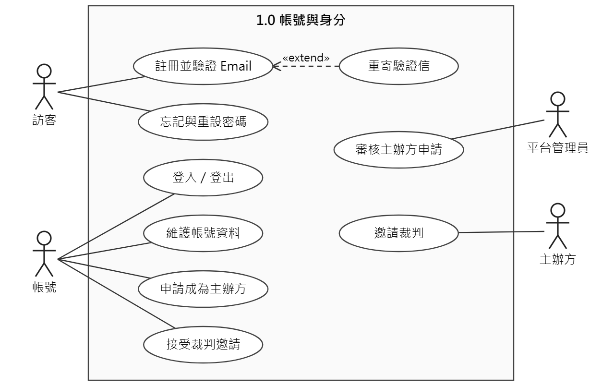

### （二）2.0 功能群：賽事建立與遊戲設定

平台管理員維護遊戲清單、預設值與學校清單；主辦方建立賽事時自動帶入所選遊戲的預設值，並可分輪設定 BO 數、抽籤前修改賽事、取消賽事、查閱操作紀錄，以及重設自訂賽事的報名連結。觀眾可瀏覽公開的賽事資訊。

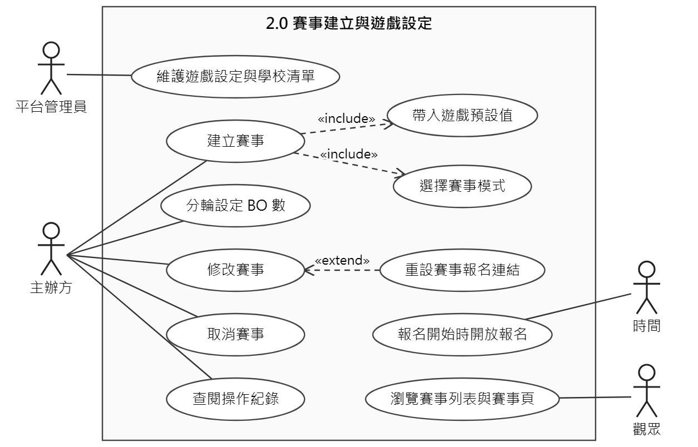

### （三）3.0 功能群：隊伍與報名

隊長建立隊伍並邀請隊員，選手填寫參賽資料後由隊長送出報名。送出報名必定包含名額判定；校園賽的優先期結算與截止補位由時間觸發。主辦方可檢視段位截圖並退回報名。

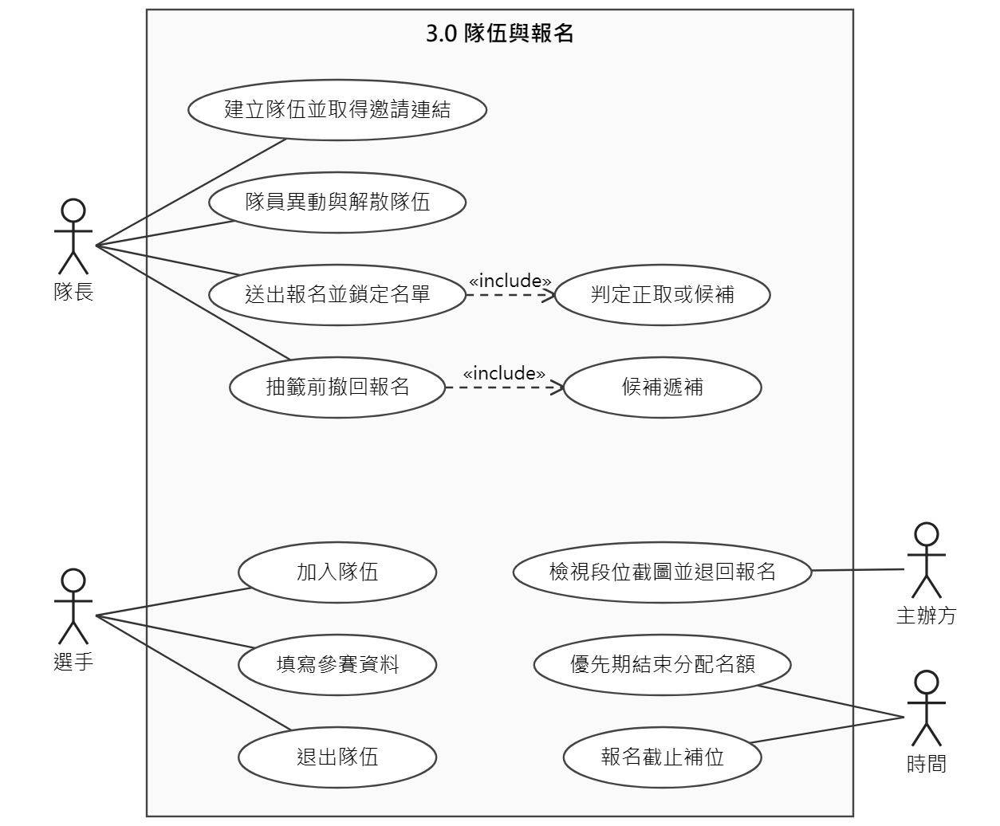

### （四）4.0 功能群：抽籤與對戰表

抽籤可由時間（報名截止）或主辦方（提前抽籤）觸發，並包含產生對戰表與排定場次時間。抽籤後主辦方可修改場次時間、指派裁判；隊長在第一場開打前退賽時，由候補遞補。

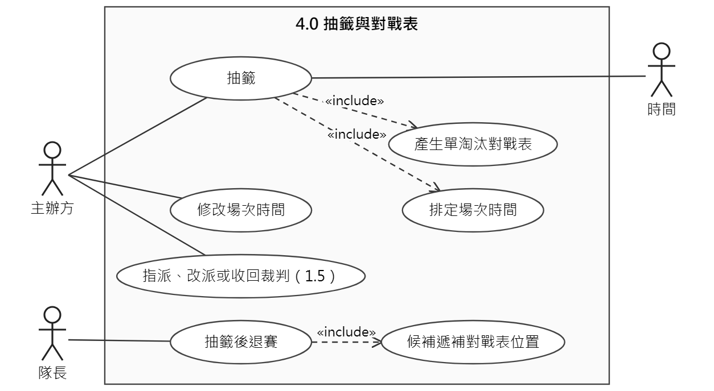

### （五）5.0 功能群：場次進行

隊長在開賽前報到，裁判逐局登錄比分並送出系列結果，勝隊隊長上傳結算截圖。逾時判棄權與申訴期滿自動確認由時間觸發，確認後必定進行晉級推進。

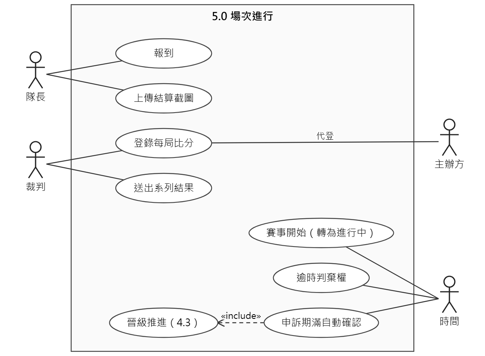

### （六）6.0 功能群：申訴與檢舉

隊長在申訴期內對場次結果申訴，或在賽事結束前對他隊資格檢舉；主辦方處理申訴（維持或更正）與查證檢舉（駁回或取消資格）。取消資格包含對戰表頂替；申訴快逾期時，系統提醒主辦方。

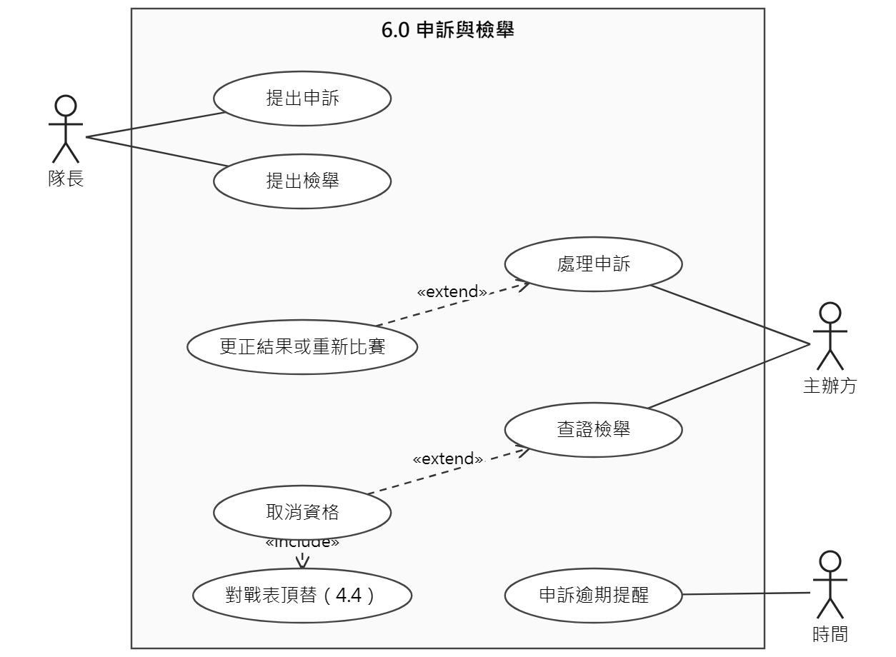

### （七）7.0 功能群：觀賽與通知

觀眾不登入就能瀏覽賽事、對戰樹與場次；登入的帳號可在通知中心查看通知。賽事中發生重要事件時，系統以站內通知與 Email 通知相關的人。

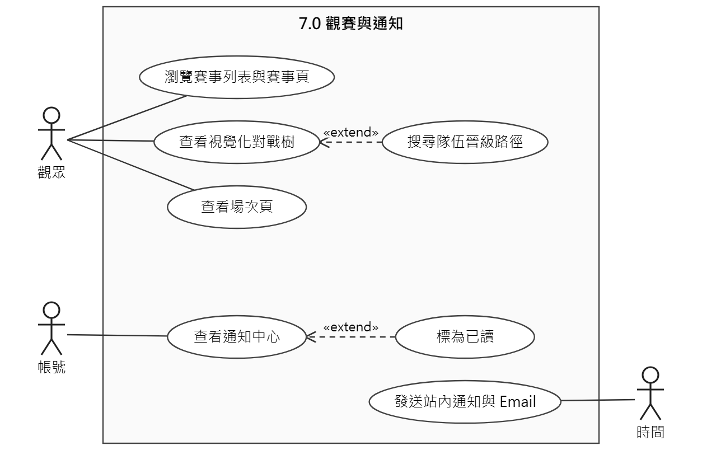

## 二、核心 Use Case 規格說明

本節挑選影響核心流程、也最能體現系統規則的三個使用案例，說明其操作流程、例外狀況與系統回應，作為設計、實作與測試的依據。

### （一）隊長送出報名

| 項目 | 說明 |
| --- | --- |
| Use Case 名稱 | 隊長送出報名 |
| 主要角色 | 隊長 |
| 次要角色 | 系統 |
| 關聯功能群 | 隊伍與報名、賽事建立與遊戲設定 |
| 對應需求 | FR-13、FR-14、FR-15、FR-39、NFR-1 |
| 優先順序 | 高 |

- **前置條件**
  1. 隊長已登入，且 Email 已驗證。
  2. 賽事狀態為「開放報名」，且目前在報名期間內。
  3. 隊伍名單人數達到先發人數，所有隊員都已填完遊戲 ID、段位與段位截圖。
- **觸發事件**：隊長在隊伍頁按下「送出報名」。
- **主要流程**
  1. 系統提示「送出後名單將鎖定」，隊長確認送出。
  2. 系統鎖住該賽事的資料列，使同時送出的報名依序處理。
  3. 系統確認送出者是隊長、名單完整，且（校園賽）所有隊員同校。
  4. 系統寫入學校、平均段位積分與送出時間的快照，並鎖定名單。
  5. 系統依目前階段判定結果：優先期內為「已送出・待分配」；先搶期內立即判定正取或候補。
  6. 系統寫入操作紀錄並發出報名結果通知。
  7. 畫面顯示結果；候補時顯示「候補第 N 位」。
- **例外流程**
  - 2a. 不在報名期間：系統拒絕並顯示原因，流程結束。
  - 3a. 名單不完整，或（校園賽）有隊員未設定學校、隊員學校不一致：系統拒絕並逐項列出缺少的條件，名單不鎖定。
  - 5a. 先搶期名額已滿、同校在優先期已有報名，或同校已有隊伍在先搶期取得正取：列為候補，並顯示候補順位；這些候補在報名截止時都可參加截止補位。
  - 5b. 自訂賽事：不檢查學校，依送出先後判定正取或候補。
- **後置條件**
  1. 報名狀態由「組隊中」改為已送出・待分配、正取或候補；名單鎖定，只有被主辦方退回時才解鎖。
  2. 正取隊數不超過名額。
  3. 操作紀錄完整，該隊隊長與選手收到站內通知與 Email。

### （二）裁判登錄比分與送出系列結果

| 項目 | 說明 |
| --- | --- |
| Use Case 名稱 | 裁判登錄比分與送出系列結果 |
| 主要角色 | 裁判（場次未指派裁判時為代登的主辦方） |
| 次要角色 | 隊長、系統（時間） |
| 關聯功能群 | 場次進行、抽籤與對戰表 |
| 對應需求 | FR-24、FR-26、FR-27、FR-29、FR-21 |
| 優先順序 | 高 |

- **前置條件**
  1. 場次已指派裁判，且該裁判已接受該賽事的邀請；場次未指派裁判時，改由該賽事的主辦方代為登錄。
  2. 兩隊隊長都已報到，裁判在場次頁看到「可開始」。
- **觸發事件**：裁判在場次頁登錄第一局的結果。
- **主要流程**
  1. 每打完一局，裁判依遊戲的比分型態登錄該局結果（選勝隊，或輸入回合比分如 13:11）。
  2. 系統鎖住該場次並記錄局結果；第一局登錄後，場次狀態變為「進行中」。
  3. 一隊達到該輪 BO 的勝局門檻時，系統停止新增局數，並算出系列結果（如 2:1）。
  4. 裁判送出系列結果，系統鎖定結果，記錄送出者與時間，場次進入「申訴期」並開始倒數。
  5. 申訴期滿且無人申訴，系統自動將場次改為「已確認」，勝隊填入下一輪的位置；下一場兩隊都確定時，系統開始計算該場的棄權期限。
  6. 下一輪對位確定後，系統通知兩隊隊長下一場的對手與時間。
- **例外流程**
  - 1a. 回合比分平手：無法送出。
  - 1b. 不是被指派的裁判（場次已指派時），或不是該賽事主辦方（場次未指派時）：系統拒絕。
  - 4a. 送出前發現某局登錄錯誤：裁判修改該局，系列結果重新計算。
  - 5a. 申訴期內有隊長提出申訴：場次改為「申訴中」，勝隊不晉級，改由主辦方處理（見（三））。
- **後置條件**
  1. 各局比分與系列結果已鎖定，送出後裁判不能再修改。
  2. 勝隊已晉級，或場次等待申訴處理。
  3. 每一次登錄與送出都留下操作紀錄。

### （三）隊長提出申訴與主辦方處理

| 項目 | 說明 |
| --- | --- |
| Use Case 名稱 | 隊長提出申訴與主辦方處理 |
| 主要角色 | 隊長、主辦方 |
| 次要角色 | 系統 |
| 關聯功能群 | 申訴與檢舉、場次進行、抽籤與對戰表 |
| 對應需求 | FR-30、FR-31、FR-25、FR-21 |
| 優先順序 | 高 |

- **前置條件**
  1. 場次狀態為「申訴期」或「申訴中」（裁判已送出系列結果，或已判棄權），且尚未超過申訴期限。
  2. 提出者是該場兩隊之一的隊長，且該隊尚未對此場次申訴過。
- **觸發事件**：隊長在場次頁按下「提出申訴」。
- **主要流程**
  1. 隊長填寫申訴說明，可附上截圖，送出申訴。
  2. 系統確認仍在申訴期限內，建立申訴；場次若為「申訴期」則改為「申訴中」，並通知主辦方。
  3. 主辦方在待處理清單開啟該場次的申訴（兩隊都申訴時一併列出），檢視說明、各局比分與結算截圖。
  4. 主辦方選擇「維持原結果」或「更正結果」（重新輸入各局結果，由系統重算系列結果），並填寫理由。
  5. 系統將該場次的申訴全部結案、場次改為「已確認」，觸發晉級，並把處理結果與理由通知兩隊。
- **例外流程**
  - 1a. 申訴期限已過：系統拒絕。
  - 1b. 同一隊已對此場次申訴過：系統拒絕。
  - 1c. 另一隊已先提出申訴（場次為「申訴中」）：仍可在申訴期限內提出，由主辦方一併處理。
  - 4a. 等待這個結果的下一場預定開始前 1 小時仍未處理（決賽與季軍賽為申訴提出後 1 小時）：系統提醒主辦方一次。
  - 4b. 申訴尚未處理時：等待這個結果的下一場（準決賽則含季軍賽）不開放報到、不起算棄權期限；處理完成、兩隊確定後，棄權期限從處理完成時間重新起算。同一輪的其他場次不受影響。
  - 4c. 申訴對象是棄權判定、主辦方認定判錯：選擇「重新比賽」並設定新時間；申訴結案，場次回到「待開打」，清除棄權判定與報到紀錄，依新時間重新報到並起算棄權期限。
- **後置條件**
  1. 申訴結案，處理理由與處理者已保存。
  2. 場次結果確定，勝隊（可能因更正而改變）晉級。
  3. 更正前後的比分都記錄在操作紀錄中。

## 三、泳道圖

本節以泳道圖呈現跨角色的兩段主要流程：從建立賽事到公布對戰表，以及開賽日從報到到晉級。

### （一）賽事建立到公布對戰表

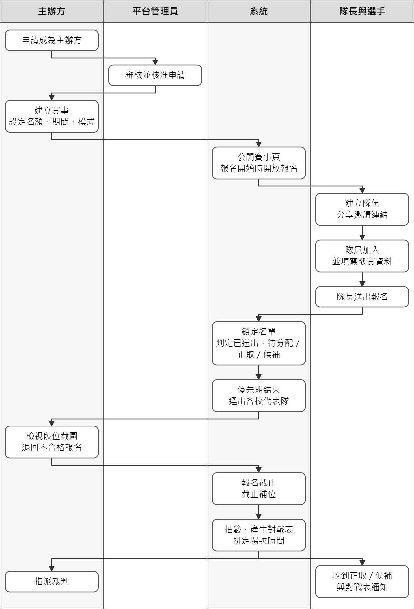

1. **主辦方**：申請成為主辦方並經核准後建立賽事；報名期間檢視段位截圖、退回不合格的報名；抽籤後指派裁判。
2. **平台管理員**：審核主辦方申請，只讓真實社團取得建立賽事的權限。
3. **隊長與選手**：建立隊伍、邀請隊員、填寫參賽資料並送出報名，之後收到分配結果與對戰表通知。
4. **系統**：負責所有規則判斷與時間驅動的動作，包含名單鎖定、三階段名額分配、截止補位、抽籤與排定賽程。

### （二）開賽日：報到到晉級

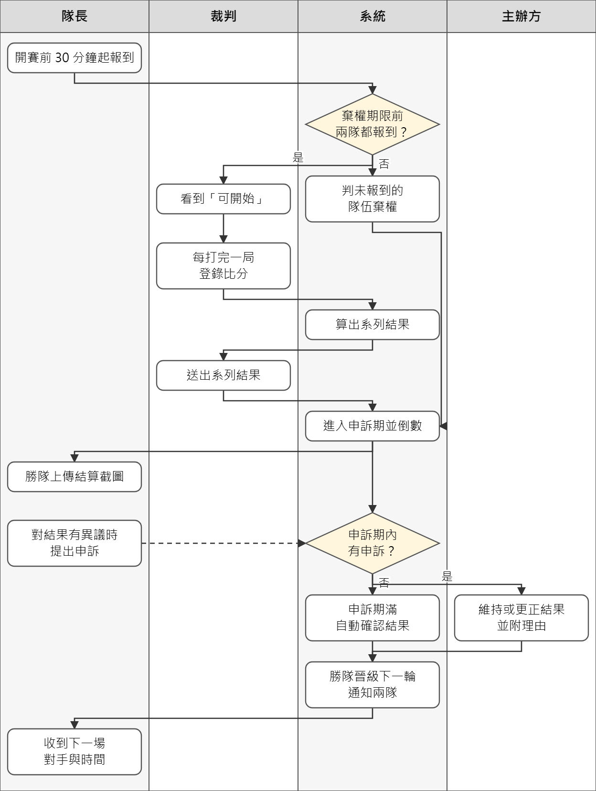

1. **隊長**：開賽前 30 分鐘起報到；比賽結束後勝隊上傳結算截圖；對結果有異議時在申訴期內申訴。
2. **裁判**：兩隊都報到後開始比賽，逐局登錄比分並送出系列結果。
3. **系統**：判斷是否棄權、算出系列結果、管理申訴期倒數，期滿自動確認並推進晉級。
4. **主辦方**：只在有人申訴時介入，維持或更正結果。

## 四、狀態圖

賽事、報名與場次是系統中三個有狀態的實體，狀態只能依下列轉換改變，任何不在圖上的轉換都會被系統拒絕。

### （一）賽事狀態

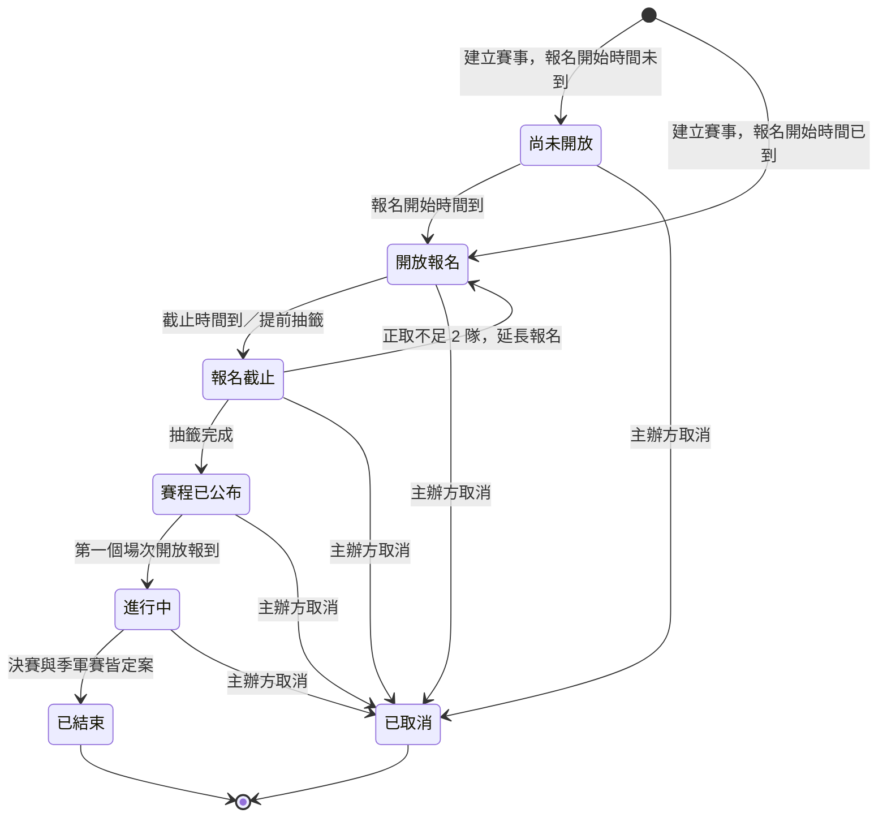

「尚未開放」時主辦方可以修改所有設定，開放報名後只能放寬。「報名開始時間到」與「第一個場次開放報到」（最早場次的預定開始前 30 分鐘）都是時間觸發，由 worker 執行。「定案」指場次已確認，或季軍賽已取消。

### （二）報名狀態

「組隊中」（建立隊伍後、尚未送出）與「已送出・待分配」（優先期內送出、等待優先期結束）都是正式的報名狀態。因此報名紀錄在建立隊伍時就產生，送出時才寫入學校、平均段位積分與送出時間的快照。

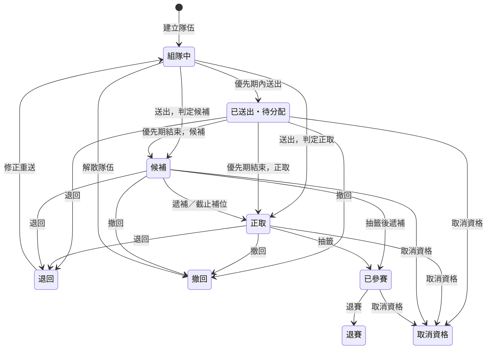

圖中各轉換的條件如下：

1. **送出**：校園賽在優先期內送出為「已送出・待分配」；先搶期與自訂賽事送出時立即判定正取或候補。
2. **遞補**：抽籤前的遞補與截止補位讓候補轉為正取；抽籤後有隊伍退賽或被取消資格時，被遞補的候補直接轉為「已參賽」並接手對戰表上的位置。抽籤時，正取隊伍轉為「已參賽」，候補隊伍保持候補。
3. **退回、撤回**：只在抽籤前；退回由主辦方附原因執行，名單解鎖後由隊伍修正重送，重送時重新寫入快照與送出時間。組隊中的隊伍被隊長解散時也轉為撤回。**退賽**只在第一場開打前。
4. **取消資格**：檢舉在賽事結束前都能對已送出報名的隊伍提出，因此待分配、正取、候補與已參賽都可能因檢舉屬實被取消資格。

### （三）場次狀態

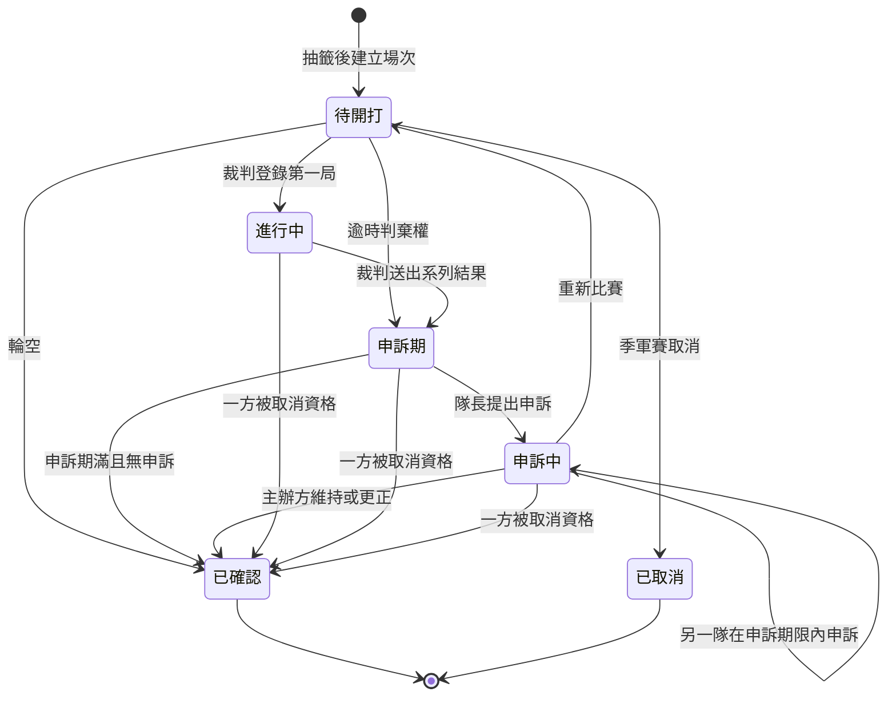

「待開打 → 申訴期」是逾時判棄權，一方或雙方未報到都適用。「待開打 → 已確認」用於輪空：對手位置確定不會有隊伍時（前一場雙方棄權，或退賽、取消資格後無人遞補），系統直接確認並讓另一方晉級。「已取消」只用於準決賽沒有產生勝隊時的季軍賽。場次停在「待開打」等待隊伍確定時，不開放報到、也不起算棄權期限（見貳、三 5.2）。「申訴中 → 待開打」只用於判棄權的場次經申訴後安排重新比賽（FR-31）。各種結果的欄位填法見資料表說明的 MATCH。

## 五、實體關聯圖

本系統的資料模型以「賽事、隊伍、報名、場次」為主軸：賽事複製遊戲設定、收到隊伍報名，抽籤後產生對戰表與場次；場次記錄每局比分、報到、結算截圖，並可能收到申訴；所有重要事件寫入事件與操作紀錄，再產生通知。全系統共 24 張資料表，為了閱讀清楚，依功能分成六張圖呈現，跨圖出現的實體（如 ACCOUNT、TOURNAMENT、TEAM、MATCH）是同一張資料表。

### （一）帳號

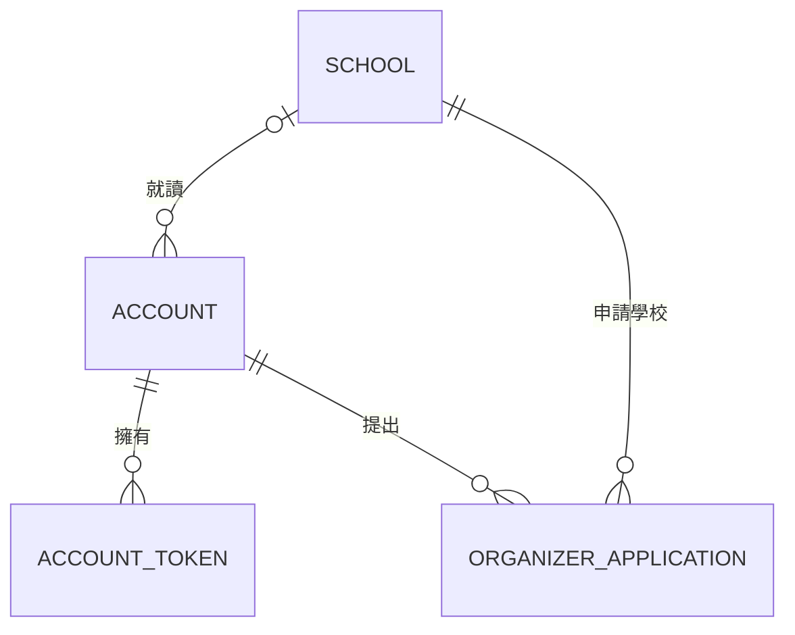

### （二）賽事設定

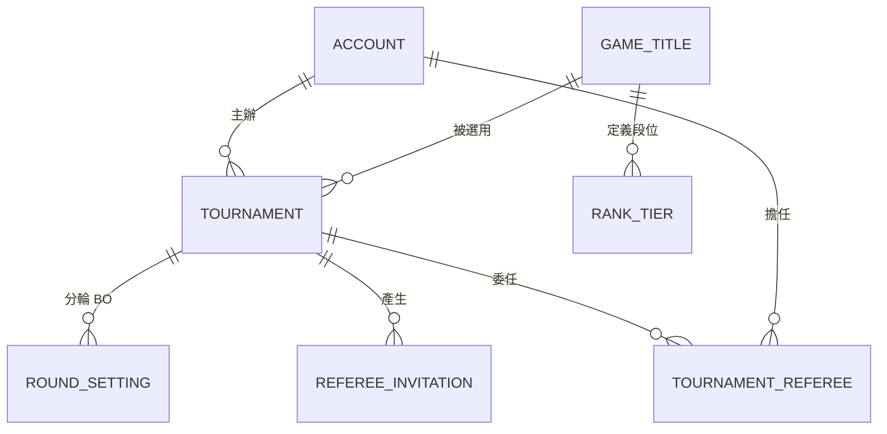

### （三）隊伍與報名

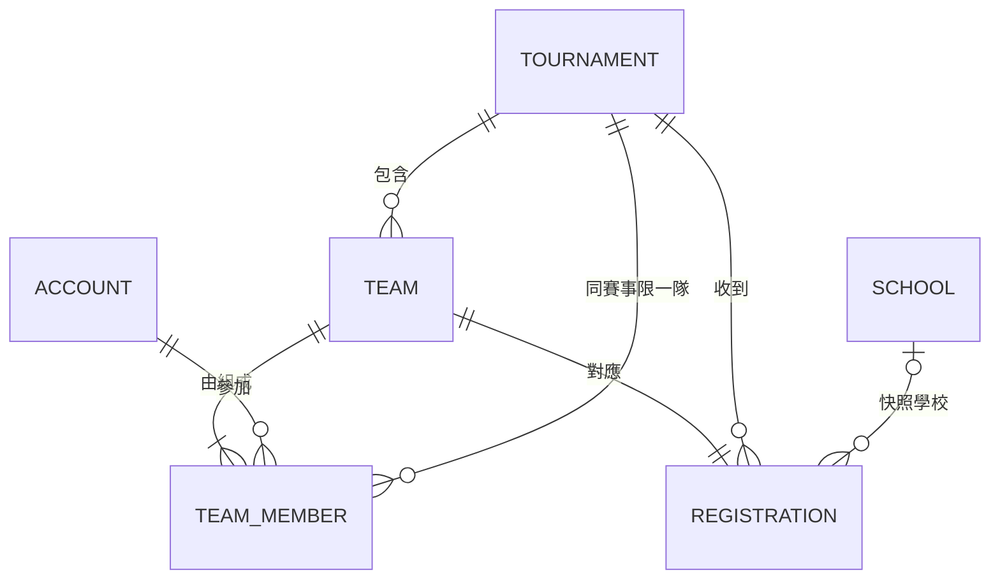

### （四）對戰

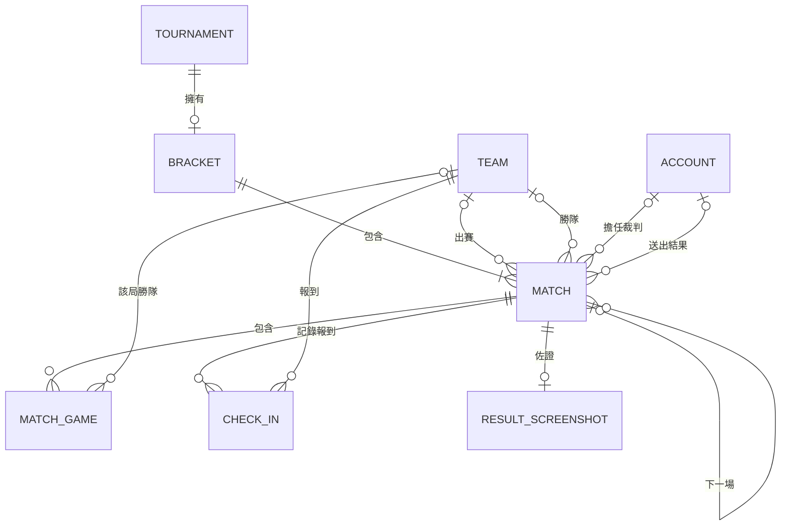

### （五）爭議

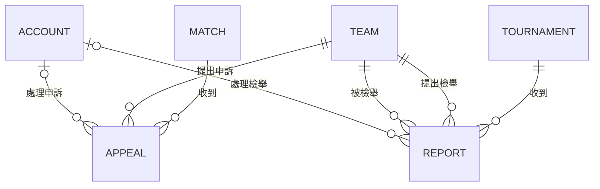

### （六）通知與紀錄

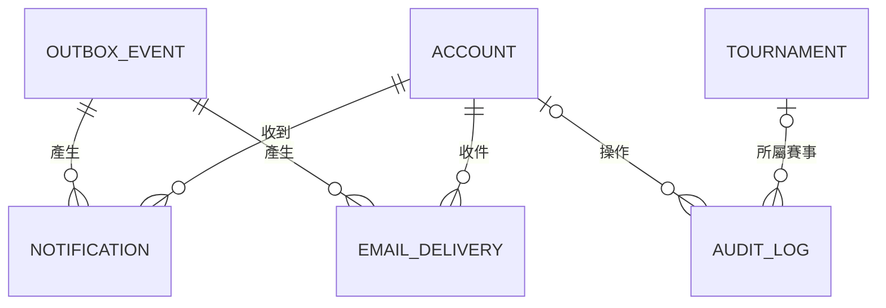

## 六、資料表說明

資料表欄位以《物件設計文件》的類別設計為基礎，補上主鍵、外鍵、建立時間與唯一鍵；所有主鍵為 UUID，時間一律以 UTC 存放（timestamptz）。除了以業務時間記錄建立時刻的 BRACKET.drawn_at、CHECK_IN.at 與 AUDIT_LOG.at 之外，每張表都有 `created_at`。由多個欄位組成的唯一鍵寫在各表下方。實作後以 Alembic 遷移檔為準。

### （一）ACCOUNT 帳號

| 欄位 | 資料型別 | PK／FK | 說明 |
| --- | --- | --- | --- |
| id | UUID | PK | 帳號主鍵 |
| email | VARCHAR | UNIQUE | 登入用 Email |
| hashed_password | VARCHAR |  | 雜湊後的密碼 |
| email_verified | BOOLEAN |  | 是否已完成 Email 驗證 |
| display_name | VARCHAR |  | 顯示名稱 |
| school_id | UUID | FK → SCHOOL.id | 學校（選填，從學校清單選擇；參加校園賽時必須設定） |
| is_platform_admin | BOOLEAN |  | 是否為平台管理員 |
| is_organizer | BOOLEAN |  | 是否具主辦方權限 |
| credentials_version | INTEGER |  | 登入憑證版本；重設密碼時加 1，使先前簽發的登入憑證全部失效 |
| created_at | TIMESTAMPTZ |  | 建立時間 |

### （二）SCHOOL 學校

| 欄位 | 資料型別 | PK／FK | 說明 |
| --- | --- | --- | --- |
| id | UUID | PK | 主鍵 |
| name | VARCHAR | UNIQUE | 學校正式名稱（例如「國立臺灣大學」） |
| created_at | TIMESTAMPTZ |  | 建立時間 |

學校清單以教育部大專校院名錄為初始資料，由平台管理員維護。同校檢查、每校名額與代表隊都以 `school_id` 比對，不比對文字。

### （三）ACCOUNT_TOKEN 一次性 token

| 欄位 | 資料型別 | PK／FK | 說明 |
| --- | --- | --- | --- |
| id | UUID | PK | 主鍵 |
| account_id | UUID | FK → ACCOUNT.id | 所屬帳號 |
| purpose | VARCHAR（列舉） |  | 用途：verify_email、reset_password |
| token_hash | VARCHAR |  | token 雜湊值，不存明文 |
| expires_at | TIMESTAMPTZ |  | 到期時間（驗證 24 小時、重設 1 小時） |
| used_at | TIMESTAMPTZ |  | 使用時間；空值代表未使用 |
| created_at | TIMESTAMPTZ |  | 產生時間 |

### （四）ORGANIZER_APPLICATION 主辦方申請

| 欄位 | 資料型別 | PK／FK | 說明 |
| --- | --- | --- | --- |
| id | UUID | PK | 主鍵 |
| account_id | UUID | FK → ACCOUNT.id | 申請人 |
| club_name | VARCHAR |  | 社團名稱 |
| school_id | UUID | FK → SCHOOL.id | 社團所屬學校 |
| status | VARCHAR（列舉） |  | 待審核、核准、退回 |
| reject_reason | TEXT |  | 退回原因 |
| created_at | TIMESTAMPTZ |  | 申請時間 |

### （五）GAME_TITLE 遊戲

| 欄位 | 資料型別 | PK／FK | 說明 |
| --- | --- | --- | --- |
| id | UUID | PK | 主鍵 |
| name | VARCHAR | UNIQUE | 遊戲名稱 |
| starters | INTEGER |  | 每隊先發人數 |
| substitutes | INTEGER |  | 每隊替補人數 |
| default_bo | INTEGER |  | 預設 BO 數，限 1、3、5、7 |
| game_minutes | INTEGER |  | 每局預估時間（分鐘），用於檢查每輪間隔與排定賽程 |
| score_type | VARCHAR（列舉） |  | 比分型態：win_loss（只記勝負）、rounds（回合比分） |
| created_at | TIMESTAMPTZ |  | 建立時間 |

### （六）RANK_TIER 段位對照

| 欄位 | 資料型別 | PK／FK | 說明 |
| --- | --- | --- | --- |
| id | UUID | PK | 主鍵 |
| game_id | UUID | FK → GAME_TITLE.id | 所屬遊戲 |
| name | VARCHAR |  | 段位名稱 |
| score | INTEGER |  | 對應的段位積分 |
| created_at | TIMESTAMPTZ |  | 建立時間 |

唯一鍵：（game_id, name），同一遊戲的段位名稱不重複。

### （七）TOURNAMENT 賽事

| 欄位 | 資料型別 | PK／FK | 說明 |
| --- | --- | --- | --- |
| id | UUID | PK | 主鍵 |
| organizer_id | UUID | FK → ACCOUNT.id | 主辦方 |
| game_id | UUID | FK → GAME_TITLE.id | 選用的遊戲 |
| name | VARCHAR |  | 賽事名稱 |
| capacity | INTEGER |  | 名額（隊數） |
| mode | VARCHAR（列舉） |  | 賽事模式：campus（校園賽）、custom（自訂） |
| registration_start | TIMESTAMPTZ |  | 報名開始時間；未到時賽事為尚未開放 |
| registration_end | TIMESTAMPTZ |  | 報名截止時間 |
| priority_hours | INTEGER |  | 優先期長度（小時）；自訂賽事為空 |
| start_at | TIMESTAMPTZ |  | 開賽日期 |
| round_interval_minutes | INTEGER |  | 每輪間隔（分鐘），不得小於「棄權時限＋預設 BO 數 × 每局預估時間＋申訴期」 |
| forfeit_minutes | INTEGER |  | 棄權時限，至少 15 分鐘 |
| appeal_minutes | INTEGER |  | 申訴期，至少 30 分鐘 |
| status | VARCHAR（列舉） |  | 賽事狀態：尚未開放、開放報名、報名截止、賽程已公布、進行中、已結束、已取消 |
| livestream_url | VARCHAR |  | 直播連結（選填） |
| game_snapshot | JSONB |  | 建立時複製的遊戲設定（人數、BO、每局預估時間、比分型態、段位對照） |
| invite_token | VARCHAR | UNIQUE | 自訂賽事的報名連結 token；校園賽為空；主辦方重設時更換，舊連結立即失效 |
| created_at | TIMESTAMPTZ |  | 建立時間 |

### （八）ROUND_SETTING 分輪設定

| 欄位 | 資料型別 | PK／FK | 說明 |
| --- | --- | --- | --- |
| id | UUID | PK | 主鍵 |
| tournament_id | UUID | FK → TOURNAMENT.id | 所屬賽事 |
| round_no | INTEGER |  | 輪次 |
| bo | INTEGER |  | 該輪 BO 數，限 1、3、5、7 |
| created_at | TIMESTAMPTZ |  | 建立時間 |

唯一鍵：（tournament_id, round_no），每一輪只有一筆設定。

### （九）REFEREE_INVITATION 裁判邀請

| 欄位 | 資料型別 | PK／FK | 說明 |
| --- | --- | --- | --- |
| id | UUID | PK | 主鍵 |
| tournament_id | UUID | FK → TOURNAMENT.id | 所屬賽事 |
| token | VARCHAR | UNIQUE | 邀請連結 token |
| created_at | TIMESTAMPTZ |  | 產生時間 |
| expires_at | TIMESTAMPTZ |  | 到期時間（7 天）；重新產生時舊邀請立即到期 |

### （十）TOURNAMENT_REFEREE 賽事裁判

| 欄位 | 資料型別 | PK／FK | 說明 |
| --- | --- | --- | --- |
| id | UUID | PK | 主鍵 |
| tournament_id | UUID | FK → TOURNAMENT.id | 賽事 |
| account_id | UUID | FK → ACCOUNT.id | 擔任裁判的帳號 |
| created_at | TIMESTAMPTZ |  | 接受邀請的時間 |

唯一鍵：（tournament_id, account_id），同一帳號在同一賽事只會是一筆裁判身分。

### （十一）TEAM 隊伍

| 欄位 | 資料型別 | PK／FK | 說明 |
| --- | --- | --- | --- |
| id | UUID | PK | 主鍵 |
| tournament_id | UUID | FK → TOURNAMENT.id | 所屬賽事（隊伍只屬於一個賽事） |
| name | VARCHAR |  | 隊名 |
| invite_token | VARCHAR | UNIQUE | 隊伍邀請連結 token |
| created_at | TIMESTAMPTZ |  | 建立時間 |

### （十二）TEAM_MEMBER 隊員

| 欄位 | 資料型別 | PK／FK | 說明 |
| --- | --- | --- | --- |
| id | UUID | PK | 主鍵 |
| team_id | UUID | FK → TEAM.id | 所屬隊伍 |
| tournament_id | UUID | FK → TOURNAMENT.id | 隊伍所屬的賽事（與 TEAM.tournament_id 相同），用於唯一鍵 |
| account_id | UUID | FK → ACCOUNT.id | 隊員帳號 |
| role | VARCHAR（列舉） |  | captain（隊長）、player（選手）；每隊恰好一位隊長；不區分先發與替補 |
| game_account_id | VARCHAR |  | 遊戲 ID |
| rank_tier | VARCHAR |  | 段位 |
| rank_score | INTEGER |  | 換算後的段位積分 |
| rank_screenshot_key | VARCHAR |  | 段位截圖的檔案鍵值 |
| created_at | TIMESTAMPTZ |  | 加入時間 |

唯一鍵：（tournament_id, account_id），同一帳號在同一賽事只能加入一支隊伍，也不會在同一隊重複出現。

### （十三）REGISTRATION 報名

| 欄位 | 資料型別 | PK／FK | 說明 |
| --- | --- | --- | --- |
| id | UUID | PK | 主鍵 |
| team_id | UUID | FK → TEAM.id，UNIQUE | 報名的隊伍；建立隊伍時同時建立 |
| tournament_id | UUID | FK → TOURNAMENT.id | 賽事 |
| status | VARCHAR（列舉） |  | 報名狀態：組隊中、已送出・待分配、正取、候補、退回、撤回、已參賽、退賽、取消資格 |
| school_id | UUID | FK → SCHOOL.id | 校園賽送出時的學校（快照）；自訂賽事與組隊中為空 |
| avg_rank_score | NUMERIC(6,2) |  | 送出時名單所有成員（含替補）的平均段位積分（快照）；組隊中為空 |
| submitted_at | TIMESTAMPTZ |  | 送出時間（快照，被退回後重送時更新）；組隊中為空 |
| reject_reason | TEXT |  | 退回原因 |
| created_at | TIMESTAMPTZ |  | 建立時間（與隊伍同時） |

### （十四）BRACKET 對戰表

| 欄位 | 資料型別 | PK／FK | 說明 |
| --- | --- | --- | --- |
| id | UUID | PK | 主鍵 |
| tournament_id | UUID | FK → TOURNAMENT.id，UNIQUE | 賽事 |
| size | INTEGER |  | 對戰表大小 P（2 的次方） |
| rounds | INTEGER |  | 輪數 |
| drawn_at | TIMESTAMPTZ |  | 抽籤時間（即建立時間） |

### （十五）MATCH 場次

| 欄位 | 資料型別 | PK／FK | 說明 |
| --- | --- | --- | --- |
| id | UUID | PK | 主鍵 |
| bracket_id | UUID | FK → BRACKET.id | 所屬對戰表 |
| round_no | INTEGER |  | 輪次 |
| slot_no | INTEGER |  | 該輪中的位置（季軍賽與決賽同輪，排在決賽之後） |
| is_third_place | BOOLEAN |  | 是否為季軍賽 |
| team_a_id | UUID | FK → TEAM.id | A 隊；尚未確定時為空 |
| team_b_id | UUID | FK → TEAM.id | B 隊；尚未確定時為空 |
| referee_account_id | UUID | FK → ACCOUNT.id | 指派的裁判帳號；指派時檢查該帳號是此賽事的裁判 |
| scheduled_at | TIMESTAMPTZ |  | 預定開始時間 |
| status | VARCHAR（列舉） |  | 場次狀態：待開打、進行中、申訴期、申訴中、已確認、已取消 |
| outcome | VARCHAR（列舉） |  | 結果類型（見下表）；尚無結果時為空 |
| winner_id | UUID | FK → TEAM.id | 勝隊 |
| wins_a | INTEGER |  | A 隊勝局數 |
| wins_b | INTEGER |  | B 隊勝局數 |
| submitted_by | UUID | FK → ACCOUNT.id | 送出系列結果的帳號（裁判或代登的主辦方） |
| submitted_at | TIMESTAMPTZ |  | 送出系列結果的時間 |
| confirmed_at | TIMESTAMPTZ |  | 場次變為已確認的時間 |
| forfeit_deadline | TIMESTAMPTZ |  | 棄權期限；兩隊都確定時才設定，空值代表尚未起算 |
| appeal_deadline | TIMESTAMPTZ |  | 申訴期限 |
| next_match_id | UUID | FK → MATCH.id | 勝隊晉級的下一場 |
| created_at | TIMESTAMPTZ |  | 建立時間 |

唯一鍵：（bracket_id, round_no, slot_no）。

各種結果類型的欄位填法如下：

| outcome | 情境 | winner_id | wins_a／wins_b |
| --- | --- | --- | --- |
| played 正常完賽 | 裁判送出系列結果 | 先達勝局門檻的一方 | 各局結果 |
| forfeit 一方棄權 | 逾時只有一隊報到 | 已報到的一方 | 0／0 |
| double_forfeit 雙方棄權 | 逾時兩隊都未報到 | 空 | 0／0 |
| walkover 輪空 | 一方位置確定不會有隊伍 | 有隊伍的一方；兩方都沒有時為空 | 0／0 |
| disqualified 取消資格 | 一方在本場進行中、申訴期或申訴中被取消資格 | 對手 | 保留已登錄的局數 |

季軍賽取消時，場次狀態為「已取消」，outcome 與 winner_id 為空。申訴更正後依更正的各局結果重新填寫，outcome 改為 played；申訴後重新比賽時，outcome、winner_id 與勝局數清空，場次回到待開打。

### （十六）MATCH_GAME 局

| 欄位 | 資料型別 | PK／FK | 說明 |
| --- | --- | --- | --- |
| id | UUID | PK | 主鍵 |
| match_id | UUID | FK → MATCH.id | 所屬場次 |
| game_no | INTEGER |  | 第幾局 |
| winner_team_id | UUID | FK → TEAM.id | 該局勝隊 |
| score_a | INTEGER |  | A 隊回合數（回合比分型態） |
| score_b | INTEGER |  | B 隊回合數（回合比分型態） |
| created_at | TIMESTAMPTZ |  | 登錄時間 |

唯一鍵：（match_id, game_no）。

### （十七）CHECK_IN 報到

| 欄位 | 資料型別 | PK／FK | 說明 |
| --- | --- | --- | --- |
| id | UUID | PK | 主鍵 |
| match_id | UUID | FK → MATCH.id | 場次 |
| team_id | UUID | FK → TEAM.id | 報到的隊伍 |
| at | TIMESTAMPTZ |  | 報到時間 |

唯一鍵：（match_id, team_id），每隊在每個場次只報到一次。

### （十八）RESULT_SCREENSHOT 結算截圖

| 欄位 | 資料型別 | PK／FK | 說明 |
| --- | --- | --- | --- |
| id | UUID | PK | 主鍵 |
| match_id | UUID | FK → MATCH.id，UNIQUE | 場次 |
| file_key | VARCHAR |  | 截圖檔案鍵值 |
| created_at | TIMESTAMPTZ |  | 上傳時間 |

### （十九）APPEAL 申訴

| 欄位 | 資料型別 | PK／FK | 說明 |
| --- | --- | --- | --- |
| id | UUID | PK | 主鍵 |
| match_id | UUID | FK → MATCH.id | 被申訴的場次 |
| team_id | UUID | FK → TEAM.id | 提出申訴的隊伍 |
| description | TEXT |  | 申訴說明 |
| attachment_key | VARCHAR |  | 附件截圖鍵值 |
| status | VARCHAR（列舉） |  | 處理中、已結案 |
| decision | VARCHAR（列舉） |  | 維持原結果、更正結果、重新比賽（只用於棄權判定）；同一場次的申訴一次處理，決定與理由相同 |
| reason | TEXT |  | 處理理由 |
| handled_by | UUID | FK → ACCOUNT.id | 處理的主辦方 |
| reminded_at | TIMESTAMPTZ |  | 逾期提醒的寄出時間；空值代表尚未提醒，每筆申訴只提醒一次 |
| created_at | TIMESTAMPTZ |  | 提出時間 |

唯一鍵：（match_id, team_id），每支隊伍對同一場次只能申訴一次。

### （二十）REPORT 檢舉

| 欄位 | 資料型別 | PK／FK | 說明 |
| --- | --- | --- | --- |
| id | UUID | PK | 主鍵 |
| tournament_id | UUID | FK → TOURNAMENT.id | 賽事 |
| reporter_team_id | UUID | FK → TEAM.id | 檢舉的隊伍 |
| reported_team_id | UUID | FK → TEAM.id | 被檢舉的隊伍 |
| description | TEXT |  | 檢舉說明 |
| attachment_key | VARCHAR |  | 附件截圖鍵值 |
| status | VARCHAR（列舉） |  | 處理中、駁回、屬實 |
| reason | TEXT |  | 處理理由 |
| handled_by | UUID | FK → ACCOUNT.id | 處理的主辦方 |
| created_at | TIMESTAMPTZ |  | 提出時間 |

### （二十一）NOTIFICATION 站內通知

| 欄位 | 資料型別 | PK／FK | 說明 |
| --- | --- | --- | --- |
| id | UUID | PK | 主鍵 |
| account_id | UUID | FK → ACCOUNT.id | 收件帳號 |
| event_id | UUID | FK → OUTBOX_EVENT.id | 來源事件 |
| type | VARCHAR |  | 通知類型 |
| title | VARCHAR |  | 通知標題 |
| link | VARCHAR |  | 點擊後導向的頁面 |
| created_at | TIMESTAMPTZ |  | 建立時間 |
| read_at | TIMESTAMPTZ |  | 已讀時間；空值代表未讀 |

唯一鍵：（event_id, account_id），同一事件不會重複通知同一人。

### （二十二）EMAIL_DELIVERY Email 寄送紀錄

| 欄位 | 資料型別 | PK／FK | 說明 |
| --- | --- | --- | --- |
| id | UUID | PK | 主鍵 |
| event_id | UUID | FK → OUTBOX_EVENT.id | 來源事件 |
| account_id | UUID | FK → ACCOUNT.id | 收件帳號 |
| status | VARCHAR（列舉） |  | 待寄、已寄出、失敗 |
| attempts | INTEGER |  | 已嘗試次數 |
| last_error | TEXT |  | 最近一次失敗原因 |
| next_attempt_at | TIMESTAMPTZ |  | 下一次可以嘗試寄送的時間；失敗後往後延 |
| created_at | TIMESTAMPTZ |  | 建立時間 |

唯一鍵：（event_id, account_id）。

### （二十三）AUDIT_LOG 操作紀錄

| 欄位 | 資料型別 | PK／FK | 說明 |
| --- | --- | --- | --- |
| id | UUID | PK | 主鍵 |
| seq | BIGINT |  | 資料庫產生的遞增序號；同一時間的紀錄依寫入順序排列 |
| actor_id | UUID | FK → ACCOUNT.id | 操作者；系統自動執行時為空，代表 system |
| tournament_id | UUID | FK → TOURNAMENT.id | 所屬賽事；帳號類的操作（註冊、主辦方申請等）不屬於任何賽事時為空 |
| action | VARCHAR |  | 動作名稱 |
| entity_type | VARCHAR |  | 對象的實體類型 |
| entity_id | UUID |  | 對象主鍵 |
| before | JSONB |  | 變更前內容 |
| after | JSONB |  | 變更後內容 |
| at | TIMESTAMPTZ |  | 操作時間 |

本表由資料庫 trigger 拒絕 UPDATE 與 DELETE，只能新增；並以（tournament_id, at, seq）建立索引，主辦方查閱自己賽事的紀錄時直接依 tournament_id 篩選，不必跨模組查詢各實體表。

### （二十四）OUTBOX_EVENT 事件

| 欄位 | 資料型別 | PK／FK | 說明 |
| --- | --- | --- | --- |
| id | UUID | PK | 主鍵 |
| type | VARCHAR |  | 事件名稱（過去式，例如 MatchResultConfirmed） |
| payload | JSONB |  | 事件內容（實體 id 與事件特有資料） |
| created_at | TIMESTAMPTZ |  | 建立時間 |
| processed_at | TIMESTAMPTZ |  | worker 處理完成時間；空值代表未處理 |

## 七、類別圖

本節的類別圖為分析層級的領域模型，呈現系統中的核心概念、主要屬性與彼此的關聯與多重性；Service、Repository 等設計層級的類別請見《物件設計文件》。

### （一）帳號、賽事與報名

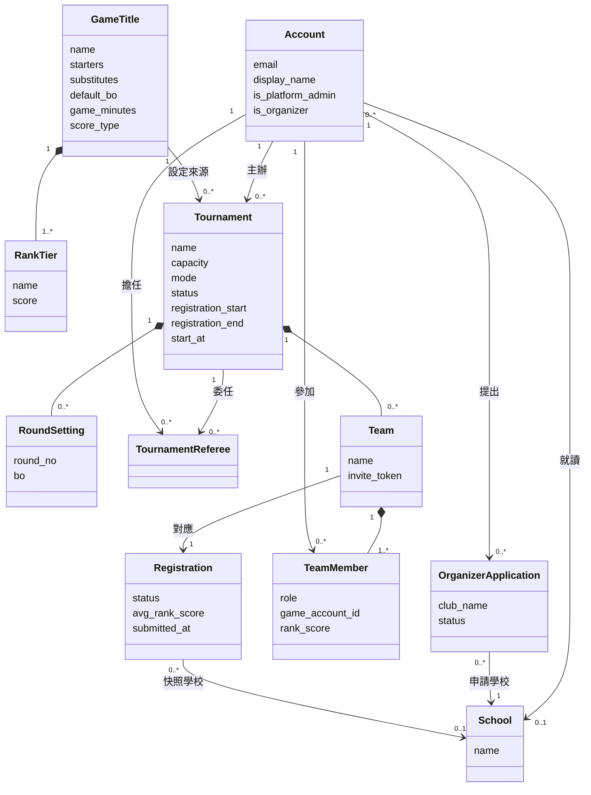

### （二）對戰、爭議與通知

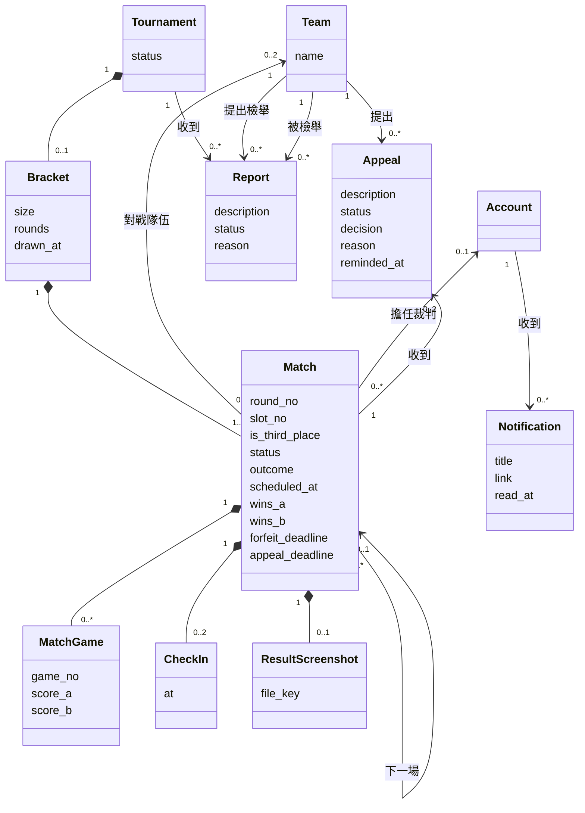

一個場次最多兩筆申訴：兩隊各一筆，第二筆須在申訴期限內提出（場次可能已是「申訴中」）。

## 八、循序圖

### （一）隊長送出報名

下圖描述隊長送出報名時，系統如何以鎖住賽事資料列的方式依序處理同時送出的報名，確保正取隊數不超過名額。整個流程在同一個資料庫交易中完成，操作紀錄與通知事件也寫在同一個交易裡。

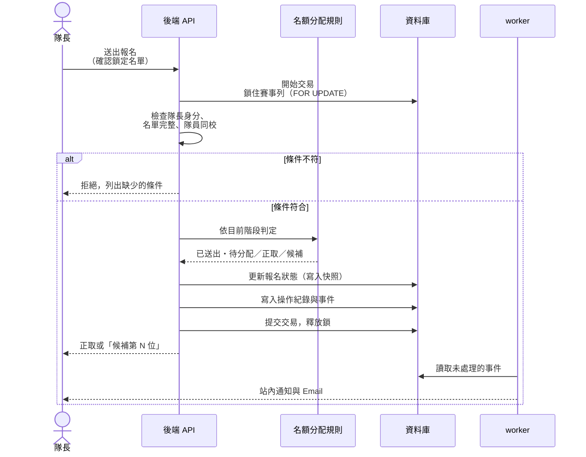

### （二）裁判登錄比分與送出系列結果

下圖描述裁判逐局登錄比分、送出系列結果，以及申訴期滿後由 worker 自動確認並推進晉級的過程。任何對場次的寫入都先鎖住該場次列，避免同時操作互相覆蓋。

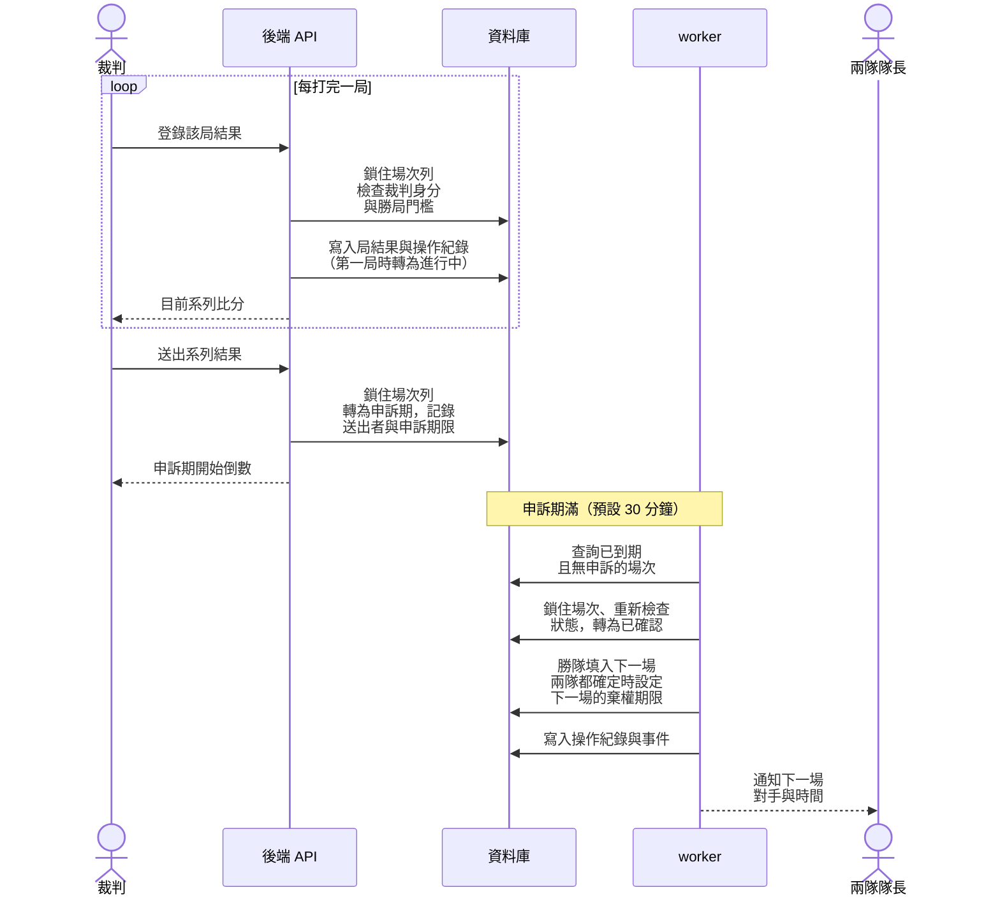

### （三）隊長提出申訴與主辦方處理

下圖描述隊長在申訴期內提出申訴，主辦方維持或更正結果後，系統確認場次並推進晉級的過程。

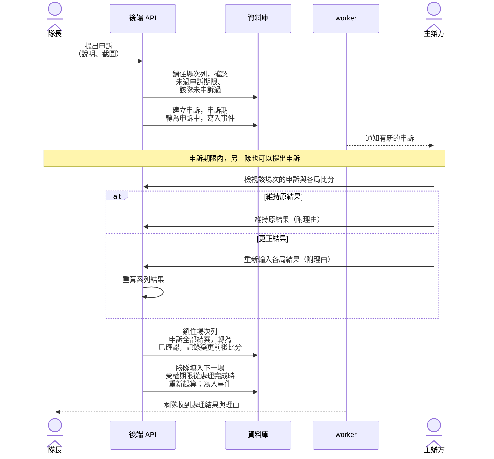

# 肆、附錄：功能需求規格

本附錄列出 FR-1～FR-41 的完整敘述與可測結果，是功能清單（貳、二）各項功能的詳細規格，也是 User Story 驗收條件與期末測試個案的依據。FR 編號沿用專案規劃階段的編號，依功能群排列；名詞以壹、四的名詞定義為準。非功能需求見貳、四。

## 一、1.0 帳號與身分

#### FR-1　註冊與登入

訪客可以用 Email 與密碼註冊帳號並登入，學校為選填、從學校清單選擇；須完成 Email 驗證才能使用報名、申請等功能。

**可測結果：**
- 已註冊的 Email 再次註冊會被拒絕。
- 註冊時可以不選學校；參加校園賽的隊員必須已設定學校（FR-13）。
- 密碼以雜湊保存，資料庫中查不到明文。
- 未驗證 Email 的帳號無法送出主辦方申請或報名。
- 驗證連結 24 小時內有效；過期的連結無法完成驗證。
- 未驗證的帳號可以要求重寄驗證信；重寄後，先前寄出的驗證連結全部失效。要求重寄時不論 Email 是否存在、是否已驗證，回應都相同，只有未驗證的帳號真的會寄出。
- 密碼至少 8 個字元，不限字元種類。
- 登入狀態 7 天內有效，不自動延長（不做 refresh token）；過期後使用需要登入的功能時，系統顯示「登入已過期，請重新登入。」並導向登入頁，登入後回到原頁面，未送出的表單內容不保留。

#### FR-40　忘記與重設密碼

訪客可以輸入註冊 Email 申請重設密碼，透過 Email 中的重設連結設定新密碼。

**可測結果：**
- 不論輸入的 Email 是否已註冊，畫面都顯示相同的訊息，無法藉此得知 Email 是否存在。
- 重設連結 1 小時內有效，只能使用一次；過期或已使用的連結無法設定密碼。
- 重新申請後，先前寄出的重設連結全部失效。
- 設定新密碼後，舊密碼無法再登入。
- 設定新密碼後，其他裝置上的登入全部失效，須重新登入。
- 尚未完成 Email 驗證的帳號重設密碼成功時，一併視為已完成 Email 驗證。

#### FR-2　主辦方申請

帳號可以填寫社團名稱、從學校清單選擇學校，送出主辦方申請。

**可測結果：**
- 同一帳號同時只能有一筆待審核的申請。
- 申請送出後狀態為「待審核」，申請人可查看。

#### FR-3　審核主辦方申請

平台管理員可以核准或退回主辦方申請；退回時須填寫原因。

**可測結果：**
- 核准後，該帳號立即可以建立賽事。
- 退回後，申請人看到原因，並可修改後重新申請，不限次數。
- 結果以站內通知與 Email 通知申請人。

#### FR-4　邀請與指派裁判

主辦方可以產生裁判邀請連結，邀請帳號擔任自己某個賽事的裁判，並把裁判指派到場次。

**可測結果：**
- 受邀者點開邀請連結並接受後，才成為該賽事的裁判；沒有帳號的需先註冊。
- 裁判身分只在該賽事有效，不能操作其他賽事。
- 一個場次指派一位裁判，只有被指派的裁判能登錄該場次比分；同賽事的其他裁判不行。一位裁判可以被指派到多個場次，包含同一時段的場次。
- 不能把裁判指派到其隊伍參賽的場次；隊伍晉級後才出現這種情況時，系統取消該場的指派並通知主辦方改派，改派前由主辦方代為登錄（FR-26）。
- 場次送出系列結果前，主辦方可以改派或收回指派；收回後由主辦方代為登錄，已登錄的局保留。
- 裁判邀請連結產生後 7 天內有效；過期的連結無法接受。
- 主辦方可以重新產生邀請連結；重新產生後，舊連結立即失效。

#### FR-5　依身分控管權限

系統依帳號在每個賽事、每支隊伍中的身分，決定可執行的操作。

**可測結果：**
- 非該隊隊長的帳號無法修改該隊伍或送出報名。
- 非該賽事主辦方的帳號無法處理申訴、檢舉或取消資格。
- 未登入的觀眾只能瀏覽公開頁面，所有寫入操作都被拒絕。

## 二、2.0 賽事建立與遊戲設定

#### FR-6　維護遊戲設定與學校清單

平台管理員可以新增或修改遊戲，設定每隊先發人數、替補人數、預設 BO 數、每局預估時間、段位積分對照表與比分型態（只記勝負，或記回合比分如 13:11）；也可以維護學校清單。

**可測結果：**
- 新增一款遊戲後，主辦方建立賽事時即可選用，不需修改或重新部署程式。
- 修改遊戲預設值不影響已建立的賽事。
- BO 數只能是 1、3、5、7，勝局門檻為（BO＋1）÷ 2。
- 學校清單以教育部大專校院名錄為初始資料，平台管理員可以新增或修正；帳號、主辦方申請與報名的學校一律從清單選擇，不能自由輸入。

#### FR-7　建立賽事

主辦方可以建立賽事，填寫賽事名稱、遊戲、名額、報名開始與截止時間、優先期長度（預設 1 天）、開賽日期、每輪間隔、棄權時限（預設 15 分鐘）、申訴期（預設 30 分鐘）、賽事模式（校園賽或自訂，見 FR-39）與直播連結（選填）；選擇遊戲後自動帶入該遊戲的預設值。

**可測結果：**
- 報名截止時間晚於開賽日期、名額少於 2 隊、棄權時限少於 15 分鐘或申訴期少於 30 分鐘時，無法建立。
- 報名開始時間晚於報名截止時間，或（校園賽）優先期結束時間晚於報名截止時間時，無法建立。
- 每輪間隔少於「棄權時限＋預設 BO 數 × 每局預估時間＋申訴期」時無法建立，並顯示最小間隔。例：每局預估 40 分鐘、BO1、棄權時限 15 分鐘、申訴期 30 分鐘時，每輪間隔至少 85 分鐘。
- 報名開始時間已到時，建立後賽事狀態為「開放報名」；尚未到時為「尚未開放」，到時由系統自動改為開放報名。兩種狀態都出現在公開頁面。
- 選擇自訂時不需填寫優先期長度。
- 直播連結須為 http 或 https 網址，否則無法建立；有填寫時，賽事頁顯示「觀看直播」，點擊後另開分頁。

#### FR-8　分輪設定 BO 數

主辦方可以為每一輪設定不同的 BO 數（例如前幾輪 BO1、四強 BO3、決賽 BO5）。

**可測結果：**
- 未分輪設定時，全部輪次使用遊戲預設 BO 數。
- 場次的勝負門檻依該輪 BO 數計算（BO3 先拿 2 局、BO5 先拿 3 局）。
- BO 數只能是 1、3、5、7，其他值被拒絕。

#### FR-9　修改賽事的限制

賽事「尚未開放」時，主辦方可以修改所有設定；開放報名後到抽籤前，只能延長報名期間、提高名額、延長棄權時限、申訴期與每輪間隔，以及修改分輪 BO 數；抽籤後只能修改場次時間。

**可測結果：**
- 開放報名後，降低名額、更換遊戲、更改賽事模式、縮短棄權時限、申訴期或每輪間隔的操作被拒絕。
- 延長棄權時限或申訴期後，每輪間隔仍須符合 FR-7 的下限，否則須一併延長每輪間隔。
- 抽籤前修改分輪 BO 數時，BO 數仍限 1、3、5、7；某一輪的 BO 數使「棄權時限＋該輪 BO 數 × 每局預估時間＋申訴期」超過每輪間隔時，抽籤後依 FR-23 順延下一輪。
- 提高名額後，新增的名額視同釋出的名額，立即依當下階段的遞補規則由候補遞補（FR-17）；優先期內提高名額時，在優先期結束時以新名額分配。
- 抽籤後，修改名額、賽事模式、BO 數的操作被拒絕；修改場次時間成功並通知相關隊伍（FR-23）。
- 直播連結不受上述限制，賽事結束前都可新增、修改或移除。

#### FR-10　取消賽事

主辦方可以取消尚未結束的賽事。

**可測結果：**
- 取消後賽事狀態為「已取消」，不再接受報名或登錄比分。
- 取消後，系統不再對該賽事的場次判棄權、自動確認或提醒申訴，賽事狀態也不再隨時間改變。
- 所有已報名隊伍的隊長與選手收到站內通知與 Email。

#### FR-39　賽事模式

主辦方建立賽事時選擇賽事模式：**校園賽**適用校際盃賽，**自訂**適用校內賽或只邀請特定隊伍的私人賽。

**可測結果：**
- 校園賽：同隊須同校，名額依三階段分配（FR-14～FR-16）。
- 自訂：建立後主辦方取得賽事報名連結；未持有效連結的帳號無法建立隊伍；主辦方重設連結後，舊連結立即失效。
- 自訂：不檢查隊員學校；送出報名即依先到先得判定正取，額滿列候補，候補依送出時間遞補，不受每校隊數上限。
- 自訂賽事照常出現在公開列表並標示「邀請制報名」，不顯示報名入口與連結；對戰樹與比分照常公開。

## 三、3.0 隊伍與報名

校園賽的名額依三個階段分配：

1. **優先期**（主辦方設定，預設開放報名後 1 天）：只收報名、不分配名額。結束時各校取平均段位積分最高的一隊為代表隊；代表隊數超過名額時，代表隊之間再比平均段位積分，取前 N 隊正取，其餘列候補。
2. **先搶期**（優先期結束至報名截止）：優先期沒有任何報名、且目前沒有正取的學校，第一支送出報名的隊伍取得正取，直到名額用完；之後的報名列為候補。
3. **截止補位**：報名截止時名額仍有剩餘，由候補依平均段位積分由高到低補位，每校最多 2 隊；順序與報名截止後的遞補相同（FR-17）。

「優先期有報名」指優先期結束時，該校仍有「已送出・待分配」的報名；在優先期內撤回或被退回、且沒有重送的學校，視為優先期沒有報名。凡是依平均段位積分排序的規則（選代表隊、代表隊超過名額時取前 N 隊、截止補位、報名截止後的候補排序），同分時依序比較送出時間（較早者優先）與報名 id，確保每次計算的結果都相同。正取隊伍在第一場開打前退賽或被取消資格時，由候補依當下階段的規則遞補（FR-17）。

#### FR-11　建立隊伍與邀請隊員

隊長可以為某個賽事建立隊伍，取得邀請連結；帳號點開連結後加入隊伍。

**可測結果：**
- 隊伍只屬於一個賽事，不能拿去報其他賽事。
- 同一帳號在同一賽事中只能加入一支隊伍；嘗試加入第二支會被拒絕。
- 主辦方不能在自己主辦的賽事建立或加入隊伍。
- 未註冊或未驗證 Email 的訪客點開連結，須先完成註冊與驗證才能加入。
- 隊伍人數達到「先發＋替補」上限後，邀請連結失效；多人同時加入時依序處理，人數不會超過上限。
- 自訂賽事中，未持有效賽事報名連結的帳號無法建立隊伍（FR-39）；隊友仍以隊伍邀請連結加入。

#### FR-41　隊員異動與解散隊伍

名單鎖定前（送出報名前，或被主辦方退回後），隊長可以移除隊員、把隊長身分轉讓給另一位隊員，或解散隊伍；隊員也可以自行退出隊伍。

**可測結果：**
- 名單鎖定期間（FR-13），移除隊員、轉讓隊長、退出與解散隊伍的操作都被拒絕。
- 隊長不能移除自己；被移除的隊員離開隊伍，其參賽資料一併刪除，可再經邀請連結加入。
- 只能轉讓給同隊的隊員；轉讓後原隊長成為一般選手，立即失去隊長的操作權限，新隊長取得。
- 隊員自行退出後離開隊伍，其參賽資料一併刪除，可以加入同賽事的其他隊伍；隊長須先轉讓隊長身分才能退出。
- 隊長解散隊伍後，所有隊員離開隊伍，報名狀態變為「撤回」，隊伍邀請連結失效；原隊員可以加入同賽事的其他隊伍。

#### FR-12　填寫選手參賽資料

選手可以為所屬隊伍填寫遊戲 ID、段位並上傳段位截圖；系統依遊戲的對照表換算段位積分。

**可測結果：**
- 段位不在該遊戲對照表內時無法送出。
- 段位截圖限圖片格式且有大小上限（5 MB 以內的 JPG／PNG）。
- 隊伍的平均段位積分由名單上所有成員（先發與替補）的段位積分計算，取到小數第二位，顯示在報名頁；系統不區分先發與替補，上場人員由隊伍在比賽時自行決定。

#### FR-13　送出報名與鎖定名單

隊長可以在報名期間送出報名；名單從此鎖定。

**可測結果：**
- 名單人數不足先發人數、有選手未填完參賽資料，或（校園賽）有隊員未設定學校、隊員學校不一致時，無法送出。
- 送出後名單鎖定，任何人都不能新增、移除或替換隊員，選手的遊戲 ID、段位與段位截圖也不能修改；只有被主辦方退回（FR-18）時解鎖。
- 報名期間以外送出，會被拒絕並顯示原因。

#### FR-14　優先期名額分配

校園賽的優先期結束時，系統依三階段規則第 1 步自動排出正取與候補。

**可測結果：**
- 同校在優先期有 3 隊報名時，只有平均段位積分最高的 1 隊成為代表隊。
- 名額 32、優先期有 40 間學校報名時，正取為代表隊中平均段位積分最高的 32 隊，其餘 8 隊列候補。
- 平均段位積分相同時，較早送出報名者優先；送出時間也相同時依報名 id 排序。

#### FR-15　先搶期即時分配

校園賽的先搶期內，系統在報名送出的當下判定正取或候補。

**可測結果：**
- 優先期已有報名的學校，其先搶期的報名一律列候補。
- 優先期內送出後撤回或被退回、且優先期結束前沒有重送的學校，視為優先期沒有報名。
- 同校已有隊伍在先搶期取得正取時，同校之後送出的隊伍列候補；報名截止時可參加截止補位（FR-16）。
- 名額只剩 1 個時，多支隊伍同時送出，只有 1 支成為正取，其餘為候補。
- 平行送出的報名數多於名額時（整合測試以 200 筆驗證），正取隊數不超過名額。

#### FR-16　截止補位

校園賽報名截止時名額仍有剩餘，系統由候補依平均段位積分由高到低補位，每校正取最多 2 隊；補位順序與報名截止後的遞補順序相同（FR-17）。

**可測結果：**
- 所有候補都參加補位，不論該校目前有沒有正取；優先期超過名額而列候補的代表隊，也和其他候補一起依平均段位積分排序。
- 補位依平均段位積分由高到低，同分時依 FR-14 的順序；會使該校正取超過 2 隊的候補略過，改看下一隊。
- 例：剩 2 個名額，候補依平均段位積分為 E（Z 校，已有 2 隊正取）、F（W 校，已有 1 隊正取）、G（W 校）、H（V 校，沒有正取）時，F、H 補位，E、G 仍為候補。
- 補上的隊伍，與同一批候補依 FR-17「報名截止後」規則算出的候補順位前 N 位相同（N 為剩餘名額）。
- 補位後，任何學校的正取隊數都不超過 2 隊。
- 補位後仍有空位時，賽事以實際正取隊數進行抽籤。

#### FR-17　退賽與候補遞補

隊長可以在隊伍第一個場次開打前退賽；系統由候補依當下階段的遞補規則遞補，候補隊伍可以看到自己的候補順位。

**可測結果：**
- 抽籤前退賽等同撤回報名，釋出的名額由候補遞補；抽籤後退賽，遞補隊伍接手退賽隊伍在對戰表上的位置，並收到通知。
- 遞補對象依名額釋出當下的階段決定（被退回、被取消資格、主辦方提高名額而釋出的名額同樣適用）：
  - 校園賽先搶期內：由候補中「優先期沒有報名且目前沒有正取」學校的隊伍依送出先後遞補，沒有則保留空位給之後的報名；釋出的是優先期代表隊時，由同校平均段位積分次高的隊伍遞補。
  - 校園賽報名截止後（含抽籤後）：依平均段位積分由高到低遞補，同分時較早送出者優先。
  - 自訂賽事：依送出時間遞補。
- 抽籤後沒有可遞補的候補時，退賽隊伍的對手輪空、直接晉級。
- 校園賽遞補後該校正取隊數仍不超過 2 隊，不符合的候補略過；自訂賽事不受每校上限。
- 候補順位（「候補第 N 位」）依上述遞補規則計算，N 是接下來陸續釋出名額時第幾個被遞補；照當下規則會被略過的候補沒有順位：
  - 校園賽先搶期內：只有「優先期沒有報名且目前沒有正取」學校的候補有順位，依送出先後；同校只有最早送出的一隊有順位。例：X、Y 兩校優先期都沒有報名、目前也沒有正取，候補依送出先後為 A（優先期有報名的學校）、B（X 校）、C（X 校）、D（Y 校）時，B 為第 1 位、D 為第 2 位，A、C 沒有順位。
  - 優先期代表隊釋出名額時由同校次高遞補，屬同校專屬的遞補，不計入順位。
  - 校園賽報名截止後（含抽籤後）：依平均段位積分由高到低逐一排入，會使該校正取超過 2 隊的候補略過、沒有順位。例：候補依平均段位積分為 E（Z 校，已有 2 隊正取）、F（W 校，已有 1 隊正取）、G（W 校）、H（V 校，沒有正取）時，F 為第 1 位、H 為第 2 位，E、G 沒有順位。
  - 自訂賽事：依送出時間，所有候補都有順位。
- 順位隨報名狀態與階段變動，例如報名截止後改依平均段位積分重新排序；有隊伍遞補、撤回或被退回後，其餘候補的順位跟著更新。
- 候補隊伍的隊長可在報名頁看到自己的候補順位與當下階段的遞補規則說明；沒有順位時顯示「候補・目前不在遞補順序中」與原因（例如「先搶期只遞補優先期沒有報名、目前也沒有正取的學校」）。

#### FR-18　檢視段位截圖與退回報名

主辦方可以檢視報名隊伍的段位截圖，並以原因退回報名；退回後名單解鎖，隊伍可在報名期間內修正重送。

**可測結果：**
- 退回時須填寫原因，隊長收到站內通知與 Email。
- 被退回的正取隊伍釋出名額，依當下所處階段的規則重新分配。
- 修正重送時，重新寫入學校、平均段位積分與送出時間的快照；在優先期結束後重送，依先搶期規則當下判定。

## 四、4.0 抽籤與對戰表

#### FR-19　抽籤

報名截止時系統自動抽籤；主辦方可在截止前按下「抽籤」提前執行。

**可測結果：**
- 提前抽籤會立即結束報名；仍在優先期內時先完成優先期名額分配（FR-14），再執行截止補位（FR-16），最後抽籤。
- 抽籤只能執行一次；抽籤後無法重抽。
- 抽籤完成後賽事狀態為「賽程已公布」，所有正取隊伍的隊長與選手收到站內通知與 Email。
- 正取隊數少於 2 隊時無法抽籤，主辦方須延長報名或取消賽事；延長報名期間後，賽事回到「開放報名」。

#### FR-20　產生單淘汰對戰表

系統依正取隊數產生對戰表。設 P 為不小於正取隊數的最小 2 的次方（例如 13 隊時 P＝16）：輪數為 log₂P，第一輪的輪空數為 P − 正取隊數；哪些隊伍輪空由抽籤隨機決定，輪空的位置平均分散在對戰表上。

**可測結果：**
- 8 隊：3 輪、0 個輪空、共 8 個場次（7 個淘汰場次＋1 個季軍賽）。
- 13 隊：4 輪、3 個輪空、共 13 個場次（12 個淘汰場次＋1 個季軍賽）。
- 正取少於 4 隊時不產生季軍賽。
- 輪空數不超過 P ÷ 4 時，兩支輪空隊伍不會在第二輪相遇（例如 13 隊的 3 個輪空，第二輪的對手都是第一輪的勝隊）；超過時無法避免，這些場次在抽籤後就確定兩隊。
- 同一組正取隊伍重複產生對戰表時，結構（輪數、場次數、輪空數）相同，只有對位隨機不同。

#### FR-21　晉級推進

場次變為「已確認」後，勝隊自動填入下一輪對應的位置；四強的敗隊進入季軍賽；決賽與季軍賽都定案後產生冠軍、亞軍、季軍，賽事狀態為「已結束」。

**可測結果：**
- 輪空隊伍在抽籤後直接出現在第二輪。
- 某一方的位置確定不會有隊伍時（前一場雙方棄權，或退賽、取消資格後沒有候補可遞補），另一方以「輪空」晉級，該場直接變為已確認；兩方都沒有隊伍時，該場以無勝隊確認，並繼續往下一輪推進。
- 準決賽沒有產生勝隊時（雙方棄權，或該場兩方都沒有隊伍）：另一場準決賽的勝隊以輪空贏得決賽、成為冠軍；季軍賽取消（場次狀態為「已取消」），另一場準決賽的敗隊列為亞軍，季軍從缺。
- 下一輪場次的兩個位置都確定後，兩隊隊長收到下一場對手與時間的通知。
- 已確認的場次結果不會被後續場次的登錄改動。

#### FR-22　取消資格後的頂替

隊伍被取消資格（FR-33）時，系統依該隊當時的處境調整對戰表。

**可測結果：**
- 該隊尚未比過任何場次 → 有候補時由候補遞補；沒有候補時對手輪空晉級（比照退賽）。
- 該隊已贏過至少一場、正在等待下一場 → 由最近一場輸給它的隊伍頂替它在對戰表上的位置；更早的場次結果不變。
- 被取消資格的是決賽隊伍時，頂替者是準決賽輸給它、正在等待季軍賽的隊伍：季軍賽尚未開打時，由它頂替進入決賽，季軍賽由對手輪空獲得季軍；季軍賽已開打或已定案時不頂替，決賽由對手輪空獲勝，亞軍從缺。
- 被取消資格的隊伍正在等待季軍賽時，季軍賽由對手以輪空獲得季軍，不另找隊伍頂替。
- 該隊有進行中、申訴期或申訴中的場次 → 該場直接判對手獲勝並確認，未結案的申訴一併結案，不另找隊伍頂替。
- 該隊已被淘汰，或所有場次都已確認且沒有下一場 → 只把報名標示為取消資格，已確認的結果與對戰表不變。
- 頂替的隊伍與相關場次的隊長收到通知。

#### FR-23　排定場次時間

抽籤後，系統依開賽日期與主辦方設定的每輪間隔，自動排定每個場次的開始時間；主辦方可以再個別修改。

**可測結果：**
- 同一輪的場次排在同一時段；下一輪的開始時間為上一輪開始時間加上每輪間隔。上一輪的 BO 數使「棄權時限＋該輪 BO 數 × 每局預估時間＋申訴期」超過每輪間隔時，下一輪順延到這個下限，並在抽籤結果中提示主辦方。
- 修改時間後，兩隊隊長、選手與指派的裁判收到站內通知與 Email；兩隊都已確定的場次，棄權期限隨新時間重新計算。
- 場次已開始（已有隊伍報到）後無法修改時間。
- 修改的新時間不得早於現在，也不得晚於勝隊要去的下一場的預定時間；決賽與季軍賽不受後者限制。
- 系統不自動把同一輪分批；裁判人手不足時，主辦方可個別修改場次時間來分批，或由同一位裁判負責多個場次（FR-4）。

## 五、5.0 場次進行

#### FR-24　報到

隊長可以在場次預定開始前 30 分鐘起按下「報到」。

**可測結果：**
- 開賽前超過 30 分鐘按報到會被拒絕並顯示可報到時間。
- 場次兩隊都確定後才開放報到；隊伍尚未確定（例如前一場仍在申訴中）時，報到被拒絕並顯示原因。
- 只有該場次兩隊的隊長能為自己的隊伍報到。
- 兩隊都報到後，指派的裁判看到「可開始」。

#### FR-25　逾時判棄權

過了棄權期限仍未報到的隊伍，系統判棄權。棄權期限為「預定開始時間」與「兩隊都確定的時間」兩者較晚者，再加上棄權時限（預設 15 分鐘）。

**可測結果：**
- 一隊未報到 → 判該隊棄權、對手獲勝；與一般結果相同，進入申訴期（FR-29）。
- 兩隊都未報到 → 兩隊皆判棄權，同樣進入申訴期；申訴期滿後兩隊皆淘汰，下一輪的對手輪空晉級（FR-21）。
- 隊伍尚未確定的場次不起算棄權期限，也不會被判棄權。前一場仍在申訴中時，只有等待該結果的場次（準決賽則含季軍賽）暫停，同一輪的其他場次照常進行；申訴處理完成、兩隊確定後，棄權期限從處理完成時間重新起算。
- 兩隊與裁判收到站內通知與 Email。

#### FR-26　登錄每局比分

被指派的裁判可以登錄每一局的結果；欄位依遊戲的比分型態顯示（只選勝隊，或輸入回合比分）。

**可測結果：**
- 非被指派的裁判登錄會被拒絕；場次未指派裁判時，該賽事主辦方可代為登錄。
- 兩隊都報到前，登錄會被拒絕。
- 回合比分型態下，輸入的比分須分出勝負，平手無法送出。
- 已有一隊達到該輪 BO 的勝局門檻後，無法再新增局數。
- 登錄第一局後，場次狀態變為「進行中」。

#### FR-27　送出系列結果

系統依各局結果自動算出系列結果（如 2:1）；裁判送出後鎖定，申訴期開始。

**可測結果：**
- 送出前，裁判可以修改任一局的結果，系列結果跟著重新計算。
- 尚無一隊達到該輪 BO 的勝局門檻時，無法送出。
- 送出後，裁判無法再修改；更正只能經由申訴（FR-31）。
- 送出時記錄送出者與時間；送出後場次為「申訴期」，尚未確認，勝隊不晉級。

#### FR-28　上傳結算截圖

勝隊隊長可以在系列結果送出後上傳結算截圖。

**可測結果：**
- 只有勝隊隊長能上傳；格式與大小限制同段位截圖。
- 沒有上傳截圖不影響結果確認與晉級。

#### FR-29　申訴期滿自動確認

裁判送出系列結果（或判棄權）後，申訴期（預設 30 分鐘）內沒有申訴，系統自動確認結果並觸發晉級（FR-21）。

**可測結果：**
- 申訴期滿前，勝隊不會出現在下一輪。
- 申訴期滿且無申訴時，場次狀態變為「已確認」，勝隊晉級。
- 申訴期內有申訴時，場次維持「申訴中」，直到主辦方處理。

## 六、6.0 申訴與檢舉

申訴針對單一場次的結果（含棄權判定），在申訴期內由任一隊隊長提出，主辦方須在等待這個結果的下一場開始前處理。檢舉針對另一支隊伍的參賽資格（例如隊員不同校），賽事結束前都能提出；主辦方查證屬實就取消該隊資格，對戰表依 FR-22 調整。所有處理結果都附理由並通知相關隊伍。

#### FR-30　提出申訴

場次兩隊的隊長可以在申訴期限內提出申訴，填寫文字說明，並可附上截圖。

**可測結果：**
- 申訴期限（裁判送出系列結果或判棄權時起算的申訴期）過後提出會被拒絕。
- 每支隊伍對同一場次只能提出一次申訴。
- 第一筆申訴提出後場次狀態變為「申訴中」，主辦方收到站內通知與 Email；另一隊在申訴期限內仍可提出申訴，主辦方同樣收到通知。

#### FR-31　處理申訴

主辦方可以「維持原結果」或「更正結果」，並填寫理由；申訴對象是棄權判定時，也可以「重新比賽」。同一場次有兩筆申訴時一次處理，兩筆申訴以相同的決定與理由結案。

**可測結果：**
- 更正結果時，主辦方重新輸入各局結果，系統重算系列結果；更正後勝隊可能改變。
- 重新比賽只適用於判棄權（一方或雙方）的場次：主辦方設定新的預定時間後，場次回到「待開打」，清除棄權判定與報到紀錄，棄權期限依新時間重新計算；兩隊與裁判收到新時間的通知。
- 維持或更正後，場次狀態為「已確認」，觸發晉級（FR-21），兩隊收到處理結果與理由。
- 等待這個結果的下一場預定開始前 1 小時仍未處理時，系統提醒主辦方（決賽與季軍賽沒有下一場，為申訴提出後 1 小時）；每筆申訴只提醒一次。
- 主辦方可在賽事後台的待處理清單看到所有未結案的申訴與檢舉，依處理期限排序。
- 申訴未處理前，等待這個結果的下一場不開放報到、不起算棄權期限（FR-24、FR-25）。

#### FR-32　提出檢舉

參賽隊伍的隊長可以在賽事結束前，對同賽事另一支已送出報名的隊伍提出資格檢舉，填寫文字說明並可附上截圖。

**可測結果：**
- 賽事狀態為「已結束」後無法提出檢舉。
- 提出檢舉的隊伍須為待分配、正取、候補或已參賽；組隊中、退回、撤回、退賽或已取消資格的隊伍不能提出。
- 不能檢舉自己的隊伍；只能檢舉報名狀態為待分配、正取、候補或已參賽的隊伍。
- 提出後主辦方收到站內通知與 Email；被檢舉的隊伍在查證前不受影響。

#### FR-33　查證檢舉與取消資格

主辦方可以「駁回」檢舉或「取消資格」，並填寫理由。

**可測結果：**
- 取消資格後，對戰表依 FR-22 調整，被取消資格的隊伍標示為「取消資格」。
- 檢舉人與被檢舉隊伍都收到處理結果與理由。
- 駁回後，對戰表與該隊狀態不變。
- 賽事已結束後，未結案的檢舉只能駁回或記錄屬實（附理由），不能取消資格，也不改動對戰表與名次。

## 七、7.0 觀賽與通知

#### FR-34　公開賽事頁

觀眾可以瀏覽賽事列表與賽事頁，查看賽事資訊、報名狀態與正取隊伍。

**可測結果：**
- 未登入即可存取，不顯示選手的 Email 等個人資料。
- 尚未開放的賽事顯示報名開始時間；已取消的賽事標示「已取消」。

#### FR-35　視覺化對戰樹

觀眾可以在賽事頁看到對戰樹：已確認的場次標示勝隊與系列比分，淘汰的隊伍以灰色顯示，尚未進行的場次顯示對戰隊伍與時間。

**可測結果：**
- 場次變為「已確認」後，開著頁面的觀眾在 10 秒內看到更新，不需手動重新整理。
- 手機寬度（375 px）下對戰樹可閱讀、可左右捲動。
- 輪空、棄權、取消資格以不同標示呈現。

#### FR-36　場次頁

觀眾可以點進場次，查看每一局的結果與目前狀態（待開打、進行中、申訴期、申訴中、已確認、已取消）。

**可測結果：**
- 申訴期與申訴中的場次不提前顯示晉級。
- 結算截圖對觀眾公開；段位截圖只有該賽事主辦方看得到。

#### FR-37　通知

系統在下列事件發生時，同時發送站內通知與 Email 給相關的人：

| 事件 | 通知對象 |
| --- | --- |
| 新的主辦方申請 | 平台管理員 |
| 主辦方申請核准／退回 | 申請人 |
| 報名結果（正取、候補、遞補、退回） | 該隊隊長與選手 |
| 抽籤完成、場次時間變更 | 相關隊伍、指派的裁判 |
| 報名截止時正取不足 2 隊、無法抽籤 | 主辦方 |
| 下一場對手確定 | 兩隊隊長 |
| 判棄權 | 兩隊、裁判 |
| 申訴提出、處理完成 | 主辦方／兩隊 |
| 檢舉提出、處理完成 | 主辦方／檢舉人與被檢舉隊伍 |
| 申訴即將逾期未處理（每筆一次） | 主辦方 |
| 裁判被指派到場次 | 該裁判 |
| 裁判指派被取消（隊伍晉級造成衝突，或主辦方改派、收回） | 被取消指派的裁判；晉級衝突時另通知主辦方 |
| 賽事取消 | 所有報名隊伍 |
| 被移除出隊伍、隊伍解散 | 被移除的選手；解散時為所有隊員 |
| 轉讓隊長 | 新隊長 |

**可測結果：**
- 每個事件只發一次，重送不會產生重複通知。
- Email 寄送失敗不影響主流程，失敗會被記錄並重試。
- 驗證信與重設密碼信（FR-1、FR-40）只寄 Email，不出現在站內通知中心。

#### FR-38　站內通知中心

登入的帳號可以在通知中心查看通知、看到未讀數量並標為已讀。

**可測結果：**
- 新通知出現在列表最上方，未讀數量加一。
- 點開通知會導向相關頁面（賽事、場次或報名）。

# 參考文獻

1. 中華民國電子競技運動協會、正修科技大學（2024）。《2024 第六屆大專盃電競錦標賽特戰英豪項目競賽規程》。國立中央大學體育室轉載。https://pe.ncu.edu.tw/Uploads/2024-07-02/66839de8865eb.pdf
2. Riot Games. *VALORANT API*. Riot Developer Portal. https://developer.riotgames.com/docs/valorant
3. 本組（2026）。產品簡介、產品需求文件（PRD）、UX 設計（DESIGN.md、EXPERIENCE.md）與 Epic 規劃。專案資料夾 `_bmad-output/planning-artifacts/`。
