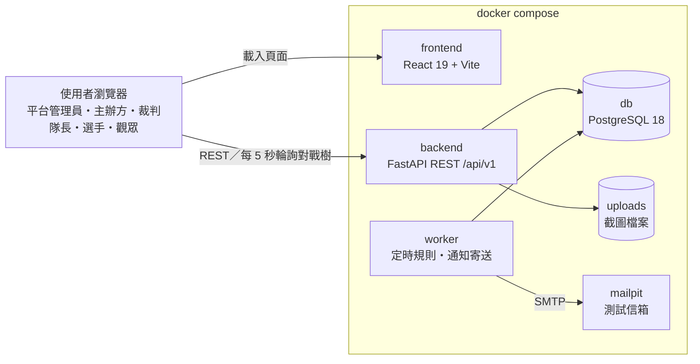
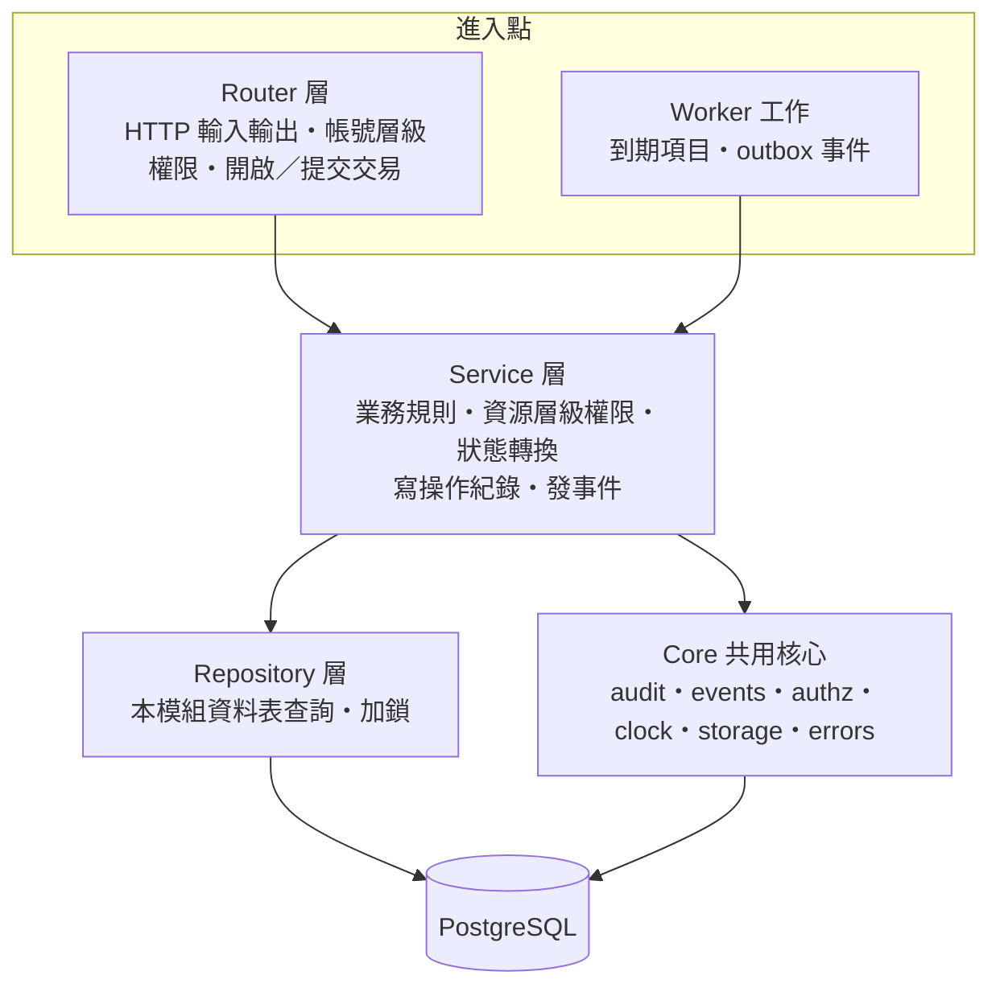
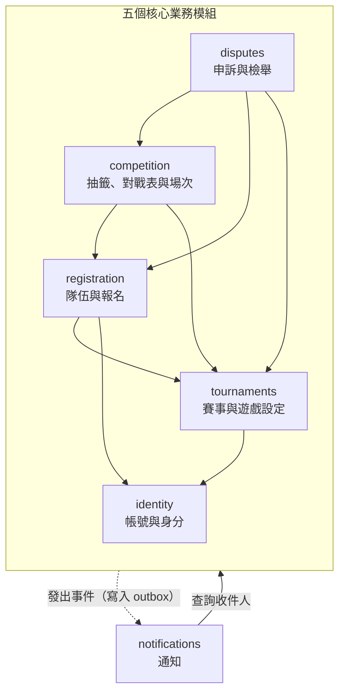
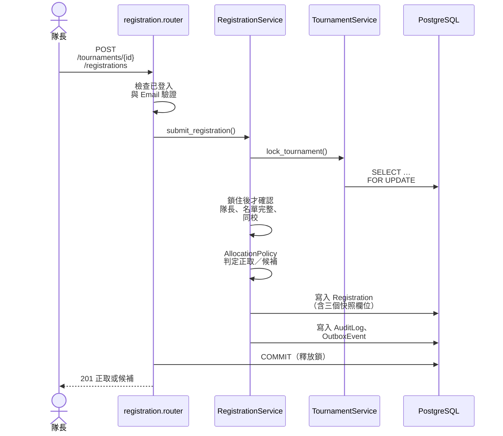
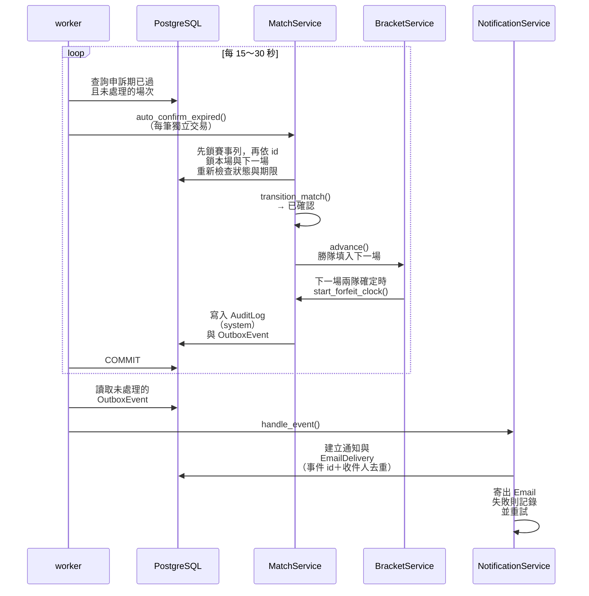
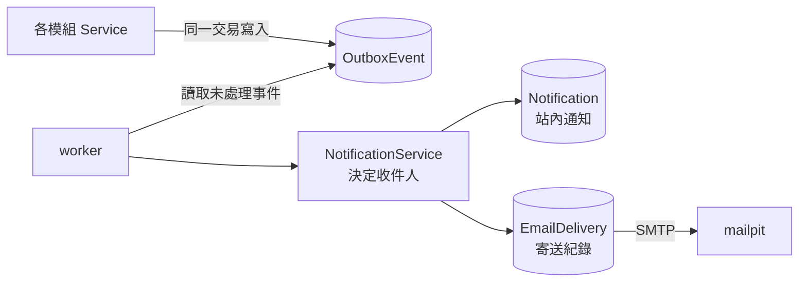

# 版本紀錄

| 版本 | 日期 | 修改內容 |
| --- | --- | --- |
| 1.0 | 2026-10-16 | 初版 |
| 1.1 | 2026-10-19 | 依審閱意見修訂：統一用語，新增「尚未開放」狀態與學校清單，補充輪空、棄權期限、名額同分與取消資格規則 |
| 1.2 | 2026-10-20 | 依一致性審查補充加鎖範圍、重新比賽與改派裁判；移除壓力測試與 Locust；新增版本紀錄與參考文獻 |
| 1.3 | 2026-10-28 | 依 Epic 1 實作補充登入憑證機制（7 天有效、不做 refresh token、重設密碼使舊憑證失效、401 的前端處理） |

# 壹、系統簡介

## 一、專案動機與目的

校際與社群電競盃賽的主辦方，現在要靠 Google 表單、Excel、FB 公告、Discord 與 email 申訴書才能辦完一場比賽：報名資格要人工計算、對戰表要人工抽、結果靠裁判手記、申訴靠寄信，出了問題也很難追查。本系統把報名、名額分配、抽籤、報到、比分登錄、申訴與檢舉收進同一個網頁系統，讓規則由系統一致地執行，每一步都留下紀錄。

本文件說明系統的整體架構、分層與模組劃分、關鍵機制的設計方式，以及部署與技術選型。各項設計決策以 AD 編號（AD-1～AD-21）標示，本文件在說明各機制時一併註明，完整清單與每條決策的規則摘要列在附錄，讓「需求 → 設計決策 → 實作規則」可以互相追溯。需求編號（FR、NFR）與狀態定義見《軟體需求分析文件》。

## 二、系統特色

1. **搶名額不超收**：所有會改變正取、候補或名單的操作，都先鎖住該賽事的資料列再判斷，多人同時報名也不會超收。
2. **規則自動且準時執行**：報名開始、優先期結束、報名截止、賽事開始、逾時判棄權、申訴期滿與申訴逾期提醒都由背景工作程序在期限到達後 1 分鐘內自動處理，不需要主辦方守在電腦前。
3. **遊戲差異全部是設定**：人數、BO 數、每局預估時間、段位對照與比分型態由平台管理員設定，程式中沒有任何依遊戲名稱的分支。
4. **結果可追查**：比分、申訴、取消資格等每一次變更都在同一個交易中寫入操作紀錄，且紀錄不能修改或刪除。
5. **觀賽即時、不需登入**：觀眾在手機上就能看到每 5 秒更新的視覺化對戰樹。

## 三、使用者定位

本系統的使用者包含平台管理員、主辦方、裁判、隊長、選手與觀眾六種身分。平台管理員與主辦方使用管理後台；裁判使用場次的比分登錄面板；隊長與選手使用隊伍、報名與場次頁；觀眾只使用公開頁面。系統依身分提供不同的介面與權限，而權限一律在伺服器端檢查，前端隱藏按鈕只是介面上的輔助。

# 貳、系統架構

## 一、系統架構圖

本系統採前後端分離的架構，以 docker compose 啟動五個服務：前端、後端 API、背景工作程序（worker）、資料庫與測試用收信伺服器。瀏覽器載入 React 單頁應用後，所有資料存取都透過後端的 REST API；worker 與後端共用同一份程式碼，負責定時規則與通知寄送。

| 服務 | 職責 | 對應需求 |
| --- | --- | --- |
| frontend | 所有頁面與對戰樹視覺化；只透過自動產生的 API client 呼叫後端 | FR-34～36、NFR-7 |
| backend | 處理所有使用者操作、權限檢查與業務規則 | FR-1～41、NFR-5 |
| worker | 每 15～30 秒處理到期工作（報名開始、優先期結束、報名截止、賽事開始、判棄權、申訴期滿、申訴逾期提醒），並寄送通知與驗證、重設密碼信 | NFR-4、FR-37 |
| db | 唯一的資料來源；以列鎖保證併發一致，以 trigger 保護操作紀錄 | NFR-1、NFR-3 |
| mailpit | 示範與測試用的收信伺服器，不對外寄信 | FR-37 |

圖中的 uploads 不是服務，而是由 backend 讀寫的 docker volume，存放段位截圖、結算截圖，以及申訴與檢舉的附件（FR-12、FR-28、FR-30、FR-32）。

各層的技術與職責如下：

1. **前端層**：以 React 建構單頁應用，採元件化設計。頁面放在 `src/routes/`（TanStack Router 檔案路由），各功能的元件與 hooks 放在 `src/features/<模組>/`，名稱與後端模組一致。前端只使用由 OpenAPI 文件自動產生的 API client，不手寫請求；需要即時更新的畫面以 TanStack Query 輪詢。
2. **後端應用層**：以 Python 與 FastAPI 建構，採模組化單體，依功能切成 6 個業務模組，每個模組內部分為 Router、Service、Repository 三層。後端負責驗證登入（JWT）與所有權限檢查。
3. **背景工作層**：worker 是同一份後端程式碼的另一個進入點，定期查詢資料庫中已到期的工作與未處理的事件，因此 API 程序中不需要任何排程器。
4. **資料層**：PostgreSQL 是唯一的資料來源，以 SQLModel 定義資料表、Alembic 管理遷移；上傳的檔案存在 docker volume，資料庫只存檔案鍵值。

## 二、分層架構

後端每個模組內部都分成三層，再加上各模組共用的核心元件（core）。請求由 Router 或 worker 進入，交給 Service 執行業務規則，Service 透過 Repository 存取本模組的資料表。

### （一）Router 層（控制層）

1. **角色與定位**
   - 負責 HTTP 請求的接收與回應，是使用者操作進入系統的入口。
   - 不處理業務邏輯，只負責把驗證過的資料交給 Service。
2. **負責項目**
   - 解析請求，以 Pydantic schema 驗證輸入格式。
   - 檢查帳號層級的權限：已登入、Email 已驗證、平台管理員、主辦方（以 FastAPI 的 `Depends` 實作）。
   - 開啟資料庫交易，呼叫 Service；成功後提交交易，失敗時回滾。
   - 把業務錯誤轉成統一格式的錯誤回應。
3. **不應包含**
   - 業務判斷，例如名額是否已滿。
   - 直接查詢資料表。

### （二）Service 層（業務邏輯層）

1. **角色與定位**
   - 系統業務規則的核心，例如名額分配、抽籤、晉級、申訴處理。
2. **負責項目**
   - 檢查資源層級的權限：是否為該賽事的主辦方、被指派的裁判、該隊的隊長。
   - 呼叫該模組唯一的狀態轉換函式改變狀態（AD-11）。
   - 需要併發控制時，先透過 Repository 鎖住資料列再判斷（AD-6）。
   - 在同一個交易中寫入操作紀錄（AD-9）與事件（AD-8）。
   - 需要其他模組的資料或動作時，只呼叫該模組 Service 的公開函式，取得的是 Pydantic schema（AD-2）。
3. **不應包含**
   - 提交或回滾交易（由進入點負責，AD-5）。
   - 讀寫其他模組的資料表。
4. **業務錯誤範例**（其餘錯誤代碼於實作各 Story 時定義）
   - `EMAIL_ALREADY_REGISTERED`：Email 已被註冊。
   - `EMAIL_NOT_VERIFIED`：Email 尚未驗證，不能報名或申請成為主辦方。
   - `APPLICATION_PENDING`：已有一筆待審核的主辦方申請。
   - `ALREADY_IN_TOURNAMENT`：同一帳號在同一賽事已加入其他隊伍。
   - `ORGANIZER_CANNOT_JOIN`：主辦方不能在自己主辦的賽事建立或加入隊伍。
   - `TOURNAMENT_INVITE_REQUIRED`：自訂賽事未持有效的報名連結。
   - `MATCH_TEAMS_PENDING`：場次的隊伍尚未確定，還不能報到。

### （三）Repository 層（資料存取層）

1. **角色與定位**
   - 集中處理本模組資料表的查詢與寫入，提供 Service 呼叫的資料存取函式。
2. **負責項目**
   - 本模組資料表的新增、查詢、更新。
   - 加鎖查詢：`lock_tournament()`、`lock_match()` 以 `SELECT … FOR UPDATE` 實作。
3. **注意事項**
   - 不做業務判斷，也不碰其他模組的資料表（AD-1）。
   - 加鎖函式只寫在擁有該資料的模組；其他模組要加鎖時，呼叫該模組 Service 提供的函式。

### （四）Core 共用核心

Core 提供各模組共用、與業務無關的基礎功能，且不得 import 任何業務模組：

| 元件 | 用途 |
| --- | --- |
| audit | 在同一交易中寫入操作紀錄（操作者、所屬賽事、動作、對象、變更前後內容），並提供依賽事查詢紀錄 |
| events | 把事件寫入 outbox 資料表，與業務資料同一交易 |
| authz | 資源層級權限的共用檢查函式，例如 `ensure_assigned_referee(match, account)` |
| clock | 取得目前時間的唯一入口，測試時可替換以模擬「30 分鐘後」 |
| storage | 上傳檔案的儲存與讀取，並驗證格式與大小 |
| errors | 業務錯誤的統一格式 |

### （五）Worker 背景工作程序

1. **角色與定位**
   - 與 Router 地位相同的另一個進入點：負責開啟交易、呼叫 Service。
2. **負責項目**
   - 每 15～30 秒查詢已到期但尚未處理的工作：報名開始（尚未開放 → 開放報名）、優先期結束、報名截止（截止補位、抽籤）、賽事開始（第一個場次開放報到時轉為進行中）、判棄權、申訴期滿、申訴逾期提醒。
   - 讀取未處理的 outbox 事件，交給通知模組產生站內通知並寄送 Email。
3. **可靠性設計**
   - 每處理一筆到期項目或一則事件就是一個獨立的交易，一筆失敗不影響其他筆。
   - 處理前先加鎖並重新檢查狀態，因此重複執行沒有副作用（冪等）。
   - 場次層級的工作（判棄權、申訴期滿、申訴逾期提醒、賽事開始）先檢查賽事狀態，已取消或已結束的賽事一律略過。

## 三、模組劃分與依賴

後端依功能群切成 6 個業務模組。每個實體只屬於一個模組，只有該模組能讀寫它（AD-1）。模組之間只能依下圖的實線方向直接呼叫，反方向一律禁止，因此不會形成循環依賴（AD-3）。

圖中的虛線不是函式呼叫：五個核心模組（包含 identity 的驗證信、重設密碼信）只把事件寫入 outbox，由 worker 交給 notifications 處理。notifications 處理事件時，再以實線呼叫各模組 Service 的查詢函式決定收件人。因為沒有任何模組會直接呼叫 notifications，直接呼叫的依賴仍然沒有循環。

| 模組 | 擁有的資料 | 對應功能群（見《軟體需求分析文件》貳、二） | 主要 FR |
| --- | --- | --- | --- |
| identity | Account、School、AccountToken、OrganizerApplication | 1.0 帳號與身分（1.5 除外）、2.1 的學校清單 | FR-1～3、FR-5、FR-6（學校清單）、FR-40 |
| tournaments | GameTitle、RankTier、Tournament、RoundSetting、RefereeInvitation、TournamentReferee | 2.0 賽事建立與遊戲設定、1.5 的裁判邀請 | FR-4、FR-6～10、FR-39 |
| registration | Team、TeamMember、Registration | 3.0 隊伍與報名、2.5 的提高名額 | FR-9（提高名額）、FR-11～18、FR-41 |
| competition | Bracket、Match、MatchGame、CheckIn、ResultScreenshot | 4.0 抽籤與對戰表、5.0 場次進行、1.5 的指派裁判 | FR-4（指派）、FR-19～29 |
| disputes | Appeal、Report | 6.0 申訴與檢舉 | FR-30～33 |
| notifications | Notification、EmailDelivery | 7.4、7.5 通知 | FR-37、FR-38 |
| core | AuditLog、OutboxEvent | 2.7 的操作紀錄、各模組共用 | NFR-3 |

- 所有模組都可使用 core；沒有任何模組直接呼叫 notifications，它只透過事件接收工作。
- 公開觀賽頁（FR-34～36）向各擁有模組的 Service 取資料，不另外建立模組。
- 抽籤後的退賽遞補與取消資格頂替，一律由 competition 主導：先修改對戰表，再呼叫 registration 取得下一個候補並更新報名狀態（AD-4）。
- 提高名額會讓候補遞補，而 tournaments 不能呼叫 registration，因此由 registration 主導：先鎖賽事列，再呼叫 tournaments 修改名額，最後依遞補規則遞補。

# 參、關鍵機制設計

## 一、搶報名不超收

**對應需求**：NFR-1、FR-9、FR-11、FR-13～FR-17、FR-41｜**設計決策**：AD-6、AD-12、AD-20

同一賽事所有會改變正取、候補或名單的操作，都必須先以 `SELECT … FOR UPDATE` 鎖住該賽事的資料列，再讀取並判斷，因此這些操作會依序執行，不可能同時讀到「還有 1 個名額」。這些操作包括：送出報名、撤回、退賽、退回、提高名額、優先期結算、截止補位、抽籤、遞補、頂替，以及名單異動（建立隊伍、加入隊伍、填寫參賽資料、移除隊員、轉讓隊長、退出隊伍、解散隊伍）。名單異動也要加鎖，是為了避免多人同時加入時超過人數上限，或同一帳號同時加入同賽事的兩支隊伍；資料表再以（tournament_id, account_id）唯一鍵作為最後一道防線。名額規則依賽事模式（校園賽、自訂）切換，所有與學校或名額相關的判斷都集中在 `AllocationPolicy`，其他程式不得自行依模式分支。

送出報名時，系統把學校、平均段位積分與送出時間寫入報名資料（快照），之後所有名額分配與候補排序只用這三個欄位，避免有人即時重算、有人用舊值而產生不一致。同分時依送出時間、再依報名 id 排序，結果固定。

場次也採相同做法：報到、登錄比分、送出系列結果、更正、判棄權、提出申訴、自動確認、晉級填位，都先鎖住該場次的資料列。同一個交易同時需要兩種鎖時，順序固定為「先賽事，再依 id 遞增鎖場次」，避免兩條流程以相反順序加鎖而造成死結。會連鎖到下一場或賽事狀態的流程（申訴期滿自動確認、處理申訴）不能先鎖本場、再去鎖下一場或賽事：它們一開始就先鎖賽事列，再依 id 遞增一次鎖住本場、下一場與季軍賽（`next_match_id` 不會變，可以事先讀出）。

## 二、定時規則與自動晉級

**對應需求**：NFR-4、FR-7、FR-14、FR-16、FR-19、FR-21、FR-25、FR-29、FR-31｜**設計決策**：AD-5、AD-7、AD-13

所有期限都以欄位存在資料表中（例如場次的 `appeal_deadline`、`forfeit_deadline`），不存在記憶體裡。獨立的 worker 每 15～30 秒查詢已到期但尚未處理的資料，處理前先加鎖並重新檢查狀態，因此即使 worker 重啟或重複執行也不會出錯。後端只透過 `core.clock.now()` 取得目前時間，測試時可以替換時鐘，直接驗證「30 分鐘後」的行為。

棄權期限只在場次兩隊都確定時才設定：抽籤時為所有兩隊都已確定的場次設定（第一輪，以及兩支輪空隊伍在第二輪相遇的場次），之後由晉級填位、遞補或頂替讓兩隊確定的那一刻設定，值為「預定開始時間與兩隊確定時間較晚者＋棄權時限」，主辦方修改時間時一併重算。隊伍還沒確定的場次 `forfeit_deadline` 為空，worker 的查詢條件（期限已到）不會選到它。因此「前一場申訴未處理時暫停棄權計時」不需要另外的狀態或暫停旗標：受影響的只有等待該結果的場次，申訴處理完成、勝隊填入時才開始起算；同一輪的其他場次照常進行。

晉級填位時，若某一方的位置確定不會有隊伍（前一場雙方棄權，或退賽、取消資格後無人遞補），該場直接以輪空確認，並繼續往下一輪推進。賽事本身的時間觸發也由同一個 worker 處理：報名開始時間到時由「尚未開放」轉為「開放報名」，最早場次開放報到時由「賽程已公布」轉為「進行中」。

## 三、事件與通知

**對應需求**：FR-37、FR-38｜**設計決策**：AD-3、AD-8、AD-21

通知採「交易式 outbox」設計：Service 不直接寄信，而是透過 `core.events.publish()` 把事件寫入 OutboxEvent 資料表，與業務資料在同一個交易中提交。worker 讀取 outbox，交給 notifications 依 FR-37 的通知對象表決定收件人，建立站內通知並寄送 Email。

這個設計解決了三個問題：

1. **資料改了但通知沒發**：事件與資料同一交易，資料提交成功，事件一定存在；交易回滾時事件也不存在。
2. **重複通知**：站內通知與寄送紀錄以（事件 id、收件人）為唯一鍵，同一事件重複處理不會重複通知。
3. **寄信失敗拖垮主流程**：Email 失敗只記錄並重試，不回滾任何業務資料。

（事件 id、收件人）只能擋住「同一事件處理兩次」。由 worker 定時檢查而發出的提醒（例如申訴逾期提醒），每次輪詢都可能產生新的事件，因此另在資料列上記錄已提醒的時間（Appeal 的 `reminded_at`）：worker 只挑尚未提醒的申訴，發出事件的同一個交易寫入 `reminded_at`，每筆申訴只提醒一次。

事件名稱一律用過去式（例如 `MatchResultConfirmed` 表示場次已確認，`MatchResultSubmitted` 表示裁判已送出系列結果），內容只帶實體 id 與事件特有的資料。驗證信與重設密碼信（`VerificationEmailRequested`、`PasswordResetRequested`）同樣經 outbox 寄出，但只寄 Email，不建立站內通知。

## 四、權限控管

**對應需求**：FR-4、FR-5、FR-11、NFR-5｜**設計決策**：AD-10、AD-19

權限分兩層，都在伺服器端檢查：

| 層級 | 檢查內容 | 實作位置 |
| --- | --- | --- |
| 帳號層級 | 已登入、Email 已驗證、平台管理員、主辦方 | Router，以 `Depends` 實作 |
| 資源層級 | 是否為該賽事的主辦方、被指派的裁判、該隊的隊長或隊員 | Service 方法開頭，呼叫 `core.authz` 的共用函式 |

資源層級的檢查寫在 Service 而非 Router，是因為 worker 與其他模組也會呼叫 Service，寫在 Router 會被繞過。`core.authz` 的函式只接收呼叫端已載入的實體，或從其他模組 Service 取得的 schema，自己不查資料庫。為此，場次直接以 `referee_account_id` 存放被指派裁判的帳號 id，`ensure_assigned_referee(match, account)` 只需比對兩個 id，不必再查 tournaments 的 TournamentReferee；指派時由 competition 呼叫 `TournamentService.is_referee()` 確認該帳號是此賽事的裁判，並呼叫 registration 確認他不是兩隊的隊員。場次未指派裁判時，由主辦方代登，competition 先向 tournaments 取得賽事的 schema，再交給 `ensure_tournament_owner()` 檢查。隊長身分也一樣：competition（報到、上傳結算截圖）與 disputes（申訴、檢舉）先向 registration 的 `get_team()` 取得 `TeamRead`（含隊員角色），再交給 `ensure_captain()` 比對。

身分衝突也在資源層級檢查：registration 建立或加入隊伍時，向 tournaments 確認該帳號不是此賽事的主辦方；晉級填位後若指派的裁判成了其中一隊的隊員，competition 取消該場的指派並發出事件通知主辦方改派。

不需登入的公開 API 只能回傳名稱以 `Public` 開頭的 schema（例如 `PublicBracket`），這類 schema 不包含 Email、學校與段位截圖，從結構上避免個資外洩。

## 五、狀態機與操作紀錄

**對應需求**：NFR-3、《軟體需求分析文件》參、四的狀態圖｜**設計決策**：AD-9、AD-11

1. **狀態機**：賽事、報名、場次三種有狀態的實體，各自在擁有模組的 Service 中只有一個轉換函式（例如 `transition_match(match, to)`）。它依照狀態轉換表檢查合法性，不合法時拋出業務錯誤；其他程式不得直接指派狀態欄位。狀態以 Python `StrEnum` 定義，值為英文。場次的「暫停」不是一個狀態，而是待開打且 `forfeit_deadline` 為空（見參、二）。
2. **操作紀錄**：報名、名額分配、抽籤、比分登錄與送出、申訴、檢舉、取消資格與時間修改，都由 Service 在同一個交易中呼叫 `core.audit.record(操作者, 所屬賽事, 動作, 對象, 變更前, 變更後)`。每筆紀錄都帶所屬賽事（帳號類的操作為空），主辦方查閱自己賽事的紀錄時，tournaments 確認主辦方身分後，以 `core.audit.list_for_tournament()` 依賽事篩選，不需要跨模組查詢各實體表。worker 自動執行的操作，操作者記為 system。程式中不對 AuditLog 發出 UPDATE 或 DELETE，資料庫 trigger 也會拒絕這兩種操作。

## 六、其他設計決策

| 機制 | 做法 | 設計決策 |
| --- | --- | --- |
| 交易邊界 | 一個使用案例一個交易；由 Router 或 worker 提交，Service 與 Repository 不提交 | AD-5 |
| 跨模組資料 | 跨模組只回傳 Pydantic schema（例如 `RegistrationRead`），不回傳 ORM 物件 | AD-2 |
| 遊戲可設定 | 建立賽事時把遊戲設定複製進賽事；程式不依遊戲名稱分支 | AD-12、AD-18 |
| 時間 | 資料庫以 timestamptz 存 UTC，API 回傳 ISO 8601，前端顯示台北時間 | AD-13 |
| 即時更新 | 不做 WebSocket，只有三種輪詢：對戰樹與場次頁每 5 秒、未讀通知數每 30 秒、倒數到期後當頁每 5 秒（最多 2 分鐘） | AD-14 |
| 檔案 | 存在 docker volume，經 API 依權限下載；限 5 MB 以內的 JPG 或 PNG | AD-15 |
| 一次性 token | 驗證信與重設密碼 token 只存雜湊、用一次即失效，重新產生時作廢舊的 | AD-21 |
| 登入憑證 | JWT access token 7 天有效，不做 refresh token；帳號帶 `credentials_version`、token 帶 `ver`，兩者不同即回 401，重設密碼時加 1 使其他裝置登出；前端收到 401 時清除登入狀態並導回登入頁（帶 `redirect`） | Story 1.4、1.5 |
| 測試資料庫 | 整合與端對端測試都使用真的 PostgreSQL，不以 SQLite 代替 | AD-16 |

# 肆、介面設計

## 一、API 設計慣例

| 項目 | 慣例 |
| --- | --- |
| 路徑 | `/api/v1/<複數資源>`，使用 kebab-case；巢狀不超過兩層，例如 `/tournaments/{tournament_id}/registrations` |
| 識別碼 | 所有資源的 id 為 UUID |
| 時間 | ISO 8601 格式並帶時區 |
| 業務錯誤 | 回傳 4xx，內容為 `{"detail": {"code": "UPPER_SNAKE", "message": "繁中訊息"}}` |
| 格式錯誤 | 沿用 FastAPI 預設的 422 |
| 公開資料 | 不需登入的 API 只回傳 `Public*` schema |
| 文件 | 由 FastAPI 自動產生 OpenAPI 文件，前端據此產生 API client |

## 二、主要 API 資源

下表為初版的資源規劃，實際端點以實作後自動產生的 OpenAPI 文件為準。

| 資源 | 主要操作 | 所屬模組 | 權限 |
| --- | --- | --- | --- |
| 帳號與登入 | 註冊、驗證 Email、重寄驗證信、登入、重設密碼、修改帳號資料 | identity | 公開／登入 |
| 學校清單 | 列出、新增、修正學校 | identity | 公開／平台管理員 |
| 主辦方申請 | 送出申請、查看狀態、核准或退回 | identity | 帳號／平台管理員 |
| 遊戲 | 新增、修改、列出遊戲與段位對照 | tournaments | 平台管理員 |
| 賽事 | 建立、修改、取消、列出、查看；分輪 BO；操作紀錄；重設自訂賽事的報名連結 | tournaments | 主辦方／公開 |
| 裁判邀請 | 產生邀請連結、接受邀請 | tournaments | 主辦方／帳號 |
| 隊伍 | 建立、加入、移除隊員、轉讓隊長、退出、解散、填寫參賽資料 | registration | 隊長／選手 |
| 報名 | 送出、撤回、退回、提高名額並遞補、列出報名與段位截圖 | registration | 隊長／主辦方 |
| 對戰表 | 抽籤、查看對戰樹、修改場次時間、指派／改派／收回裁判、退賽 | competition | 主辦方／隊長／公開 |
| 場次 | 報到、登錄局結果、送出系列結果、上傳結算截圖、查看場次 | competition | 隊長／裁判／公開 |
| 申訴與檢舉 | 提出申訴與檢舉、處理申訴（維持、更正或重新比賽）、查證檢舉、待處理清單 | disputes | 隊長／主辦方 |
| 通知 | 列出通知、未讀數、標為已讀 | notifications | 帳號 |

## 三、前端架構

1. **頁面結構**：公開頁（賽事列表、賽事頁、對戰樹、場次頁）、帳號頁（註冊、登入、通知中心、身分切換）、隊伍與報名頁、裁判的比分登錄面板、主辦方後台與平台管理後台，共約 38 個畫面。
2. **程式結構**：`src/routes/` 放頁面，`src/features/<模組>/` 放元件與 hooks，與後端模組一一對應。
3. **資料存取**：只透過 `@hey-api/openapi-ts` 依 OpenAPI 文件產生的 client 呼叫後端，後端介面變更時重新產生即可發現不相容之處。
4. **即時更新**：以 TanStack Query 輪詢，只有前述三種輪詢頻率，各頁不另訂頻率。
5. **響應式設計**：以 Tailwind CSS 與 shadcn/ui 建構，所有頁面在 375 px 寬的手機上可操作；對戰樹在手機上可左右捲動。

# 伍、部署與技術選型

## 一、部署與環境

1. 唯一的執行環境是本機 docker compose，一個指令就能啟動 db、backend、worker、frontend、mailpit 五個服務，並自動載入示範資料（2 款遊戲、學校清單、32 隊賽事）。示範資料透過各模組的 Service 建立，確保設定快照與操作紀錄齊全（AD-17）。
2. 設定一律從 `.env` 讀取，`.env.example` 放進版本控制。
3. 測試環境同樣使用 compose 中的 PostgreSQL 18，併發整合測試也在這個資料庫上執行。
4. 第一版不做雲端部署、HTTPS、正式寄信與錯誤監控。

## 二、技術選型

各項技術的官方文件列於參考文獻。

| 層 | 技術 | 版本 | 選用理由 |
| --- | --- | --- | --- |
| 前端 | React、TypeScript、Vite | 19.3、6.0、8.3 | 元件化開發、型別檢查、快速建置 |
| 前端路由與資料 | TanStack Router、TanStack Query | 1.170、5.104 | 檔案路由、內建輪詢與快取 |
| 前端樣式 | Tailwind CSS、shadcn/ui | 4.2、隨範本 | 快速建構響應式介面 |
| 後端 | Python、FastAPI | 3.14、≥ 0.141.1 | 自動產生 OpenAPI 文件、以型別驗證輸入 |
| ORM 與遷移 | SQLModel、Alembic | ≥ 0.0.46、≥ 1.19.1 | 資料表與 schema 共用定義、版本化遷移 |
| 資料庫 | PostgreSQL | 18 | 支援列鎖、trigger、JSONB |
| 測試 | pytest、Playwright | 隨範本、1.63.0 | 單元與整合測試、端對端測試 |
| 起始範本 | fastapi/full-stack-fastapi-template | 2026-10 | 官方維護，內建登入、測試與 docker 設定 |

表中的版本是選型時查證的版本。「≥」表示可接受的最低版本，「隨範本」表示沿用起始範本的設定；實際安裝的版本一律由版本鎖定檔固定（後端 `uv.lock`、前端 `bun.lock`），並與程式一起放進版本控制，所有組員與 docker image 安裝的版本完全相同。升級套件時更新鎖定檔並重新跑完測試。

# 陸、軟體設計架構與設計理由

本系統採用「模組化單體」加上「模組內三層」的架構。選擇這個架構的理由，以及我們放棄的替代方案如下：

| 設計決策 | 理由 | 放棄的替代方案 |
| --- | --- | --- |
| 模組化單體，而非微服務 | 一個學期、小型團隊、單機部署，微服務的部署與跨服務交易成本遠大於好處；模組邊界（AD-1～3）仍保留日後拆分的可能 | 微服務 |
| 模組內三層 | 每一層只有一種職責，業務規則集中在 Service，可以獨立做單元測試；Repository 隔離資料存取，便於整合測試 | 在 Router 中直接寫業務邏輯 |
| 資料庫列鎖控制併發 | 名額與比分的正確性是本系統最重要的需求；列鎖讓判斷與寫入在同一個鎖內完成，邏輯簡單且可用真資料庫驗證（參考文獻 4） | 樂觀鎖重試、應用層佇列 |
| worker 輪詢資料庫處理期限 | 期限存在資料表中，重啟不遺失；處理前重新檢查狀態，重複執行也安全 | 在 API 程序內放排程器 |
| 交易式 outbox 處理通知 | 保證「資料改了通知就一定會發、而且只發一次」，Email 失敗不影響主流程（參考文獻 5） | Service 直接寄信 |
| 前端輪詢，不做 WebSocket | 觀賽只需 10 秒內更新，輪詢已足夠，實作與測試都較單純 | WebSocket、Server-Sent Events |

分層與模組化能有效降低模組之間的耦合：修改某個功能（例如名額規則）只會影響該模組，不會意外影響對戰表或申訴。業務邏輯與資料存取的明確分離，也讓單元測試與整合測試可以分別驗證各層的行為，提升開發效率與系統品質。

# 附錄：設計決策（AD）一覽

下表列出本文件與《物件設計文件》引用的 21 條設計決策。每條決策都是開發時必須遵守的約束，用來避免各組員各自實作時做出不一致的選擇。

| 編號 | 決策 | 規則摘要 | 說明位置 |
| --- | --- | --- | --- |
| AD-1 | 模組清單與資料擁有權 | 每個實體只屬於一個模組，只有該模組的 Repository 能讀寫它；新增實體須歸入既有模組，新增模組須先修改設計 | 貳、三 |
| AD-2 | 跨模組只經 Service 公開介面 | 需要別的模組的資料或動作時，只呼叫該模組 Service 的公開函式，回傳 Pydantic schema 而非 ORM 物件；資料表可以有跨模組外鍵，但查詢只能由擁有模組發出 | 貳、二（二）、參、六 |
| AD-3 | 依賴方向與事件溝通 | 模組只能依依賴圖的方向呼叫；通知只能發事件，沒有模組可以呼叫 notifications，notifications 處理事件時可查詢各模組；core 不 import 任何模組 | 貳、三 |
| AD-4 | 抽籤後的隊伍異動由 competition 主導 | 抽籤前退賽由 registration 處理；抽籤後的退賽與取消資格由 competition 先改對戰表，再呼叫 registration 取得候補並更新報名狀態 | 貳、三 |
| AD-5 | 一個使用案例一個交易 | 交易由 Router 或 worker 開啟並提交；Service 與 Repository 不 commit、不 rollback；操作紀錄與事件寫在同一個交易 | 參、六 |
| AD-6 | 鎖列並固定加鎖順序 | 會改變正取、候補或名單的操作先鎖賽事列；Match 的寫入先鎖場次列，鎖住後才檢查狀態；同時需要時先鎖賽事、再依 id 遞增鎖場次；會連鎖到下一場或賽事狀態的流程一開始就先鎖賽事列 | 參、一 |
| AD-7 | 定時規則由 worker 輪詢並冪等執行 | 到期時間存在資料表；worker 每 15～30 秒處理到期項目，處理前加鎖並重新檢查狀態；API 程序不放排程器；已取消或已結束賽事的場次工作一律略過 | 參、二 |
| AD-8 | 交易式 outbox | 事件與業務資料同交易寫入 OutboxEvent；以（事件 id、收件人）去重；Email 失敗只重試、不回滾；收件人由 notifications 依 FR-37 決定 | 參、三 |
| AD-9 | 操作紀錄同交易寫入、只增不改 | NFR-3 列出的每種變更都在同一交易寫入 AuditLog（含所屬賽事）；worker 的操作者記為 system；trigger 拒絕 UPDATE 與 DELETE | 參、五 |
| AD-10 | 權限分兩層、皆在伺服器端 | 帳號層級在 Router 以 Depends 檢查；資源層級在 Service 開頭呼叫 core.authz，authz 只接收已載入的實體或 schema，不查資料庫 | 參、四 |
| AD-11 | 狀態只能經唯一的轉換函式修改 | 賽事、報名、場次各有一個轉換函式，依《軟體需求分析文件》的狀態圖檢查合法性；狀態以 StrEnum 定義，值為英文 | 參、五 |
| AD-12 | 快照 | 建立賽事時複製遊戲設定；送出報名時寫入學校、平均段位積分與送出時間，名額分配與候補排序只用快照 | 參、一 |
| AD-13 | 時間：UTC 儲存、可替換時鐘 | 資料庫以 timestamptz 存 UTC，API 回傳 ISO 8601，前端顯示台北時間；後端只經 core.clock.now() 取得時間 | 參、二、參、六 |
| AD-14 | 只用三種輪詢 | 對戰樹與場次頁每 5 秒、未讀數每 30 秒、倒數到期後每 5 秒（最多 2 分鐘）；後端不提供推播，各頁不另訂頻率 | 參、六、肆、三 |
| AD-15 | 截圖檔案儲存與存取 | 存 docker volume，資料庫只存鍵值；一律經 API 依權限下載；限 5 MB 以內的 JPG／PNG | 參、六 |
| AD-16 | 測試使用真 PostgreSQL | 整合與端對端測試都連線 PostgreSQL 18，不以 SQLite 或模擬層代替 | 參、六 |
| AD-17 | 執行環境只有本機 docker compose | 固定 db、backend、worker、frontend、mailpit 五個服務，一鍵啟動並載入示範資料；示範資料經 Service 建立 | 伍、一 |
| AD-18 | 遊戲差異只能來自設定 | 程式不依遊戲名稱或 id 分支；人數、BO、勝局門檻、段位換算與比分型態一律讀賽事上的快照 | 參、六 |
| AD-19 | 公開資料只經 Public schema | 不需登入的 API 只回傳 Public* schema，不含 Email、學校與段位截圖鍵值 | 參、四 |
| AD-20 | 名額規則只在 AllocationPolicy 分支 | 賽事模式開放報名後不可更改；同校檢查、正取判定、候補排序、遞補對象與每校上限都經 AllocationPolicy，其他程式不得依模式分支 | 參、一 |
| AD-21 | 一次性 token 由 identity 管理 | 驗證與重設密碼 token 只存雜湊、用一次即失效、重新產生時作廢舊的；寄信只經 outbox，只寄 Email 不建立站內通知 | 參、六 |

# 參考文獻

1. FastAPI 官方文件。https://fastapi.tiangolo.com/
2. FastAPI. *Full Stack FastAPI Template*. GitHub. https://github.com/fastapi/full-stack-fastapi-template
3. SQLModel 官方文件。https://sqlmodel.tiangolo.com/
4. PostgreSQL Global Development Group. *PostgreSQL 18 Documentation: Explicit Locking*. https://www.postgresql.org/docs/18/explicit-locking.html
5. Richardson, C. *Pattern: Transactional outbox*. microservices.io. https://microservices.io/patterns/data/transactional-outbox.html
6. TanStack Query 官方文件。https://tanstack.com/query/latest/docs/framework/react/overview
7. Docker Compose 官方文件。https://docs.docker.com/compose/
8. Playwright 官方文件。https://playwright.dev/
9. 本組（2026）。架構骨幹（ARCHITECTURE-SPINE.md）與 C／D 設計打底稿。專案資料夾 `_bmad-output/planning-artifacts/architecture/`。
