# 版本紀錄

| 版本 | 日期 | 修改內容 |
| --- | --- | --- |
| 1.0 | 2026-10-16 | 初版 |
| 1.1 | 2026-10-19 | 依審閱意見修訂：統一用語，新增「尚未開放」狀態與學校清單，補充輪空、棄權期限、名額同分與取消資格規則 |
| 1.2 | 2026-10-20 | 依一致性審查補充類別方法（退出與解散隊伍、改派裁判、重新比賽）與列舉英文值，並拆分過大的類別圖；新增版本紀錄與參考文獻 |
| 1.3 | 2026-10-23 | 配合截止補位改由所有候補依平均段位積分補位，AllocationPolicy 的 `fill_second_teams()` 改名為 `fill_from_waitlist()` |
| 1.4 | 2026-10-28 | 依 Epic 1 實作補上 Account.credentials_version、EmailDelivery.next_attempt_at、AuditLog.seq，以及 ApplicationStatus、DeliveryStatus 的英文值 |

# 壹、系統簡介

## 一、系統簡介與特色

本系統是校際與社群電競盃賽的一站式管理平台，整合主辦方申請、遊戲設定、賽事建立、組隊報名、三階段名額分配、抽籤與單淘汰對戰表、報到與逐局比分、申訴與檢舉、觀賽與通知等功能。系統以模組化架構設計，透過資料庫列鎖、單一狀態轉換函式與交易式 outbox 等機制，避免名額超收、比分互相覆蓋與通知遺漏；所有影響結果的操作都留下不可修改的紀錄，讓主辦方在爭議發生時有據可查。

本文件說明後端各模組的類別設計、類別職責與模組之間的協作方式。類別圖中只列出決定職責的主要欄位與方法，完整的資料欄位與唯一鍵請見《軟體需求分析文件》的資料表說明；文中的設計決策編號（AD-1～AD-21）的規則摘要見《軟體設計文件》附錄。本文件的類別圖為實作前的設計，程式完成後將以程式碼為準重新產生類別圖並更新本文件。

## 二、軟體架構圖

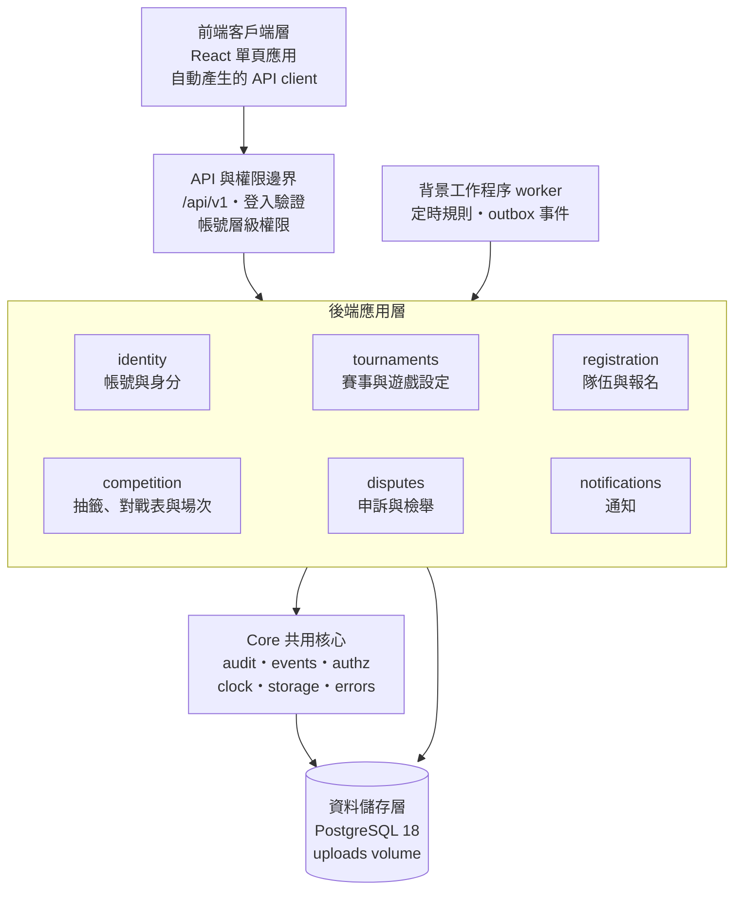

### （一）前端客戶端層

前端以 React 單頁應用呈現，可在手機與電腦上使用。前端只負責介面呈現與操作互動，不包含任何業務規則；所有資料存取都透過依 OpenAPI 文件自動產生的 API client，需要即時更新的畫面以固定頻率輪詢。

### （二）API 與權限邊界

所有請求都經由 `/api/v1` 進入後端。Router 在這一層驗證登入身分，並檢查帳號層級的權限（已登入、Email 已驗證、平台管理員、主辦方）；不需登入的公開 API 只回傳 `Public*` schema，避免個資外洩。

### （三）後端應用層

後端採模組化單體，依功能切成 6 個業務模組。每個模組內部分成三層：

1. **Router 層**：API 路由、輸入驗證、帳號層級權限，並開啟與提交交易。
2. **Service 層**：業務規則、資源層級權限、狀態轉換、寫入操作紀錄與發出事件；跨模組時只呼叫其他模組 Service 的公開函式。
3. **Repository 層**：本模組資料表的查詢、寫入與加鎖，提供 Service 一致的資料存取介面。

### （四）背景工作與通知

worker 是後端程式碼的另一個進入點，定期處理到期工作（報名開始、優先期結束、報名截止、賽事開始、判棄權、申訴期滿、申訴逾期提醒），並讀取 outbox 事件交給通知模組，使通知寄送不會阻塞使用者的操作。

### （五）資料儲存層

PostgreSQL 是唯一的資料來源，以列鎖保證併發一致、以 trigger 保護操作紀錄；上傳的截圖存在 docker volume，資料庫只存檔案鍵值。

# 貳、物件設計

各模組的類別依角色分為四類：**實體**（對應資料表的 SQLModel 類別）、**控制**（Router）、**服務**（Service，承載業務規則）、**資料存取**（Repository）。另有少數**策略**與**演算法**類別，是不碰資料庫的純函式，方便單元測試；共用核心還有一個**例外**類別 BusinessError，用來表示業務錯誤。Router 與 Repository 的結構在各模組都相同，因此只在帳號與身分模組完整呈現，其他模組的類別圖中省略。類別較多的模組分成兩張圖：tournaments 與 competition 的第一張是實體與其關聯，第二張是服務類別與它們操作的實體（只列類別名稱）；共用核心的第一張是兩張資料表與寫入它們的服務，第二張是其餘彼此沒有關聯的共用工具。

## 一、共用核心 core

共用核心提供各模組共用、與業務無關的基礎功能，不得 import 任何業務模組。它擁有操作紀錄（AuditLog）與事件（OutboxEvent）兩張資料表。

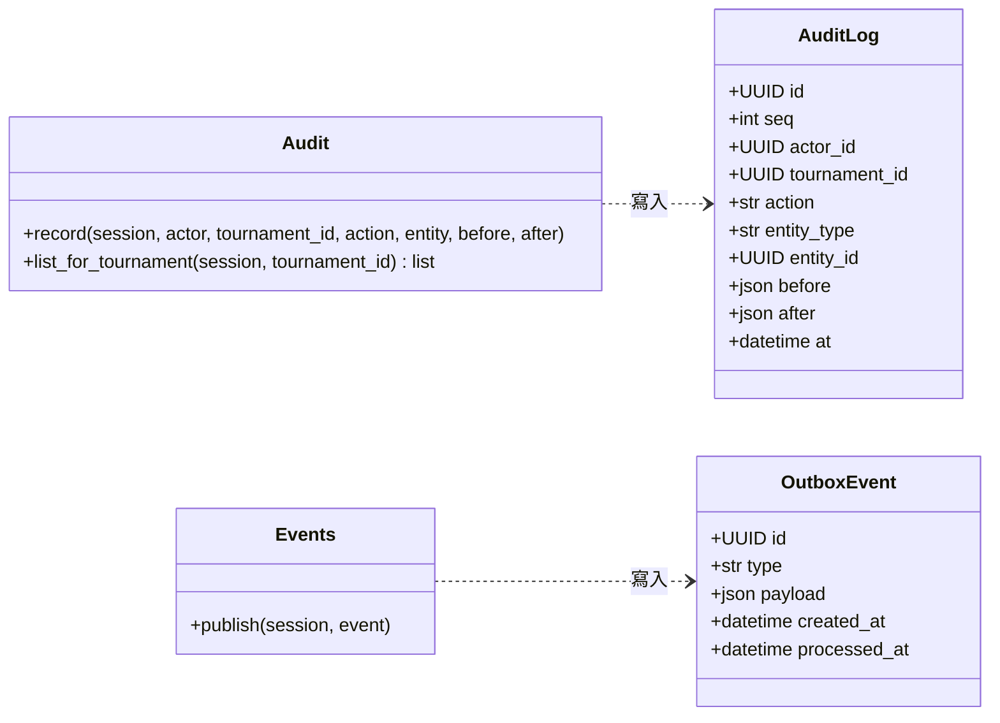

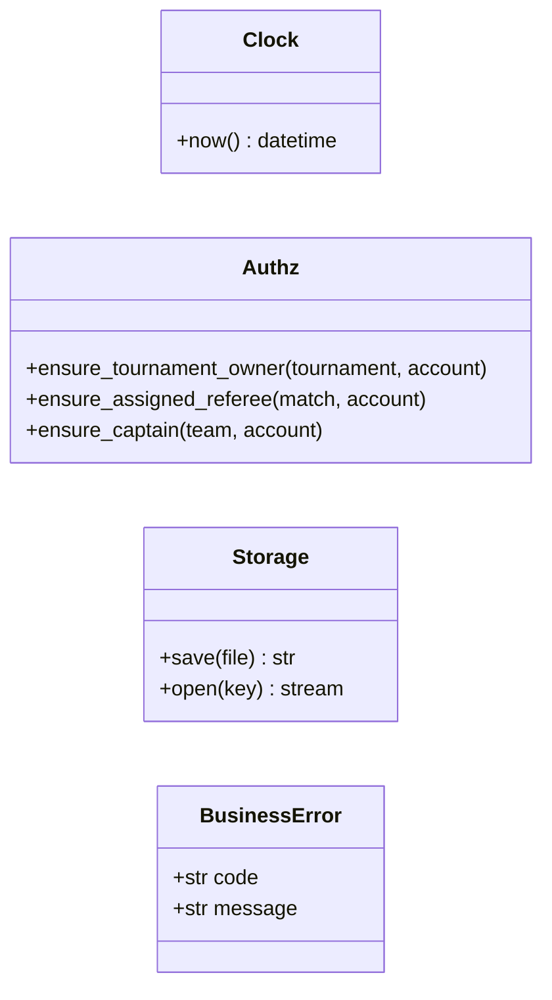

| 類別 | 類型 | 職責 |
| --- | --- | --- |
| AuditLog | 實體 | 一筆操作紀錄：操作者、所屬賽事、動作、對象與變更前後內容；只能新增 |
| OutboxEvent | 實體 | 一則待處理的事件，與業務資料同一交易寫入 |
| Audit | 服務 | 提供 `record()`，讓各 Service 在同一交易中寫入操作紀錄；`list_for_tournament()` 依賽事查詢紀錄 |
| Events | 服務 | 提供 `publish()`，把事件寫入 outbox |
| Clock | 服務 | 取得目前時間的唯一入口；測試時以假時鐘替換 |
| Authz | 服務 | 資源層級權限的共用檢查；只接收呼叫端已載入的實體或跨模組取得的 schema，自己不查資料庫 |
| Storage | 服務 | 上傳檔案的儲存與讀取，驗證格式與大小 |
| BusinessError | 例外 | 業務錯誤，帶英文代碼與繁中訊息，由 Router 轉成 4xx 回應 |

**設計重點**

1. `record()` 的 `tournament_id` 由呼叫端傳入：賽事內的操作帶該賽事的 id，帳號類的操作（註冊、主辦方申請等）傳空值。主辦方查閱自己賽事的紀錄時，由 tournaments 確認主辦方身分後呼叫 `list_for_tournament()`，不需要跨模組 join 各實體表（AD-1、AD-9）。
2. Authz 的函式都只比對傳入物件的欄位。例如 `ensure_assigned_referee(match, account)` 只比對 `match.referee_account_id` 與 `account.id`；因為場次直接存裁判的帳號 id，這個檢查不必查 tournaments 的 TournamentReferee（AD-10）。

## 二、帳號與身分模組 identity

**職責**：註冊、登入、Email 驗證與重寄驗證信、忘記與重設密碼、主辦方申請與審核、學校清單，並提供帳號查詢給其他模組。

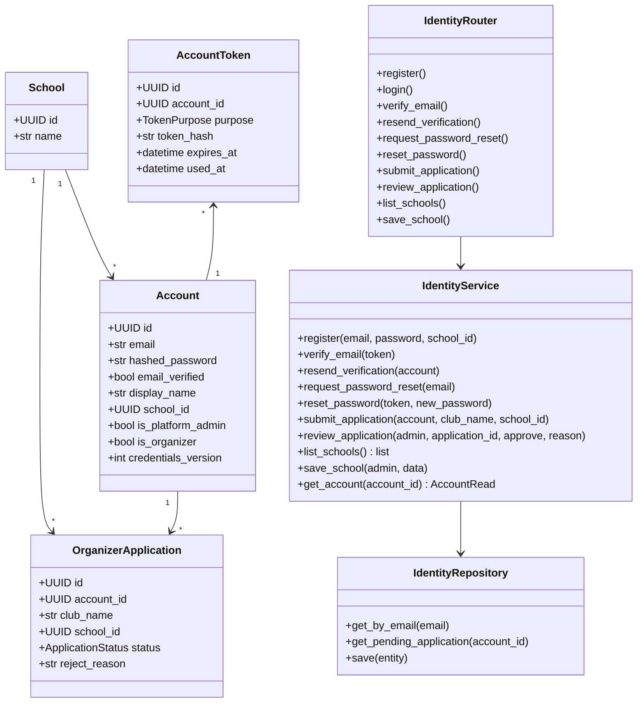

| 類別 | 類型 | 職責 |
| --- | --- | --- |
| Account | 實體 | 帳號資料；平台管理員與主辦方是帳號上的旗標 |
| School | 實體 | 學校清單中的一間學校；同校檢查一律比對 `school_id` |
| AccountToken | 實體 | Email 驗證與重設密碼的一次性 token，只存雜湊 |
| OrganizerApplication | 實體 | 主辦方申請與審核結果 |
| IdentityRouter | 控制 | 帳號相關的 API 端點，檢查帳號層級權限 |
| IdentityService | 服務 | 註冊、驗證、重設密碼、申請審核與學校清單的業務規則；`get_account()` 回傳 schema 給其他模組 |
| IdentityRepository | 資料存取 | 帳號、學校、token 與申請的查詢與儲存 |

**設計重點**

1. 驗證 token 24 小時、重設 token 1 小時到期，用一次即寫入 `used_at`；產生新 token 時，同帳號同用途的舊 token 全部作廢（AD-21）。
2. 寄信一律經 outbox 事件（`VerificationEmailRequested`、`PasswordResetRequested`），只寄 Email、不建立站內通知。
3. `request_password_reset()` 對未註冊的 Email 不產生事件，但回應與已註冊時完全相同，避免洩漏 Email 是否存在。
4. `get_account()` 回傳 Pydantic schema 而非 ORM 物件，其他模組無法透過它修改帳號資料（AD-2）。
5. 學校清單以教育部大專校院名錄為初始資料；帳號的學校為選填、主辦方申請的學校必填，兩者都只能選清單內的學校；校園賽送出報名時，每位隊員都必須已設定學校。School 放在 identity，是因為 identity 位於依賴鏈的最底層，其他模組都可以向它查詢。

## 三、賽事與遊戲設定模組 tournaments

**職責**：遊戲清單與段位對照（平台管理員維護）、建立與修改賽事（含設定快照）、賽事狀態轉換、裁判邀請與裁判身分、依賽事查閱操作紀錄。

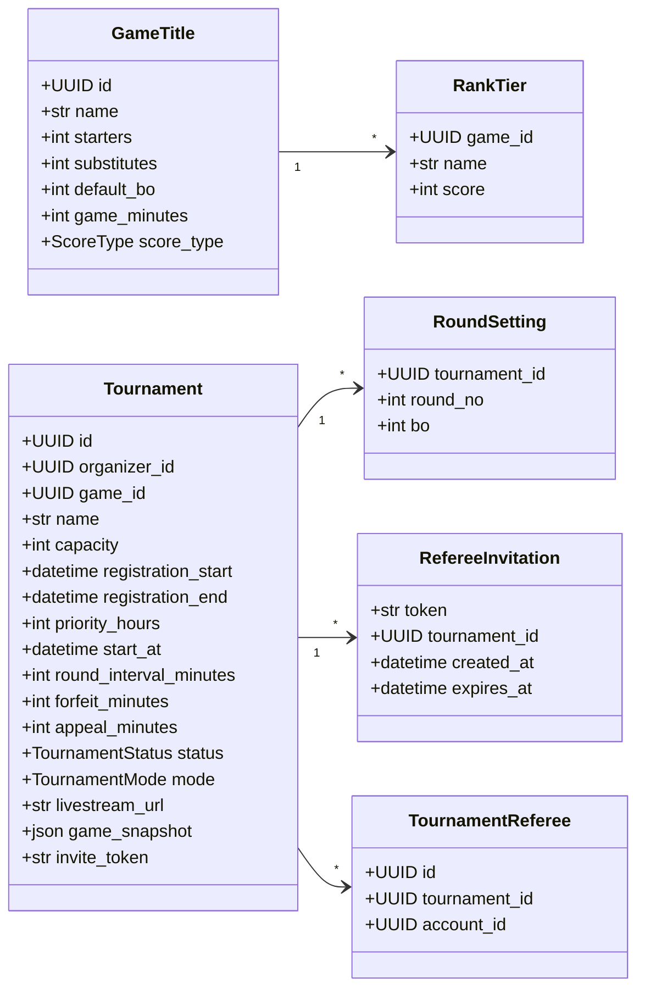

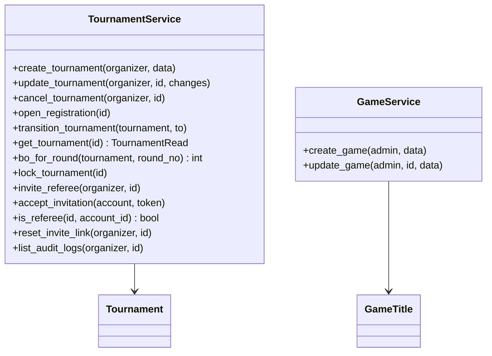

| 類別 | 類型 | 職責 |
| --- | --- | --- |
| GameTitle | 實體 | 遊戲與其預設值（人數、BO、每局預估時間、比分型態） |
| RankTier | 實體 | 遊戲的段位與段位積分對照 |
| Tournament | 實體 | 賽事設定、狀態與建立時複製的遊戲設定快照 |
| RoundSetting | 實體 | 某一輪的 BO 數 |
| RefereeInvitation | 實體 | 裁判邀請連結與到期時間 |
| TournamentReferee | 實體 | 帳號在某賽事中的裁判身分 |
| TournamentService | 服務 | 賽事的建立、修改限制、取消、狀態轉換、加鎖、裁判邀請與操作紀錄查詢 |
| GameService | 服務 | 平台管理員維護遊戲設定 |

**設計重點**

1. 建立賽事時把遊戲的人數、BO、每局預估時間、比分型態與段位對照複製到 `game_snapshot`，之後只讀這份副本；平台管理員修改遊戲預設值不影響已建立的賽事（AD-12）。
2. `bo_for_round()` 先查 RoundSetting，沒有分輪設定時才用快照中的預設 BO 數；BO 數只接受 1、3、5、7。程式中沒有任何依遊戲名稱的分支（AD-18）。
3. `create_tournament()` 與 `update_tournament()` 檢查每輪間隔不小於「棄權時限＋預設 BO 數 × 每局預估時間＋申訴期」。報名開始時間未到時，賽事建立為「尚未開放」，由 worker 呼叫 `open_registration()` 轉為開放報名。
4. `update_tournament()` 依賽事狀態限制可改的欄位：尚未開放時都能改；開放報名後到抽籤前只能放寬或修改分輪 BO，抽籤後只能改場次時間，直播連結在結束前都能改（FR-9）。提高名額會讓候補遞補，因此由 registration 的 `raise_capacity()` 在鎖住賽事列後呼叫本函式，tournaments 自己不呼叫 registration。
5. `mode` 在開放報名後不可更改；所有與模式有關的判斷交給 registration 模組的 AllocationPolicy（AD-20）。自訂賽事建立時產生 `invite_token` 作為賽事報名連結，`reset_invite_link()` 換成新的 token，舊連結立即失效（FR-39）。
6. `lock_tournament()` 是全系統鎖住賽事列的唯一入口，其他模組要加鎖時都呼叫它（AD-6）。
7. `invite_referee()` 產生 7 天後到期的邀請，並使同賽事尚未到期的舊邀請立即失效。`is_referee()` 供 competition 指派裁判時確認身分。

## 四、隊伍與報名模組 registration

**職責**：建立隊伍與邀請隊員、選手參賽資料、送出報名、三階段名額分配、候補排序、抽籤前撤回、主辦方退回、提高名額後的遞補。名額規則集中在純函式的 AllocationPolicy。

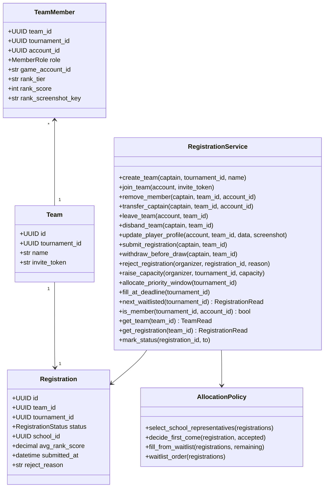

| 類別 | 類型 | 職責 |
| --- | --- | --- |
| Team | 實體 | 隊伍，只屬於一個賽事，帶有隊伍邀請 token |
| TeamMember | 實體 | 隊員與其角色（隊長或選手）、遊戲 ID、段位與段位截圖；帶所屬賽事以建立（tournament_id, account_id）唯一鍵 |
| Registration | 實體 | 報名狀態與分配結果；建立隊伍時即產生（組隊中），送出時寫入學校、平均段位積分與送出時間快照 |
| RegistrationService | 服務 | 組隊、名單異動（含退出與解散）、送出、撤回、退回、提高名額、優先期結算與截止補位，並提供隊伍與報名查詢給其他模組 |
| AllocationPolicy | 策略 | 依賽事模式判定代表隊、正取或候補、截止補位與候補順位；不碰資料庫的純函式 |

**設計重點**

1. 隊長身分只看 `TeamMember.role`，每隊恰好一位隊長；`core.authz.ensure_captain()` 依此判斷；其他模組以 `get_team()` 取得的 `TeamRead` 判斷。
2. 會改變名額或名單的操作——`create_team()`、`join_team()`、`update_player_profile()`、`remove_member()`、`transfer_captain()`、`leave_team()`、`disband_team()`、`submit_registration()`、`withdraw_before_draw()`、`reject_registration()`、`raise_capacity()`——都先鎖住賽事列，鎖住之後才檢查隊長身分、人數上限與名單狀態，避免檢查後被其他操作改變（AD-6）。TeamMember 的（tournament_id, account_id）唯一鍵是最後一道防線，即使程式漏鎖，同一帳號也無法加入同賽事的兩支隊伍。名單鎖定期間，`update_player_profile()`、`remove_member()`、`transfer_captain()`、`leave_team()` 與 `disband_team()` 都被拒絕；`disband_team()` 把報名轉為撤回，原隊員可以加入同賽事的其他隊伍。
3. `create_team()` 與 `join_team()` 先向 tournaments 取得賽事 schema，拒絕該賽事的主辦方建立或加入隊伍。
4. 名額分配與候補排序只使用 Registration 上的三個快照欄位，所有人用同一份資料判斷（AD-12）。平均段位積分計入名單上所有成員（含替補），同分時依送出時間、再依報名 id 排序。被退回後重送時，三個快照欄位都重新寫入。
5. AllocationPolicy 是策略模式：校園賽與自訂賽事各有一套規則，RegistrationService 依賽事模式取得對應策略，其他程式不得自行依模式分支（AD-20）。由於它是純函式，《軟體需求分析文件》附錄中每一條名額規則的可測結果（例如「名額 32、40 間學校報名」）都能直接寫成單元測試。
6. `raise_capacity()` 鎖住賽事列後呼叫 `TournamentService.update_tournament()` 修改名額，再依當下階段的遞補規則讓候補遞補；優先期內只改名額，留待優先期結算時一併分配。
7. `allocate_priority_window()` 與 `fill_at_deadline()` 由 worker 在期限到達時呼叫，重複呼叫不會重複分配。`fill_at_deadline()` 交給 AllocationPolicy 的 `fill_from_waitlist()` 決定補上的隊伍：所有候補都參加，結果就是 `waitlist_order()` 在報名截止後階段的前 N 隊（N 為剩餘名額），不另寫一套排序。
8. `next_waitlisted()` 回傳 `RegistrationRead` schema 而非 ORM 物件；competition 要改報名狀態時，一律呼叫 `mark_status()`（AD-2）。
9. `get_team()` 回傳 `TeamRead`（隊名、隊員帳號與角色），`get_registration()` 回傳 `RegistrationRead`（報名狀態與快照）。competition 報到、上傳結算截圖，disputes 申訴與檢舉，都先用它們取得隊長身分與報名狀態，再交給 `core.authz.ensure_captain()`，不直接讀 registration 的資料表（AD-2、AD-10）。

## 五、抽籤、對戰表與場次模組 competition

**職責**：抽籤與產生單淘汰對戰表（含輪空、季軍賽）、排定場次時間、晉級推進（含輪空）、抽籤後退賽遞補與取消資格頂替、指派裁判、報到、判棄權、逐局比分、送出系列結果、申訴期與自動確認，以及賽事開始時的狀態推進。對戰表產生演算法集中在純函式的 BracketGenerator。

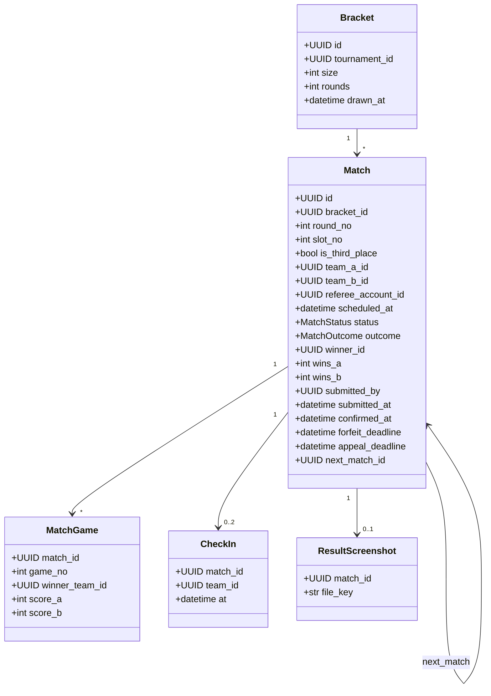

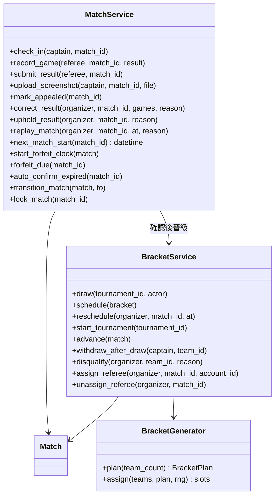

| 類別 | 類型 | 職責 |
| --- | --- | --- |
| Bracket | 實體 | 一個賽事的對戰表：大小、輪數與抽籤時間 |
| Match | 實體 | 場次：對戰隊伍、裁判、時間、狀態、結果類型、系列比分、各種期限與下一場 |
| MatchGame | 實體 | 場次中的一局與其比分 |
| CheckIn | 實體 | 隊伍的報到紀錄，每場最多兩筆 |
| ResultScreenshot | 實體 | 勝隊上傳的結算截圖 |
| BracketGenerator | 演算法 | 依正取隊數計算對戰表結構（輪數、輪空數、季軍賽），再以亂數排定對位；純函式 |
| BracketService | 服務 | 抽籤、排定與修改時間、賽事開始、晉級推進與輪空、抽籤後退賽與取消資格頂替、指派裁判 |
| MatchService | 服務 | 報到、登錄與送出比分、結算截圖、申訴標記、更正與重新比賽、棄權期限與判棄權、自動確認、場次狀態轉換與加鎖 |

**設計重點**

1. BracketGenerator 與資料庫無關：設 P 為不小於正取隊數的最小 2 的次方，輪數為 log₂P，第一輪輪空數為 P 減正取隊數。哪些隊伍輪空由亂數決定，輪空的位置平均分散；輪空數不超過 P ÷ 4 時，兩支輪空隊伍不會在第二輪相遇。亂數來源以參數傳入，測試時可固定，驗證「8 隊 3 輪 8 場、13 隊 4 輪 13 場」等規則。
2. `schedule()` 讓同一輪排在同一時段，下一輪晚於上一輪「每輪間隔」；若上一輪的 BO 數使「棄權時限＋BO 數 × 每局預估時間＋申訴期」超過每輪間隔，下一輪順延到這個下限。系統不自動分批，一位裁判可以被指派到多個場次。`reschedule()` 的新時間不得早於現在，也不得晚於 `next_match_id` 那一場的預定時間（決賽與季軍賽不受後者限制）。
3. 任何 Match 的寫入都先 `lock_match()`，鎖住後再檢查狀態與期限；同時需要賽事鎖時，先鎖賽事、再依 id 遞增鎖場次（AD-6）。會連鎖到下一場或賽事狀態的流程（`auto_confirm_expired()`、處理申訴後的 `advance()`）一開始就先鎖賽事列，再依 id 遞增一次鎖住本場、下一場與季軍賽；`next_match_id` 不會變，可以事先讀出。
4. 場次狀態只能經 `transition_match()` 改變，依《軟體需求分析文件》場次狀態圖的轉換表檢查（AD-11）；「已取消」只用於準決賽沒有產生勝隊時的季軍賽。
5. 棄權期限：`start_forfeit_clock()` 在場次兩隊都確定時設定 `forfeit_deadline`＝max（預定開始時間, 現在）＋棄權時限。抽籤後由 `schedule()` 為所有兩隊都已確定的場次呼叫（第一輪，以及兩支輪空隊伍在第二輪相遇的場次）；之後由 `advance()`、遞補與頂替在填入第二支隊伍時呼叫；`reschedule()` 會重算。隊伍未確定時 `forfeit_deadline` 為空，`forfeit_due()` 不會選到它，`check_in()` 也拒絕報到（`MATCH_TEAMS_PENDING`）。前一場申訴未處理時的「暫停」就是這個狀況，不需要額外的狀態。
6. `advance()` 在場次確認後把勝隊填入下一場、準決賽敗隊填入季軍賽。若下一場某一方確定不會有隊伍（前一場雙方棄權，或退賽、取消資格後無人遞補），把該場以 `walkover` 確認並繼續推進；準決賽沒有產生勝隊時，季軍賽轉為「已取消」。填位後若指派的裁判是其中一隊的隊員，取消該場的指派並發出事件通知主辦方。
7. `record_game()` 在兩隊都報到前拒絕登錄（FR-26），`submit_result()` 在尚無一隊達到勝局門檻時拒絕送出（FR-27）。`submit_result()` 寫入 `submitted_by` 與 `submitted_at`，場次進入申訴期；場次變為已確認時寫入 `confirmed_at`。申訴更正的處理者記在 Appeal，不覆寫原送出者。各種結果類型的欄位填法見《軟體需求分析文件》的 MATCH 資料表。
8. `assign_referee()` 呼叫 `TournamentService.is_referee()` 確認帳號是此賽事的裁判，並呼叫 `RegistrationService.is_member()` 拒絕指派到其隊伍參賽的場次；結果寫入 `referee_account_id`。送出系列結果前，主辦方可以改派（再次呼叫 `assign_referee()`）或以 `unassign_referee()` 收回指派；收回後由主辦方代登，已登錄的局保留，被取消指派的裁判收到通知。
9. 抽籤後的退賽與取消資格由 BracketService 主導：先修改對戰表，再呼叫 registration 取得下一個候補並更新報名狀態（AD-4）。
10. `start_tournament()`、`forfeit_due()` 與 `auto_confirm_expired()` 由 worker 呼叫，每筆一個交易，可重複執行。`start_tournament()` 在最早場次開放報到時呼叫 `TournamentService.transition_tournament()` 轉為進行中。這些工作都先檢查賽事狀態，已取消或已結束的賽事一律略過。

## 六、申訴與檢舉模組 disputes

**職責**：隊長提出申訴（每隊每場一次）與資格檢舉；主辦方處理申訴（維持或更正）與查證檢舉（駁回或取消資格），實際的場次與對戰表變更交由 competition 執行；申訴逾期時提醒主辦方一次。

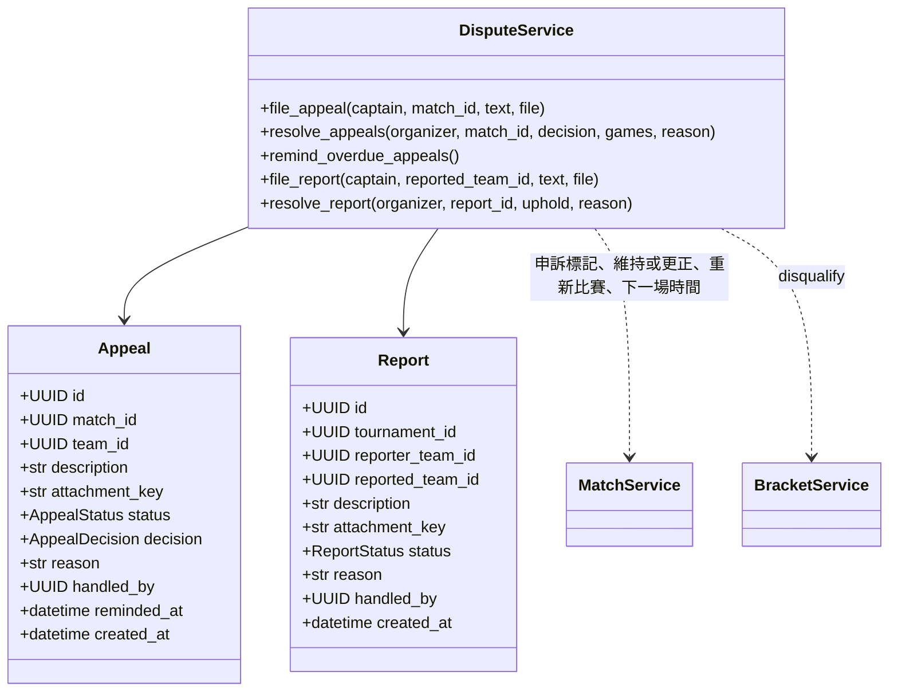

| 類別 | 類型 | 職責 |
| --- | --- | --- |
| Appeal | 實體 | 對單一場次結果的申訴、處理結果與提醒時間 |
| Report | 實體 | 對另一支隊伍參賽資格的檢舉、查證結果與處理者 |
| DisputeService | 服務 | 申訴與檢舉的提出、處理、查證與逾期提醒；呼叫 competition 執行場次更正與取消資格 |

**設計重點**

1. `file_appeal()` 透過 MatchService 鎖住場次，確認未超過 `appeal_deadline`、場次為申訴期或申訴中、該隊未申訴過，再建立申訴；場次仍在申訴期時才呼叫 `mark_appealed()` 轉為申訴中。所以另一隊在期限內仍能申訴，一個場次最多兩筆。
2. `resolve_appeals()` 以場次為單位處理：同一場次未結案的申訴以相同的決定與理由一併結案，並寫入 `handled_by`。選擇更正時，由 MatchService 依新的各局結果重算系列比分，變更前後內容寫入操作紀錄。選擇重新比賽時（只用於判棄權的場次），呼叫 `MatchService.replay_match()`：場次回到待開打，清除 outcome、勝隊與報到紀錄，設定新時間並重新起算棄權期限。
3. `remind_overdue_appeals()` 由 worker 呼叫：只挑處理中且 `reminded_at` 為空的申訴，提醒時間為下一場預定開始前 1 小時（以 `MatchService.next_match_start()` 取得；決賽與季軍賽沒有下一場，為提出後 1 小時）；發出提醒事件的同一個交易寫入 `reminded_at`，所以 worker 重複輪詢也只提醒一次。
4. `resolve_report()` 寫入 `handled_by` 與理由；判定屬實時呼叫 `BracketService.disqualify()`，頂替規則完全由 competition 處理，disputes 不直接修改對戰表（AD-4）。`file_report()` 只接受檢舉人與被檢舉隊伍都已送出報名（待分配、正取、候補或已參賽），報名狀態以 `RegistrationService.get_registration()` 取得。
5. disputes 位於依賴鏈的最上層，可以呼叫 competition、registration 與 tournaments，反方向的呼叫一律禁止（AD-3）。

## 七、通知模組 notifications

**職責**：消化 outbox 事件，依通知對象表決定收件人，建立站內通知並寄送 Email（失敗重試）；提供通知中心的查詢與標為已讀。

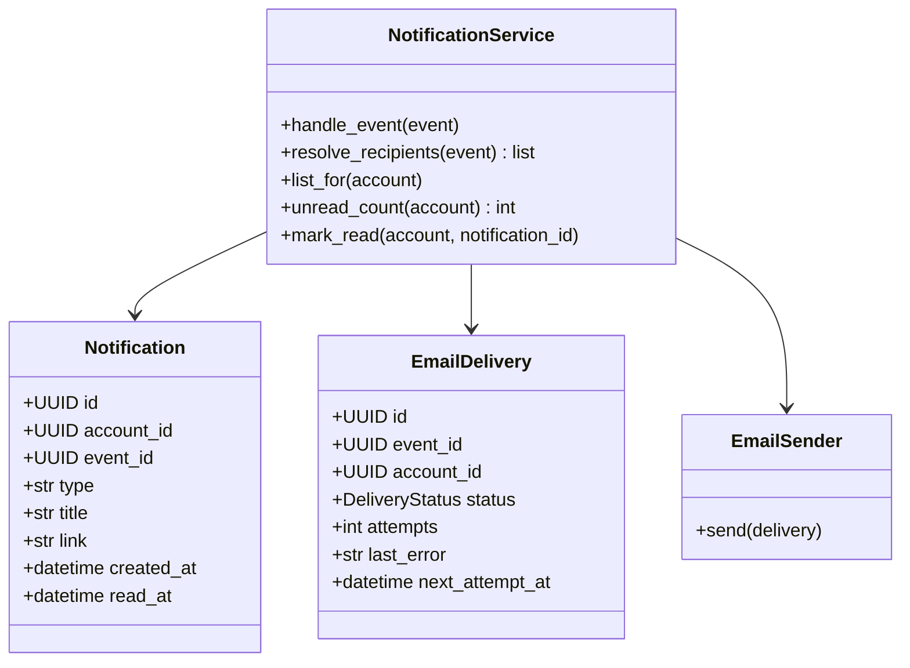

| 類別 | 類型 | 職責 |
| --- | --- | --- |
| Notification | 實體 | 一則站內通知，記錄已讀時間 |
| EmailDelivery | 實體 | 一封 Email 的寄送狀態、嘗試次數與最近一次錯誤 |
| NotificationService | 服務 | 處理事件、決定收件人、建立通知與寄送紀錄；提供通知中心查詢 |
| EmailSender | 服務 | 透過 SMTP 寄出 Email（示範環境寄到 Mailpit） |

**設計重點**

1. `handle_event()` 以（事件 id、收件人）為唯一鍵建立通知與寄送紀錄，同一事件重複處理不會重複通知。
2. 收件人由 `resolve_recipients()` 依 FR-37 的通知對象表（《軟體需求分析文件》附錄）查詢決定，事件本身不帶收件人清單；查詢時可呼叫任何模組的 Service，但沒有模組可以呼叫 notifications（AD-3、AD-8）。
3. Email 失敗時更新 `attempts` 與 `last_error` 並稍後重試，不影響任何業務資料。
4. `list_for()` 依建立時間由新到舊排序；前端每 30 秒輪詢 `unread_count()` 更新頂欄的未讀數。

## 八、模組協作設計

模組之間只透過 Service 的公開函式溝通，回傳值為 Pydantic schema；通知這類附帶動作則一律透過事件。下表整理主要的跨模組呼叫：

| 呼叫方 | 被呼叫方 | 公開函式 | 用途 |
| --- | --- | --- | --- |
| registration | tournaments | `lock_tournament()`、`get_tournament()` | 名單與報名操作前鎖住賽事、讀取名額、模式與主辦方 |
| registration | tournaments | `update_tournament()` | 提高名額（之後由 registration 遞補候補） |
| registration | identity | `get_account()` | 取得隊員的學校以檢查同校 |
| competition | registration | `next_waitlisted()`、`mark_status()` | 抽籤後退賽或取消資格時取得候補並更新報名狀態 |
| competition | registration | `is_member()` | 指派裁判與晉級填位時，檢查裁判是不是兩隊的隊員 |
| competition | registration | `get_team()` | 報到、上傳結算截圖時確認隊長；公開對戰樹取隊名 |
| competition | tournaments | `bo_for_round()`、`transition_tournament()`、`is_referee()`、`get_tournament()` | 取得該輪 BO 數、推進賽事狀態、確認裁判身分、主辦方代登時檢查身分 |
| disputes | competition | `mark_appealed()`、`correct_result()`、`uphold_result()`、`replay_match()`、`next_match_start()`、`disqualify()` | 申訴處理（含重新比賽）與取消資格的實際執行、計算提醒時間 |
| disputes | registration | `get_team()`、`get_registration()` | 申訴與檢舉時確認隊長、檢查檢舉雙方的報名狀態 |
| tournaments | core | `audit.list_for_tournament()` | 主辦方查閱自己賽事的操作紀錄 |
| 各模組 | core | `audit.record()`、`events.publish()` | 寫入操作紀錄、發出事件 |
| notifications | 各模組 | 查詢函式 | 決定事件的收件人 |

以「主辦方查證檢舉屬實、取消某隊資格」為例，這個操作橫跨 disputes、competition、registration 三個模組，但仍在同一個交易中完成：

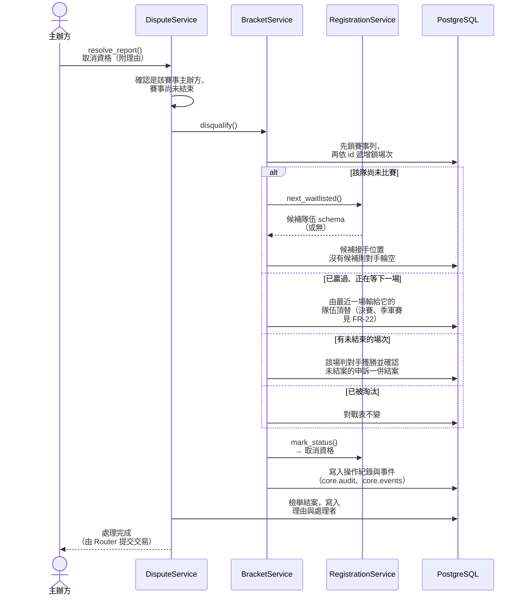

# 參、設計原則與模式

下表整理本系統採用的設計原則與模式。Repository 與資料傳輸物件的定義參考 Fowler（參考文獻 1），策略模式參考 Gamma 等人（參考文獻 2），交易式 outbox 參考 Richardson（參考文獻 3）。

| 原則或模式 | 應用位置 | 解決的問題 |
| --- | --- | --- |
| 分層架構 | 每個模組的 Router／Service／Repository | 每一層只有一種職責，業務規則可獨立測試 |
| Repository 模式 | 各模組的 Repository | 隔離資料存取，Service 不直接寫 SQL；加鎖集中管理 |
| 策略模式 | AllocationPolicy（校園賽、自訂） | 名額規則依賽事模式切換，新增模式時只需新增策略 |
| 純函式領域邏輯 | AllocationPolicy、BracketGenerator | 最複雜的規則不碰資料庫，可以大量撰寫單元測試 |
| 狀態機（單一轉換函式） | `transition_tournament()`、`transition_match()`、`mark_status()` | 避免各處直接改狀態而跳過規定的流程 |
| 交易式 outbox | `core.events` 與 notifications | 資料與通知一致、通知不重複、寄信失敗不影響主流程 |
| 快照 | Tournament.game_snapshot、Registration 的三個快照欄位 | 遊戲設定或隊員資料之後改變，也不影響已建立的賽事與分配結果 |
| 依賴注入 | Clock、亂數來源、EmailSender | 測試時以假物件替換，可驗證「30 分鐘後」與固定的抽籤結果 |
| 資料傳輸物件 | 跨模組回傳的 Pydantic schema（`AccountRead`、`TournamentRead`、`TeamRead`、`RegistrationRead`）、公開 API 的 `Public*` schema | 模組之間不共享 ORM 物件；公開資料不含個資 |

## 一、列舉型別

狀態與類型以 Python `StrEnum`（參考文獻 4）定義。賽事、報名、場次三個狀態列舉的英文值，沿用《軟體需求分析文件》狀態圖中的代號（列在括號內）；其他列舉中還沒寫出英文值的，在實作第一個 Story 時依同一命名慣例訂定。

| 列舉 | 所屬模組 | 成員 |
| --- | --- | --- |
| TokenPurpose | identity | verify_email、reset_password |
| ApplicationStatus | identity | 待審核（pending）、核准（approved）、退回（rejected） |
| ScoreType | tournaments | win_loss（只記勝負）、rounds（回合比分） |
| TournamentMode | tournaments | campus（校園賽）、custom（自訂） |
| TournamentStatus | tournaments | 尚未開放（upcoming）、開放報名（open）、報名截止（closed）、賽程已公布（published）、進行中（ongoing）、已結束（finished）、已取消（cancelled） |
| MemberRole | registration | captain（隊長）、player（選手） |
| RegistrationStatus | registration | 組隊中（forming）、已送出・待分配（pending）、正取（accepted）、候補（waitlisted）、退回（rejected）、撤回（withdrawn）、已參賽（drawn）、退賽（retired）、取消資格（disqualified） |
| MatchStatus | competition | 待開打（scheduled）、進行中（live）、申訴期（appeal_window）、申訴中（appealed）、已確認（confirmed）、已取消（voided） |
| MatchOutcome | competition | played（正常完賽）、forfeit（一方棄權）、double_forfeit（雙方棄權）、walkover（輪空）、disqualified（取消資格判負） |
| AppealStatus／AppealDecision | disputes | 處理中、已結案／維持原結果、更正結果、重新比賽（只用於棄權判定） |
| ReportStatus | disputes | 處理中、駁回、屬實 |
| DeliveryStatus | notifications | 待寄（pending）、已寄出（sent）、失敗（failed） |

# 參考文獻

1. Fowler, M. (2002). *Patterns of Enterprise Application Architecture*. Addison-Wesley.
2. Gamma, E., Helm, R., Johnson, R., & Vlissides, J. (1994). *Design Patterns: Elements of Reusable Object-Oriented Software*. Addison-Wesley.
3. Richardson, C. *Pattern: Transactional outbox*. microservices.io. https://microservices.io/patterns/data/transactional-outbox.html
4. Python Software Foundation. *enum — Support for enumerations*. https://docs.python.org/3/library/enum.html
5. Pydantic 官方文件。https://docs.pydantic.dev/latest/
6. SQLModel 官方文件。https://sqlmodel.tiangolo.com/
7. 本組（2026）。架構骨幹與 C／D 設計打底稿。專案資料夾 `_bmad-output/planning-artifacts/architecture/`。
