# 版本紀錄

| 版本 | 日期 | 修改內容 |
| --- | --- | --- |
| 1.0 | 2026-10-16 | 初版 |
| 1.1 | 2026-10-19 | 依審閱意見修訂：統一用語，新增「尚未開放」狀態與學校清單，補充輪空、棄權期限、名額同分與取消資格規則 |
| 1.2 | 2026-10-20 | 依一致性審查補充類別方法（退出與解散隊伍、改派裁判、重新比賽）與列舉英文值，並拆分過大的類別圖；新增版本紀錄與參考文獻 |
| 1.3 | 2026-10-23 | 配合截止補位改由所有候補依平均段位積分補位，AllocationPolicy 的 `fill_second_teams()` 改名為 `fill_from_waitlist()` |
| 1.4 | 2026-10-28 | 依 Epic 1 實作補上 Account.credentials_version、EmailDelivery.next_attempt_at、AuditLog.seq，以及 ApplicationStatus、DeliveryStatus 的英文值 |
| 1.5 | 2026-11-11 | 依期中實作（已完成的 35 個 Story）更新各模組類別圖、類別職責、模組協作與列舉；期中後才實作的類別與方法集中列於貳、九 |

# 壹、系統簡介

## 一、系統簡介與特色

本系統是校際與社群電競盃賽的一站式管理平台，整合主辦方申請、遊戲設定、賽事建立、組隊報名、三階段名額分配、抽籤與單淘汰對戰表、報到與逐局比分、申訴與檢舉、觀賽與通知等功能。系統以模組化架構設計，透過資料庫列鎖、單一狀態轉換函式與交易式 outbox 等機制，避免名額超收、比分互相覆蓋與通知遺漏；所有影響結果的操作都留下不可修改的紀錄，讓主辦方在爭議發生時有據可查。

本文件說明後端各模組的類別設計、類別職責與模組之間的協作方式。類別圖中只列出決定職責的主要欄位與方法，完整的資料欄位與唯一鍵請見《軟體需求分析文件》的資料表說明；文中的設計決策編號（AD-1～AD-21）的規則摘要見《軟體設計文件》附錄。本文件的類別圖已依 2026-11-10 的程式碼更新，只畫目前實際存在的類別與公開函式；擱置到期中後的 15 個 Story 預計新增的部分，集中列在貳、九。

## 二、軟體架構圖

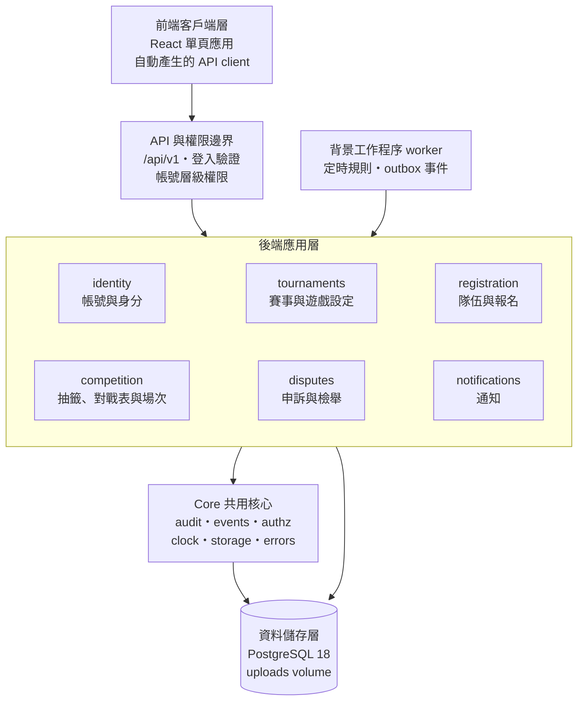

### （一）前端客戶端層

前端以 React 單頁應用呈現，可在手機與電腦上使用。前端只負責介面呈現與操作互動，不包含任何業務規則；所有資料存取都透過依 OpenAPI 文件自動產生的 API client，需要即時更新的畫面以固定頻率輪詢。

### （二）API 與權限邊界

所有請求都經由 `/api/v1` 進入後端。Router 在這一層驗證登入身分，並檢查帳號層級的權限（已登入、Email 已驗證、平台管理員、主辦方）；不需登入的公開 API 只回傳 `Public*` schema，避免個資外洩。

### （三）後端應用層

後端採模組化單體，依功能切成 6 個業務模組。每個模組內部分成三層：

1. **Router 層**：API 路由、輸入驗證、帳號層級權限，並開啟與提交交易。
2. **Service 層**：業務規則、資源層級權限、狀態轉換、寫入操作紀錄與發出事件；跨模組時只呼叫其他模組 Service 的公開函式。
3. **Repository 層**：本模組資料表的查詢、寫入與加鎖，提供 Service 一致的資料存取介面。

### （四）背景工作與通知

worker 是後端程式碼的另一個進入點，定期處理到期工作（報名開始、優先期結束、報名截止、賽事開始、判棄權、申訴期滿），並讀取 outbox 事件交給通知模組，使通知寄送不會阻塞使用者的操作。

### （五）資料儲存層

PostgreSQL 是唯一的資料來源，以列鎖保證併發一致、以 trigger 保護操作紀錄；上傳的截圖存在 docker volume，資料庫只存檔案鍵值。

# 貳、物件設計

各模組的類別依角色分為四類：**實體**（對應資料表的 SQLModel 類別）、**控制**（Router）、**服務**（Service，承載業務規則）、**資料存取**（Repository）。另有少數**規則**模組，是不碰資料庫的純函式，方便單元測試；共用核心還有一個**例外**類別 BusinessError，用來表示業務錯誤。Router 與 Repository 的結構在各模組都相同，因此只在帳號與身分模組呈現，其他模組的類別圖中省略。類別較多的模組分成多張圖：identity、tournaments、registration 的第一張是實體與其關聯，第二張是服務與規則；competition 的第一張是實體，第二張是服務與申訴、取消資格，第三張是判棄權工作、對 registration 的轉接與規則；共用核心的第一張是兩張資料表與寫入它們的服務，第二張是其餘彼此沒有關聯的共用工具。

程式中的 Service、Repository 與規則都是 Python 模組裡的函式，不是 class。類別圖以一個「類別」代表一個模組檔（例如 `CompetitionService` 代表 `competition/service.py`），並省略每個函式都有的第一個參數 `session`，以及上傳檔案的 `content_type`、`file_name` 與 `for_update` 等附帶參數；參數過多的規則函式以 `...` 表示；對照方式見各節的職責表。

## 一、共用核心 core

共用核心提供各模組共用、與業務無關的基礎功能，不得 import 任何業務模組。它擁有操作紀錄（AuditLog）與事件（OutboxEvent）兩張資料表。

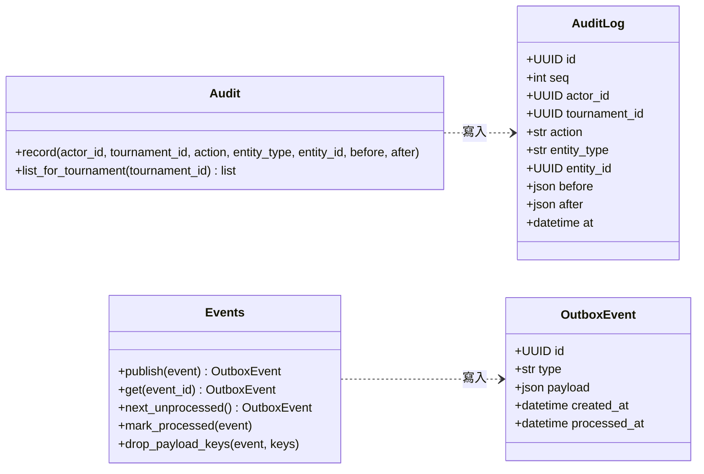

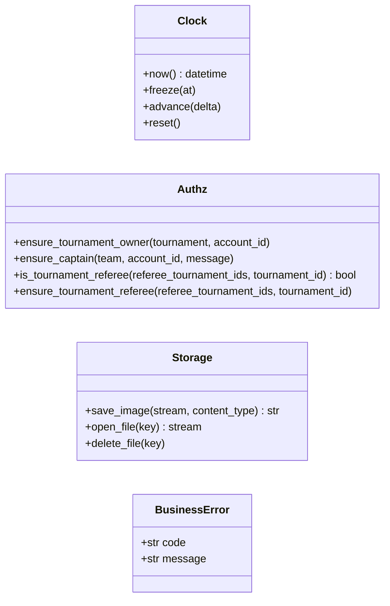

| 類別 | 類型 | 職責 |
| --- | --- | --- |
| AuditLog | 實體 | 一筆操作紀錄：操作者、所屬賽事、動作、對象與變更前後內容；只能新增 |
| OutboxEvent | 實體 | 一則待處理的事件，與業務資料同一交易寫入 |
| Audit | 服務 | `core/audit.py`：`record()` 讓各 Service 在同一交易中寫入操作紀錄；`list_for_tournament()` 依賽事查詢紀錄 |
| Events | 服務 | `core/events.py`：`publish()` 把事件寫入 outbox；`next_unprocessed()`、`mark_processed()` 供 worker 依序處理；`drop_payload_keys()` 在信件寄出後移除 payload 中的 token 明文 |
| Clock | 服務 | `core/clock.py`：取得目前時間的唯一入口；測試時以 `freeze()`、`advance()`、`reset()` 控制時間 |
| Authz | 服務 | `core/authz.py`：資源層級權限的共用檢查；只接收呼叫端已載入的實體或跨模組取得的 schema（以 Protocol 描述需要的欄位），自己不查資料庫 |
| Storage | 服務 | `core/storage.py`：上傳檔案的儲存、讀取與刪除，驗證格式與大小 |
| BusinessError | 例外 | 業務錯誤，帶英文代碼與繁中訊息，由 Router 轉成 4xx 回應 |

**設計重點**

1. `record()` 的 `tournament_id` 由呼叫端傳入：賽事內的操作帶該賽事的 id，帳號類的操作（註冊、主辦方申請等）傳空值，worker 自動執行時 `actor_id` 為空。`list_for_tournament()` 已提供，主辦方查閱操作紀錄的 API 與頁面屬於 Story 2.8（AD-1、AD-9）。
2. Authz 的函式都只比對傳入物件的欄位。`ensure_tournament_owner()` 比對主辦方 id，`ensure_captain()` 比對隊員角色。場次的裁判身分不經 Authz：場次直接存裁判的帳號 id，competition 的 Service 比對 `match.referee_account_id` 與登入帳號；場次沒有指派裁判時，由該賽事主辦方代登（AD-10）。

## 二、帳號與身分模組 identity

**職責**：註冊、登入、Email 驗證與重寄驗證信、忘記與重設密碼、主辦方申請與審核、學校清單，並提供帳號查詢給其他模組。

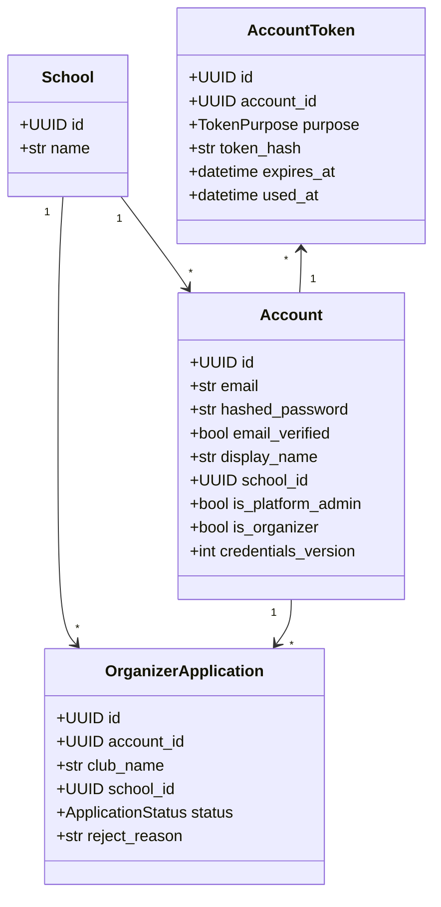

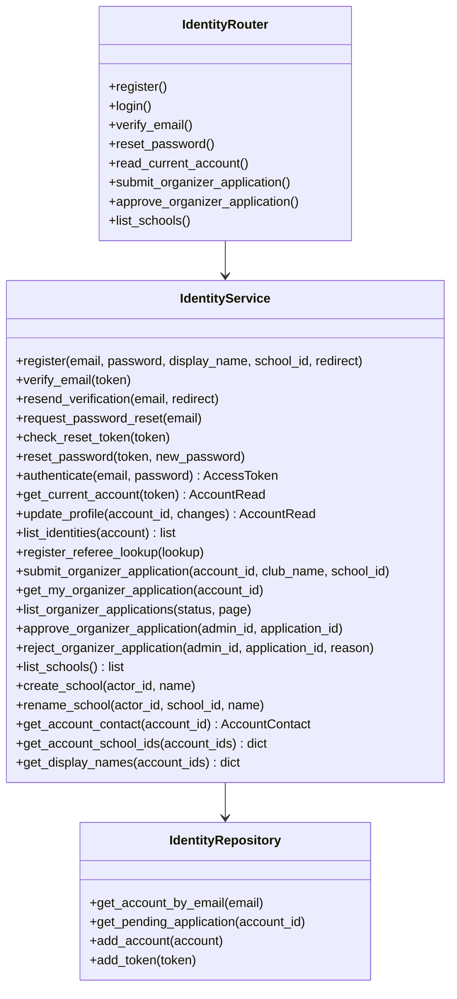

| 類別 | 類型 | 職責 |
| --- | --- | --- |
| Account | 實體 | 帳號資料；平台管理員與主辦方是帳號上的旗標 |
| School | 實體 | 學校清單中的一間學校；同校檢查一律比對 `school_id` |
| AccountToken | 實體 | Email 驗證與重設密碼的一次性 token，只存雜湊 |
| OrganizerApplication | 實體 | 主辦方申請與審核結果 |
| IdentityRouter | 控制 | 帳號相關的 API 端點，檢查帳號層級權限（圖中只列代表性的端點，完整清單見《軟體設計文件》肆、二） |
| IdentityService | 服務 | `identity/service.py`：註冊、驗證、登入、重設密碼、身分清單、申請審核與學校清單的業務規則；`get_account_contact()` 等函式回傳 schema 或基本型別給其他模組 |
| IdentityRepository | 資料存取 | `identity/repository.py`：帳號、學校、token 與申請的查詢與儲存（圖中只列代表性的函式） |

**設計重點**

1. 驗證 token 24 小時、重設 token 1 小時到期，用一次即寫入 `used_at`；產生新 token 時，同帳號同用途的舊 token 全部作廢（AD-21）。
2. 寄信一律經 outbox 事件（`VerificationEmailRequested`、`PasswordResetRequested`），只寄 Email、不建立站內通知。
3. `request_password_reset()` 對未註冊的 Email 不產生事件，但回應與已註冊時完全相同，避免洩漏 Email 是否存在。
4. `get_account_contact()`、`get_account_school_ids()`、`get_display_names()` 回傳 schema 或基本型別而非 ORM 物件，其他模組無法透過它們修改帳號資料（AD-2）。
5. 學校清單以教育部大專校院名錄為初始資料；帳號的學校為選填、主辦方申請的學校必填，兩者都只能選清單內的學校；校園賽送出報名時，每位隊員都必須已設定學校。School 放在 identity，是因為 identity 位於依賴鏈的最底層，其他模組都可以向它查詢。
6. identity 位於呼叫方向的最底層，不能呼叫 tournaments，但身分切換器要知道帳號有沒有裁判身分。因此 identity 開放 `register_referee_lookup()` 註冊點，由 `api/main.py` 啟動時把 tournaments 的 `has_referee_role()` 註冊進去，呼叫方向不變。
7. 登入 token 帶 `credentials_version`，重設密碼時版本加 1，其他裝置的 token 即失效。

## 三、賽事與遊戲設定模組 tournaments

**職責**：遊戲清單與段位對照（平台管理員維護）、建立賽事（含設定快照）、賽事狀態轉換、裁判邀請與裁判身分。修改賽事、取消賽事與查閱操作紀錄在期中後加入（見貳、九）。

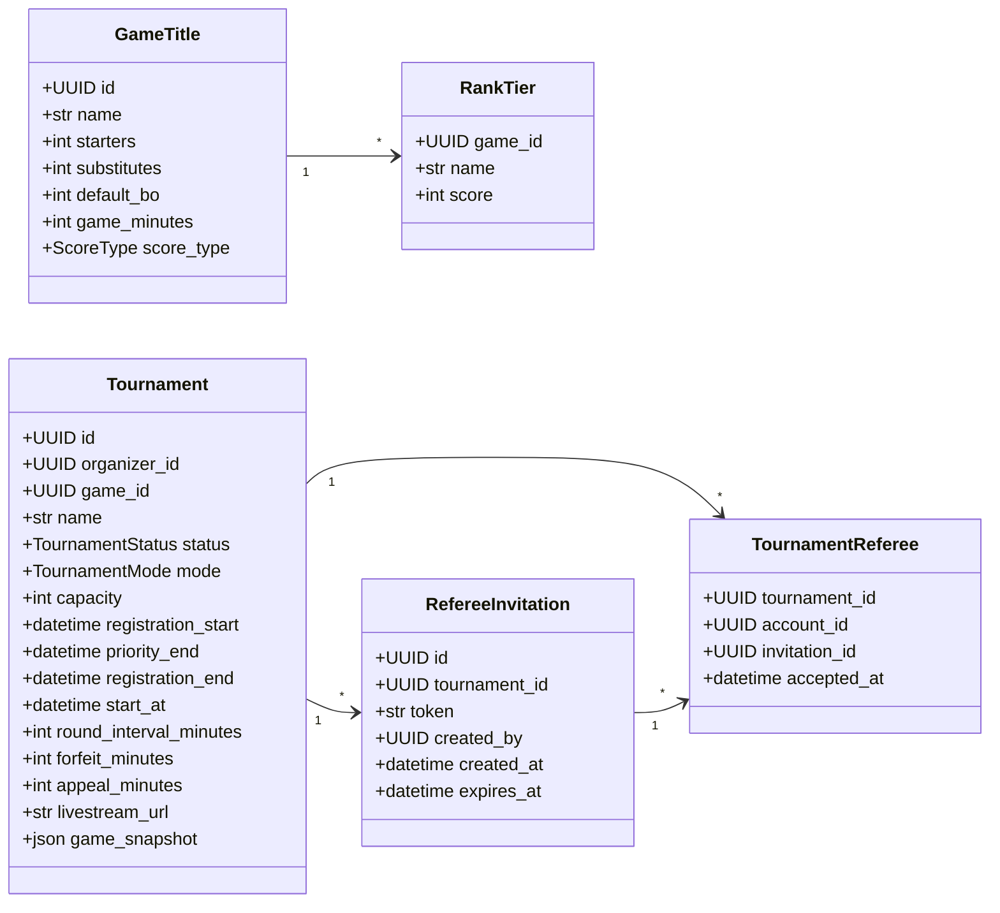

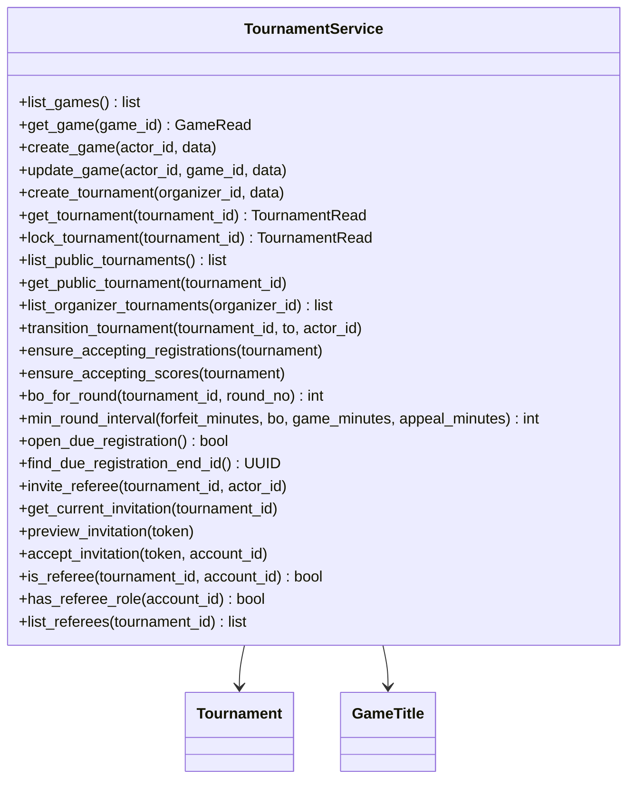

| 類別 | 類型 | 職責 |
| --- | --- | --- |
| GameTitle | 實體 | 遊戲與其預設值（人數、BO、每局預估時間、比分型態） |
| RankTier | 實體 | 遊戲的段位與段位積分對照 |
| Tournament | 實體 | 賽事設定、狀態與建立時複製的遊戲設定快照 |
| RefereeInvitation | 實體 | 裁判邀請連結、建立者與到期時間 |
| TournamentReferee | 實體 | 帳號在某賽事中的裁判身分，主鍵為（賽事, 帳號），並記錄接受的邀請與時間 |
| TournamentService | 服務 | `tournaments/service.py`：遊戲維護、賽事建立、狀態轉換、加鎖、公開查詢與裁判邀請 |

**設計重點**

1. 建立賽事時把遊戲的人數、BO、每局預估時間、比分型態與段位對照複製到 `game_snapshot`，之後只讀這份副本；平台管理員修改遊戲預設值不影響已建立的賽事（AD-12）。
2. `bo_for_round()` 目前回傳快照中的預設 BO 數，每一輪相同；分輪設定在 Story 2.3 加入。BO 數只接受 1、3、5、7。程式中沒有任何依遊戲名稱的分支（AD-18）。
3. `create_tournament()` 以 `min_round_interval()` 檢查每輪間隔不小於「棄權時限＋預設 BO 數 × 每局預估時間＋申訴期」。API 接收優先期長度 `priority_hours`，資料表存換算後的 `priority_end`。報名開始時間未到時，賽事建立為「尚未開放」，由 worker 呼叫 `open_due_registration()` 轉為開放報名；報名開始時間已過時直接為「開放報名」。
4. 賽事建立後目前不能修改；修改賽事的限制（FR-9）屬於 Story 2.5。
5. `mode` 欄位已建立，但期中只開放校園賽（表單不顯示模式，一律存 `campus`）；所有與模式有關的判斷交給 registration 模組的 `allocation.py`（AD-20）。
6. `lock_tournament()` 是全系統鎖住賽事列的唯一入口，其他模組要加鎖時都呼叫它（AD-6）。
7. `invite_referee()` 產生 7 天後到期的邀請，並使同賽事尚未到期的舊邀請立即失效。`accept_invitation()` 拒絕該賽事的主辦方接受邀請；賽事已結束或已取消時，產生與接受邀請都被拒絕（`ensure_accepting_referees()`）。`is_referee()` 供 competition 指派裁判時確認身分。

## 四、隊伍與報名模組 registration

**職責**：建立隊伍與邀請隊員、選手參賽資料、送出報名、校園賽的三階段名額分配、候補排序、抽籤前的最後分配，以及取消資格時的報名狀態更新。名額規則集中在純函式的 `allocation.py`（下稱 AllocationPolicy）。

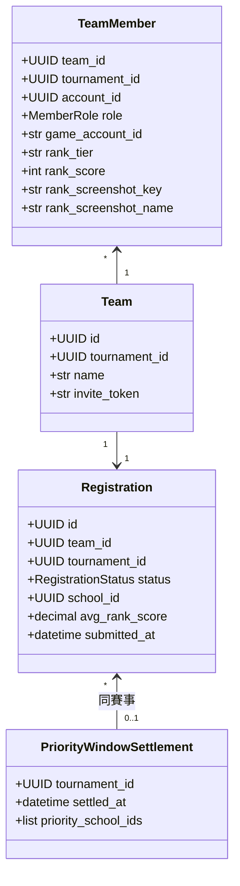

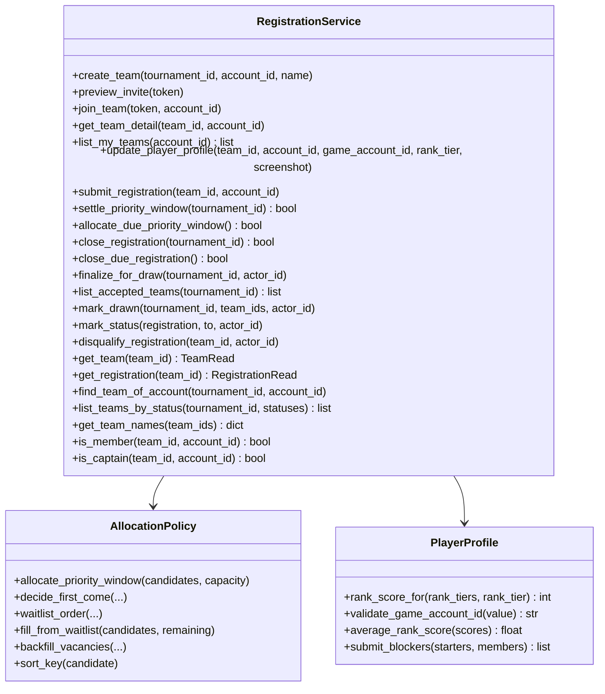

| 類別 | 類型 | 職責 |
| --- | --- | --- |
| Team | 實體 | 隊伍，只屬於一個賽事，帶有隊伍邀請 token |
| TeamMember | 實體 | 隊員與其角色（隊長或選手）、遊戲 ID、段位與段位截圖；帶所屬賽事以建立（tournament_id, account_id）唯一鍵 |
| Registration | 實體 | 報名狀態與分配結果；建立隊伍時即產生（組隊中），送出時寫入學校、平均段位積分與送出時間快照 |
| PriorityWindowSettlement | 實體 | 優先期結算紀錄：每場賽事一筆，存優先期有報名的學校，確保結算只做一次 |
| RegistrationService | 服務 | `registration/service.py`：組隊、填寫參賽資料、送出、三階段分配與抽籤前的最後分配，並提供隊伍與報名查詢給其他模組 |
| AllocationPolicy | 規則 | `registration/allocation.py`：判定代表隊、正取或候補、截止補位、遞補與候補順位；不碰資料庫的純函式 |
| PlayerProfile | 規則 | `registration/player_profile.py`：段位換算、遊戲 ID 驗證、平均段位積分與送出條件檢查；純函式 |

**設計重點**

1. 隊長身分只看 `TeamMember.role`，每隊恰好一位隊長；`core.authz.ensure_captain()` 依此判斷；其他模組以 `get_team()` 取得的 `TeamRead` 或 `is_captain()` 判斷。
2. 會改變名額或名單的操作——`create_team()`、`join_team()`、`update_player_profile()`、`submit_registration()`——都先鎖住賽事列，鎖住之後才檢查隊長身分、人數上限與名單狀態，避免檢查後被其他操作改變（AD-6）。TeamMember 的（tournament_id, account_id）唯一鍵是最後一道防線，即使程式漏鎖，同一帳號也無法加入同賽事的兩支隊伍。報名截止時間由 registration 自己比對，同時套用到送出、建隊、加入與修改參賽資料。
3. `create_team()` 與 `join_team()` 先向 tournaments 取得賽事 schema，拒絕該賽事的主辦方建立或加入隊伍。
4. 名額分配與候補排序只使用 Registration 上的三個快照欄位，所有人用同一份資料判斷（AD-12）。平均段位積分計入名單上所有成員（含替補），同分時依送出時間、再依報名 id 排序。送出前畫面上的平均值只算已填段位的成員並註明人數；送出時要求全員填完，凍結的值包含所有成員。
5. AllocationPolicy 集中校園賽的所有名額規則，其他程式不得自行依模式分支（AD-20）。由於它是純函式，《軟體需求分析文件》附錄中每一條名額規則的可測結果（例如「名額 32、40 間學校報名」）都能直接寫成單元測試。
6. worker 呼叫 `allocate_due_priority_window()` 與 `close_due_registration()`，內部分別執行 `settle_priority_window()` 與 `close_registration()`，重複呼叫不會重複分配。沒有任何已送出報名的賽事不寫結算紀錄，判定時以空集合計算，結果相同。
7. `submit_registration()` 在優先期內轉為「已送出・待分配」，優先期結束後依 `decide_first_come()` 當下判定正取或候補。有空出的名額時，同一個鎖內先讓有順位的候補遞補（`backfill_vacancies()`），再判定新送出的報名。
8. `finalize_for_draw()` 供抽籤呼叫：立即完成尚未執行的優先期結算、補做先搶期與截止補位，操作紀錄的操作者記主辦方。competition 經 `registration_port.py` 呼叫這些函式，要改報名狀態時也一律走 `mark_status()` 或 `disqualify_registration()`（AD-2）。
9. `get_team()` 回傳 `TeamRead`（隊名、隊員帳號與角色），`get_registration()` 回傳 `RegistrationRead`（報名狀態與快照）。其他模組用它們取得隊長身分與報名狀態，不直接讀 registration 的資料表（AD-2、AD-10）。

## 五、抽籤、對戰表與場次模組 competition

**職責**：抽籤與產生單淘汰對戰表（含輪空、季軍賽）、排定場次時間、晉級推進（含輪空）、取消資格頂替、指派裁判、報到、判棄權、逐局比分、送出系列結果、申訴期與自動確認、申訴後的更正與重新比賽，以及賽事開始時的狀態推進。對戰表、排程、晉級、比分、報到與棄權的規則都是純函式模組。

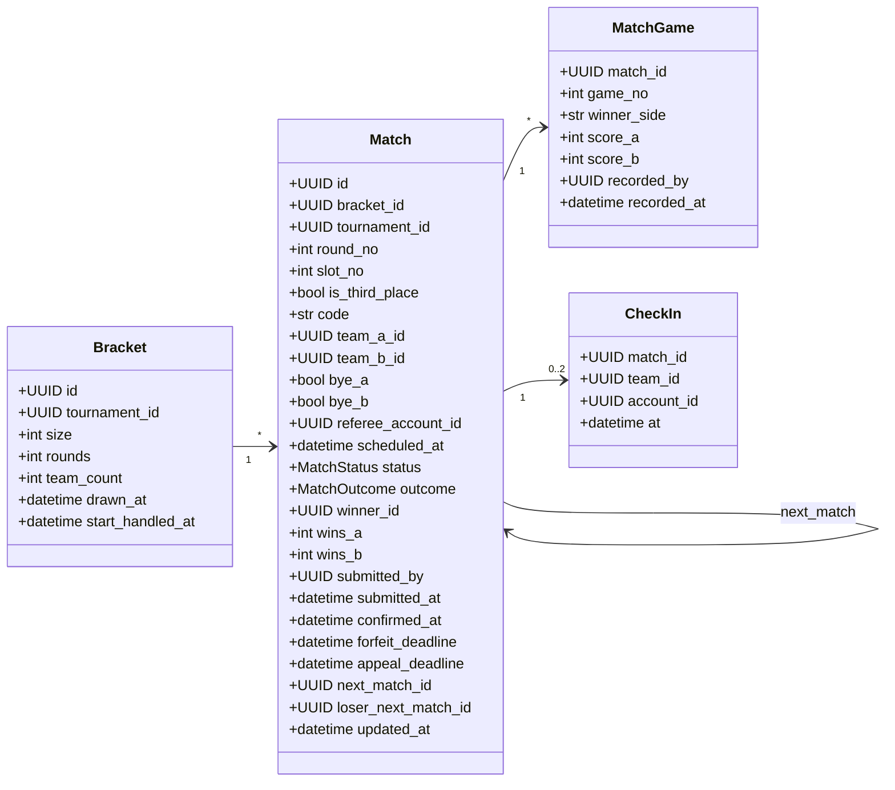

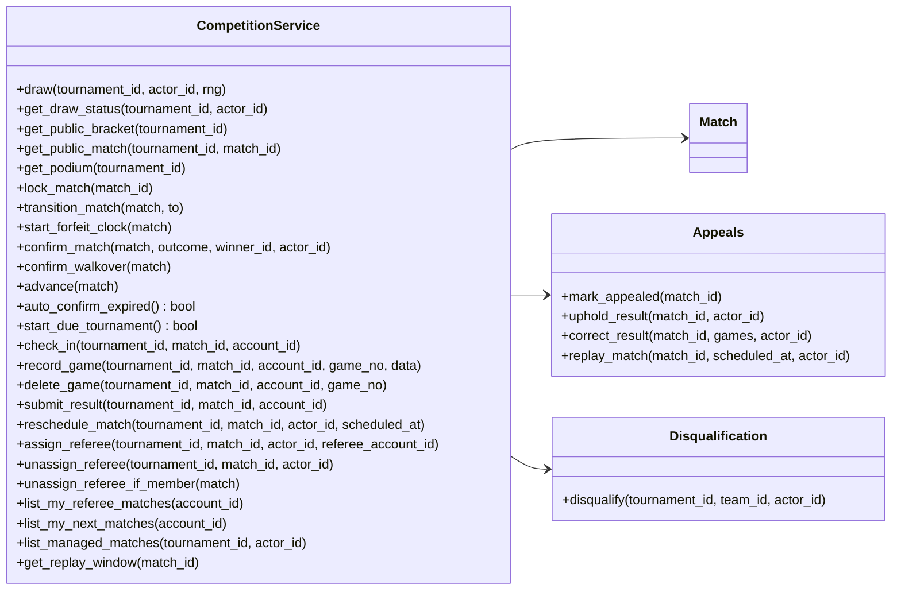

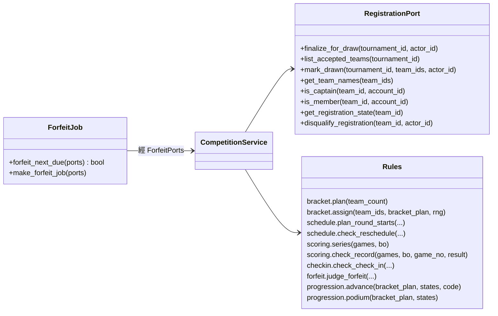

| 類別 | 類型 | 職責 |
| --- | --- | --- |
| Bracket | 實體 | 一個賽事的對戰表：大小、輪數與抽籤時間 |
| Match | 實體 | 場次：對戰隊伍、裁判、時間、狀態、結果類型、系列比分、各種期限與下一場 |
| MatchGame | 實體 | 場次中的一局與其比分 |
| CheckIn | 實體 | 隊伍的報到紀錄，每場最多兩筆 |
| CompetitionService | 服務 | `competition/service.py`：抽籤、排程與修改時間、賽事開始、晉級推進與輪空、指派裁判、報到、比分、送出結果、自動確認、場次狀態轉換與加鎖，並提供公開查詢 |
| Appeals | 服務 | `competition/appeals.py`：申訴標記、維持、更正與重新比賽；經 `service.py` 的同名公開函式供 disputes 呼叫 |
| Disqualification | 服務 | `competition/disqualification.py`：取消資格時的對戰表調整 |
| ForfeitJob | 服務 | `competition/forfeit_job.py`：worker 的判棄權工作，以 `ForfeitPorts` 注入需要的函式，由 `forfeit_adapter.py` 接上 service |
| RegistrationPort | 資料存取 | `competition/registration_port.py`：competition 對 registration 的呼叫集中在此，把回傳值轉成 competition 需要的形式 |
| Rules | 規則 | `bracket.py`、`schedule.py`、`scoring.py`、`checkin.py`、`forfeit.py`、`progression.py`：對戰表結構、排程、比分、報到、棄權與晉級的純函式 |

**設計重點**

1. `bracket.py` 與資料庫無關：設 P 為不小於正取隊數的最小 2 的次方，輪數為 log₂P，第一輪輪空數為 P 減正取隊數。哪些隊伍輪空由亂數決定，輪空的位置平均分散；輪空數不超過 P ÷ 4 時，兩支輪空隊伍不會在第二輪相遇。亂數來源以參數傳入，測試時可固定，驗證「8 隊 3 輪 8 場、13 隊 4 輪 13 場」等規則。開賽時間已過時 `draw()` 拒絕抽籤（`TOURNAMENT_START_PASSED`）。
2. `schedule.plan_round_starts()` 讓同一輪排在同一時段，下一輪晚於上一輪「每輪間隔」；若上一輪的 BO 數使「棄權時限＋BO 數 × 每局預估時間＋申訴期」超過每輪間隔，下一輪順延到這個下限。系統不自動分批，一位裁判可以被指派到多個場次。`reschedule_match()` 的新時間最早為現在進位到整分後加 30 分鐘，且不早於前一輪最晚場次加該輪最小間隔；最晚為下一場（準決賽取決賽與季軍賽中較早者）減本場最小間隔，決賽與季軍賽沒有上限；棄權期限已過的場次不能修改。
3. 任何 Match 的寫入都先 `lock_match()`，鎖住後再檢查狀態與期限；同時需要賽事鎖時，先鎖賽事、再依 id 遞增鎖場次（AD-6）。會連鎖到下一場或賽事狀態的流程（`auto_confirm_expired()`、判棄權、處理申訴後的 `advance()`）一開始就先鎖賽事列。
4. 場次狀態只能經 `transition_match()` 改變，依《軟體需求分析文件》場次狀態圖的轉換表檢查（AD-11）；「已取消」只用於準決賽沒有產生勝隊時的季軍賽。
5. 棄權期限：`start_forfeit_clock()` 在場次兩隊都確定時設定 `forfeit_deadline`＝max（預定開始時間, 現在）＋棄權時限。`draw()` 為所有兩隊都已確定的場次呼叫（第一輪，以及兩支輪空隊伍在第二輪相遇的場次）；之後由 `advance()` 與頂替在填入第二支隊伍時呼叫；`reschedule_match()` 會重算。隊伍未確定時 `forfeit_deadline` 為空，worker 不會選到它，`check_in()` 也拒絕報到（`MATCH_TEAMS_PENDING`）。前一場申訴未處理時的「暫停」就是這個狀況，不需要額外的狀態。
6. `advance()` 在場次確認後依 `progression.advance()` 的結果把勝隊填入下一場、準決賽敗隊填入季軍賽（`loser_next_match_id`）。若下一場某一方確定不會有隊伍，把該場以 `walkover` 確認並繼續推進；準決賽沒有產生勝隊時，季軍賽轉為「已取消」。填位後若指派的裁判是其中一隊的隊員，`unassign_referee_if_member()` 取消該場的指派並發出 `RefereeUnassigned`。
7. `record_game()` 在兩隊都報到前拒絕登錄（FR-26），`submit_result()` 在尚無一隊達到勝局門檻時拒絕送出（FR-27）；送出前可用 `delete_game()` 刪除最後的局。`submit_result()` 寫入 `submitted_by` 與 `submitted_at`，場次進入申訴期；場次變為已確認時寫入 `confirmed_at`。申訴更正的處理者記在 Appeal，不覆寫原送出者。各種結果類型的欄位填法見《軟體需求分析文件》的 MATCH 資料表。
8. `assign_referee()` 呼叫 `is_referee()` 確認帳號是此賽事的裁判，並經 RegistrationPort 拒絕指派到其隊伍參賽的場次；結果寫入 `referee_account_id`。送出系列結果前，主辦方可以改派（再次呼叫 `assign_referee()`）或以 `unassign_referee()` 收回指派；收回後由主辦方代登，已登錄的局保留。
9. `disqualify()` 一開始就鎖賽事列，依該隊處境調整對戰表，再呼叫 registration 更新報名狀態（AD-4）。期中不做候補遞補：還沒比過且對手已在場時，以 `disqualified` 判對手獲勝；對手尚未確定時回 409 `DISQUALIFY_OPPONENT_PENDING`，不改任何資料；已贏過時由最近一場輸給它的隊伍頂替，該場若是取消資格勝則判對手獲勝，輪空勝場略過往前找。
10. `start_due_tournament()`、判棄權與 `auto_confirm_expired()` 由 worker 呼叫，每筆一個交易，可重複執行。`start_due_tournament()` 在最早場次開放報到時呼叫 `transition_tournament()` 轉為進行中，並以 `Bracket.start_handled_at` 記錄已處理。這些工作都先檢查賽事狀態，已取消或已結束的賽事一律略過。

## 六、申訴與檢舉模組 disputes

**職責**：隊長提出申訴與資格檢舉；主辦方處理申訴（維持、更正或重新比賽）與查證檢舉（駁回或屬實），實際的場次與對戰表變更交由 competition 執行；提供主辦方的待處理清單與附件下載。

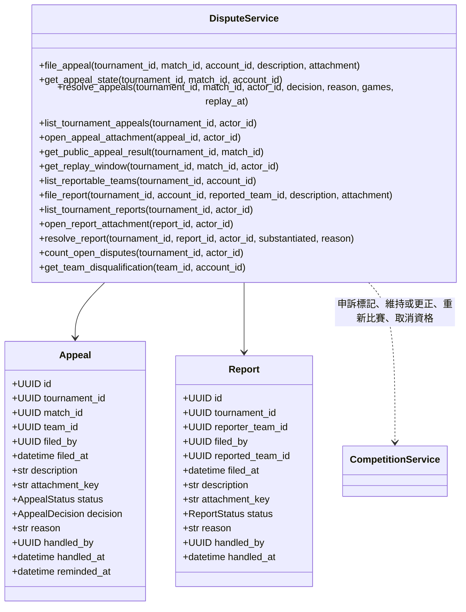

| 類別 | 類型 | 職責 |
| --- | --- | --- |
| Appeal | 實體 | 對單一場次結果的申訴、處理結果與提醒時間 |
| Report | 實體 | 對另一支隊伍參賽資格的檢舉、查證結果與處理者 |
| DisputeService | 服務 | `disputes/service.py`：申訴與檢舉的提出、處理、查證與待處理清單；呼叫 competition 執行場次更正與取消資格 |

**設計重點**

1. `file_appeal()` 透過 competition 鎖住場次，確認未超過 `appeal_deadline`、場次為申訴期或申訴中、該隊沒有未結案的申訴，再建立申訴；場次仍在申訴期時才呼叫 `mark_appealed()` 轉為申訴中。部分唯一索引限制同一隊對同一場只能有一筆未結案申訴，所以重新比賽後，隊伍可以對重賽的結果再申訴。
2. `resolve_appeals()` 以場次為單位處理：同一場次未結案的申訴以相同的決定與理由一併結案，並寫入 `handled_by` 與 `handled_at`。另一隊申訴期限未到時主辦方也可以處理，處理後場次已確認，另一隊不能再申訴。選擇更正時，由 competition 依新的各局結果重算系列比分，變更前後內容寫入操作紀錄。選擇重新比賽時（只用於一方或雙方棄權的場次），呼叫 `replay_match()`：場次回到待開打，清除 outcome、勝隊與報到紀錄，設定新時間並重新起算棄權期限。
3. 申訴逾期提醒屬於 Story 6.3，`reminded_at` 欄位已預留。`count_open_disputes()` 提供 S27 待處理清單：申訴以等待結果的下一場開始前為期限；檢舉以被檢舉隊伍下一場的開始時間為期限，沒有下一場時排在最後。
4. `resolve_report()` 寫入 `handled_by`、`handled_at` 與理由；判定屬實時呼叫 `disqualify()`，頂替規則完全由 competition 處理，disputes 不直接修改對戰表（AD-4）。一併結案的申訴 `decision` 記為 `disqualified`；被取消資格隊伍的其他未結案檢舉在同一交易結案為屬實。賽事已結束或已取消時只能駁回或記錄屬實。`file_report()` 只接受檢舉人與被檢舉隊伍都已送出報名（待分配、正取、候補或已參賽）；同一隊對同一對象已有處理中的檢舉時回 409 `REPORT_ALREADY_FILED`，結案後可以再檢舉。
5. disputes 位於依賴鏈的最上層，可以呼叫 competition、registration 與 tournaments，反方向的呼叫一律禁止（AD-3）。

## 七、通知模組 notifications

**職責**：消化 outbox 事件並寄送 Email（失敗重試）。期中只處理驗證信與重設密碼信；其他事件已寫入 outbox，收件規則與站內通知中心在 Story 1.6 接上（見貳、九）。

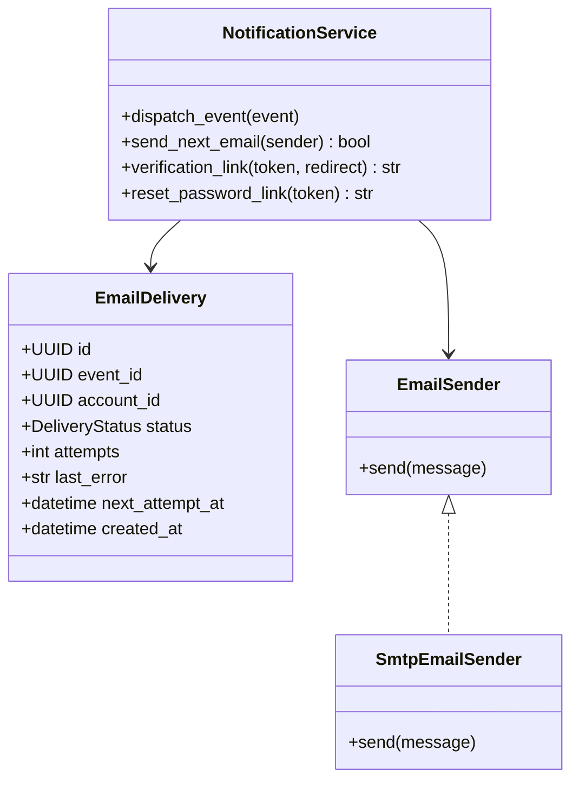

| 類別 | 類型 | 職責 |
| --- | --- | --- |
| EmailDelivery | 實體 | 一封 Email 的寄送狀態、嘗試次數、最近一次錯誤與下次嘗試時間 |
| NotificationService | 服務 | `notifications/service.py`：分派事件、建立寄送紀錄、逐封寄出 |
| EmailSender | 服務 | 寄信介面；`SmtpEmailSender` 透過 SMTP 寄出（示範環境寄到 Mailpit），測試以假物件替換 |

**設計重點**

1. `dispatch_event()` 以（事件 id、收件人）唯一鍵建立寄送紀錄，同一事件重複處理不會重複寄信；沒有登錄的事件類型由 worker 略過並標為已處理。
2. 寄送失敗時更新 `attempts`、`last_error` 與 `next_attempt_at`，間隔為 1、2、4、8 分鐘，第 5 次失敗後標為 `failed`，不影響任何業務資料。
3. 信件寄出後以 `drop_payload_keys()` 移除事件中的 token 明文。
4. 沒有模組可以呼叫 notifications，它只透過事件接收工作（AD-3、AD-8）。

## 八、模組協作設計

模組之間只透過 Service 的公開函式溝通，回傳值為 Pydantic schema；通知這類附帶動作則一律透過事件。下表整理主要的跨模組呼叫：

| 呼叫方 | 被呼叫方 | 公開函式 | 用途 |
| --- | --- | --- | --- |
| registration | tournaments | `lock_tournament()`、`get_tournament()` | 名單與報名操作前鎖住賽事、讀取名額、模式與主辦方 |
| registration | identity | `get_account_school_ids()` | 取得隊員的學校以檢查同校 |
| competition | registration | `finalize_for_draw()`、`list_accepted_teams()`、`mark_drawn()` | 抽籤前完成分配、取得正取隊伍、標記已參賽 |
| competition | registration | `is_member()`、`is_captain()`、`get_team_names()` | 檢查裁判與隊長身分、公開對戰樹取隊名 |
| competition | registration | `get_registration()`、`disqualify_registration()` | 取消資格時讀取報名狀態並更新 |
| competition | tournaments | `lock_tournament()`、`bo_for_round()`、`transition_tournament()`、`is_referee()`、`get_tournament()` | 加鎖、取得 BO 數、推進賽事狀態、確認裁判身分與主辦方 |
| disputes | competition | `mark_appealed()`、`uphold_result()`、`correct_result()`、`replay_match()`、`get_replay_window()`、`disqualify()`、`lock_match()` | 申訴處理（含重新比賽）與取消資格的實際執行 |
| disputes | registration | `get_team()`、`get_registration()`、`find_team_of_account()`、`list_teams_by_status()` | 申訴與檢舉時確認隊長、檢查檢舉雙方的報名狀態 |
| disputes | tournaments | `get_tournament()`、`lock_tournament()` | 檢查賽事狀態與主辦方身分 |
| 各模組 | core | `audit.record()`、`events.publish()` | 寫入操作紀錄、發出事件 |
| notifications | identity | `get_account_contact()` | 取得收件人的 Email |
| worker | 各模組 | `open_due_registration()`、`allocate_due_priority_window()`、`close_due_registration()`、`start_due_tournament()`、判棄權、`auto_confirm_expired()`、`dispatch_event()`、`send_next_email()` | 依序執行的八個定時工作，每筆一個交易 |

以「主辦方查證檢舉屬實、取消某隊資格」為例，這個操作橫跨 disputes、competition、registration 三個模組，但仍在同一個交易中完成：

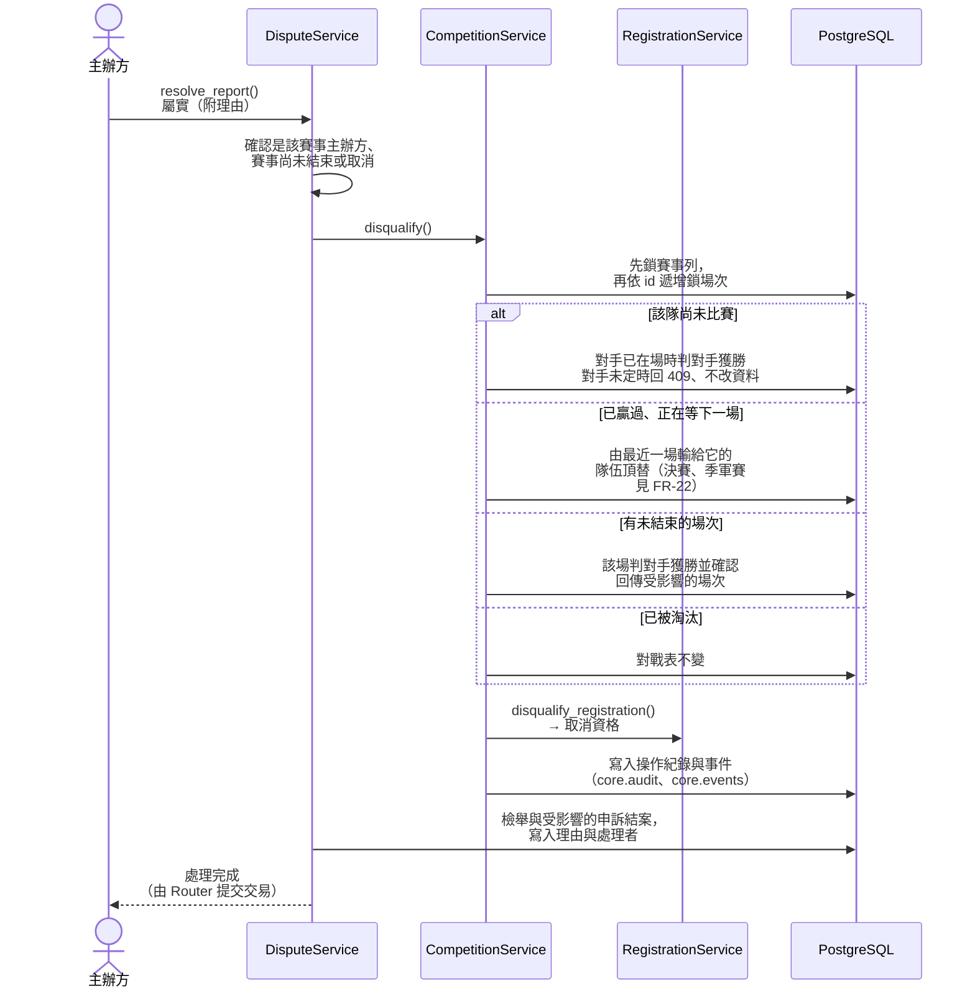

## 九、期中後預計新增的類別與方法

下列內容屬於擱置到期中後的 15 個 Story，目前程式中還沒有；設計沿用本文件的分層與 AD 約束，實作時再更新類別圖。

| Story | 預計新增 |
| --- | --- |
| 1.6 通知中心 | Notification 實體（收件帳號、來源事件、類型、標題、連結、已讀時間）；NotificationService 的事件類型登錄、`resolve_recipients()`、`list_for()`、`unread_count()`、`mark_read()`；依 FR-37 通知對象表登錄目前已發出的事件 |
| 2.3 分輪 BO | RoundSetting 實體（tournament_id、round_no、bo）；`bo_for_round()` 先查分輪設定 |
| 2.5 抽籤前修改賽事 | `update_tournament()`；registration 的 `raise_capacity()` 鎖住賽事列後呼叫它，再讓候補遞補 |
| 2.6 取消賽事 | `cancel_tournament()`；取消流程依 AD-6 鎖賽事再鎖場次 |
| 2.8 查閱操作紀錄 | `list_audit_logs()`，確認主辦方身分後呼叫 `core.audit.list_for_tournament()` |
| 3.7 抽籤前撤回 | `withdraw_before_draw()` |
| 3.8 退回報名 | `reject_registration()`、`Registration.reject_reason`；優先期代表隊退出時由同校次高遞補的規則 |
| 3.9 公開正取名單 | 公開查詢函式與 S2 正取隊伍分頁 |
| 3.10 自訂模式 | `Tournament.invite_token`、`reset_invite_link()`、自訂賽事的先到先得規則（`allocation.py` 依模式分支） |
| 3.11 隊員異動 | `remove_member()`、`transfer_captain()`、`leave_team()`、`disband_team()` |
| 4.2 自動抽籤 | 報名截止時由 worker 自動抽籤，正取不足時通知主辦方 |
| 4.5 抽籤後退賽 | `withdraw_after_draw()`、`next_waitlisted()`，以及取消資格時由候補遞補 |
| 4.7 隊伍搜尋 | 對戰樹的隊伍搜尋與晉級路徑 |
| 5.7 結算截圖 | ResultScreenshot 實體（match_id、file_key）、`upload_screenshot()` |
| 6.3 申訴逾期提醒 | `remind_overdue_appeals()`、`next_match_start()`，以 `Appeal.reminded_at` 確保只提醒一次 |

# 參、設計原則與模式

下表整理本系統採用的設計原則與模式。Repository 與資料傳輸物件的定義參考 Fowler（參考文獻 1），策略模式參考 Gamma 等人（參考文獻 2），交易式 outbox 參考 Richardson（參考文獻 3）。

| 原則或模式 | 應用位置 | 解決的問題 |
| --- | --- | --- |
| 分層架構 | 每個模組的 Router／Service／Repository | 每一層只有一種職責，業務規則可獨立測試 |
| Repository 模式 | 各模組的 Repository | 隔離資料存取，Service 不直接寫 SQL；加鎖集中管理 |
| 策略模式 | `allocation.py`（目前為校園賽；自訂模式於 Story 3.10 加入） | 名額規則集中一處，新增模式時不必修改其他程式 |
| 純函式領域邏輯 | `allocation.py`、`bracket.py`、`schedule.py`、`scoring.py`、`checkin.py`、`forfeit.py`、`progression.py` | 最複雜的規則不碰資料庫，可以大量撰寫單元測試 |
| 狀態機（單一轉換函式） | `transition_tournament()`、`transition_match()`、`mark_status()` | 避免各處直接改狀態而跳過規定的流程 |
| 交易式 outbox | `core.events` 與 notifications | 資料與通知一致、通知不重複、寄信失敗不影響主流程 |
| 快照 | Tournament.game_snapshot、Registration 的三個快照欄位 | 遊戲設定或隊員資料之後改變，也不影響已建立的賽事與分配結果 |
| 依賴注入 | Clock、亂數來源、EmailSender、`ForfeitPorts`、`register_referee_lookup()` | 測試時以假物件替換，可驗證「30 分鐘後」與固定的抽籤結果；identity 不必反向呼叫 tournaments |
| 資料傳輸物件 | 跨模組回傳的 Pydantic schema（`AccountRead`、`TournamentRead`、`TeamRead`、`RegistrationRead`）、公開 API 的 `Public*` schema | 模組之間不共享 ORM 物件；公開資料不含個資。跨模組可以 import 對方 `models.py` 裡的列舉、schema 與事件型別，不能 import 資料表類別，由架構測試檢查 |

## 一、列舉型別

狀態與類型以 Python `StrEnum`（參考文獻 4）定義，下表的英文值與程式相同。

| 列舉 | 所屬模組 | 成員 |
| --- | --- | --- |
| TokenPurpose | identity | verify_email、reset_password |
| IdentityKey | identity | browse（瀏覽賽事）、organizer（主辦方後台）、platform_admin（平台管理）、my_teams（我的隊伍）、referee（裁判） |
| ApplicationStatus | identity | 待審核（pending）、核准（approved）、退回（rejected） |
| ScoreType | tournaments | win_loss（只記勝負）、rounds（回合比分） |
| TournamentMode | tournaments | campus（校園賽）、custom（自訂） |
| TournamentStatus | tournaments | 尚未開放（upcoming）、開放報名（open）、報名截止（closed）、賽程已公布（published）、進行中（ongoing）、已結束（finished）、已取消（cancelled） |
| MemberRole | registration | captain（隊長）、player（選手） |
| RegistrationStatus | registration | 組隊中（forming）、已送出・待分配（pending）、正取（accepted）、候補（waitlisted）、退回（rejected）、撤回（withdrawn）、已參賽（drawn）、退賽（retired）、取消資格（disqualified） |
| AllocationPhase | registration | first_come（先搶期）、after_deadline（報名截止後） |
| WaitlistReason | registration | SCHOOL_NOT_ELIGIBLE、LATER_THAN_SCHOOLMATE、SCHOOL_LIMIT_REACHED（沒有候補順位的原因） |
| MatchStatus | competition | 待開打（scheduled）、進行中（live）、申訴期（appeal_window）、申訴中（appealed）、已確認（confirmed）、已取消（voided） |
| MatchOutcome | competition | played（正常完賽）、forfeit（一方棄權）、double_forfeit（雙方棄權）、walkover（輪空）、disqualified（取消資格判負） |
| AppealStatus | disputes | 處理中（open）、已結案（closed） |
| AppealDecision | disputes | 維持原結果（upheld）、更正結果（corrected）、重新比賽（rematch，只用於棄權判定）、取消資格（disqualified，取消資格時一併結案） |
| ReportStatus | disputes | 處理中（open）、駁回（dismissed）、屬實（substantiated） |
| DeliveryStatus | notifications | 待寄（pending）、已寄出（sent）、失敗（failed） |

# 參考文獻

1. Fowler, M. (2002). *Patterns of Enterprise Application Architecture*. Addison-Wesley.
2. Gamma, E., Helm, R., Johnson, R., & Vlissides, J. (1994). *Design Patterns: Elements of Reusable Object-Oriented Software*. Addison-Wesley.
3. Richardson, C. *Pattern: Transactional outbox*. microservices.io. https://microservices.io/patterns/data/transactional-outbox.html
4. Python Software Foundation. *enum — Support for enumerations*. https://docs.python.org/3/library/enum.html
5. Pydantic 官方文件。https://docs.pydantic.dev/latest/
6. SQLModel 官方文件。https://sqlmodel.tiangolo.com/
7. 本組（2026）。架構骨幹與 C／D 設計打底稿。專案資料夾 `_bmad-output/planning-artifacts/architecture/`。
