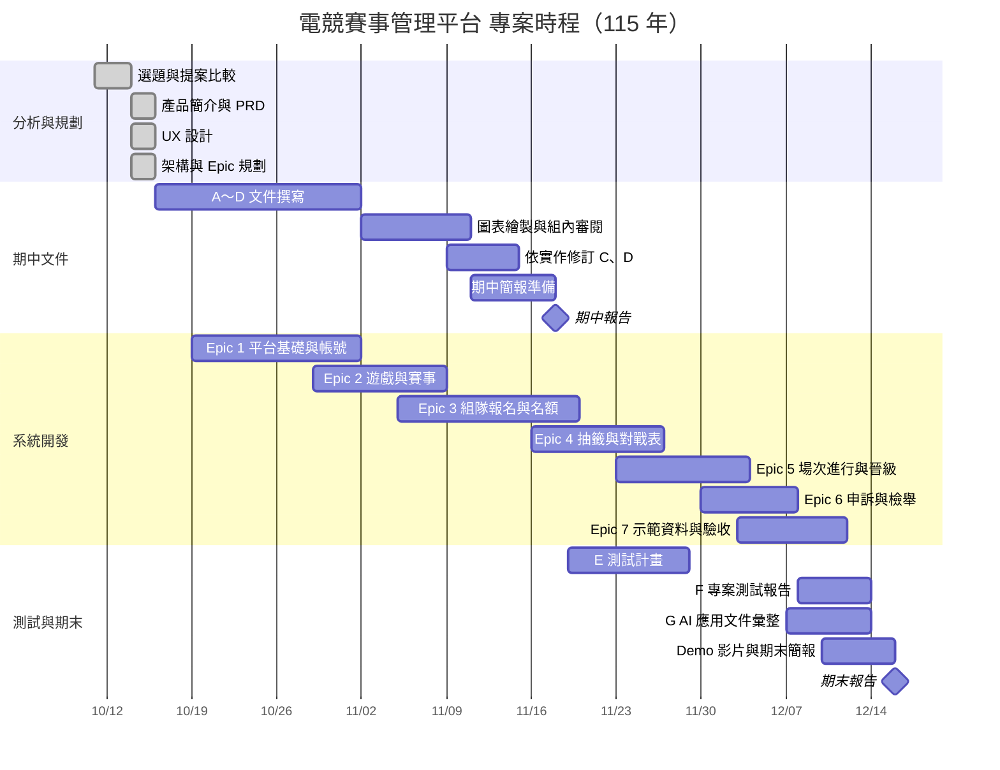

# 壹、專案簡介

## 一、文件目的

本文件是「電競賽事管理平台（FLOW）」的專案管理依據，界定專案的目的、範疇、利害關係人、成果物、時程、分工與風險，讓組員與指導教授對專案有一致的理解。本文件綜整產品簡介、產品需求文件（PRD）、架構骨幹與 Epic 規劃後撰寫，並與同期交付的《軟體需求分析文件》（B）、《軟體設計文件》（C）、《物件設計文件》（D）互相對應。

本專案從 115 年 10 月 11 日開始選題，比往年晚約一個月，而期末報告（12 月 16 日）又比往年早 11 天。因此本文件特別強調「範疇收斂」：明確列出必做、加分與不做的項目，所有功能需求都有編號與可測結果，避免開發途中範疇蔓延；同時把定時規則、併發控制、操作紀錄等高風險設計提早定案，讓後續開發與測試有一致的依據。

## 二、系統背景與問題定義

校際與社群的電競盃賽越來越多，但主辦方（多半是學生社團）仍靠 PDF 規程、Google 表單、Excel、FB 公告、Discord 頻道與 email 申訴書，才能把一場比賽辦完。以 2024 年第六屆大專盃電競錦標賽特戰英豪項目的規程為例，一場 64 隊的比賽需要大量人工作業，具體問題如下：

1. **報名審核靠人工計算**
   同校有多支隊伍報名時，規程以選手段位積分平均決定學校代表隊，全由主辦方逐筆計算，容易出錯也難以公開說明。
2. **抽籤與賽程分散在公告裡**
   抽籤結果貼在 FB，選手要自己去找對手是誰、幾點打；賽程異動時也只能再發公告。
3. **檢錄與遲到判定靠人工計時**
   規程要求賽前進入 Discord 頻道報到，超過 15 分鐘未開打判棄權，全靠裁判盯著時間。
4. **結果與證據分開保存**
   比分由裁判手記，結算截圖由選手「自行存證」，兩者沒有綁在一起，發生爭議時難以查證。
5. **申訴流程笨重且無法追蹤**
   申訴須在比賽結束後 30 分鐘內以 email 寄出申訴書，處理進度無從得知，處理理由也沒有統一保存。

主辦方是最大的受害者：每多一隊報名，人工工作就多一份，出錯時也最難追查。社群與系上的小型比賽人力更少，問題只會更嚴重。

因此，本專案要建立一個網頁平台，把「開賽事 → 報名與名額分配 → 抽籤 → 報到 → 比分登錄 → 申訴與檢舉 → 晉級與觀賽」整條流程收進同一個系統，每一步都留下操作者與時間紀錄。系統以《英雄聯盟》與《特戰英豪》為示範，但各遊戲的差異（每隊人數、幾戰幾勝、段位對照、比分型態）都做成設定，任何「兩隊對打、分出勝負」的遊戲都能使用。

## 三、利害關係人

本系統的使用者共有六種身分。其中「隊長」是帳號在某支隊伍裡的身分、「裁判」是帳號在某個賽事裡的身分，都不是獨立的帳號類型；同一個帳號可以在一隊當隊長、在另一隊只是選手，也可以同時是主辦方。以下整理各身分的需求與關注點。

### （一）主辦方

主辦方是本系統的主要服務對象，通常是學生電競社團的幹部，需求包含：

1. 以最少的人工建立賽事、收報名，並由系統自動完成名額分配與抽籤。
2. 檢視報名隊伍的段位截圖，退回造假或不合格的報名。
3. 處理申訴與資格檢舉，並在發生爭議時拿出完整的操作紀錄。
4. 抽籤後指派裁判、調整場次時間。

主辦方最在乎的是「少做人工」、「規則一致」與「出事查得到」。

### （二）裁判

裁判由主辦方邀請，負責被指派場次的比分登錄，需求包含：

1. 在同一個頁面看到兩隊的報到狀態，確認可以開始比賽。
2. 每打完一局就登錄比分，不必另外抄寫。
3. 系統自動算出系列結果，確認後鎖定。

裁判重視「操作快速」與「結果正確」。

### （三）隊長與選手

隊長負責組隊、報名、報到與申訴；選手負責提供自己的遊戲 ID 與段位。需求包含：

1. 用邀請連結找齊隊員，在同一個地方完成報名，並立刻知道是正取還是候補。
2. 清楚知道下一場的對手與時間，不必翻找 FB 與 Discord。
3. 比分有誤或懷疑他隊資格不符時，有正式的線上管道申訴或檢舉。

隊長與選手最在乎「資訊透明」與「權益有保障」。

### （四）觀眾

觀眾是參賽學校的同學或社群玩家，不需註冊。需求是用手機打開賽事頁，就能看到視覺化對戰樹、每局比分，以及誰晉級、誰淘汰。觀眾重視「不用登入」與「即時更新」。

### （五）平台管理員

平台管理員負責審核主辦方申請，只讓真實存在的社團取得主辦方權限，並維護遊戲清單與預設值。平台管理員重視「新增遊戲不用改程式」與「主辦方身分可信」。

### （六）利害關係人與責任矩陣

| 利害關係人 | 在專案中的角色 | 權限與職責 |
| --- | --- | --- |
| 指導教授 | 專案指導與評分 | 審閱各階段文件與成果，確認流程符合軟體工程要求 |
| 平台管理員 | 系統使用者 | 審核主辦方申請、維護遊戲設定 |
| 主辦方 | 系統主要使用者 | 建立與管理賽事、審核報名、處理申訴與檢舉、邀請與指派裁判 |
| 裁判 | 系統使用者 | 登錄被指派場次的比分並確認系列結果 |
| 隊長 | 系統使用者 | 組隊、送出報名、報到、上傳結算截圖、申訴與檢舉 |
| 選手 | 系統使用者 | 填寫遊戲 ID、段位與段位截圖 |
| 觀眾 | 系統使用者（不登入） | 瀏覽賽事、對戰樹與比分 |
| 專案開發團隊 | 開發者 | 需求分析、設計、實作、測試、文件與展示 |

# 貳、專案範疇

## 一、功能清單

本專案的功能依「開賽事 → 報名 → 抽籤 → 比賽 → 申訴 → 觀賽」的流程，按使用者身分整理如下。功能需求在 PRD 中統一編號為 FR-1～FR-41，詳細規格與可測結果見《軟體需求分析文件》。

### （一）平台管理員端功能

1. **審核主辦方申請**（FR-2、FR-3）
   - 檢視待審核的申請（社團名稱、學校），核准或附原因退回。
   - 核准後申請人立即取得建立賽事的權限。
2. **維護遊戲設定**（FR-6）
   - 新增或修改遊戲的先發人數、替補人數、預設 BO 數、段位積分對照表與比分型態。
   - 修改預設值不影響已建立的賽事。

### （二）主辦方端功能

1. **建立與管理賽事**（FR-7～FR-10、FR-39）
   - 選擇遊戲後自動帶入預設值，填寫名額、報名期間、優先期、開賽日期、每輪間隔、棄權時限、申訴期與賽事模式（校園賽或自訂）。
   - 為不同輪次設定 BO 數；抽籤前可延長報名、提高名額；可取消尚未結束的賽事。
2. **審核報名**（FR-18）
   - 檢視段位截圖，附原因退回不合格的報名。
3. **抽籤與賽程**（FR-4、FR-19、FR-23）
   - 報名截止自動抽籤，或在截止前提前抽籤；系統自動排定場次時間，主辦方可個別調整。
   - 產生裁判邀請連結，並把裁判指派到場次。
4. **處理爭議**（FR-31、FR-33）
   - 對申訴維持或更正結果；對檢舉駁回或取消該隊資格，皆須附理由。
5. **查閱操作紀錄**（NFR-3）
   - 查閱自己賽事的所有操作紀錄（操作者、時間、變更前後內容）。

### （三）裁判端功能

1. **登錄比分**（FR-26）：依遊戲的比分型態，逐局登錄勝隊或回合比分。
2. **確認系列結果**（FR-27）：系統依各局結果算出系列比分，裁判確認後鎖定並進入申訴期。

### （四）隊長與選手端功能

1. **組隊與報名**（FR-11～FR-13、FR-41）
   - 建立隊伍、以邀請連結邀請隊員；名單鎖定前可移除隊員或轉讓隊長。
   - 選手填寫遊戲 ID、段位並上傳段位截圖；隊長送出報名後名單鎖定。
2. **查看分配結果**（FR-14～FR-17）
   - 立即或在優先期結束後看到正取或候補，候補隊伍可看到自己的候補順位。
   - 第一場開打前可退賽，由候補遞補。
3. **比賽當天**（FR-24、FR-28）
   - 開賽前 30 分鐘起報到；勝隊隊長上傳結算截圖作為佐證。
4. **申訴與檢舉**（FR-30、FR-32）
   - 在申訴期內對場次結果提出申訴；賽事結束前對他隊資格提出檢舉。

### （五）觀眾端功能

1. **公開賽事頁**（FR-34）：不登入就能瀏覽賽事列表、賽事資訊與正取隊伍。
2. **視覺化對戰樹**（FR-35）：手機上可閱讀的單淘汰對戰樹，結果確認後 10 秒內更新，可搜尋隊伍並顯示晉級路徑。
3. **場次頁**（FR-36）：查看每一局的比分與場次目前狀態。

### （六）系統自動處理

1. **名額分配**（FR-14～FR-16）：校園賽依「優先期 → 先搶期 → 截止補位」三階段自動分配正取與候補；自訂賽事依送出先後分配。
2. **定時規則**（FR-19、FR-25、FR-29）：報名截止自動抽籤、逾時判棄權、申訴期滿自動確認並晉級。
3. **對戰表推進**（FR-20～FR-22）：產生含輪空與季軍賽的單淘汰對戰表，勝隊自動晉級；隊伍被取消資格時依規則頂替。
4. **通知**（FR-37、FR-38）：重要事件同時發送站內通知與 Email。

## 二、非功能清單

非功能需求是系統穩定、公平與可信的基本條件。本系統最重要的是「搶名額不超收」與「規則自動且準時執行」，主要分為以下六類：

### （一）效能需求

1. **回應時間**（NFR-2）
   - 1000 名使用者同時使用時，95% 的請求在 1 秒內回應，錯誤率低於 1%。
2. **觀賽更新**（FR-35）
   - 場次結果確認後，開著頁面的觀眾在 10 秒內看到對戰樹更新。

### （二）一致性與可靠度

1. **併發一致性**（NFR-1）
   - 1000 人同時送出報名時，正取隊數不超過名額，不產生重複的正取或遺失的報名。
   - 同一場次的比分不會因同時操作而互相覆蓋。
2. **定時規則可靠**（NFR-4）
   - 優先期結束、報名截止、棄權判定、申訴期滿，即使沒有人操作，也在預定時間後 1 分鐘內自動執行。

### （三）安全與個資保護

1. **權限在伺服器端檢查**（NFR-5）：所有權限都在後端驗證，繞過介面直接呼叫 API 也會被拒絕。
2. **個資保護**（NFR-6）：密碼雜湊保存；Email、學校與段位截圖不出現在公開頁面。
3. **操作紀錄**（NFR-3）：報名、名額分配、抽籤、比分、申訴、檢舉、取消資格與時間修改都記錄操作者、時間與變更前後內容，紀錄不可修改或刪除。

### （四）使用性

1. **手機可用**（NFR-7）：所有頁面在 375 px 寬的手機上可操作。
2. **繁體中文介面**：介面文字一律使用繁體中文。

### （五）可維護性與擴充性

1. **模組化架構**：後端依功能切成 6 個業務模組，模組內分 Router、Service、Repository 三層，模組之間只透過 Service 公開介面溝通。
2. **遊戲可擴充**（NFR-9）：新增遊戲只需在後台設定，不需修改程式。

### （六）可部署性

1. **一鍵啟動**（NFR-8）：以 docker compose 一個指令啟動全部服務，並自動載入示範資料（2 款遊戲、32 隊賽事）。

## 三、範疇界定

為了在時程內完成，專案範疇分為必做、加分與不做三類。加分項目只有在必做功能完成且測試通過後才會考慮。

| 類別 | 項目 |
| --- | --- |
| 必做 | 帳號與身分權限、主辦方申請審核、遊戲設定、建隊與名單鎖定、報名與三階段名額分配、搶名額不超收、抽籤產生單淘汰對戰表（含輪空與季軍賽）、賽前報到與逾時判棄權、裁判逐局登錄比分、結算截圖、限時申訴與主辦方處理、資格檢舉與取消資格頂替、自動晉級、視覺化對戰樹、站內通知與 Email |
| 加分 | 選手 KDA 與個人戰績、串接《英雄聯盟》官方 API 自動帶入比分、雙敗制或循環賽、手機推播、《特戰英豪》地圖選取流程 |
| 不做 | 必須依賴遊戲官方 API 才能運作的功能、直播（只放連結）、報名費與獎金金流、防作弊、大逃殺類遊戲、帶隊老師角色、原生手機 App |

## 四、成果物清單

本專案依課程要求交付三類成果物：文件成果物、系統實作成果物與展示成果物。

### （一）文件成果物

| 代號 | 文件 | 主要內容 | 交付時間 |
| --- | --- | --- | --- |
| A | 軟體專案管理規劃文件 | 背景與問題、利害關係人、範疇、成果物、時程、分工、風險 | 期中 |
| B | 軟體需求分析文件 | Epic 與 User Story、功能清單、非功能需求、使用案例圖、核心使用案例規格、泳道圖、狀態圖、ERD、資料表說明、類別圖、循序圖 | 期中 |
| C | 軟體設計文件 | 系統架構圖、分層架構、模組劃分、關鍵機制、介面設計、部署與技術選型、設計理由 | 期中 |
| D | 物件設計文件 | 各模組類別圖、類別職責、模組協作與設計原則 | 期中 |
| E | 測試計畫 | 測試目的、範圍、方法（單元、整合、端對端、壓力）、環境與工具 | 期末 |
| F | 專案測試報告 | 測試個案與結果、覆蓋率、端對端腳本、壓力測試結果 | 期末 |
| G | AI 應用文件 | 各開發階段的 AI 使用說明、Prompt、AI 回覆與團隊的篩選修改 | 期末 |

### （二）系統實作成果物

1. 前端單頁應用（React）：公開賽事頁與對戰樹、帳號與通知中心、隊伍與報名、裁判場次頁、主辦方後台、平台管理後台。
2. 後端 API（FastAPI）：identity、tournaments、registration、competition、disputes、notifications 六個模組。
3. 背景工作程序（worker）：定時規則（優先期結束、報名截止、判棄權、申訴期滿）與通知寄送。
4. 資料庫 Schema（PostgreSQL）與 Alembic 遷移檔。
5. docker compose 設定：db、backend、worker、frontend、mailpit 五個服務，一鍵啟動並載入示範資料。
6. 自動化測試：pytest 單元與整合測試、Playwright 端對端測試、Locust 壓力測試腳本。

### （三）最終展示成果物

1. 期中與期末簡報。
2. 實際操作 Demo：以《英雄聯盟》與《特戰英豪》各跑一場完整賽事。
3. Demo 影片：錄製從開賽事、報名、抽籤、比賽、申訴到頒獎的完整流程。
4. 專案整合包：所有文件、程式碼、測試結果與 AI 使用紀錄。

# 參、專案時程規劃

## 一、開發方法

本專案採用 BMAD Method（AI 輔助的敏捷開發流程），依「分析 → 規劃 → 方案設計 → 實作」四個階段進行，每個階段的產出都存放在專案資料夾，作為下一階段的輸入：

| 階段 | 主要產出 | 狀態 |
| --- | --- | --- |
| 分析 | 專案背景說明、候選題目比較、產品簡介 | 已完成（10/11～10/14） |
| 規劃 | 產品需求文件（FR-1～41、NFR-1～9）、UX 設計（DESIGN.md、EXPERIENCE.md） | 已完成（10/14～10/15） |
| 方案設計 | 架構骨幹（AD-1～21）、C／D 打底稿、Epic 與 User Story（7 個 Epic、52 個 Story）、Sprint 規劃 | 已完成（10/14～10/15） |
| 實作 | 依 Story 逐一開發、程式審查、測試 | 10/19 起 |

實作階段以 Story 為單位：開發 → 程式審查 → 單元與整合測試 → 標記完成，進度記錄在 sprint-status.yaml。各階段與 AI 的對話（Prompt 與回覆）全程保留，作為期末 G 文件的素材。

## 二、里程碑

| 編號 | 日期 | 里程碑 | 驗收方式 |
| --- | --- | --- | --- |
| M1 | 10/15 | 規劃與設計文件定稿 | PRD、架構骨幹、Epic 皆為定稿狀態 |
| M2 | 11/01 | 系統骨架與帳號功能完成 | docker compose 一鍵啟動，可註冊、登入、收驗證信 |
| M3 | 11/18 | 期中報告 | 交付 A～D 文件與期中簡報 |
| M4 | 11/26 | 報名到對戰表可展示 | 可完成建立賽事、報名分配、抽籤並顯示對戰樹 |
| M5 | 12/07 | 必做功能全部完成 | Epic 1～6 的 Story 全部完成並通過測試 |
| M6 | 12/11 | 整體驗收完成 | 1000 人壓力測試與兩款遊戲的端對端演練通過 |
| M7 | 12/16 | 期末報告 | 交付 E～G 文件、系統、Demo 影片與期末簡報 |

## 三、甘特圖

以下為預定時程。各 Epic 的開發期間互相重疊，是因為前一個 Epic 的收尾（測試與修正）和下一個 Epic 的開工同時進行；實際進度依組內分工與每週檢討調整。

## 四、組織與分工

本組為跨校、跨系組成，分工以「每項工作都有一位主要負責人」為原則，負責人之外的組員負責審閱。下表為角色規劃，負責人待組內討論後填入。

| 角色 | 主要職責 | 負責人 |
| --- | --- | --- |
| 專案負責人（組長） | 時程控管、每週進度檢討、對外與指導教授溝通 | 【待填】 |
| 需求與文件 | A～D、E～G 文件撰寫與整合、圖表繪製 | 【待填】 |
| 後端開發 | FastAPI 模組、資料庫遷移、worker 定時規則 | 【待填】 |
| 前端開發 | React 頁面、對戰樹視覺化、響應式介面 | 【待填】 |
| 測試 | 單元與整合測試、Playwright 端對端、Locust 壓力測試 | 【待填】 |
| AI 使用紀錄 | 彙整各階段 Prompt 與回覆、記錄團隊如何篩選修改 | 【待填】 |

# 肆、風險管理

| 編號 | 風險 | 可能影響 | 因應措施 |
| --- | --- | --- | --- |
| R1 | 時程壓縮：比往年晚一個月開始，期末又早 11 天 | 功能做不完、測試不足 | 守住必做範圍，加分項目只在必做完成後才做；每週對照甘特圖檢討進度 |
| R2 | 名額分配規則複雜（三階段、候補順位、同校上限） | 正取判定錯誤，影響公平性 | 規則集中在單一的 AllocationPolicy 純函式，以 PRD 的可測結果逐條寫單元測試 |
| R3 | 多人同時報名造成超收 | 違反 NFR-1，壓力測試失敗 | 送出報名先以 `SELECT … FOR UPDATE` 鎖住賽事列；整合與壓力測試使用真的 PostgreSQL，不用 SQLite 代替 |
| R4 | 定時規則沒有準時或重複執行 | 該判棄權沒判、重複晉級 | 到期時間存在資料表，由獨立 worker 輪詢並重新檢查狀態；以可替換時鐘撰寫測試 |
| R5 | 跨校組員溝通與整合成本高 | 規格理解不一致、重工 | 以 PRD 名詞表與架構骨幹為唯一依據；所有產出集中在同一個專案資料夾並以 Git 版本控管 |
| R6 | AI 產出的程式或文件品質不一 | 埋入錯誤、與規格不符 | 每個 Story 都經程式審查與測試；保留 Prompt 與修改紀錄，作為 G 文件素材 |
| R7 | 新版本框架（Python 3.14、React 19 等）相容性問題 | 環境建置卡關 | 以官方 full-stack-fastapi-template 為起點，固定套件版本，Epic 1 第一個 Story 即驗證一鍵啟動 |
