# 壹、系統整體概述

本章界定「電競賽事管理平台（FLOW）」的定位、使用者類型與系統邊界，作為後續功能需求、流程分析與資料規格的共同基礎。專案目標、利害關係人分析與時程請見《軟體專案管理規劃文件》。

## 一、系統定位

電競賽事管理平台是給校際與社群中小型電競盃賽使用的一站式網頁系統。它把賽事從「開放報名」到「產生冠亞季軍」的完整流程收進同一個系統：主辦方開賽事、審報名、抽籤；系統自動分配名額、排定賽程、判定棄權與晉級；裁判登錄比分；隊長報到、申訴與檢舉；觀眾不登入就能看到視覺化對戰樹。

系統只支援「兩隊對打、分出勝負」的遊戲，賽制為單淘汰（含季軍賽）。各遊戲的差異（每隊先發與替補人數、BO 數、段位積分對照、比分型態）都是平台管理員維護的設定，不寫死在程式裡；第一版以《英雄聯盟》與《特戰英豪》示範。比分一律由裁判登錄，不依賴任何遊戲官方 API。

## 二、使用者類型

本系統的使用者依權限分為六種身分。帳號是唯一的登入單位，「主辦方」「平台管理員」是帳號上的權限，「裁判」與「隊長」則是帳號在特定賽事或隊伍中的身分：

1. **平台管理員**：審核主辦方申請、維護遊戲設定。擁有平台層級的管理權限，但不介入個別賽事的運作。
2. **主辦方**：主辦方申請被核准的帳號。可建立賽事、審核報名、抽籤、指派裁判、處理申訴與檢舉；權限只及於自己建立的賽事。
3. **裁判**：受主辦方邀請、在某一賽事中負責登錄比分的帳號。裁判身分只在該賽事有效，且只能登錄被指派的場次。
4. **隊長**：建立隊伍的帳號在該隊伍中的身分。負責邀請隊員、送出報名、報到、上傳結算截圖、申訴與檢舉；名單鎖定前可轉讓給隊員。
5. **選手**：隊伍中的帳號。須填寫該遊戲的遊戲 ID、段位與段位截圖。同一帳號可以在一隊是隊長、在另一隊只是選手。
6. **觀眾**：未登入、只瀏覽公開頁面的訪客，所有寫入操作都會被拒絕。

## 三、系統邊界

### （一）系統內部邊界

系統內部負責的範圍包含：

1. **帳號與身分**：註冊、Email 驗證、登入、重設密碼、主辦方申請與審核、裁判邀請，以及依身分控管權限。
2. **賽事建立與遊戲設定**：遊戲清單與預設值、賽事建立與修改、賽事模式（校園賽、自訂）、分輪 BO 數、取消賽事。
3. **隊伍與報名**：組隊與邀請、選手參賽資料、送出報名與鎖定名單、三階段名額分配、候補順位與遞補、退回報名。
4. **抽籤與對戰表**：抽籤、產生含輪空與季軍賽的單淘汰對戰表、排定場次時間、晉級推進、取消資格後的頂替。
5. **場次進行**：報到、逾時判棄權、逐局登錄比分、確認系列結果、結算截圖、申訴期滿自動確認。
6. **申訴與檢舉**：提出與處理申訴、提出與查證檢舉、取消資格。
7. **觀賽與通知**：公開賽事頁、視覺化對戰樹、場次頁、站內通知與 Email 通知。
8. **操作紀錄**：所有影響結果的操作都記錄操作者、時間與變更前後內容，且不可修改或刪除。

### （二）系統外部邊界

本系統不處理且不負責的範圍包含：

1. **遊戲官方 API**：不串接 Riot 等官方 API 取得比分或驗證帳號（VALORANT API 需 Riot 審核且須玩家授權）；比分一律由裁判登錄。
2. **直播**：不提供直播功能，賽事頁只放主辦方填寫的直播連結。
3. **金流**：不處理報名費與獎金。
4. **防作弊與在學資格審核**：不偵測作弊、不查驗學籍；資格問題以「檢舉 → 主辦方查證」處理。
5. **其他賽制與遊戲類型**：不支援雙敗制、循環賽，也不支援大逃殺等多隊同場的遊戲。
6. **正式寄信服務**：第一版的 Email 寄到本機測試信箱 Mailpit，不對外寄送。

## 四、名詞定義

本文件與其他文件一律使用以下名詞，不使用同義詞。

| 名詞 | 定義 |
| --- | --- |
| 賽事模式 | 建立賽事時選定、開放報名後不可更改的報名規則。**校園賽**要求同隊同校，名額依三階段分配；**自訂**採邀請制報名、不限學校、先到先得 |
| 段位積分 | 依遊戲的對照表把段位換算成的分數；同校多隊時以名單的平均段位積分決定正取 |
| 優先期 | 校園賽開放報名後的第一段期間（預設 1 天），只收報名、不分配名額；結束時各校段位積分平均最高的一隊成為代表隊 |
| 先搶期 | 優先期結束到報名截止；優先期沒有報名的學校，第一支送出報名的隊伍取得正取，直到名額用完 |
| 截止補位 | 報名截止時名額仍有剩，同校第二隊依段位積分平均補位，每校最多 2 隊 |
| 正取／候補 | 報名的分配結果。正取隊伍釋出名額時，由候補依當下階段的規則遞補 |
| 候補順位 | 介面上「候補第 N 位」的 N，表示接下來陸續釋出名額時，這支候補隊伍是第幾個會被遞補的 |
| 對戰表 | 一個賽事的單淘汰對戰樹 |
| 場次 | 對戰表中兩支隊伍的一次對決，以 BO 數決定勝負 |
| 局 | 場次中的一局比賽 |
| 系列結果 | 由各局比分算出的場次結果，例如 2:1 |
| 報到 | 隊長在場次預定開始前 30 分鐘起按下的確認 |
| 棄權 | 預定開賽時間過了棄權時限（預設 15 分鐘，主辦方只能延長）仍未報到，該隊被判負 |
| 輪空 | 隊伍不經比賽直接晉級 |
| 申訴期 | 系列結果確認或判棄權後的一段時間（預設 30 分鐘，主辦方只能延長）；期間內無申訴，結果自動確認 |
| 申訴 | 隊長在申訴期內對場次結果提出的異議，由主辦方維持或更正 |
| 檢舉 | 隊長對另一支隊伍參賽資格提出的質疑，由主辦方查證 |
| 取消資格 | 主辦方查證檢舉屬實後對隊伍的處分 |
| 退賽 | 隊伍在第一場開打前主動退出；抽籤前退賽等同撤回報名 |

# 貳、需求規格

## 一、功能需求分析

本節依 Epic 與 User Story 描述各身分在系統中可執行的行為。Epic 是依開發順序切分的功能群，共 7 個 Epic、52 個 User Story；每個 Story 另有 Given／When／Then 形式的驗收條件，記錄於專案的 Epic 規劃文件，並作為測試個案的來源。

### （一）Epic 1：平台基礎、帳號與通知中心

建立可一鍵啟動的系統骨架與共用元件；訪客能註冊、驗證 Email、登入、重設密碼，登入後以身分切換器進入各身分的首頁；社團能申請成為主辦方並由平台管理員審核；所有人能在通知中心收到站內通知與 Email。

| User Story | 內容 |
| --- | --- |
| 1.1 以官方範本建立可一鍵啟動的專案骨架 | As a 開發組員<br>I want to 以官方全端範本建立符合架構骨幹的專案骨架<br>So that 所有人從同一個可執行、可測試的基礎開始開發 |
| 1.2 FLOW 前端外框與主題 | As a 使用平台的任何人<br>I want to 有一致的外觀、頂欄與深淺色切換<br>So that 不論在桌機或手機，都用同一套熟悉的介面操作 |
| 1.3 以 Email 註冊並完成驗證 | As a 訪客<br>I want to 用 Email 與密碼註冊，並透過驗證信完成驗證<br>So that 我能擁有帳號參與平台 |
| 1.4 登入、登出、帳號資料與身分切換器 | As a 已註冊的使用者<br>I want to 登入後用身分切換器進入我的各個身分，並管理自己的帳號資料<br>So that 我能以自己的身分使用平台 |
| 1.5 忘記與重設密碼 | As a 忘記密碼的使用者<br>I want to 透過 Email 中的連結重設密碼<br>So that 我不必重新註冊就能回到原帳號 |
| 1.6 通知中心 | As a 已登入的使用者<br>I want to 在頂欄看到未讀數，並在通知中心查看與我有關的通知<br>So that 我不會錯過與我有關的事 |
| 1.7 申請成為主辦方 | As a 已驗證的帳號<br>I want to 填寫社團名稱與學校，送出主辦方申請<br>So that 我能取得建立賽事的資格 |
| 1.8 平台管理員審核主辦方申請 | As a 平台管理員<br>I want to 檢視待審核的申請並核准或退回<br>So that 只有真實存在的社團能成為主辦方 |

### （二）Epic 2：遊戲設定與賽事建立

平台管理員維護遊戲；主辦方建立、修改、取消賽事並邀請裁判；觀眾能瀏覽賽事列表與賽事頁；主辦方能查閱自己賽事的操作紀錄。

| User Story | 內容 |
| --- | --- |
| 2.1 平台管理員維護遊戲設定 | As a 平台管理員<br>I want to 新增與修改遊戲的人數、BO、段位對照表與比分型態<br>So that 主辦方能用任何兩隊對打的遊戲辦賽事，而不需改程式 |
| 2.2 主辦方建立賽事 | As a 主辦方<br>I want to 選擇遊戲並填寫賽事資訊來建立賽事<br>So that 隊伍能開始報名 |
| 2.3 分輪設定 BO 數 | As a 主辦方<br>I want to 為不同輪次設定不同的 BO 數<br>So that 前幾輪快速、四強與決賽更慎重 |
| 2.4 公開賽事列表與賽事頁 | As a 觀眾<br>I want to 不登入就能瀏覽賽事列表與賽事頁<br>So that 我知道有哪些賽事、何時開打、哪裡看直播 |
| 2.5 抽籤前修改賽事 | As a 主辦方<br>I want to 在抽籤前延長報名、提高名額、放寬時限，並隨時更新直播連結<br>So that 報名狀況不如預期時能調整 |
| 2.6 取消賽事 | As a 主辦方<br>I want to 取消尚未結束的賽事<br>So that 賽事辦不成時能正式停止 |
| 2.7 邀請裁判 | As a 主辦方<br>I want to 產生裁判邀請連結，讓受邀者接受後成為該賽事的裁判<br>So that 我有人手負責登錄比分 |
| 2.8 主辦方查閱操作紀錄 | As a 主辦方<br>I want to 查閱我的賽事的所有操作紀錄<br>So that 發生爭議時能拿出證據 |

### （三）Epic 3：組隊報名與名額分配

隊長組隊並送出報名，名單鎖定前可移除隊員或轉讓隊長；系統依賽事模式（校園賽三階段、自訂先到先得）自動分配正取與候補，且不超收；主辦方能檢視段位截圖與退回報名。

| User Story | 內容 |
| --- | --- |
| 3.1 建立隊伍與邀請隊員 | As a 隊長<br>I want to 為一個賽事建立隊伍並取得邀請連結<br>So that 隊友能加入我的隊伍 |
| 3.2 選手填寫參賽資料 | As a 選手<br>I want to 填寫遊戲 ID、段位並上傳段位截圖<br>So that 我的隊伍能符合報名條件 |
| 3.3 送出報名與鎖定名單 | As a 隊長<br>I want to 在報名期間送出報名並鎖定名單<br>So that 我的隊伍正式參加名額分配 |
| 3.4 優先期結束自動分配 | As a 主辦方<br>I want to 優先期結束時由系統自動選出各校代表隊並分配正取<br>So that 我不必手動計算誰是學校代表隊 |
| 3.5 先搶期即時分配 | As a 隊長<br>I want to 在先搶期送出報名時立刻知道是正取或候補<br>So that 我能及早準備或另做安排 |
| 3.6 報名截止與截止補位 | As a 主辦方<br>I want to 報名截止時由系統自動以同校第二隊補上剩餘名額<br>So that 名額不會浪費 |
| 3.7 抽籤前撤回報名 | As a 隊長<br>I want to 在抽籤前撤回報名，並在候補時看懂自己的順位<br>So that 隊伍無法參賽時能讓出名額，候補隊伍也知道何時可能遞補 |
| 3.8 主辦方檢視段位截圖與退回報名 | As a 主辦方<br>I want to 在報名清單檢視段位截圖，並附原因退回不合格的報名<br>So that 段位造假的隊伍不會拿到名額 |
| 3.9 公開正取名單與取消賽事通知 | As a 觀眾與參賽隊伍<br>I want to 在賽事頁看到正取隊伍，並在賽事取消時收到通知<br>So that 大家都清楚誰參賽、賽事是否照常舉行 |
| 3.10 自訂模式的先到先得分配 | As a 校內賽的主辦方<br>I want to 賽事模式設為「自訂」時，系統不限學校、依送出先後分配正取<br>So that 同校隊伍互打的賽事也能用平台辦理 |
| 3.11 移除隊員與轉讓隊長 | As a 隊長<br>I want to 在名單鎖定前移除隊員，或把隊長身分轉讓給隊友<br>So that 隊員異動或我無法帶隊時，隊伍仍能完成報名 |

### （四）Epic 4：抽籤與對戰表

報名截止時自動抽籤（或由主辦方提前抽籤），產生含輪空與季軍賽的單淘汰對戰表並排定時間；主辦方指派裁判；抽籤後退賽由候補遞補；觀眾在手機上看到自動更新的視覺化對戰樹，並能搜尋隊伍看到晉級路徑。

| User Story | 內容 |
| --- | --- |
| 4.1 主辦方提前抽籤並產生對戰表 | As a 主辦方<br>I want to 在報名截止前按下「抽籤」立即產生單淘汰對戰表<br>So that 報名人數足夠時能提早公布賽程 |
| 4.2 報名截止時自動抽籤 | As a 主辦方<br>I want to 報名截止時由系統自動完成補位與抽籤<br>So that 我不必在截止那一刻守在電腦前 |
| 4.3 排定與修改場次時間 | As a 主辦方<br>I want to 系統依開賽日期與每輪間隔自動排定場次時間，並讓我個別調整<br>So that 賽程公布時就有時間表 |
| 4.4 指派裁判到場次 | As a 主辦方<br>I want to 把賽事的裁判指派到場次<br>So that 每個場次都有人負責登錄比分 |
| 4.5 抽籤後退賽與候補遞補 | As a 隊長<br>I want to 在隊伍第一個場次開打前退賽<br>So that 無法出賽時能讓候補隊伍頂上 |
| 4.6 視覺化對戰樹 | As a 觀眾<br>I want to 在手機與桌機上看到視覺化對戰樹<br>So that 我隨時知道賽事進行到哪裡 |
| 4.7 對戰樹隊伍搜尋與晉級路徑 | As a 觀眾<br>I want to 輸入隊名就在對戰樹上看到該隊的晉級路徑<br>So that 我在手機上也能馬上找到我關心的隊伍 |

### （五）Epic 5：場次進行與晉級

隊長報到、系統逾時判棄權（含雙方棄權）；裁判在場次頁逐局登錄比分並確認；申訴期滿自動確認並晉級，直到產生冠軍、亞軍與季軍。

| User Story | 內容 |
| --- | --- |
| 5.1 場次頁與隊長報到 | As a 隊長<br>I want to 在場次頁看到場次資訊，並在開賽前 30 分鐘起為自己的隊伍報到<br>So that 裁判知道我們準備好了 |
| 5.2 逾時判棄權 | As a 主辦方<br>I want to 過了棄權時限仍未報到的隊伍由系統自動判棄權<br>So that 賽程不會因缺席而卡住 |
| 5.3 裁判逐局登錄比分 | As a 裁判<br>I want to 在場次頁每打完一局就登錄結果<br>So that 比分即時留下紀錄，不必另外抄寫 |
| 5.4 確認系列結果 | As a 裁判<br>I want to 系統依各局結果算出系列比分，由我確認後鎖定<br>So that 結果正確且不能隨意更改 |
| 5.5 申訴期滿自動確認與一般晉級 | As a 隊長與觀眾<br>I want to 申訴期滿後結果自動確認，勝隊自動晉級<br>So that 賽程不需人工推進 |
| 5.6 季軍賽、雙方棄權與賽事結束 | As a 主辦方<br>I want to 季軍賽、雙方棄權與冠軍產生都由系統自動處理<br>So that 賽事能自動走到終點並產生名次 |
| 5.7 勝隊上傳結算截圖 | As a 勝隊隊長<br>I want to 上傳遊戲結算畫面作為佐證<br>So that 結果有圖可查 |
| 5.8 場次頁與對戰樹結果標示 | As a 觀眾<br>I want to 在場次頁看到每局比分與目前狀態，並在對戰樹上看到勝負<br>So that 我能掌握每一場的細節 |

### （六）Epic 6：申訴、檢舉與取消資格

隊長能對場次結果申訴、對他隊資格檢舉；主辦方處理申訴與取消資格，對戰表依規則頂替。

| User Story | 內容 |
| --- | --- |
| 6.1 提出申訴 | As a 隊長<br>I want to 在申訴期內對場次結果（含棄權判定）提出申訴<br>So that 比分有誤時能經正式管道更正 |
| 6.2 主辦方處理申訴 | As a 主辦方<br>I want to 附理由維持或更正申訴的結果<br>So that 爭議有明確結論 |
| 6.3 申訴逾期提醒與下一輪暫停 | As a 主辦方<br>I want to 申訴快逾期時收到提醒，且申訴未處理前下一輪不會開始<br>So that 不會有隊伍因為我還沒處理申訴而被誤判棄權 |
| 6.4 提出檢舉 | As a 隊長<br>I want to 檢舉同一賽事中我懷疑資格不符的隊伍<br>So that 違規隊伍能被查證 |
| 6.5 查證檢舉與取消資格 | As a 主辦方<br>I want to 駁回檢舉，或取消違規隊伍的資格並讓對戰表自動頂替<br>So that 違規隊伍不會繼續晉級，賽程也不必重排 |

### （七）Epic 7：示範資料與整體驗收

一鍵啟動即載入 2 款遊戲與 32 隊示範賽事；完成 1000 人壓力測試，以及兩款遊戲在桌機與 375 px 手機上的端對端完整演練。本 Epic 對應期末的《測試計畫》與《專案測試報告》。

| User Story | 內容 |
| --- | --- |
| 7.1 一鍵載入示範資料 | As a Demo 評審<br>I want to 執行 docker compose up 後就有完整的示範資料<br>So that 不必手動建資料就能看到完整流程 |
| 7.2 壓力測試：1000 人同時報名 | As a 測試負責人<br>I want to 用 Locust 模擬 1000 人同時報名<br>So that 證明系統不會超收且效能達標 |
| 7.3 壓力測試：1000 人同時觀賽與輪詢 | As a 測試負責人<br>I want to 模擬 1000 名使用者依三種輪詢同時使用系統<br>So that 確認觀賽高峰時系統仍正常運作 |
| 7.4 端對端演練：兩款遊戲的完整賽事 | As a 指導教授與評審<br>I want to 用自動化腳本跑完兩款遊戲從報名到頒獎的完整流程<br>So that 證明系統不需外部試算表就能辦完一場賽事 |
| 7.5 測試覆蓋率與測試報告素材 | As a 測試負責人<br>I want to 一個指令就產出四層測試的結果與覆蓋率<br>So that 能直接放進測試計畫與測試報告 |

## 二、功能清單

功能清單依系統功能（而非開發順序）分為 7 個模組，每項功能對應 PRD 的功能需求編號（FR）與實作它的 User Story。

| 模組編號 | 模組名稱 | 功能編號 | 功能名稱 | 對應 FR | 對應 Story |
| --- | --- | --- | --- | --- | --- |
| 1.0 | 帳號與身分 | 1.1 | 註冊、Email 驗證與登入 | FR-1 | 1.3、1.4 |
|  |  | 1.2 | 忘記與重設密碼 | FR-40 | 1.5 |
|  |  | 1.3 | 主辦方申請 | FR-2 | 1.7 |
|  |  | 1.4 | 審核主辦方申請 | FR-3 | 1.8 |
|  |  | 1.5 | 邀請與指派裁判 | FR-4 | 2.7、4.4 |
|  |  | 1.6 | 依身分控管權限 | FR-5 | 1.1、1.4 及各 Story |
| 2.0 | 賽事建立與遊戲設定 | 2.1 | 維護遊戲設定 | FR-6 | 2.1 |
|  |  | 2.2 | 建立賽事 | FR-7 | 2.2 |
|  |  | 2.3 | 賽事模式與報名連結 | FR-39 | 2.2、3.1、3.10 |
|  |  | 2.4 | 分輪設定 BO 數 | FR-8 | 2.3 |
|  |  | 2.5 | 修改賽事 | FR-9 | 2.5、4.3 |
|  |  | 2.6 | 取消賽事 | FR-10 | 2.6、3.9 |
|  |  | 2.7 | 查閱操作紀錄 | NFR-3 | 2.8 |
| 3.0 | 隊伍與報名 | 3.1 | 建立隊伍與邀請隊員 | FR-11 | 3.1 |
|  |  | 3.2 | 移除隊員與轉讓隊長 | FR-41 | 3.11 |
|  |  | 3.3 | 填寫選手參賽資料 | FR-12 | 3.2 |
|  |  | 3.4 | 送出報名與鎖定名單 | FR-13 | 3.3 |
|  |  | 3.5 | 優先期名額分配 | FR-14 | 3.4 |
|  |  | 3.6 | 先搶期即時分配 | FR-15 | 3.5 |
|  |  | 3.7 | 截止補位 | FR-16 | 3.6 |
|  |  | 3.8 | 退賽與候補遞補 | FR-17 | 3.7、4.5 |
|  |  | 3.9 | 檢視段位截圖與退回報名 | FR-18 | 3.8 |
| 4.0 | 抽籤與對戰表 | 4.1 | 抽籤 | FR-19 | 4.1、4.2 |
|  |  | 4.2 | 產生單淘汰對戰表 | FR-20 | 4.1 |
|  |  | 4.3 | 晉級推進 | FR-21 | 4.1、5.5、5.6 |
|  |  | 4.4 | 取消資格後的頂替 | FR-22 | 6.5 |
|  |  | 4.5 | 排定場次時間 | FR-23 | 4.3 |
| 5.0 | 場次進行 | 5.1 | 報到 | FR-24 | 5.1 |
|  |  | 5.2 | 逾時判棄權 | FR-25 | 5.2、6.3 |
|  |  | 5.3 | 登錄每局比分 | FR-26 | 5.3 |
|  |  | 5.4 | 確認系列結果 | FR-27 | 5.4 |
|  |  | 5.5 | 上傳結算截圖 | FR-28 | 5.7 |
|  |  | 5.6 | 申訴期滿自動確認 | FR-29 | 5.5 |
| 6.0 | 申訴與檢舉 | 6.1 | 提出申訴 | FR-30 | 6.1 |
|  |  | 6.2 | 處理申訴 | FR-31 | 6.2、6.3 |
|  |  | 6.3 | 提出檢舉 | FR-32 | 6.4 |
|  |  | 6.4 | 查證檢舉與取消資格 | FR-33 | 6.5 |
| 7.0 | 觀賽與通知 | 7.1 | 公開賽事頁 | FR-34 | 2.4、3.9 |
|  |  | 7.2 | 視覺化對戰樹 | FR-35 | 4.6、4.7、5.8 |
|  |  | 7.3 | 場次頁 | FR-36 | 5.1、5.8 |
|  |  | 7.4 | 事件通知（站內與 Email） | FR-37 | 1.3、1.6 及各 Epic |
|  |  | 7.5 | 站內通知中心 | FR-38 | 1.6 |

## 三、功能清單說明

### （一）1.0 模組：帳號與身分

帳號與身分模組是整個系統的入口。任何人都能以 Email 註冊帳號，完成 Email 驗證後才能報名或申請成為主辦方。想辦賽事的人送出主辦方申請，由平台管理員審核；主辦方再針對自己的賽事邀請裁判。系統依帳號在每個賽事、每支隊伍中的身分決定可執行的操作，所有權限都在伺服器端檢查。

- 1.1 註冊、Email 驗證與登入：以 Email 與密碼註冊；驗證連結 24 小時內有效，可重寄，重寄後舊連結失效；密碼以雜湊保存。
- 1.2 忘記與重設密碼：重設連結 1 小時內有效、只能使用一次；不論 Email 是否註冊，畫面都顯示相同訊息。
- 1.3 主辦方申請：填寫社團名稱與學校；同一帳號同時只能有一筆待審核的申請。
- 1.4 審核主辦方申請：平台管理員核准或附原因退回；退回後可修改重送，不限次數。
- 1.5 邀請與指派裁判：主辦方產生 7 天內有效的邀請連結；受邀者接受後成為該賽事裁判，再由主辦方指派到場次。
- 1.6 依身分控管權限：非隊長不能修改隊伍、非主辦方不能處理爭議、觀眾不能執行任何寫入操作。

### （二）2.0 模組：賽事建立與遊戲設定

各遊戲的差異做成設定，而不是寫死在程式裡。平台管理員維護遊戲清單與預設值；主辦方建立賽事時選擇遊戲，系統自動帶入預設值並把設定複製一份到賽事上，之後修改遊戲預設值不會影響已建立的賽事。賽事依「開放報名 → 報名截止 → 賽程已公布 → 進行中 → 已結束」推進，也可被主辦方取消。

- 2.1 維護遊戲設定：先發人數、替補人數、預設 BO 數、段位積分對照表與比分型態（只記勝負，或記回合比分）。
- 2.2 建立賽事：名額、報名期間、優先期、開賽日期、每輪間隔、棄權時限（至少 15 分鐘）、申訴期（至少 30 分鐘）與選填的直播連結。
- 2.3 賽事模式與報名連結：校園賽要求同隊同校並依三階段分配；自訂賽事由主辦方發出報名連結，持有效連結才能建立隊伍；主辦方可重設報名連結，舊連結立即失效。
- 2.4 分輪設定 BO 數：例如前幾輪 BO1、四強 BO3、決賽 BO5；未設定時使用遊戲預設值。
- 2.5 修改賽事：抽籤前只能放寬（延長報名、提高名額、延長時限），抽籤後只能修改場次時間；直播連結在賽事結束前都能修改。
- 2.6 取消賽事：尚未結束的賽事可取消，所有已報名隊伍收到通知。
- 2.7 查閱操作紀錄：主辦方可查閱自己賽事的所有操作紀錄。

### （三）3.0 模組：隊伍與報名

隊長為每個賽事建立隊伍，以邀請連結找齊隊員；每位選手提供遊戲 ID、段位與段位截圖。名單湊齊後送出報名並鎖定。校園賽的名額依三個階段分配，兼顧段位高的隊伍與先到的隊伍；自訂賽事改為先到先得。這是本系統最核心、也最容易出錯的規則，所有會改變正取或候補的操作都必須依序處理，確保不超收。

- 3.1 建立隊伍與邀請隊員：隊伍只屬於一個賽事；同一帳號在同一賽事只能加入一支隊伍；人數達上限後邀請連結失效。
- 3.2 移除隊員與轉讓隊長：只能在名單鎖定前操作；隊長不能移除自己。
- 3.3 填寫選手參賽資料：段位須在該遊戲的對照表內；段位截圖限 5 MB 以內的 JPG 或 PNG。
- 3.4 送出報名與鎖定名單：人數不足、資料未填完或（校園賽）隊員不同校時無法送出。
- 3.5 優先期名額分配：優先期結束時，各校取段位積分平均最高的一隊為代表隊；代表隊超過名額時再依段位積分平均取前 N 隊。
- 3.6 先搶期即時分配：優先期沒有報名的學校，第一支送出的隊伍立即成為正取，額滿後列候補。
- 3.7 截止補位：截止時名額仍有剩，同校第二隊依段位積分平均補位，每校最多 2 隊。
- 3.8 退賽與候補遞補：第一場開打前可退賽，由候補依當下階段的規則遞補；候補隊伍可看到自己的候補順位。
- 3.9 檢視段位截圖與退回報名：主辦方附原因退回，名單解鎖，隊伍可在報名期間內修正重送。

### （四）4.0 模組：抽籤與對戰表

報名截止時系統自動抽籤，主辦方也可以提前抽籤。系統隨機排定單淘汰對戰表；隊伍數不是 2 的次方時，第一輪安排輪空。場次結果確認後，勝隊自動進入下一輪，四強的兩支敗隊另打季軍賽。

- 4.1 抽籤：只能執行一次；提前抽籤會立即結束報名並先執行截止補位；正取少於 2 隊時無法抽籤。
- 4.2 產生單淘汰對戰表：設 P 為不小於正取隊數的最小 2 的次方，輪數為 log₂P，第一輪輪空數為 P 減正取隊數；正取少於 4 隊時不產生季軍賽。
- 4.3 晉級推進：勝隊自動填入下一輪；下一輪對位確定後通知兩隊；決賽與季軍賽都確認後賽事結束。
- 4.4 取消資格後的頂替：尚未比賽的隊伍由候補遞補；已贏過比賽的隊伍由最近一場輸給它的隊伍頂替；進行中的場次直接判對手獲勝。
- 4.5 排定場次時間：依開賽日期與每輪間隔自動排定；場次已有隊伍報到後不能修改。

### （五）5.0 模組：場次進行

開賽前 30 分鐘開放報到；過了棄權時限仍未報到的隊伍由系統判棄權。裁判每打完一局登錄比分，有一隊達到勝局門檻時系統算出系列結果，裁判確認後進入申訴期；申訴期滿無申訴則自動確認並晉級。

- 5.1 報到：只有該場兩隊的隊長能報到；兩隊都報到後，裁判看到「可開始」。
- 5.2 逾時判棄權：一隊未報到判該隊棄權；兩隊都未報到則兩隊皆判棄權；前一輪仍有申訴未處理時，棄權計時暫停。
- 5.3 登錄每局比分：只有被指派的裁判能登錄（未指派時主辦方可代登）；回合比分不能平手；達到勝局門檻後不能再新增局數。
- 5.4 確認系列結果：確認前可修改任一局；確認後鎖定，更正只能經由申訴。
- 5.5 上傳結算截圖：只有勝隊隊長能上傳；沒有上傳不影響結果確認。
- 5.6 申訴期滿自動確認：申訴期滿前勝隊不會出現在下一輪；期滿且無申訴時，結果確認並晉級。

### （六）6.0 模組：申訴與檢舉

申訴針對單一場次的結果（含棄權判定），在申訴期內由任一隊隊長提出，主辦方須在下一輪開始前處理。檢舉針對另一支隊伍的參賽資格，賽事結束前都能提出；主辦方查證屬實就取消該隊資格，對戰表依頂替規則調整。所有處理結果都附理由並通知相關隊伍。

- 6.1 提出申訴：每支隊伍對同一場次只能申訴一次；提出後場次狀態變為「申訴中」。
- 6.2 處理申訴：主辦方維持或更正結果並附理由；下一輪開始前 1 小時仍未處理時系統再次提醒。
- 6.3 提出檢舉：不能檢舉自己的隊伍；被檢舉的隊伍在查證前不受影響。
- 6.4 查證檢舉與取消資格：駁回或取消資格並附理由；賽事結束後只能駁回或記錄屬實，不改動名次。

### （七）7.0 模組：觀賽與通知

任何人不登入就能瀏覽賽事列表、視覺化對戰樹與場次結果，手機上也能順暢閱讀。賽事中的重要事件以站內通知與 Email 同時通知相關的人，每個事件只通知一次。

- 7.1 公開賽事頁：顯示賽事資訊、報名狀態與正取隊伍，不顯示 Email 等個人資料。
- 7.2 視覺化對戰樹：已確認的場次標示勝隊與比分，淘汰的隊伍以灰色顯示；結果確認後 10 秒內更新；375 px 手機可左右捲動閱讀。
- 7.3 場次頁：顯示每一局的結果與場次狀態；結算截圖公開，段位截圖只有主辦方看得到。
- 7.4 事件通知：主辦方申請結果、報名結果、抽籤完成、場次時間變更、下一場對手、判棄權、申訴與檢舉、賽事取消等事件；Email 寄送失敗會記錄並重試，不影響主流程。
- 7.5 站內通知中心：新通知顯示在最上方並增加未讀數；點開通知導向相關頁面。

## 四、非功能需求

| 編號 | 類別 | 需求 | 驗證方式 |
| --- | --- | --- | --- |
| NFR-1 | 併發一致性 | 1000 名使用者同時送出報名時，正取隊數不超過名額，不產生重複的正取或遺失的報名；同一場次的比分不會因同時操作而互相覆蓋 | 以真 PostgreSQL 執行的併發整合測試；Locust 壓力測試 |
| NFR-2 | 效能 | 1000 名同時使用者下，95% 的請求在 1 秒內回應，錯誤率低於 1% | Locust 壓力測試（含對戰樹、未讀數與倒數三種輪詢負載） |
| NFR-3 | 操作紀錄 | 報名、名額分配、抽籤、比分、申訴、檢舉、取消資格與時間修改都記錄操作者、時間與變更前後內容；紀錄不可修改或刪除 | 整合測試逐項檢查紀錄；資料庫 trigger 拒絕修改與刪除 |
| NFR-4 | 定時規則 | 優先期結束、報名截止、棄權判定、申訴期滿在預定時間後 1 分鐘內自動執行 | 以可替換時鐘推進時間的整合測試 |
| NFR-5 | 權限 | 所有權限在伺服器端驗證，繞過介面直接呼叫也會被拒絕 | 直接呼叫 API 的權限測試 |
| NFR-6 | 個資保護 | 密碼雜湊保存；Email、學校與段位截圖不出現在公開頁面 | 檢查公開 API 回應內容 |
| NFR-7 | 手機可用 | 所有頁面在 375 px 寬的手機上可操作；介面為繁體中文 | Playwright 以 375 px 視窗執行端對端測試 |
| NFR-8 | 可部署 | 以 docker compose 一個指令啟動全部服務，並提供示範資料 | 在乾淨環境執行一鍵啟動 |
| NFR-9 | 可擴充 | 新增遊戲只需在後台設定，不需修改程式 | 於後台新增一款遊戲並建立賽事 |

# 參、系統分析

## 一、使用案例圖

本節依功能模組繪製使用案例圖。圖中人形為參與者（actor），方框為系統邊界，橢圓為使用案例；實線表示參與者使用該案例，虛線箭頭標示 «include»（必定包含）與 «extend»（選擇性延伸）。「時間」代表由背景工作程序（worker）在期限到達時自動觸發的使用案例。少數使用案例屬於其他模組，因為與本模組的流程直接相關而一併畫出，名稱後以括號標示其功能編號。

### （一）1.0 模組：帳號與身分

本模組涵蓋帳號的建立、驗證、登入與主辦方權限的申請審核。訪客註冊並驗證 Email 後成為帳號；帳號可申請成為主辦方，由平台管理員審核；主辦方再邀請帳號擔任自己賽事的裁判。

```usecase
system: 1.0 帳號與身分
actor visitor left 1.5: 訪客
actor account left 4.5: 帳號
actor admin right 2: 平台管理員
actor org right 4: 主辦方
uc u1 1 1: 註冊並驗證 Email
uc u2 2 1: 重寄驗證信
uc u3 1 2: 忘記與重設密碼
uc u4 1 3: 登入／登出
uc u5 1 4: 維護帳號資料
uc u6 1 5: 申請成為主辦方
uc u7 1 6: 接受裁判邀請
uc u8 2 2.5: 審核主辦方申請
uc u9 2 4: 邀請裁判
visitor -- u1
visitor -- u3
account -- u4
account -- u5
account -- u6
account -- u7
admin -- u8
org -- u9
u2 ..> u1 : extend
```

### （二）2.0 模組：賽事建立與遊戲設定

平台管理員維護遊戲清單與預設值；主辦方建立賽事時自動帶入所選遊戲的預設值，並可分輪設定 BO 數、抽籤前修改賽事、取消賽事、查閱操作紀錄，以及重設自訂賽事的報名連結。觀眾可瀏覽公開的賽事資訊。

```usecase
system: 2.0 賽事建立與遊戲設定
actor admin left 1: 平台管理員
actor org left 3.8: 主辦方
actor viewer right 6: 觀眾
uc u1 1 1: 維護遊戲設定
uc u2 1 2: 建立賽事
uc u3 2 1.6: 帶入遊戲預設值
uc u4 2 2.7: 選擇賽事模式
uc u5 1 3: 分輪設定 BO 數
uc u6 1 4: 修改賽事
uc u7 1 5: 取消賽事
uc u8 1 6: 查閱操作紀錄
uc u10 2 4: 重設賽事報名連結
uc u9 2 6: 瀏覽賽事列表與賽事頁
admin -- u1
org -- u2
org -- u5
org -- u6
org -- u7
org -- u8
viewer -- u9
u2 ..> u3 : include
u2 ..> u4 : include
u10 ..> u6 : extend
```

### （三）3.0 模組：隊伍與報名

隊長建立隊伍並邀請隊員，選手填寫參賽資料後由隊長送出報名。送出報名必定包含名額判定；校園賽的優先期結算與截止補位由時間觸發。主辦方可檢視段位截圖並退回報名。

```usecase
system: 3.0 隊伍與報名
actor cap left 2.5: 隊長
actor player left 6.5: 選手
actor org right 6: 主辦方
actor timer right 7.6: 時間
uc u1 1 1: 建立隊伍並取得邀請連結
uc u2 1 2: 移除隊員／轉讓隊長
uc u3 1 3: 送出報名並鎖定名單
uc u4 1 4: 抽籤前撤回報名
uc u5 2 3: 判定正取或候補
uc u6 2 4: 候補遞補
uc u7 1 6: 加入隊伍
uc u8 1 7: 填寫參賽資料
uc u9 2 6: 檢視段位截圖並退回報名
uc u10 2 7: 優先期結束分配名額
uc u11 2 8: 報名截止補位
cap -- u1
cap -- u2
cap -- u3
cap -- u4
player -- u7
player -- u8
org -- u9
timer -- u10
timer -- u11
u3 ..> u5 : include
u4 ..> u6 : include
```

### （四）4.0 模組：抽籤與對戰表

抽籤可由時間（報名截止）或主辦方（提前抽籤）觸發，並包含產生對戰表與排定場次時間。抽籤後主辦方可修改場次時間、指派裁判；隊長在第一場開打前退賽時，由候補遞補。

```usecase
system: 4.0 抽籤與對戰表
actor org left 2.5: 主辦方
actor cap left 5: 隊長
actor timer right 1: 時間
uc u1 1 1: 抽籤
uc u2 2 2: 產生單淘汰對戰表
uc u3 2 3: 排定場次時間
uc u4 1 3: 修改場次時間
uc u5 1 4: 指派裁判到場次（1.5）
uc u6 1 5: 抽籤後退賽
uc u7 2 5: 候補遞補對戰表位置
org -- u1
org -- u4
org -- u5
timer -- u1
cap -- u6
u1 ..> u2 : include
u1 ..> u3 : include
u6 ..> u7 : include
```

### （五）5.0 模組：場次進行

隊長在開賽前報到，裁判逐局登錄比分並確認系列結果，勝隊隊長上傳結算截圖。逾時判棄權與申訴期滿自動確認由時間觸發，確認後必定進行晉級推進。

```usecase
system: 5.0 場次進行
actor cap left 1.5: 隊長
actor ref left 3.5: 裁判
actor org right 3: 主辦方
actor timer right 6.5: 時間
uc u1 1 1: 報到
uc u2 1 2: 上傳結算截圖
uc u3 1 3: 登錄每局比分
uc u4 1 4: 確認系列結果
uc u5 2 6: 逾時判棄權
uc u6 2 7: 申訴期滿自動確認
uc u7 1 7: 晉級推進（4.3）
cap -- u1
cap -- u2
ref -- u3
ref -- u4
org -- u3 : 代登
timer -- u5
timer -- u6
u6 ..> u7 : include
```

### （六）6.0 模組：申訴與檢舉

隊長在申訴期內對場次結果申訴，或在賽事結束前對他隊資格檢舉；主辦方處理申訴（維持或更正）與查證檢舉（駁回或取消資格）。取消資格包含對戰表頂替；申訴快逾期時，系統提醒主辦方。

```usecase
system: 6.0 申訴與檢舉
actor cap left 1.5: 隊長
actor org right 4: 主辦方
actor timer right 7: 時間
uc u1 1 1: 提出申訴
uc u2 1 2: 提出檢舉
uc u3 2 3: 處理申訴
uc u4 1 4: 更正場次結果
uc u5 2 5: 查證檢舉
uc u6 1 6: 取消資格
uc u7 1 7: 對戰表頂替（4.4）
uc u8 2 7: 申訴逾期提醒
cap -- u1
cap -- u2
org -- u3
org -- u5
timer -- u8
u4 ..> u3 : extend
u6 ..> u5 : extend
u6 ..> u7 : include
```

### （七）7.0 模組：觀賽與通知

觀眾不登入就能瀏覽賽事、對戰樹與場次；登入的帳號可在通知中心查看通知。各模組發生重要事件時，系統以站內通知與 Email 通知相關的人。

```usecase
system: 7.0 觀賽與通知
actor viewer left 2: 觀眾
actor account left 5: 帳號
actor timer right 6: 時間
uc u1 1 1: 瀏覽賽事列表與賽事頁
uc u2 1 2: 查看視覺化對戰樹
uc u3 2 2: 搜尋隊伍晉級路徑
uc u4 1 3: 查看場次頁
uc u5 1 5: 查看通知中心
uc u6 2 5: 標為已讀
uc u7 2 6: 發送站內通知與 Email
viewer -- u1
viewer -- u2
viewer -- u4
account -- u5
timer -- u7
u3 ..> u2 : extend
u6 ..> u5 : extend
```

## 二、核心 Use Case 規格說明

本節挑選影響核心流程、也最能體現系統規則的三個使用案例，說明其操作流程、例外狀況與系統回應，作為設計、實作與測試的依據。

### （一）隊長送出報名

| 項目 | 說明 |
| --- | --- |
| Use Case 名稱 | 隊長送出報名 |
| 主要角色 | 隊長 |
| 次要角色 | 系統 |
| 關聯模組 | 隊伍與報名、賽事建立與遊戲設定 |
| 對應需求 | FR-13、FR-14、FR-15、FR-39、NFR-1 |
| 優先順序 | 高 |

- **前置條件**
  1. 隊長已登入，且 Email 已驗證。
  2. 賽事狀態為「開放報名」，且目前在報名期間內。
  3. 隊伍名單人數達到先發人數，所有隊員都已填完遊戲 ID、段位與段位截圖。
- **觸發事件**：隊長在隊伍頁按下「送出報名」。
- **主要流程**
  1. 系統提示「送出後名單將鎖定」，隊長確認送出。
  2. 系統鎖住該賽事的資料列，使同時送出的報名依序處理。
  3. 系統確認送出者是隊長、名單完整，且（校園賽）所有隊員同校。
  4. 系統寫入學校、平均段位積分與送出時間的快照，並鎖定名單。
  5. 系統依目前階段判定結果：優先期內為「已送出・待分配」；先搶期內立即判定正取或候補。
  6. 系統寫入操作紀錄並發出報名結果通知。
  7. 畫面顯示結果；候補時顯示「候補第 N 位」。
- **例外流程**
  - 2a. 不在報名期間：系統拒絕並顯示原因，流程結束。
  - 3a. 名單不完整或隊員學校不一致：系統拒絕並逐項列出缺少的條件，名單不鎖定。
  - 5a. 先搶期名額已滿，或同校在優先期已有報名：列為候補，並顯示候補順位。
  - 5b. 自訂賽事：不檢查學校，依送出先後判定正取或候補。
- **後置條件**
  1. 報名狀態由「組隊中」改為已送出・待分配、正取或候補；名單鎖定，只有被主辦方退回時才解鎖。
  2. 正取隊數不超過名額。
  3. 操作紀錄完整，該隊隊長與選手收到站內通知與 Email。

### （二）裁判登錄比分與確認系列結果

| 項目 | 說明 |
| --- | --- |
| Use Case 名稱 | 裁判登錄比分與確認系列結果 |
| 主要角色 | 裁判 |
| 次要角色 | 隊長、系統（時間） |
| 關聯模組 | 場次進行、抽籤與對戰表 |
| 對應需求 | FR-24、FR-26、FR-27、FR-29、FR-21 |
| 優先順序 | 高 |

- **前置條件**
  1. 裁判已接受該賽事的邀請，且被指派到此場次。
  2. 兩隊隊長都已報到，裁判在場次頁看到「可開始」。
- **觸發事件**：裁判在場次頁登錄第一局的結果。
- **主要流程**
  1. 每打完一局，裁判依遊戲的比分型態登錄該局結果（選勝隊，或輸入回合比分如 13:11）。
  2. 系統鎖住該場次並記錄局結果；第一局登錄後，場次狀態變為「進行中」。
  3. 一隊達到該輪 BO 的勝局門檻時，系統停止新增局數，並算出系列結果（如 2:1）。
  4. 裁判確認系列結果，系統鎖定結果，記錄確認者與時間，場次進入「申訴期」並開始倒數。
  5. 申訴期滿且無人申訴，系統自動將場次改為「已確認」，勝隊填入下一輪的位置。
  6. 下一輪對位確定後，系統通知兩隊隊長下一場的對手與時間。
- **例外流程**
  - 1a. 回合比分平手：無法送出。
  - 1b. 非被指派的裁判登錄：系統拒絕；場次未指派裁判時，主辦方可代為登錄。
  - 4a. 確認前發現某局登錄錯誤：裁判修改該局，系列結果重新計算。
  - 5a. 申訴期內有隊長提出申訴：場次改為「申訴中」，勝隊不晉級，改由主辦方處理（見（三））。
- **後置條件**
  1. 各局比分與系列結果已鎖定，確認後裁判不能再修改。
  2. 勝隊已晉級，或場次等待申訴處理。
  3. 每一次登錄與確認都留下操作紀錄。

### （三）隊長提出申訴與主辦方處理

| 項目 | 說明 |
| --- | --- |
| Use Case 名稱 | 隊長提出申訴與主辦方處理 |
| 主要角色 | 隊長、主辦方 |
| 次要角色 | 系統 |
| 關聯模組 | 申訴與檢舉、場次進行、抽籤與對戰表 |
| 對應需求 | FR-30、FR-31、FR-25、FR-21 |
| 優先順序 | 高 |

- **前置條件**
  1. 場次狀態為「申訴期」（系列結果已確認，或已判棄權）。
  2. 提出者是該場兩隊之一的隊長，且該隊尚未對此場次申訴過。
- **觸發事件**：隊長在場次頁按下「提出申訴」。
- **主要流程**
  1. 隊長填寫申訴說明，可附上截圖，送出申訴。
  2. 系統確認仍在申訴期內，建立申訴，場次改為「申訴中」，並通知主辦方。
  3. 主辦方在待處理清單開啟申訴，檢視說明、各局比分與結算截圖。
  4. 主辦方選擇「維持原結果」或「更正結果」（重新輸入各局結果，由系統重算系列結果），並填寫理由。
  5. 系統將場次改為「已確認」，觸發晉級，並把處理結果與理由通知兩隊。
- **例外流程**
  - 1a. 申訴期已過：系統拒絕。
  - 1b. 同一隊已對此場次申訴過：系統拒絕。
  - 4a. 下一輪開始前 1 小時仍未處理：系統再次提醒主辦方。
  - 4b. 申訴尚未處理時：下一輪場次無法開放報到，其棄權計時暫停，處理完成後重新起算。
- **後置條件**
  1. 申訴結案，處理理由與處理者已保存。
  2. 場次結果確定，勝隊（可能因更正而改變）晉級。
  3. 更正前後的比分都記錄在操作紀錄中。

## 三、泳道圖

本節以泳道圖呈現跨角色的兩段主要流程：從建立賽事到公布對戰表，以及開賽日從報到到晉級。

### （一）賽事建立到公布對戰表

```swimlane
lanes: 主辦方 | 平台管理員 | 系統 | 隊長與選手
o1 主辦方 1: 申請成為主辦方
a1 平台管理員 2: 審核並核准申請
o2 主辦方 3: 建立賽事<br>設定名額、期間、模式
s1 系統 4: 開放報名<br>公開賽事頁
c1 隊長與選手 5: 建立隊伍<br>分享邀請連結
c2 隊長與選手 6: 隊員加入<br>並填寫參賽資料
c3 隊長與選手 7: 隊長送出報名
s2 系統 8: 鎖定名單<br>判定已送出・待分配／正取／候補
s3 系統 9: 優先期結束<br>選出各校代表隊
o3 主辦方 10: 檢視段位截圖<br>退回不合格報名
s4 系統 11: 報名截止<br>截止補位
s5 系統 12: 抽籤、產生對戰表<br>排定場次時間
o4 主辦方 13: 指派裁判
c4 隊長與選手 13: 收到正取／候補<br>與對戰表通知
o1 -> a1
a1 -> o2
o2 -> s1
s1 -> c1
c1 -> c2
c2 -> c3
c3 -> s2
s2 -> s3
s3 -> o3
o3 -> s4
s4 -> s5
s5 -> o4
s5 -> c4
```

1. **主辦方**：申請成為主辦方並經核准後建立賽事；報名期間檢視段位截圖、退回不合格的報名；抽籤後指派裁判。
2. **平台管理員**：審核主辦方申請，只讓真實社團取得建立賽事的權限。
3. **隊長與選手**：建立隊伍、邀請隊員、填寫參賽資料並送出報名，之後收到分配結果與對戰表通知。
4. **系統**：負責所有規則判斷與時間驅動的動作，包含名單鎖定、三階段名額分配、截止補位、抽籤與排定賽程。

### （二）開賽日：報到到晉級

```swimlane
lanes: 隊長 | 裁判 | 系統 | 主辦方
c1 隊長 1: 開賽前 30 分鐘起報到
s0 系統 2?: 棄權時限前<br>兩隊都報到？
r1 裁判 3: 看到「可開始」
s1 系統 3: 判未報到的<br>隊伍棄權
r2 裁判 4: 每打完一局<br>登錄比分
s2 系統 5: 算出系列結果
r3 裁判 6: 確認系列結果
s3 系統 7: 進入申訴期並倒數
c2 隊長 8: 勝隊上傳結算截圖
c3 隊長 9: 對結果有異議時<br>提出申訴
s4 系統 9?: 申訴期內<br>有申訴？
o1 主辦方 10: 維持或更正結果<br>並附理由
s5 系統 10: 申訴期滿<br>自動確認結果
s6 系統 11: 勝隊晉級下一輪<br>通知兩隊
c4 隊長 12: 收到下一場<br>對手與時間
c1 -> s0
s0 -> r1 : 是
s0 -> s1 : 否
r1 -> r2
r2 -> s2
s2 -> r3
r3 -> s3
s1 -> s3
s3 -> c2
s3 -> s4
c3 ..> s4
s4 -> s5 : 否
s4 -> o1 : 是
s5 -> s6
o1 -> s6
s6 -> c4
```

1. **隊長**：開賽前 30 分鐘起報到；比賽結束後勝隊上傳結算截圖；對結果有異議時在申訴期內申訴。
2. **裁判**：兩隊都報到後開始比賽，逐局登錄比分並確認系列結果。
3. **系統**：判斷是否棄權、算出系列結果、管理申訴期倒數，期滿自動確認並推進晉級。
4. **主辦方**：只在有人申訴時介入，維持或更正結果。

## 四、狀態圖

賽事、報名與場次是系統中三個有狀態的實體，狀態只能依下列轉換改變，任何不在圖上的轉換都會被系統拒絕。

### （一）賽事狀態

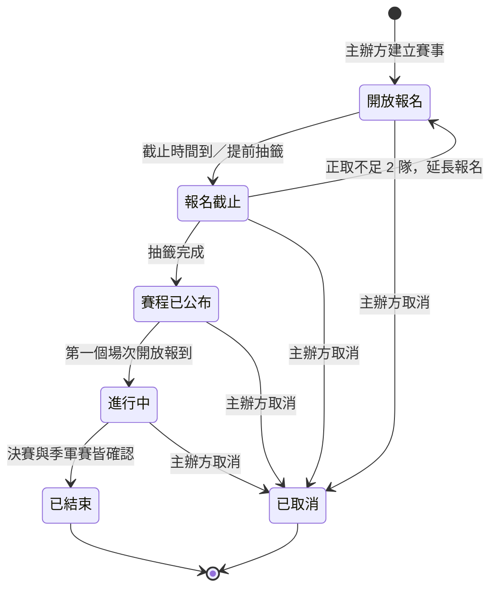

### （二）報名狀態

「組隊中」（建立隊伍後、尚未送出）與「已送出・待分配」（優先期內送出、等待優先期結束）都是正式的報名狀態。因此報名紀錄在建立隊伍時就產生，送出時才寫入學校、平均段位積分與送出時間的快照。

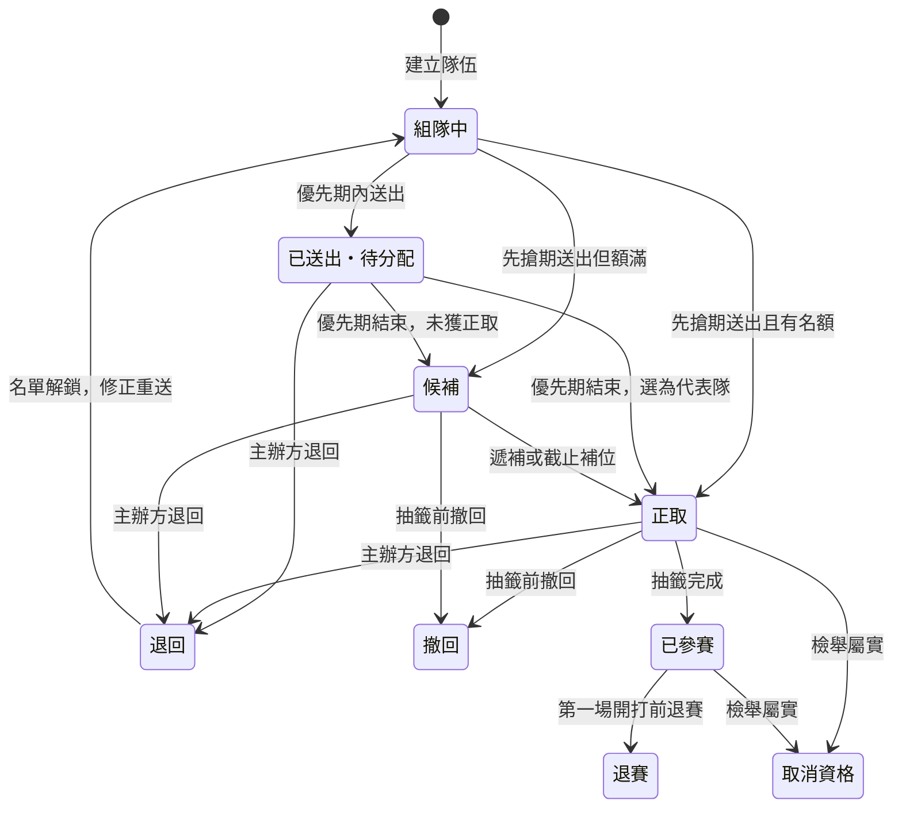

### （三）場次狀態

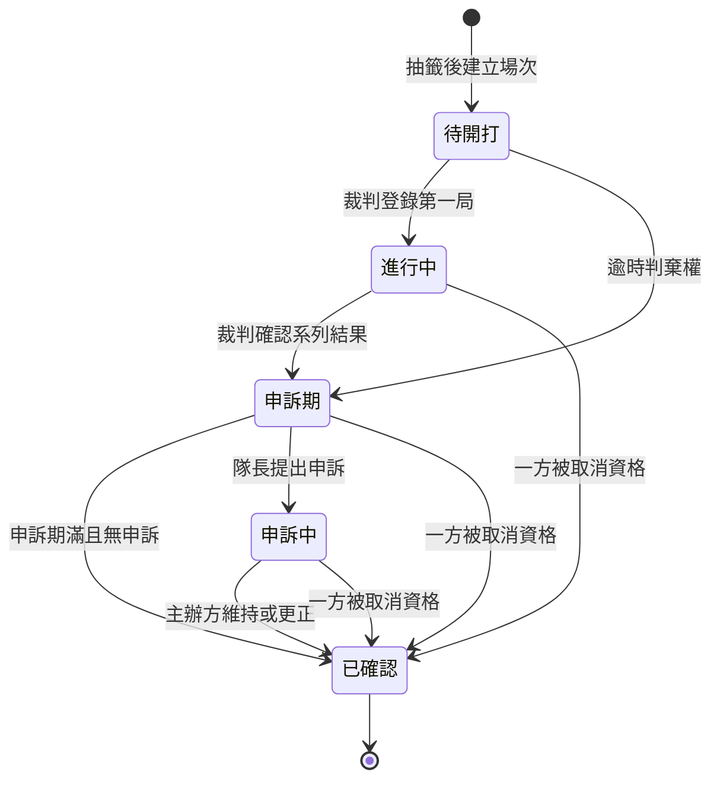

## 五、實體關聯圖

本系統的資料模型以「賽事、隊伍、報名、場次」為主軸：賽事複製遊戲設定、收到隊伍報名，抽籤後產生對戰表與場次；場次記錄每局比分、報到、結算截圖，並可能收到申訴；所有重要事件寫入事件與操作紀錄，再產生通知。全系統共 23 張資料表，為了閱讀清楚，依功能分成四張圖呈現，跨圖出現的實體（如 ACCOUNT、TOURNAMENT、TEAM）是同一張資料表。

### （一）帳號與賽事設定

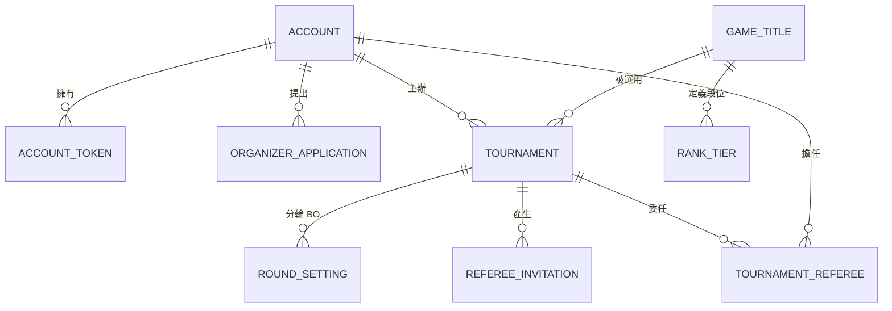

### （二）隊伍與報名

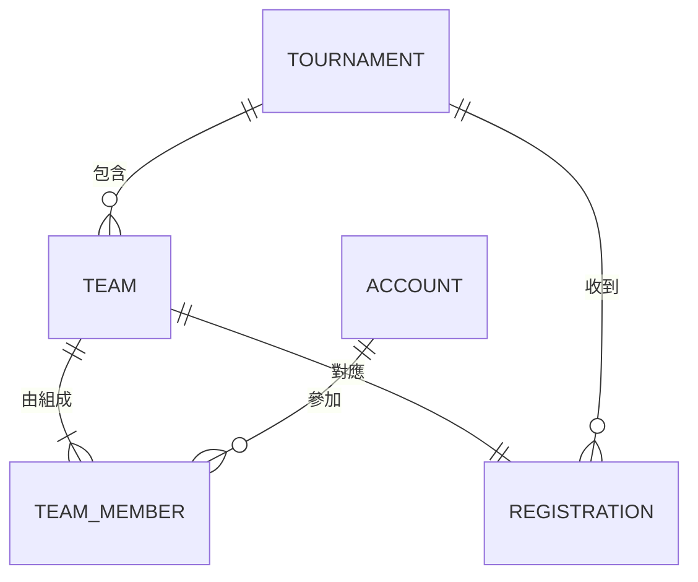

### （三）對戰與爭議

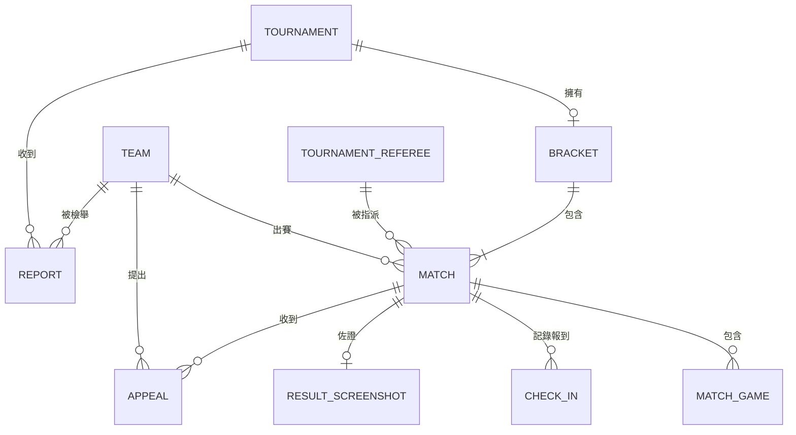

### （四）通知與紀錄

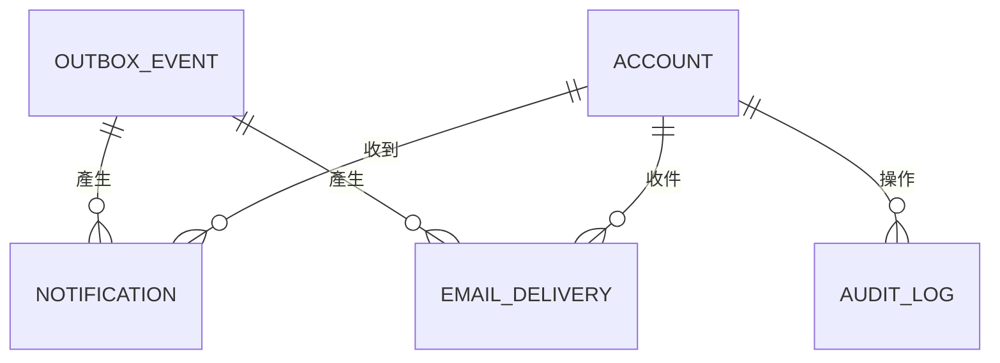

## 六、資料表說明

資料表欄位以《物件設計文件》的類別設計為基礎，補上主鍵、外鍵與建立時間；所有主鍵為 UUID，時間一律以 UTC 存放（timestamptz）。實作後以 Alembic 遷移檔為準。

### （一）ACCOUNT 帳號

| 欄位 | 資料型別 | PK／FK | 說明 |
| --- | --- | --- | --- |
| id | UUID | PK | 帳號主鍵 |
| email | VARCHAR | UNIQUE | 登入用 Email |
| hashed_password | VARCHAR |  | 雜湊後的密碼 |
| email_verified | BOOLEAN |  | 是否已完成 Email 驗證 |
| display_name | VARCHAR |  | 顯示名稱 |
| school | VARCHAR |  | 學校 |
| is_platform_admin | BOOLEAN |  | 是否為平台管理員 |
| is_organizer | BOOLEAN |  | 是否具主辦方權限 |
| created_at | TIMESTAMPTZ |  | 建立時間 |

### （二）ACCOUNT_TOKEN 一次性 token

| 欄位 | 資料型別 | PK／FK | 說明 |
| --- | --- | --- | --- |
| id | UUID | PK | 主鍵 |
| account_id | UUID | FK → ACCOUNT.id | 所屬帳號 |
| purpose | VARCHAR（列舉） |  | 用途：verify_email、reset_password |
| token_hash | VARCHAR |  | token 雜湊值，不存明文 |
| expires_at | TIMESTAMPTZ |  | 到期時間（驗證 24 小時、重設 1 小時） |
| used_at | TIMESTAMPTZ |  | 使用時間；空值代表未使用 |

### （三）ORGANIZER_APPLICATION 主辦方申請

| 欄位 | 資料型別 | PK／FK | 說明 |
| --- | --- | --- | --- |
| id | UUID | PK | 主鍵 |
| account_id | UUID | FK → ACCOUNT.id | 申請人 |
| club_name | VARCHAR |  | 社團名稱 |
| school | VARCHAR |  | 學校 |
| status | VARCHAR（列舉） |  | 待審核、核准、退回 |
| reject_reason | TEXT |  | 退回原因 |
| created_at | TIMESTAMPTZ |  | 申請時間 |

### （四）GAME_TITLE 遊戲

| 欄位 | 資料型別 | PK／FK | 說明 |
| --- | --- | --- | --- |
| id | UUID | PK | 主鍵 |
| name | VARCHAR | UNIQUE | 遊戲名稱 |
| starters | INTEGER |  | 每隊先發人數 |
| substitutes | INTEGER |  | 每隊替補人數 |
| default_bo | INTEGER |  | 預設 BO 數 |
| score_type | VARCHAR（列舉） |  | 比分型態：win_loss（只記勝負）、rounds（回合比分） |

### （五）RANK_TIER 段位對照

| 欄位 | 資料型別 | PK／FK | 說明 |
| --- | --- | --- | --- |
| id | UUID | PK | 主鍵 |
| game_id | UUID | FK → GAME_TITLE.id | 所屬遊戲 |
| name | VARCHAR |  | 段位名稱 |
| score | INTEGER |  | 對應的段位積分 |

### （六）TOURNAMENT 賽事

| 欄位 | 資料型別 | PK／FK | 說明 |
| --- | --- | --- | --- |
| id | UUID | PK | 主鍵 |
| organizer_id | UUID | FK → ACCOUNT.id | 主辦方 |
| game_id | UUID | FK → GAME_TITLE.id | 選用的遊戲 |
| name | VARCHAR |  | 賽事名稱 |
| capacity | INTEGER |  | 名額（隊數） |
| mode | VARCHAR（列舉） |  | 賽事模式：campus（校園賽）、custom（自訂） |
| registration_start | TIMESTAMPTZ |  | 報名開始時間 |
| registration_end | TIMESTAMPTZ |  | 報名截止時間 |
| priority_hours | INTEGER |  | 優先期長度（小時）；自訂賽事為空 |
| start_at | TIMESTAMPTZ |  | 開賽日期 |
| round_interval_minutes | INTEGER |  | 每輪間隔（分鐘） |
| forfeit_minutes | INTEGER |  | 棄權時限，至少 15 分鐘 |
| appeal_minutes | INTEGER |  | 申訴期，至少 30 分鐘 |
| status | VARCHAR（列舉） |  | 賽事狀態 |
| livestream_url | VARCHAR |  | 直播連結（選填） |
| game_snapshot | JSONB |  | 建立時複製的遊戲設定（人數、BO、比分型態、段位對照） |
| invite_token | VARCHAR | UNIQUE | 自訂賽事的報名連結 token；校園賽為空；主辦方重設時更換，舊連結立即失效 |
| created_at | TIMESTAMPTZ |  | 建立時間 |

### （七）ROUND_SETTING 分輪設定

| 欄位 | 資料型別 | PK／FK | 說明 |
| --- | --- | --- | --- |
| id | UUID | PK | 主鍵 |
| tournament_id | UUID | FK → TOURNAMENT.id | 所屬賽事 |
| round_no | INTEGER |  | 輪次 |
| bo | INTEGER |  | 該輪 BO 數 |

### （八）REFEREE_INVITATION 裁判邀請

| 欄位 | 資料型別 | PK／FK | 說明 |
| --- | --- | --- | --- |
| id | UUID | PK | 主鍵 |
| tournament_id | UUID | FK → TOURNAMENT.id | 所屬賽事 |
| token | VARCHAR | UNIQUE | 邀請連結 token |
| created_at | TIMESTAMPTZ |  | 產生時間 |
| expires_at | TIMESTAMPTZ |  | 到期時間（7 天）；重新產生時舊邀請立即到期 |

### （九）TOURNAMENT_REFEREE 賽事裁判

| 欄位 | 資料型別 | PK／FK | 說明 |
| --- | --- | --- | --- |
| id | UUID | PK | 主鍵 |
| tournament_id | UUID | FK → TOURNAMENT.id | 賽事 |
| account_id | UUID | FK → ACCOUNT.id | 擔任裁判的帳號 |

### （十）TEAM 隊伍

| 欄位 | 資料型別 | PK／FK | 說明 |
| --- | --- | --- | --- |
| id | UUID | PK | 主鍵 |
| tournament_id | UUID | FK → TOURNAMENT.id | 所屬賽事（隊伍只屬於一個賽事） |
| name | VARCHAR |  | 隊名 |
| invite_token | VARCHAR | UNIQUE | 隊伍邀請連結 token |
| created_at | TIMESTAMPTZ |  | 建立時間 |

### （十一）TEAM_MEMBER 隊員

| 欄位 | 資料型別 | PK／FK | 說明 |
| --- | --- | --- | --- |
| id | UUID | PK | 主鍵 |
| team_id | UUID | FK → TEAM.id | 所屬隊伍 |
| account_id | UUID | FK → ACCOUNT.id | 隊員帳號 |
| role | VARCHAR（列舉） |  | captain（隊長）、player（選手）；每隊恰好一位隊長 |
| game_account_id | VARCHAR |  | 遊戲 ID |
| rank_tier | VARCHAR |  | 段位 |
| rank_score | INTEGER |  | 換算後的段位積分 |
| rank_screenshot_key | VARCHAR |  | 段位截圖的檔案鍵值 |

### （十二）REGISTRATION 報名

| 欄位 | 資料型別 | PK／FK | 說明 |
| --- | --- | --- | --- |
| id | UUID | PK | 主鍵 |
| team_id | UUID | FK → TEAM.id，UNIQUE | 報名的隊伍；建立隊伍時同時建立 |
| tournament_id | UUID | FK → TOURNAMENT.id | 賽事 |
| status | VARCHAR（列舉） |  | 報名狀態：組隊中、已送出・待分配、正取、候補、退回、撤回、已參賽、退賽、取消資格 |
| school | VARCHAR |  | 送出時的學校（快照）；組隊中為空 |
| avg_rank_score | NUMERIC(6,2) |  | 送出時的平均段位積分（快照）；組隊中為空 |
| submitted_at | TIMESTAMPTZ |  | 送出時間（快照）；組隊中為空 |
| reject_reason | TEXT |  | 退回原因 |

### （十三）BRACKET 對戰表

| 欄位 | 資料型別 | PK／FK | 說明 |
| --- | --- | --- | --- |
| id | UUID | PK | 主鍵 |
| tournament_id | UUID | FK → TOURNAMENT.id，UNIQUE | 賽事 |
| size | INTEGER |  | 對戰表大小 P（2 的次方） |
| rounds | INTEGER |  | 輪數 |
| drawn_at | TIMESTAMPTZ |  | 抽籤時間 |

### （十四）MATCH 場次

| 欄位 | 資料型別 | PK／FK | 說明 |
| --- | --- | --- | --- |
| id | UUID | PK | 主鍵 |
| bracket_id | UUID | FK → BRACKET.id | 所屬對戰表 |
| round_no | INTEGER |  | 輪次 |
| slot_no | INTEGER |  | 該輪中的位置 |
| is_third_place | BOOLEAN |  | 是否為季軍賽 |
| team_a_id | UUID | FK → TEAM.id | A 隊 |
| team_b_id | UUID | FK → TEAM.id | B 隊 |
| referee_id | UUID | FK → TOURNAMENT_REFEREE.id | 指派的裁判 |
| scheduled_at | TIMESTAMPTZ |  | 預定開始時間 |
| status | VARCHAR（列舉） |  | 場次狀態 |
| winner_id | UUID | FK → TEAM.id | 勝隊 |
| wins_a | INTEGER |  | A 隊勝局數 |
| wins_b | INTEGER |  | B 隊勝局數 |
| confirmed_by | UUID | FK → ACCOUNT.id | 確認系列結果的帳號 |
| confirmed_at | TIMESTAMPTZ |  | 確認時間 |
| forfeit_deadline | TIMESTAMPTZ |  | 棄權判定期限 |
| appeal_deadline | TIMESTAMPTZ |  | 申訴期截止時間 |
| next_match_id | UUID | FK → MATCH.id | 勝隊晉級的下一場 |

### （十五）MATCH_GAME 局

| 欄位 | 資料型別 | PK／FK | 說明 |
| --- | --- | --- | --- |
| id | UUID | PK | 主鍵 |
| match_id | UUID | FK → MATCH.id | 所屬場次 |
| game_no | INTEGER |  | 第幾局 |
| winner_team_id | UUID | FK → TEAM.id | 該局勝隊 |
| score_a | INTEGER |  | A 隊回合數（回合比分型態） |
| score_b | INTEGER |  | B 隊回合數（回合比分型態） |

### （十六）CHECK_IN 報到

| 欄位 | 資料型別 | PK／FK | 說明 |
| --- | --- | --- | --- |
| id | UUID | PK | 主鍵 |
| match_id | UUID | FK → MATCH.id | 場次 |
| team_id | UUID | FK → TEAM.id | 報到的隊伍 |
| at | TIMESTAMPTZ |  | 報到時間 |

### （十七）RESULT_SCREENSHOT 結算截圖

| 欄位 | 資料型別 | PK／FK | 說明 |
| --- | --- | --- | --- |
| id | UUID | PK | 主鍵 |
| match_id | UUID | FK → MATCH.id，UNIQUE | 場次 |
| file_key | VARCHAR |  | 截圖檔案鍵值 |

### （十八）APPEAL 申訴

| 欄位 | 資料型別 | PK／FK | 說明 |
| --- | --- | --- | --- |
| id | UUID | PK | 主鍵 |
| match_id | UUID | FK → MATCH.id | 被申訴的場次 |
| team_id | UUID | FK → TEAM.id | 提出申訴的隊伍 |
| description | TEXT |  | 申訴說明 |
| attachment_key | VARCHAR |  | 附件截圖鍵值 |
| status | VARCHAR（列舉） |  | 處理中、已結案 |
| decision | VARCHAR（列舉） |  | 維持原結果、更正結果 |
| reason | TEXT |  | 處理理由 |
| handled_by | UUID | FK → ACCOUNT.id | 處理的主辦方 |
| created_at | TIMESTAMPTZ |  | 提出時間 |

### （十九）REPORT 檢舉

| 欄位 | 資料型別 | PK／FK | 說明 |
| --- | --- | --- | --- |
| id | UUID | PK | 主鍵 |
| tournament_id | UUID | FK → TOURNAMENT.id | 賽事 |
| reporter_team_id | UUID | FK → TEAM.id | 檢舉的隊伍 |
| reported_team_id | UUID | FK → TEAM.id | 被檢舉的隊伍 |
| description | TEXT |  | 檢舉說明 |
| attachment_key | VARCHAR |  | 附件截圖鍵值 |
| status | VARCHAR（列舉） |  | 處理中、駁回、屬實 |
| reason | TEXT |  | 處理理由 |
| created_at | TIMESTAMPTZ |  | 提出時間 |

### （二十）NOTIFICATION 站內通知

| 欄位 | 資料型別 | PK／FK | 說明 |
| --- | --- | --- | --- |
| id | UUID | PK | 主鍵 |
| account_id | UUID | FK → ACCOUNT.id | 收件帳號 |
| event_id | UUID | FK → OUTBOX_EVENT.id | 來源事件；與 account_id 組成唯一鍵以防重複通知 |
| type | VARCHAR |  | 通知類型 |
| title | VARCHAR |  | 通知標題 |
| link | VARCHAR |  | 點擊後導向的頁面 |
| created_at | TIMESTAMPTZ |  | 建立時間 |
| read_at | TIMESTAMPTZ |  | 已讀時間；空值代表未讀 |

### （二十一）EMAIL_DELIVERY Email 寄送紀錄

| 欄位 | 資料型別 | PK／FK | 說明 |
| --- | --- | --- | --- |
| id | UUID | PK | 主鍵 |
| event_id | UUID | FK → OUTBOX_EVENT.id | 來源事件；與 account_id 組成唯一鍵 |
| account_id | UUID | FK → ACCOUNT.id | 收件帳號 |
| status | VARCHAR（列舉） |  | 待寄、已寄出、失敗 |
| attempts | INTEGER |  | 已嘗試次數 |
| last_error | TEXT |  | 最近一次失敗原因 |

### （二十二）AUDIT_LOG 操作紀錄

| 欄位 | 資料型別 | PK／FK | 說明 |
| --- | --- | --- | --- |
| id | UUID | PK | 主鍵 |
| actor_id | UUID | FK → ACCOUNT.id | 操作者；系統自動執行時為空，代表 system |
| action | VARCHAR |  | 動作名稱 |
| entity_type | VARCHAR |  | 對象的實體類型 |
| entity_id | UUID |  | 對象主鍵 |
| before | JSONB |  | 變更前內容 |
| after | JSONB |  | 變更後內容 |
| at | TIMESTAMPTZ |  | 操作時間 |

本表由資料庫 trigger 拒絕 UPDATE 與 DELETE，只能新增。

### （二十三）OUTBOX_EVENT 事件

| 欄位 | 資料型別 | PK／FK | 說明 |
| --- | --- | --- | --- |
| id | UUID | PK | 主鍵 |
| type | VARCHAR |  | 事件名稱（過去式，例如 MatchResultConfirmed） |
| payload | JSONB |  | 事件內容（實體 id 與事件特有資料） |
| created_at | TIMESTAMPTZ |  | 建立時間 |
| processed_at | TIMESTAMPTZ |  | worker 處理完成時間；空值代表未處理 |

## 七、類別圖

本節的類別圖為分析層級的領域模型，呈現系統中的核心概念、主要屬性與彼此的關聯與多重性；Service、Repository 等設計層級的類別請見《物件設計文件》。

### （一）帳號、賽事與報名

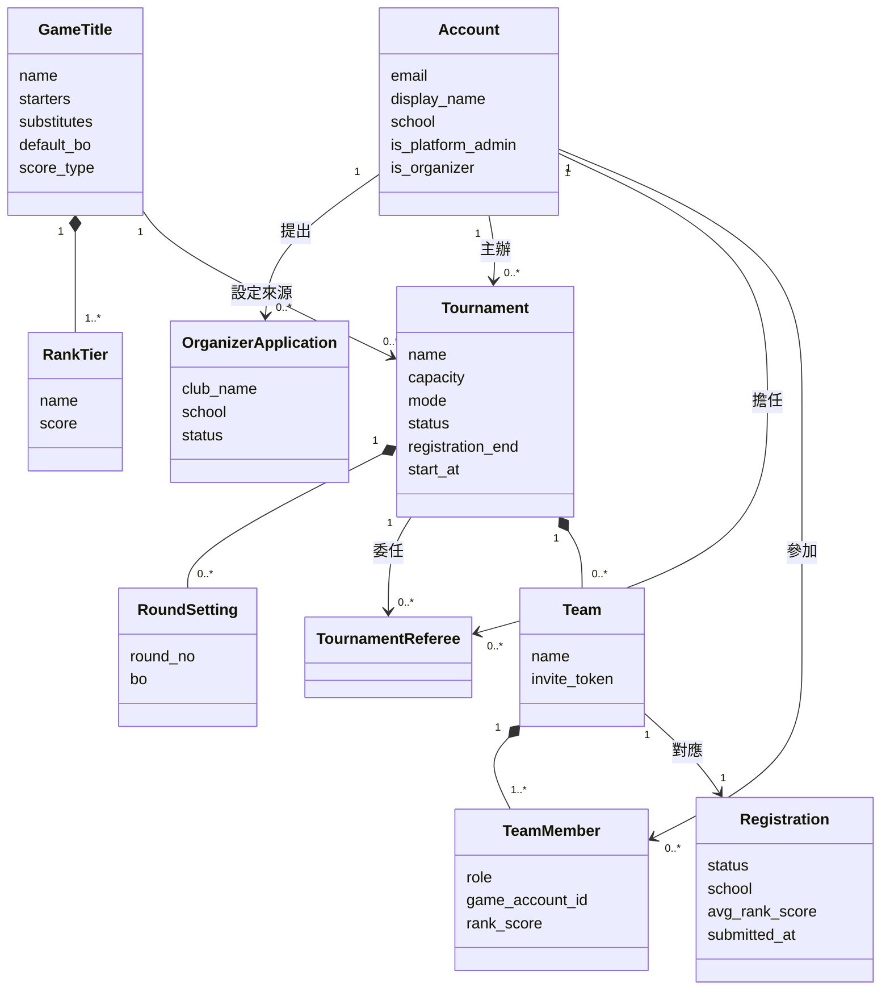

### （二）對戰、爭議與通知

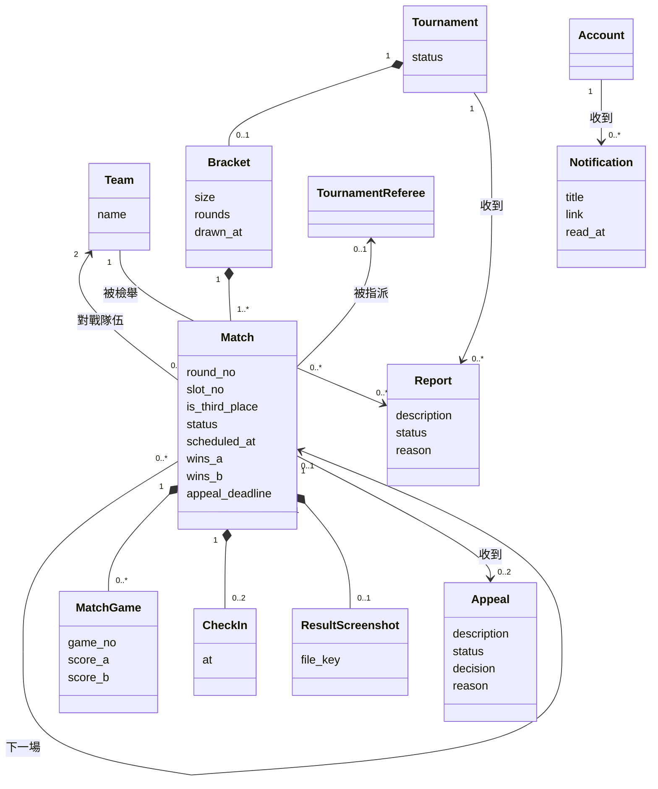

## 八、循序圖

### （一）隊長送出報名

下圖描述隊長送出報名時，系統如何以鎖住賽事資料列的方式依序處理同時送出的報名，確保正取隊數不超過名額。整個流程在同一個資料庫交易中完成，操作紀錄與通知事件也寫在同一個交易裡。

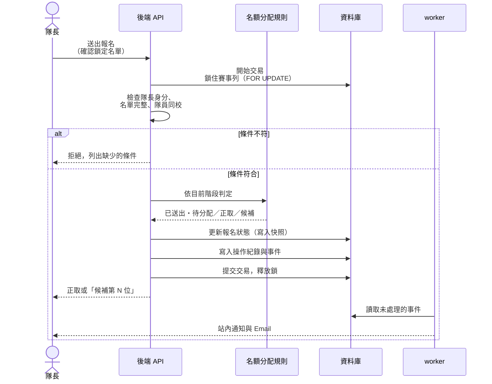

### （二）裁判登錄比分與確認系列結果

下圖描述裁判逐局登錄比分、確認系列結果，以及申訴期滿後由 worker 自動確認並推進晉級的過程。任何對場次的寫入都先鎖住該場次列，避免同時操作互相覆蓋。

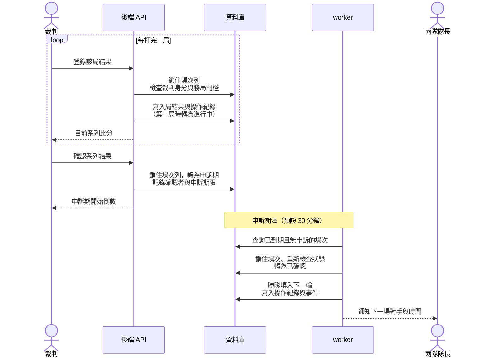

### （三）隊長提出申訴與主辦方處理

下圖描述隊長在申訴期內提出申訴，主辦方維持或更正結果後，系統確認場次並推進晉級的過程。

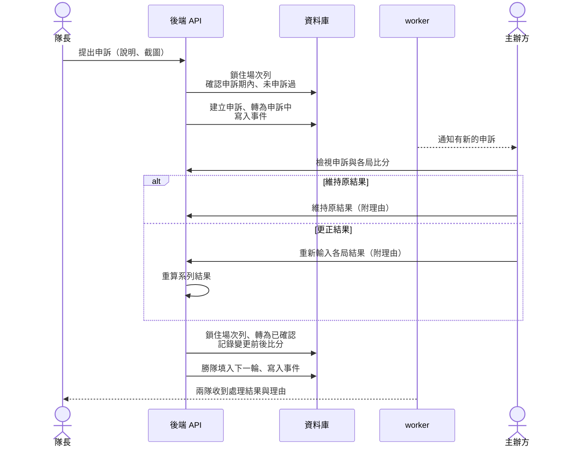
