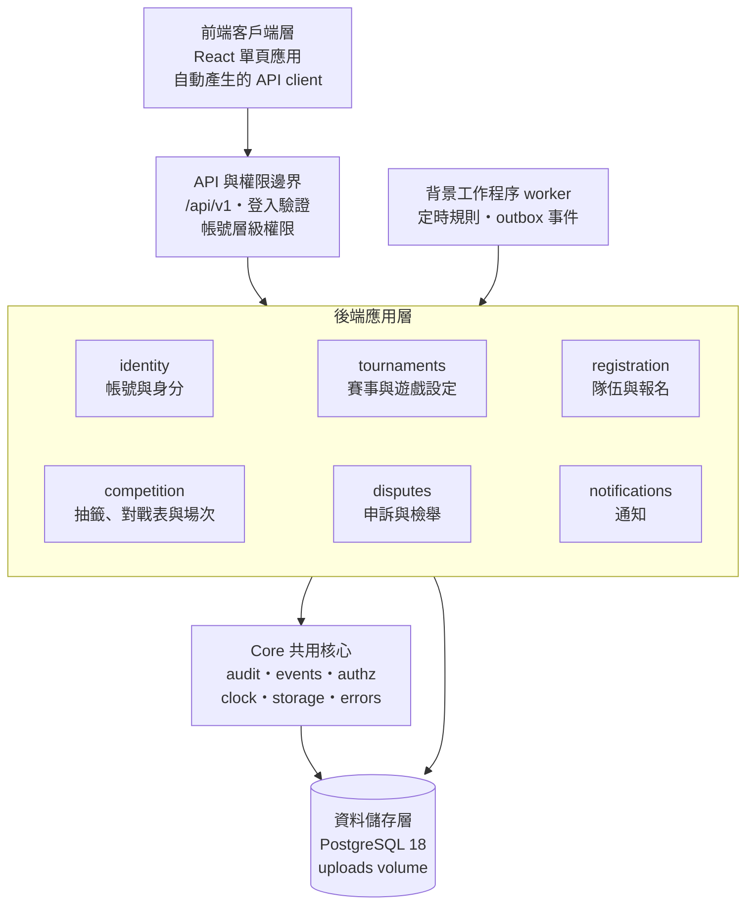
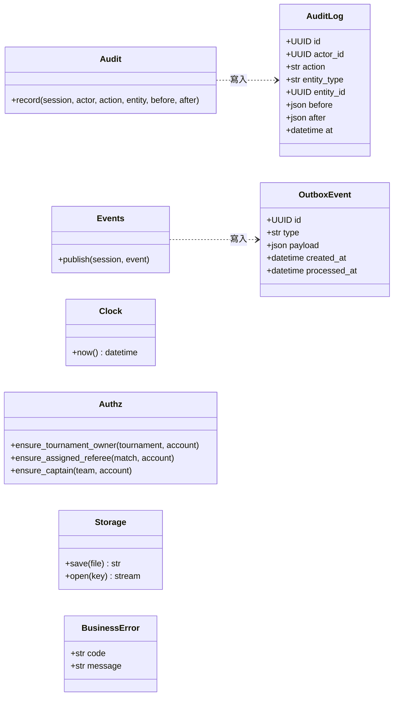
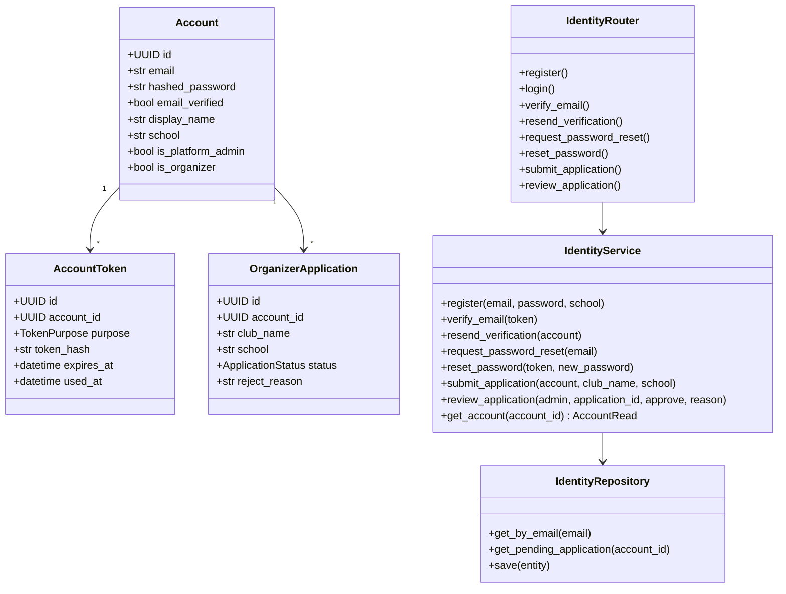
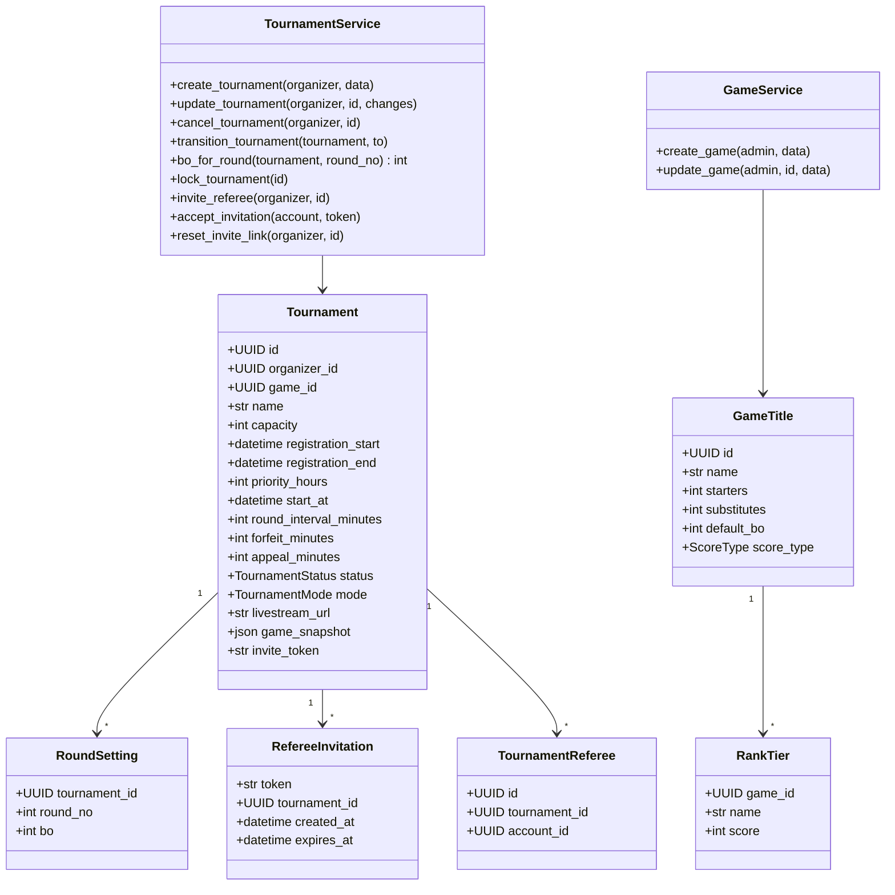
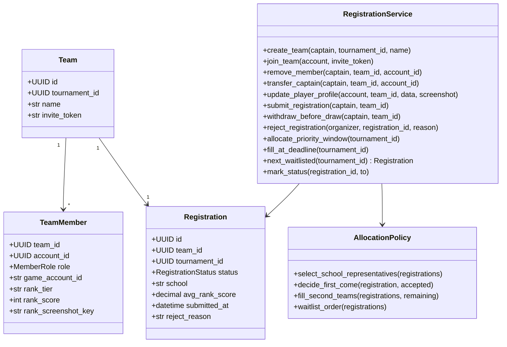
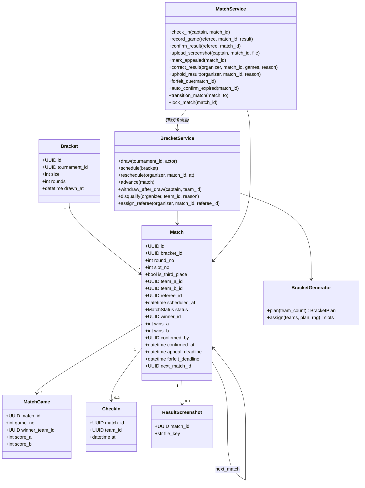
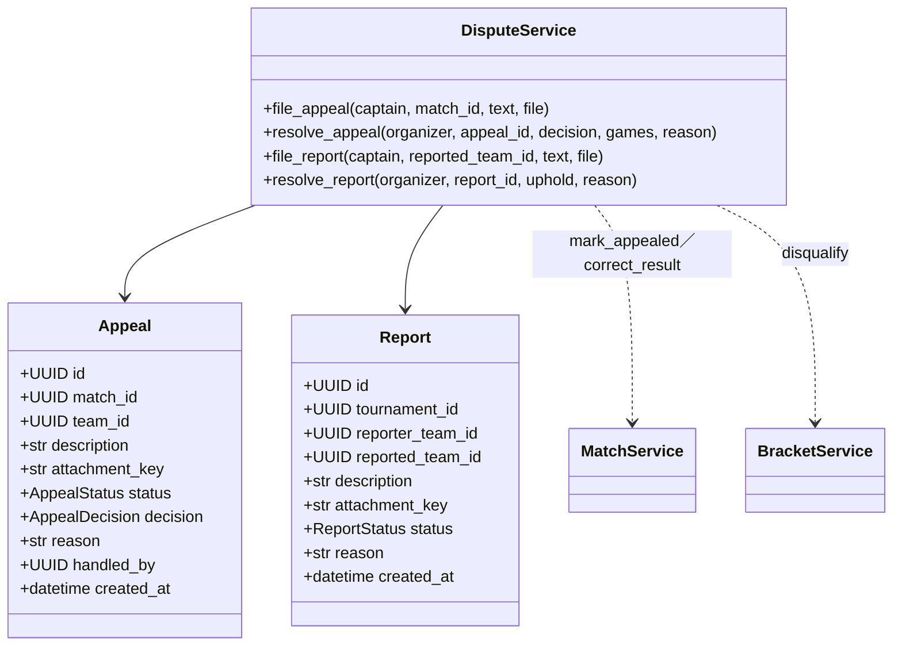
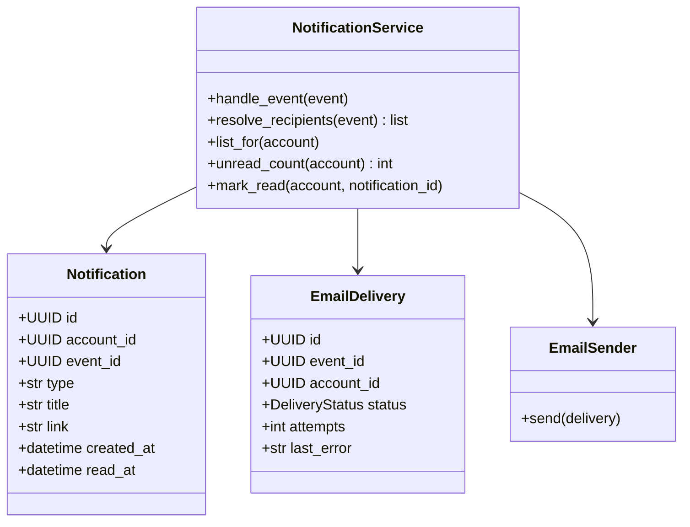
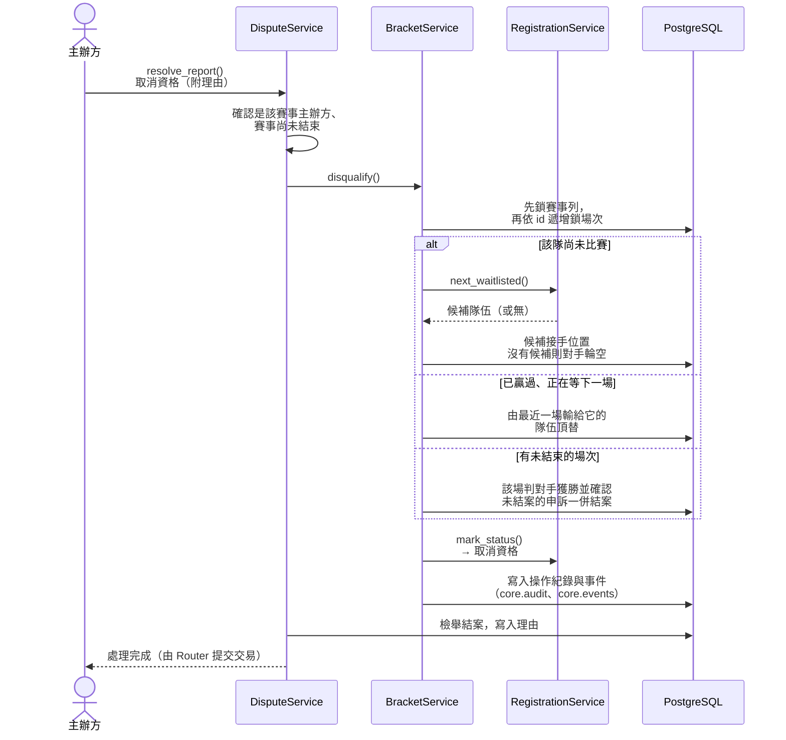

# 壹、系統簡介

## 一、系統簡介與特色

本系統是校際與社群電競盃賽的一站式管理平台，整合主辦方申請、遊戲設定、賽事建立、組隊報名、三階段名額分配、抽籤與單淘汰對戰表、報到與逐局比分、申訴與檢舉、觀賽與通知等功能。系統以模組化架構設計，透過資料庫列鎖、單一狀態轉換函式與交易式 outbox 等機制，避免名額超收、比分互相覆蓋與通知遺漏；所有影響結果的操作都留下不可修改的紀錄，讓主辦方在爭議發生時有據可查。

本文件說明後端各模組的類別設計、類別職責與模組之間的協作方式。類別圖中只列出決定職責的主要欄位與方法，完整的資料欄位請見《軟體需求分析文件》的資料表說明。本文件的類別圖為實作前的設計，程式完成後將以程式碼為準重新產生類別圖並更新本文件。

## 二、軟體架構圖

### （一）前端客戶端層

前端以 React 單頁應用呈現，可在手機與電腦上使用。前端只負責介面呈現與操作互動，不包含任何業務規則；所有資料存取都透過依 OpenAPI 文件自動產生的 API client，需要即時更新的畫面以固定頻率輪詢。

### （二）API 與權限邊界

所有請求都經由 `/api/v1` 進入後端。Router 在這一層驗證登入身分，並檢查帳號層級的權限（已登入、Email 已驗證、平台管理員、主辦方）；不需登入的公開 API 只回傳 `Public*` schema，避免個資外洩。

### （三）後端應用層

後端採模組化單體，依功能切成 6 個業務模組。每個模組內部分成三層：

1. **Router 層**：API 路由、輸入驗證、帳號層級權限，並開啟與提交交易。
2. **Service 層**：業務規則、資源層級權限、狀態轉換、寫入操作紀錄與發出事件；跨模組時只呼叫其他模組 Service 的公開函式。
3. **Repository 層**：本模組資料表的查詢、寫入與加鎖，提供 Service 一致的資料存取介面。

### （四）背景工作與通知

worker 是後端程式碼的另一個進入點，定期處理到期工作（優先期結束、報名截止、判棄權、申訴期滿），並讀取 outbox 事件交給通知模組，使通知寄送不會阻塞使用者的操作。

### （五）資料儲存層

PostgreSQL 是唯一的資料來源，以列鎖保證併發一致、以 trigger 保護操作紀錄；上傳的截圖存在 docker volume，資料庫只存檔案鍵值。

# 貳、物件設計

各模組的類別依角色分為四類：**實體**（對應資料表的 SQLModel 類別）、**控制**（Router）、**服務**（Service，承載業務規則）、**資料存取**（Repository）。另有少數**策略**與**演算法**類別，是不碰資料庫的純函式，方便單元測試；共用核心還有一個**例外**類別 BusinessError，用來表示業務錯誤。Router 與 Repository 的結構在各模組都相同，因此只在帳號與身分模組完整呈現，其他模組的類別圖中省略。

## 一、共用核心 core

共用核心提供各模組共用、與業務無關的基礎功能，不得 import 任何業務模組。它擁有操作紀錄（AuditLog）與事件（OutboxEvent）兩張資料表。

| 類別 | 類型 | 職責 |
| --- | --- | --- |
| AuditLog | 實體 | 一筆操作紀錄：操作者、動作、對象與變更前後內容；只能新增 |
| OutboxEvent | 實體 | 一則待處理的事件，與業務資料同一交易寫入 |
| Audit | 服務 | 提供 `record()`，讓各 Service 在同一交易中寫入操作紀錄 |
| Events | 服務 | 提供 `publish()`，把事件寫入 outbox |
| Clock | 服務 | 取得目前時間的唯一入口；測試時以假時鐘替換 |
| Authz | 服務 | 資源層級權限的共用檢查；只接收已載入的實體，自己不查資料庫 |
| Storage | 服務 | 上傳檔案的儲存與讀取，驗證格式與大小 |
| BusinessError | 例外 | 業務錯誤，帶英文代碼與繁中訊息，由 Router 轉成 4xx 回應 |

## 二、帳號與身分模組 identity

**職責**：註冊、登入、Email 驗證與重寄驗證信、忘記與重設密碼、主辦方申請與審核，並提供帳號查詢給其他模組。

| 類別 | 類型 | 職責 |
| --- | --- | --- |
| Account | 實體 | 帳號資料；平台管理員與主辦方是帳號上的旗標 |
| AccountToken | 實體 | Email 驗證與重設密碼的一次性 token，只存雜湊 |
| OrganizerApplication | 實體 | 主辦方申請與審核結果 |
| IdentityRouter | 控制 | 帳號相關的 API 端點，檢查帳號層級權限 |
| IdentityService | 服務 | 註冊、驗證、重設密碼與申請審核的業務規則；`get_account()` 回傳 schema 給其他模組 |
| IdentityRepository | 資料存取 | 帳號、token 與申請的查詢與儲存 |

**設計重點**

1. 驗證 token 24 小時、重設 token 1 小時到期，用一次即寫入 `used_at`；產生新 token 時，同帳號同用途的舊 token 全部作廢（AD-21）。
2. 寄信一律經 outbox 事件（`VerificationEmailRequested`、`PasswordResetRequested`），只寄 Email、不建立站內通知。
3. `request_password_reset()` 對未註冊的 Email 不產生事件，但回應與已註冊時完全相同，避免洩漏 Email 是否存在。
4. `get_account()` 回傳 Pydantic schema 而非 ORM 物件，其他模組無法透過它修改帳號資料（AD-2）。

## 三、賽事與遊戲設定模組 tournaments

**職責**：遊戲清單與段位對照（平台管理員維護）、建立與修改賽事（含設定快照）、賽事狀態轉換、裁判邀請與裁判身分。

| 類別 | 類型 | 職責 |
| --- | --- | --- |
| GameTitle | 實體 | 遊戲與其預設值（人數、BO、比分型態） |
| RankTier | 實體 | 遊戲的段位與段位積分對照 |
| Tournament | 實體 | 賽事設定、狀態與建立時複製的遊戲設定快照 |
| RoundSetting | 實體 | 某一輪的 BO 數 |
| RefereeInvitation | 實體 | 裁判邀請連結與到期時間 |
| TournamentReferee | 實體 | 帳號在某賽事中的裁判身分 |
| TournamentService | 服務 | 賽事的建立、修改限制、取消、狀態轉換、加鎖與裁判邀請 |
| GameService | 服務 | 平台管理員維護遊戲設定 |

**設計重點**

1. 建立賽事時把遊戲的人數、BO、比分型態與段位對照複製到 `game_snapshot`，之後只讀這份副本；平台管理員修改遊戲預設值不影響已建立的賽事（AD-12）。
2. `bo_for_round()` 先查 RoundSetting，沒有分輪設定時才用快照中的預設 BO 數；程式中沒有任何依遊戲名稱的分支（AD-18）。
3. `update_tournament()` 依賽事狀態限制可改的欄位：抽籤前只能放寬，抽籤後只能改場次時間，直播連結在結束前都能改（FR-9）。
4. `mode` 建立後不可更改；所有與模式有關的判斷交給 registration 模組的 AllocationPolicy（AD-20）。自訂賽事建立時產生 `invite_token` 作為賽事報名連結，`reset_invite_link()` 換成新的 token，舊連結立即失效（FR-39）。
5. `lock_tournament()` 是全系統鎖住賽事列的唯一入口，其他模組要加鎖時都呼叫它（AD-6）。
6. `invite_referee()` 產生 7 天後到期的邀請，並使同賽事尚未到期的舊邀請立即失效。

## 四、隊伍與報名模組 registration

**職責**：建立隊伍與邀請隊員、選手參賽資料、送出報名、三階段名額分配、候補排序、抽籤前撤回、主辦方退回。名額規則集中在純函式的 AllocationPolicy。

| 類別 | 類型 | 職責 |
| --- | --- | --- |
| Team | 實體 | 隊伍，只屬於一個賽事，帶有隊伍邀請 token |
| TeamMember | 實體 | 隊員與其角色（隊長或選手）、遊戲 ID、段位與段位截圖 |
| Registration | 實體 | 報名狀態與分配結果；建立隊伍時即產生（組隊中），送出時寫入學校、平均段位積分與送出時間快照 |
| RegistrationService | 服務 | 組隊、名單異動、送出、撤回、退回，以及優先期結算與截止補位 |
| AllocationPolicy | 策略 | 依賽事模式判定代表隊、正取或候補、截止補位與候補順位；不碰資料庫的純函式 |

**設計重點**

1. 隊長身分只看 `TeamMember.role`，每隊恰好一位隊長；`core.authz.ensure_captain()` 依此判斷。
2. `submit_registration()`、`remove_member()`、`transfer_captain()` 都先鎖住賽事列，鎖住之後才檢查隊長身分與名單狀態，避免檢查後被其他操作改變（AD-6）。
3. 名額分配與候補排序只使用 Registration 上的三個快照欄位，所有人用同一份資料判斷（AD-12）。
4. AllocationPolicy 是策略模式：校園賽與自訂賽事各有一套規則，RegistrationService 依賽事模式取得對應策略，其他程式不得自行依模式分支（AD-20）。由於它是純函式，PRD 中每一條名額規則的可測結果（例如「名額 32、40 間學校報名」）都能直接寫成單元測試。
5. `allocate_priority_window()` 與 `fill_at_deadline()` 由 worker 在期限到達時呼叫，重複呼叫不會重複分配。

## 五、抽籤、對戰表與場次模組 competition

**職責**：抽籤與產生單淘汰對戰表（含輪空、季軍賽）、排定場次時間、晉級推進、抽籤後退賽遞補與取消資格頂替、報到、判棄權、逐局比分、確認系列結果、申訴期與自動確認。對戰表產生演算法集中在純函式的 BracketGenerator。

| 類別 | 類型 | 職責 |
| --- | --- | --- |
| Bracket | 實體 | 一個賽事的對戰表：大小、輪數與抽籤時間 |
| Match | 實體 | 場次：對戰隊伍、裁判、時間、狀態、系列比分、各種期限與下一場 |
| MatchGame | 實體 | 場次中的一局與其比分 |
| CheckIn | 實體 | 隊伍的報到紀錄，每場最多兩筆 |
| ResultScreenshot | 實體 | 勝隊上傳的結算截圖 |
| BracketGenerator | 演算法 | 依正取隊數計算對戰表結構（輪數、輪空數、季軍賽），再以亂數排定對位；純函式 |
| BracketService | 服務 | 抽籤、排定與修改時間、晉級推進、抽籤後退賽與取消資格頂替、指派裁判 |
| MatchService | 服務 | 報到、登錄與確認比分、結算截圖、申訴標記與更正、判棄權、自動確認、場次狀態轉換與加鎖 |

**設計重點**

1. BracketGenerator 與資料庫無關：設 P 為不小於正取隊數的最小 2 的次方，輪數為 log₂P，第一輪輪空數為 P 減正取隊數。亂數來源以參數傳入，測試時可固定，驗證「8 隊 3 輪 8 場、13 隊 4 輪 13 場」等規則。
2. 任何 Match 的寫入都先 `lock_match()`，鎖住後再檢查狀態與期限；同時需要賽事鎖時，先鎖賽事、再依 id 遞增鎖場次（AD-6）。
3. 場次狀態只能經 `transition_match()` 改變，依「待開打 → 進行中 → 申訴期 → 申訴中 → 已確認」的轉換表檢查（AD-11）。
4. `confirm_result()` 寫入 `confirmed_by` 與 `confirmed_at`；申訴更正的處理者記在 Appeal，不覆寫原確認者。
5. 抽籤後的退賽與取消資格由 BracketService 主導：先修改對戰表，再呼叫 registration 取得下一個候補並更新報名狀態（AD-4）。
6. `forfeit_due()` 與 `auto_confirm_expired()` 由 worker 呼叫，每筆一個交易，可重複執行。

## 六、申訴與檢舉模組 disputes

**職責**：隊長提出申訴（每隊每場一次）與資格檢舉；主辦方處理申訴（維持或更正）與查證檢舉（駁回或取消資格），實際的場次與對戰表變更交由 competition 執行。

| 類別 | 類型 | 職責 |
| --- | --- | --- |
| Appeal | 實體 | 對單一場次結果的申訴與處理結果 |
| Report | 實體 | 對另一支隊伍參賽資格的檢舉與查證結果 |
| DisputeService | 服務 | 申訴與檢舉的提出、處理與查證；呼叫 competition 執行場次更正與取消資格 |

**設計重點**

1. `file_appeal()` 透過 MatchService 鎖住場次，確認仍在申訴期、該隊未申訴過，再把場次標記為申訴中。
2. `resolve_appeal()` 選擇更正時，由 MatchService 依新的各局結果重算系列比分，變更前後內容寫入操作紀錄。
3. `resolve_report()` 判定屬實時呼叫 `BracketService.disqualify()`，頂替規則完全由 competition 處理，disputes 不直接修改對戰表（AD-4）。
4. disputes 位於依賴鏈的最上層，可以呼叫 competition、registration 與 tournaments，反方向的呼叫一律禁止（AD-3）。

## 七、通知模組 notifications

**職責**：消化 outbox 事件，依通知對象表決定收件人，建立站內通知並寄送 Email（失敗重試）；提供通知中心的查詢與標為已讀。

| 類別 | 類型 | 職責 |
| --- | --- | --- |
| Notification | 實體 | 一則站內通知，記錄已讀時間 |
| EmailDelivery | 實體 | 一封 Email 的寄送狀態、嘗試次數與最近一次錯誤 |
| NotificationService | 服務 | 處理事件、決定收件人、建立通知與寄送紀錄；提供通知中心查詢 |
| EmailSender | 服務 | 透過 SMTP 寄出 Email（示範環境寄到 Mailpit） |

**設計重點**

1. `handle_event()` 以（事件 id、收件人）為唯一鍵建立通知與寄送紀錄，同一事件重複處理不會重複通知。
2. 收件人由 `resolve_recipients()` 依 PRD 的通知對象表查詢決定，事件本身不帶收件人清單；查詢時可呼叫任何模組的 Service，但沒有模組可以呼叫 notifications（AD-3、AD-8）。
3. Email 失敗時更新 `attempts` 與 `last_error` 並稍後重試，不影響任何業務資料。
4. `list_for()` 依建立時間由新到舊排序；前端每 30 秒輪詢 `unread_count()` 更新頂欄的未讀數。

## 八、模組協作設計

模組之間只透過 Service 的公開函式溝通，回傳值為 Pydantic schema；通知這類附帶動作則一律透過事件。下表整理主要的跨模組呼叫：

| 呼叫方 | 被呼叫方 | 公開函式 | 用途 |
| --- | --- | --- | --- |
| registration | tournaments | `lock_tournament()`、賽事設定查詢 | 送出報名前鎖住賽事、讀取名額與模式 |
| registration | identity | `get_account()` | 取得隊員的學校以檢查同校 |
| competition | registration | `next_waitlisted()`、`mark_status()` | 抽籤後退賽或取消資格時取得候補並更新報名狀態 |
| competition | tournaments | `bo_for_round()`、`transition_tournament()` | 取得該輪 BO 數、推進賽事狀態 |
| disputes | competition | `mark_appealed()`、`correct_result()`、`uphold_result()`、`disqualify()` | 申訴與取消資格的實際執行 |
| 各模組 | core | `audit.record()`、`events.publish()` | 寫入操作紀錄、發出事件 |
| notifications | 各模組 | 查詢函式 | 決定事件的收件人 |

以「主辦方查證檢舉屬實、取消某隊資格」為例，這個操作橫跨 disputes、competition、registration 三個模組，但仍在同一個交易中完成：

# 參、設計原則與模式

| 原則或模式 | 應用位置 | 解決的問題 |
| --- | --- | --- |
| 分層架構 | 每個模組的 Router／Service／Repository | 每一層只有一種職責，業務規則可獨立測試 |
| Repository 模式 | 各模組的 Repository | 隔離資料存取，Service 不直接寫 SQL；加鎖集中管理 |
| 策略模式 | AllocationPolicy（校園賽、自訂） | 名額規則依賽事模式切換，新增模式時只需新增策略 |
| 純函式領域邏輯 | AllocationPolicy、BracketGenerator | 最複雜的規則不碰資料庫，可以大量撰寫單元測試 |
| 狀態機（單一轉換函式） | `transition_tournament()`、`transition_match()`、`mark_status()` | 避免各處直接改狀態而跳過規定的流程 |
| 交易式 outbox | `core.events` 與 notifications | 資料與通知一致、通知不重複、寄信失敗不影響主流程 |
| 快照 | Tournament.game_snapshot、Registration 的三個快照欄位 | 遊戲設定或隊員資料之後改變，也不影響已建立的賽事與分配結果 |
| 依賴注入 | Clock、亂數來源、EmailSender | 測試時以假物件替換，可驗證「30 分鐘後」與固定的抽籤結果 |
| 資料傳輸物件 | 跨模組回傳的 Pydantic schema、公開 API 的 `Public*` schema | 模組之間不共享 ORM 物件；公開資料不含個資 |

## 一、列舉型別

狀態與類型以 Python `StrEnum` 定義。部分列舉的英文值將在實作第一個 Story 時訂定命名慣例後確定，下表先列出各列舉的意義與成員。

| 列舉 | 所屬模組 | 成員 |
| --- | --- | --- |
| TokenPurpose | identity | verify_email、reset_password |
| ApplicationStatus | identity | 待審核、核准、退回 |
| ScoreType | tournaments | win_loss（只記勝負）、rounds（回合比分） |
| TournamentMode | tournaments | campus（校園賽）、custom（自訂） |
| TournamentStatus | tournaments | 開放報名、報名截止、賽程已公布、進行中、已結束、已取消 |
| MemberRole | registration | captain（隊長）、player（選手） |
| RegistrationStatus | registration | 組隊中、已送出・待分配、正取、候補、退回、撤回、已參賽、退賽、取消資格 |
| MatchStatus | competition | 待開打、進行中、申訴期、申訴中、已確認 |
| AppealStatus／AppealDecision | disputes | 處理中、已結案／維持原結果、更正結果 |
| ReportStatus | disputes | 處理中、駁回、屬實 |
| DeliveryStatus | notifications | 待寄、已寄出、失敗 |
