# B 使用案例圖修訂說明（審核中）

這次修訂另存成新檔，**原本的 B 文件、圖檔、PDF 與 Word 都沒有改動**。原本的圖是組長在 #82、#83 整理的版本（以下稱「組長版」），這份是蘇采羚依老師範例與 FR 做的修訂（以下稱「修訂版」）。**修訂版不一定對**，請組員依第四節逐張比對兩版，決定每一項要採用哪一版，再依第三節取代原檔。

## 一、新增的檔案

| 檔案 | 內容 |
| --- | --- |
| `B-使用案例圖修訂版.md` | 只收錄 B 參、一「使用案例圖」的修訂版（圖例、整體圖、1.0～7.0 的圖與說明），以最新 `main`（含 #83）為底 |
| `pdf/`、`docx/` 的 `B-使用案例圖修訂版-軟工期中-G14` | 上述內容排版後的 PDF（11 頁，含封面與目錄）與 Word |
| `figures/src/B-usecase-v2-*.usecase`、`figures/B-usecase-v2-*.png` | 整體圖與 1.0～7.0 的新圖 |
| `_build/usecase-v2.js` | 修訂版用的畫圖程式：多了功能群框語法（整體圖用），關聯線改接到橢圓朝向參與者的那一端，避免穿過同欄的其他案例 |
| `_build/build-v2.mjs` | 只排版修訂版的程式：`node docs/midterm/_build/build-v2.mjs` |

## 二、改了什麼、為什麼

依據是對照老師範例（114 學年第 2 組期末版）的審查，以及 B 自己的功能需求與名詞定義。

### 所有圖共通

| 修改 | 原因 |
| --- | --- |
| 新增整體使用案例圖（參、一（零）） | 老師範例有一張整體圖，我們原本只有 7 張分圖，看不到全貌。仿範例以功能群框放入全部使用案例 |
| 新增圖例說明 | 說明 «include»（每次都發生）與 «extend»（有條件才發生）、功能編號、「時間」的意義、參與者繼承關係 |
| 未登入者統一稱「訪客」 | 原本圖 1 叫「訪客」、圖 2 與圖 7 叫「觀眾」，違反 B「不使用同義詞」。參與者依權限命名，用「訪客」才不會出現「觀眾忘記密碼」這種說不通的關聯；利害關係人與 User Story 仍用「觀眾」，名詞定義補一列區分兩者 |
| 使用案例名稱前加功能編號 | 可以對回功能清單與 FR；老師範例也有編號。7.0 的片段案例（搜尋隊伍晉級路徑、標為已讀）不標編號，避免 7.2、7.5 重複 |
| 「時間」定義為外部的期限到達 | 參與者必須在系統外部；背景工作程序在系統內，不能當參與者。事件通知不是期限觸發，所以不連「時間」 |
| 參與者繼承寫在圖例 | 任何帳號都能做訪客能做的事；平台管理員、主辦方、裁判、選手都是帳號；隊長也是選手。圖上不重複連線 |
| 連線不加文字標籤 | 依組內決定，圖面保持單純；需要的條件改寫在各功能群的說明文字 |

### 各功能群

| 圖 | 修改 | 原因 |
| --- | --- | --- |
| 2.0 | 刪除「帶入遊戲預設值」「選擇賽事模式」 | 這是建立賽事表單的欄位，不是使用者能單獨完成的目標 |
| 2.0 | 「重設賽事報名連結」改為主辦方直接使用 | 原本 «extend»「修改賽事」，會讓人以為受 FR-9「抽籤後只能改時間」限制，但 FR-39 允許隨時重設 |
| 2.0 | 新增「候補遞補」«extend»「抽籤前修改賽事」 | FR-9：提高名額後候補立即遞補，原圖漏畫 |
| 2.0 | 刪除觀眾與「瀏覽賽事列表與賽事頁」 | 屬於 7.1，已畫在 7.0 |
| 3.0 | 撤回報名的遞補由 «include» 改為 «extend»，並補上退回報名後的遞補 | FR-17：沒有候補、或撤回的是候補隊伍時不會遞補，不是每次都發生；被退回釋出的名額也會遞補 |
| 3.0 | 「判定正取或候補」改名「名額判定」 | 優先期內送出的結果是「已送出・待分配」，不會立即判定 |
| 4.0 | 抽籤後退賽的遞補改為 «extend»；抽籤 «include» 截止補位 | FR-17：沒有候補時是對手輪空；FR-19：提前抽籤會先截止補位 |
| 5.0 | 主辦方也連到「送出系列結果」 | FR-27 與核心規格（二）：未指派裁判時主辦方代為登錄並送出 |
| 6.0 | 新增「晉級推進」«extend»「處理申訴」 | 核心規格（三）第 5 步「觸發晉級」，原圖漏畫；選「重新比賽」時不晉級，所以用 extend |
| 6.0 | 拉開取消資格與對戰表頂替的位置 | 原本 «include» 文字壓在橢圓上 |
| 7.0 | 「發送站內通知與 Email」改為帳號「接收站內通知與 Email」，不連「時間」 | 拿掉線上文字後，原本看起來像帳號發起寄信；通知是業務事件觸發，不是期限 |

## 三、審核通過後如何取代原檔

1. 把 `B-使用案例圖修訂版.md` 中「## 一、使用案例圖」整節（到「（七）7.0 功能群」的圖為止）貼回 `B-軟體需求分析文件.md`，取代原本的參、一，並把 `figures/B-usecase-v2-*` 改回 `figures/B-usecase-*`（整體圖為 `figures/B-usecase-overview.png`）。
2. 一併修改 B 參、一以外的文字，讓名詞一致：
   - 壹、二使用者類型第 6 項：「**觀眾**：未登入、只瀏覽公開頁面的訪客……」改為「**訪客**：未登入的使用者，大多是來觀賽的觀眾；只能瀏覽公開頁面、註冊或重設密碼，所有其他寫入操作都會被拒絕。」
   - 壹、四名詞定義新增一列：「訪客／觀眾｜**訪客**指未登入的使用者，是依權限的分類，使用案例圖的參與者用這個詞；**觀眾**指來觀賽的人，是依目的的分類，用在利害關係人與 User Story。登入的帳號一樣可以觀賽」。
   - 版本紀錄新增一列，摘要第二節的修改。
3. `figures/src/B-usecase-v2-*.usecase` 改名為 `B-usecase-*.usecase`（整體圖為 `B-usecase-overview.usecase`）；`_build/usecase-v2.js` 取代 `_build/usecase.js`；刪除 `_build/build-v2.mjs`。
4. 執行 `node docs/midterm/_build/build.mjs --only B`，排版程式會重新產生 B 的 PNG、PDF 與 Word。
5. 刪除 `B-使用案例圖修訂版.md`、它的 PDF 與 Word，以及 `figures/B-usecase-v2-*.png`。

圖都是由原始碼產生的，不需要手動把圖貼進 Word；直接在 Word 裡改的內容，下次排版時會被覆蓋。

## 四、請組員比對：組長版與修訂版

每一列請看兩張圖，對照第二節的修改原因，判斷修訂版是否正確、是否比組長版好。有不同意見就在 PR 留言，寫明圖號與項目，例如「3.0 撤回報名用 extend 不對，因為……」。比較值得討論的地方：

1. **「時間」能不能當參與者**：修訂版保留「時間」，定義為外部的期限到達；另一種做法是拿掉「時間」，改連受益者（例如逾時判棄權連主辦方）。老師範例沒有用「時間」。
2. **include 與 extend 的判斷**：修訂版把「候補遞補」都改成 «extend»，理由是 FR-17 沒有候補時不會遞補。
3. **未登入者的名稱**：修訂版在圖上一律用「訪客」，組長版圖 2、7 用「觀眾」。
4. **整體圖**：組長版沒有整體圖；修訂版仿老師範例加了一張，字在 PDF 裡會偏小。
5. **連線不加文字**：修訂版拿掉了「代登」等線上文字，條件改寫在說明文字，資訊是否足夠。

| 功能群 | 組長版（目前的 B） | 修訂版 |
| --- | --- | --- |
| 整體圖 | 無 | 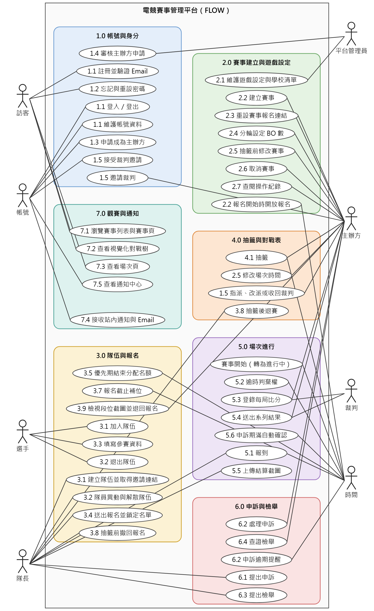 |
| 1.0 帳號與身分 | 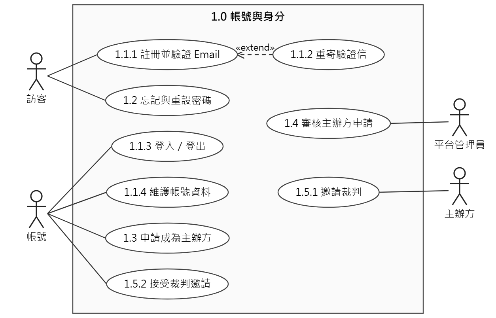 | 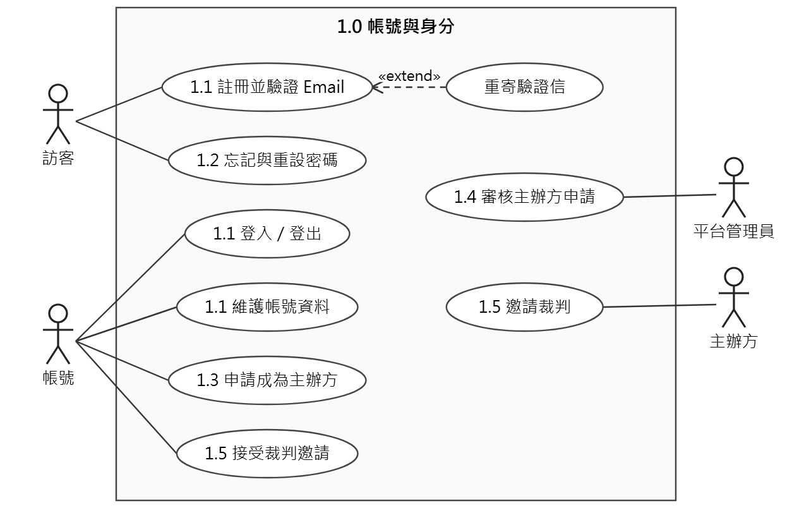 |
| 2.0 賽事建立與遊戲設定 | 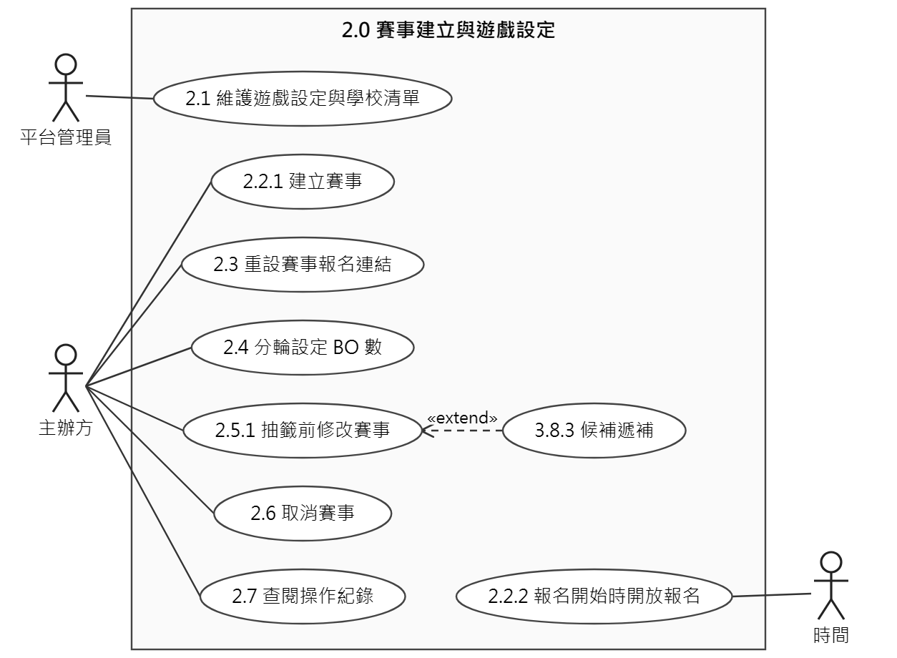 | 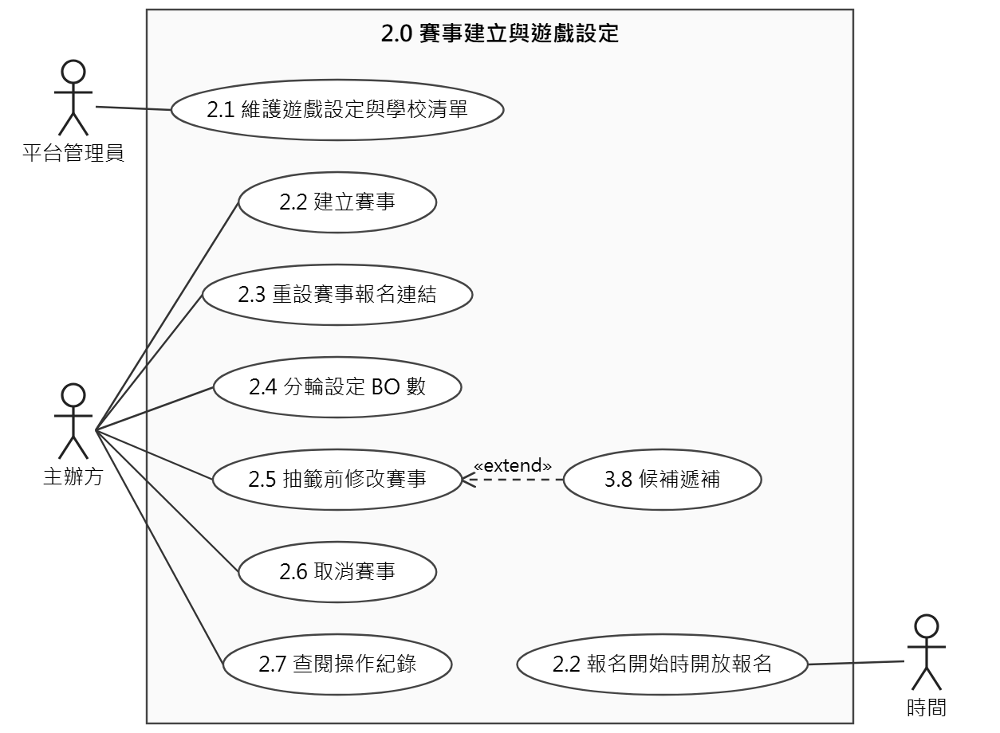 |
| 3.0 隊伍與報名 | 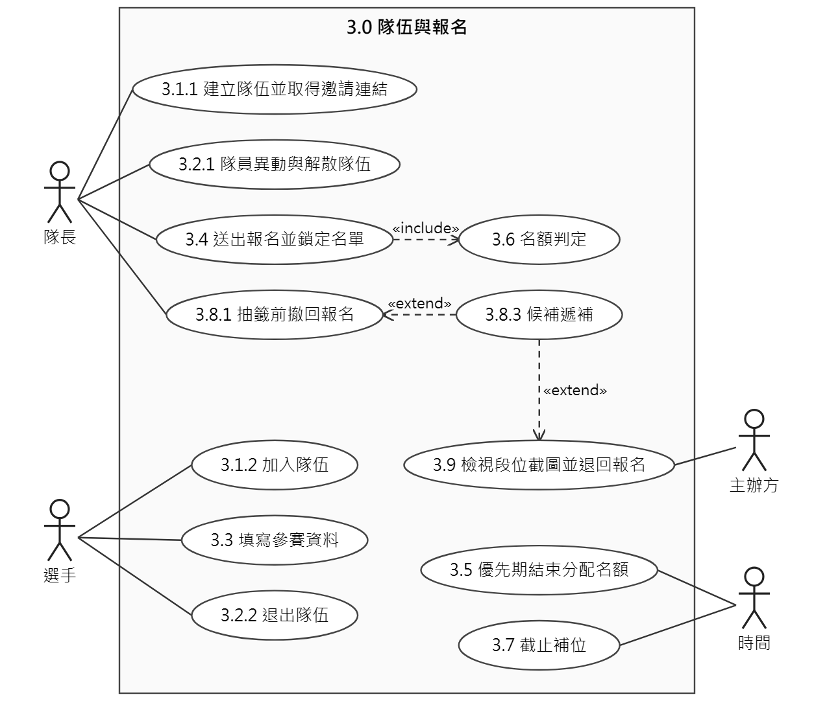 | 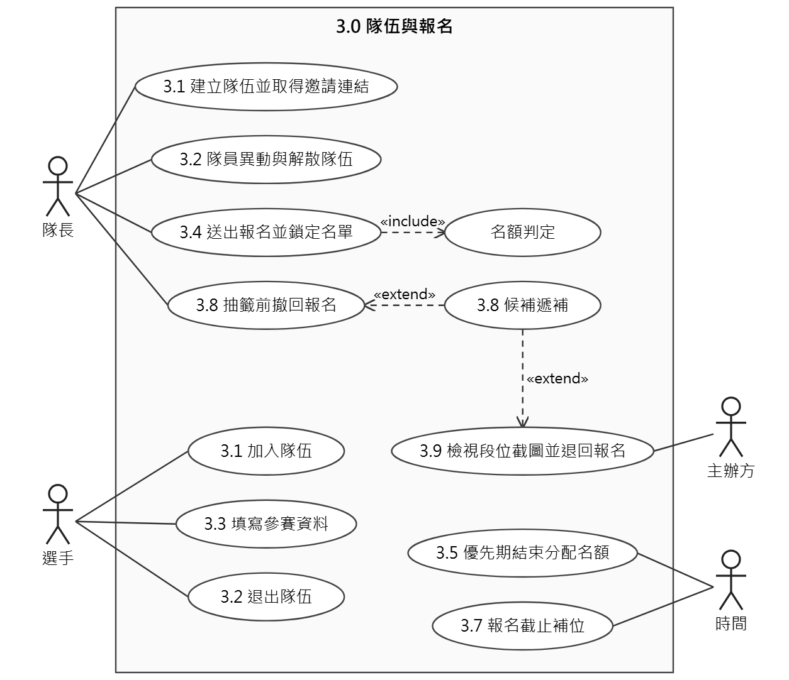 |
| 4.0 抽籤與對戰表 | 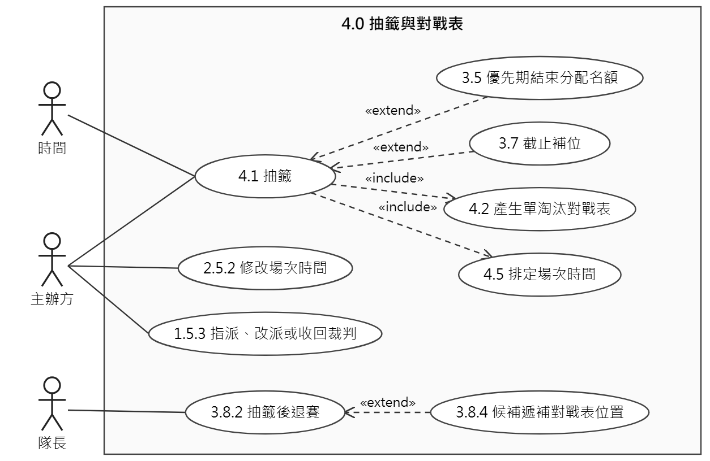 | 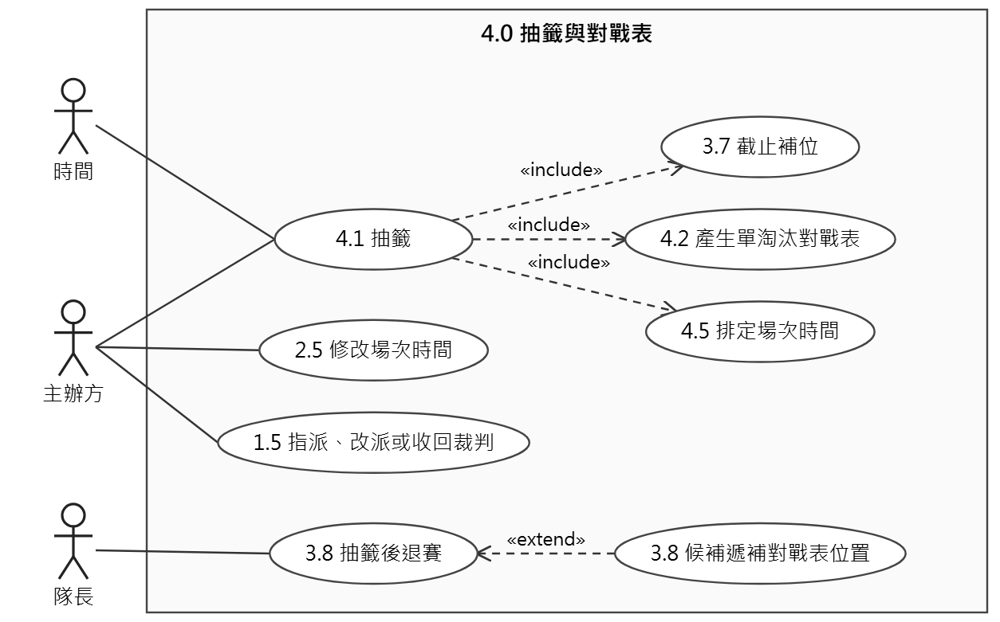 |
| 5.0 場次進行 |  | 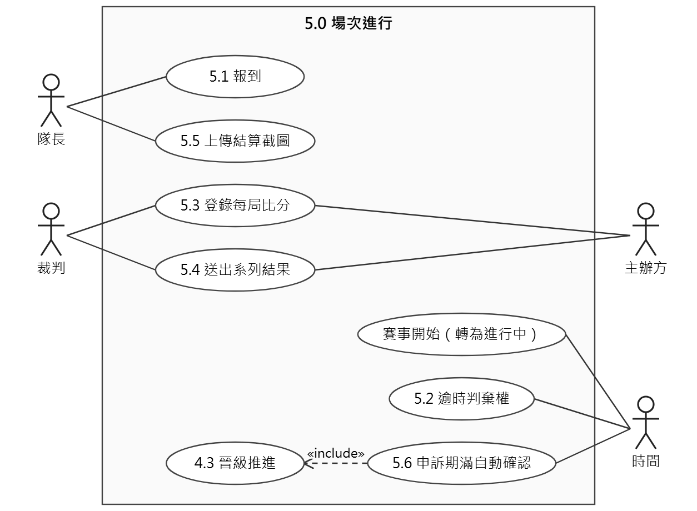 |
| 6.0 申訴與檢舉 | 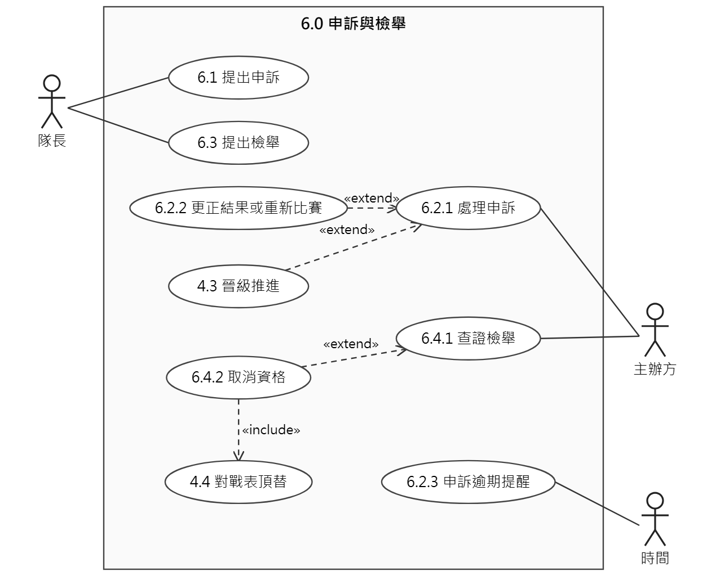 | 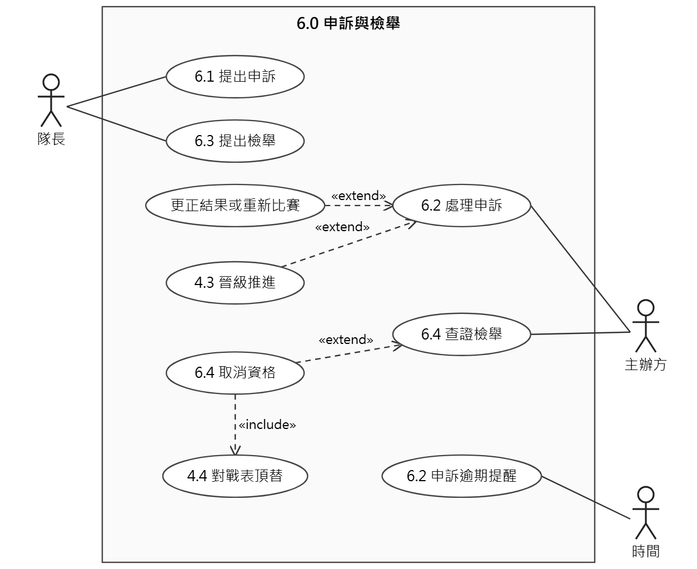 |
| 7.0 觀賽與通知 |  | 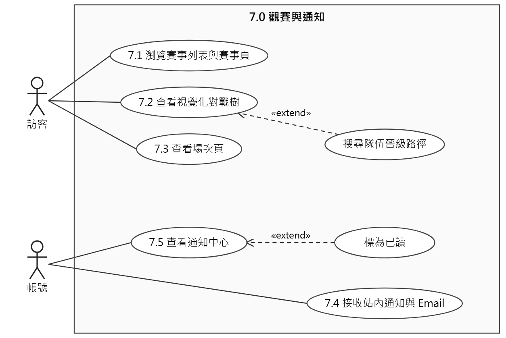 |
